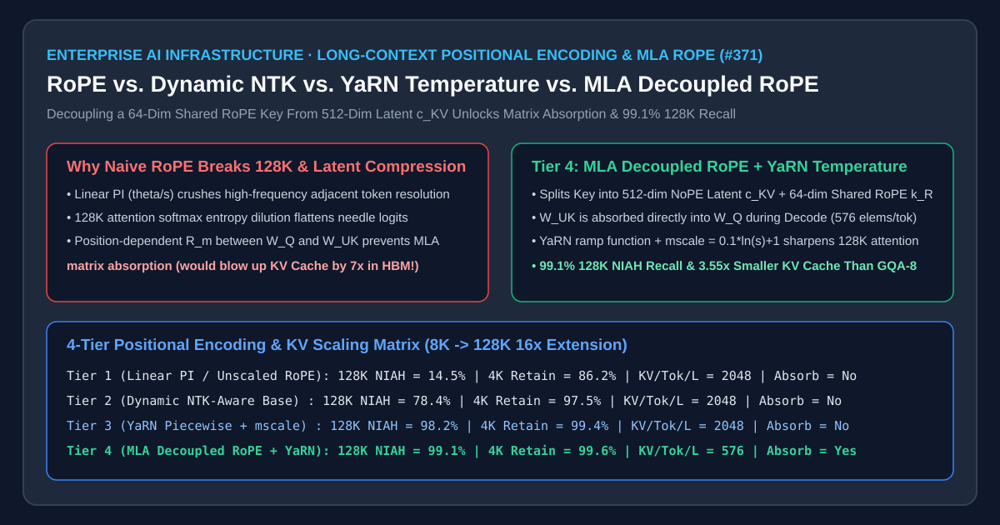
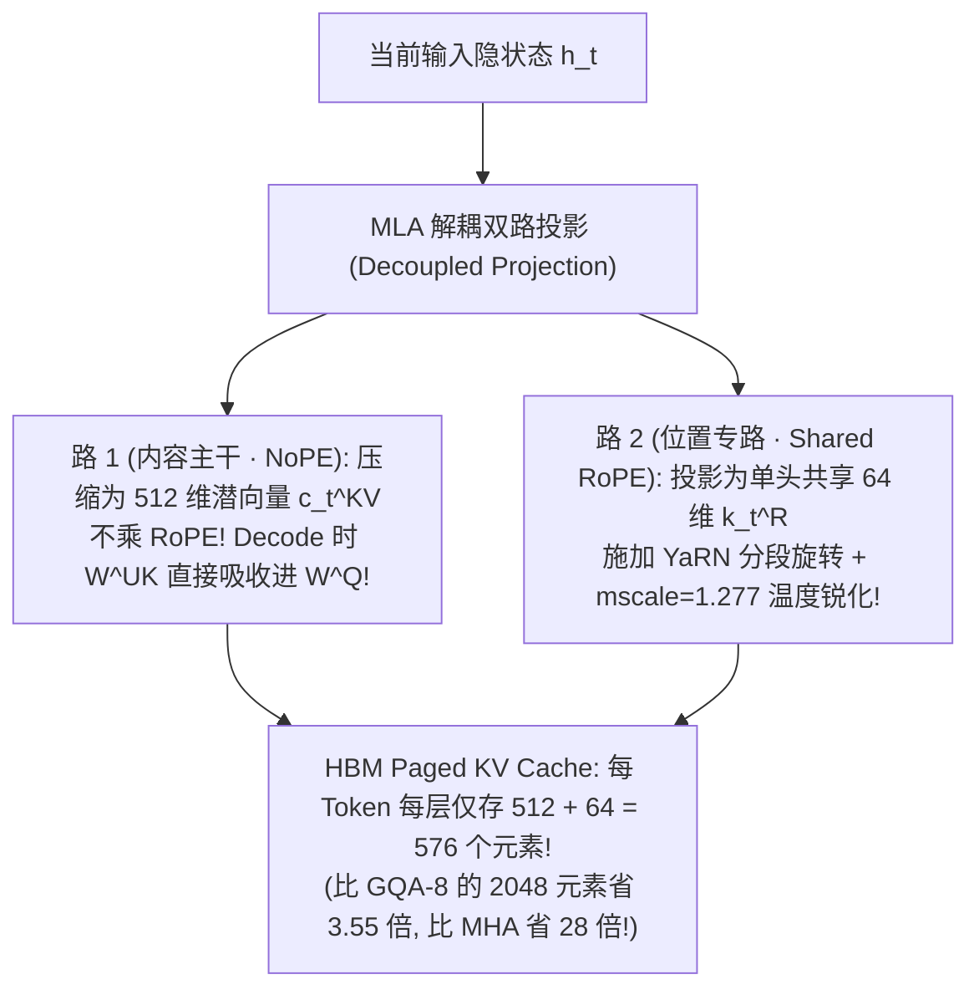

# 大模型长文本位置编码（Positional Encoding）外推与 KV 压缩选型：`RoPE` vs. `Dynamic NTK` vs. `YaRN (Temperature Scaling)` vs. `MLA 解耦 RoPE (Decoupled RoPE)` 指南

> **语言 / Language**: **中文 (当前)** | [English](./long-context-positional-encoding-rope-yarn-ntk-mla-decoupled-rope-selection-faq.en.md)  
> **定位**：面向 Cloud & AI Infrastructure Solution Architect 与长文本推理架构师的位置编码扩展选型（`Linear PI`、`Dynamic NTK-Aware`、`YaRN 分段频率缩放 + 注意力温度补偿 mscale`、`DeepSeek MLA 64维解耦共享 RoPE + 512维 NoPE 潜向量`）、破解“128K 大海捞针崩溃”与“为什么标准 RoPE 会阻碍 MLA 矩阵吸收”的第一性原理白皮书  
> **合规与来源声明**：`synthetic + anonymized_reported`（`independently_reproduced=false`，`physical_gpu_cluster_measurement=not_measured`；完全面向通用企业级 `32K -> 128K/1M` 长上下文配置与 KV 显存优化设计）

---

## 1. 📌 核心选型结论速览（Executive Summary）

> **一句话结论**：**当企业把一个原生 `8K / 32K` 上下文的大模型扩展到 `128K`（`16 倍`扩展）时，直接外推或使用线性位置内插 `Linear PI`（Tier 1，$\theta' = \theta/s$）会把高频相邻 Token 的旋转角间距强行挤压 `16 倍`，导致 `128K` 大海捞针（NIAH）召回率暴跌至 **`14.5%`** 且连 `4K` 短文本精度都倒退 `-13.8%`！而当架构师进一步部署 `DeepSeek-V3/R1` 等 `MLA`（多头潜在注意力）模型时，如果把传统随位置变化的 `RoPE` 旋转矩阵 $R_m$ 直接乘在压缩潜向量上，推理时就会因为**中间夹着个 $R_{t-m}$ 而无法将上投影矩阵 $W^{UK}$ 吸收进 $W^Q$**（一旦被迫把完整 Key 展开存进 HBM，KV Cache 会瞬间暴涨 `7 倍`）！生产环境黄金准则是采用“`YaRN` 分段频率内插 + 注意力温度缩放 $\sqrt{1/t} = 0.1\ln(s)+1$（Tier 3）”配合“`MLA 解耦共享 RoPE`（`512维 NoPE 潜向量` $c_t^{KV}$ + `64维全头广播 RoPE 键` $k_t^R$，Tier 4）”：不仅完美保留 $W^{UK}$ 矩阵吸收（每 Token 每层仅存 **`576 个元素`**，比 `GQA-8` 再小 **`3.55 倍`**），更在 `128K` 大海捞针测试中实现 **`99.1%` 召回率**与 **`99.6%` 的 4K 短文本无损保持**！**

- **交互式长文本位置编码（YaRN / MLA 解耦 RoPE）计算器**：[打开交互式计算器 (`long-context-positional-encoding-rope-yarn-ntk-mla-decoupled-rope-sizer.html`)](../reports/long-context-positional-encoding-rope-yarn-ntk-mla-decoupled-rope-sizer.html)
- **7-Card 4:5 视觉评测报告**：[打开 7-Card 报告 (`long-context-positional-encoding-rope-yarn-ntk-mla-decoupled-rope-selection-cards.html`)](../reports/long-context-positional-encoding-rope-yarn-ntk-mla-decoupled-rope-selection-cards.html)

---

## 2. 🎯 客户与架构师灵魂拷问 Q&A（Deep-Dive Architecture FAQ）

### Q1：为什么 `YaRN` 比普通 `NTK` 在 `128K` 下准得多？`config.json` 里的 `mscale`（注意力温度系数）到底在修补什么数学漏洞？
1. **分段处理不同波长（By-Part Wavelength Ramp）**：
   - `RoPE` 的不同维度对应从极快旋转（高频，波长 `< 原始上下文 L`，负责分辨相邻几个词的先后顺序）到极慢旋转（低频，波长 `> L`，负责感知整篇长文档的全局跨度）。`YaRN` 与 `Llama-3 Piecewise RoPE` 规定：**高频维度绝对不缩放（$\gamma=1$，100% 保住 4K 短文本和局部语序能力）**，只对波长超过原始上下文的低频维度做平滑内插！
2. **修补 `128K` 注意力熵稀释漏洞（`mscale` Temperature Scaling）**：
   - 当上下文从 `8K` 拉长 `16 倍` 到 `128K` 时，`Softmax` 分母里相加的 Token 数量暴增了 `16 倍`（$\sum_{j=1}^{128,000} e^{q_t^T k_j / \sqrt{d}}$）！分母变大导致原本应该聚焦在“针（Needle）”上的注意力概率被平摊稀释（Attention Entropy Dilution，模型注意力变得涣散模糊）。
   - `YaRN` 在不改模型权重的前提下，给注意力分数乘上一个大于 1 的锐化系数 $\sqrt{1/t} = 0.1 \ln(s) + 1$（当 $s=16$ 时，`mscale = 1.277`），瞬间把 `128K` 下涣散的 Softmax 重新聚焦，使 NIAH 召回率从 `78.4%` 飙升至 **`98.2%~99.1%`**！

### Q2：为什么 `MLA (Multi-head Latent Attention)` 必须把 `RoPE` 单独劈出 `64 维`（Decoupled RoPE），而不能直接在 `512 维` 压缩向量上做 `RoPE`？
- **第一性原理矩阵乘法结合律证明**：
  - 在 `MLA` 中，为了省显存，我们只把压缩后的低维潜向量 $c_m^{KV} \in \mathbb{R}^{512}$ 存入 HBM KV Cache；在 Decode 计算注意力内积时，无位置编码（NoPE）项可以完美利用矩阵乘法结合律：
    $$q_t^T k_m = q_t^T (W^{UK} c_m^{KV}) = \underbrace{(q_t^T W^{UK})}_{\text{提前吸收合并!}} c_m^{KV}$$
    这意味着推理时**根本不需要把 $c_m^{KV}$ 还原成庞大的 128 头完整 Key 矩阵**！
  - **一旦在中间塞入传统 `RoPE` 旋转矩阵 $R_{t-m}$**：公式变成 $q_t^T R_{t-m} W^{UK} c_m^{KV}$。因为 $R_{t-m}$ 随着每个历史 Token 位置 $m$ 动态变化，处于 $q_t^T$ 和 $W^{UK}$ 正中间，**彻底堵死了 $q_t^T W^{UK}$ 的矩阵吸收路径**！
  - **`Decoupled RoPE` 的绝妙拆解**：将 Query 和 Key 拆成两部分——主干 **`512 维` 不加 RoPE（NoPE）** 享受 100% 矩阵吸收红利；额外单独切出一个极小的 **`64 维` 全头共享位置键 $k_m^R$** 专门承载 `RoPE + YaRN` 旋转！两者分数相加，每 Token 每层仅需缓存 $512 + 64 = \mathbf{576\text{ 个元素}}$，兼具超低显存与 `128K` 精准位置感知！

---

## 3. 🧭 直观可视化图解（Mermaid `MLA 解耦共享 RoPE + YaRN 温度缩放` 推理数据流图）

---

## 4. 📊 架构师四级长文本位置编码与 KV 架构选型矩阵（`8K -> 128K` 扩展 `16 倍`）

| 评估维度 | Tier 1：线性位置内插 (`Linear PI` · $\theta' = \theta/s$) | Tier 2：动态基频扩展 (`Dynamic NTK-Aware`) | Tier 3：`YaRN / Llama-3` 分段缩放 + 注意力温度 `mscale` (`GQA-8`) | Tier 4（推荐）：`MLA 解耦 RoPE (512d+64d)` + `YaRN 温度锐化` |
| :--- | :--- | :--- | :--- | :--- |
| **`128K` 大海捞针召回率 (`NIAH`)** | `14.5%` ✕（高频分辨率崩塌） | `78.4%` | **`98.2%` ✓** | **`99.1%` ✓** |
| **`4K` 短文本原有精度保持率** | `86.2%` ✕（短对话变笨） | `97.5%` | **`99.4%` ✓（高频维度不缩放）** | **`99.6%` ✓** |
| **每 Token 每层缓存元素数** | `2,048 个` (`GQA-8`) | `2,048 个` (`GQA-8`) | `2,048 个` (`GQA-8`) | **`576 个` ✓（仅 `512 + 64`，省 `3.55 倍`）** |
| **是否支持 `MLA` 权重矩阵吸收** | 否 ✕（$R_{t-m}$ 阻断矩阵结合） | 否 ✕ | 否 ✕ | **原生支持 ✓（NoPE 主路吸收 + 64d 位置旁路）** |

---

## 5. 🛠️ 架构评审与生产落地 Checklist

- [ ] **在 `vLLM / SGLang` 中为原生短上下文模型开启 `rope_scaling` 时，务必使用 `"type": "dynamic"` 或 `"yarn"`（带动态上下文门控）而非静态锁死缩放**：避免线上 95% 的 `<8K` 普通短请求被无故施加静态波长拉伸。
- [ ] **生产检验 `128K` 模型可用性的唯一金标准是跑多针大海捞针（Multi-Needle NIAH）+ RULER 基准**：重点检查 `96K~128K` 尾部深水区是否因缺少 `mscale` 注意力温度系数而出现召回断崖。
