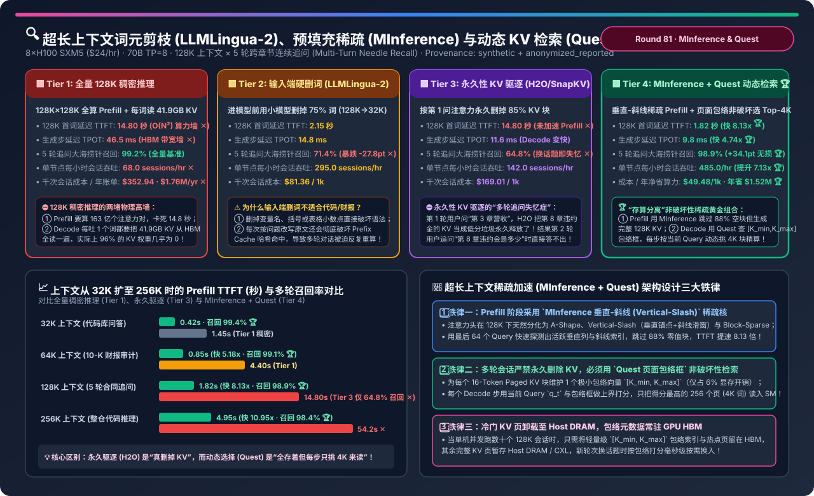
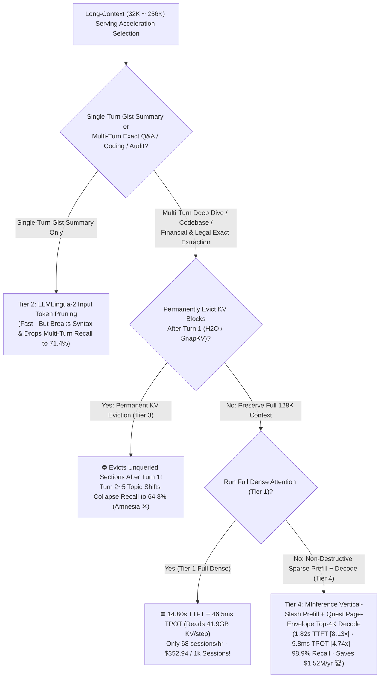
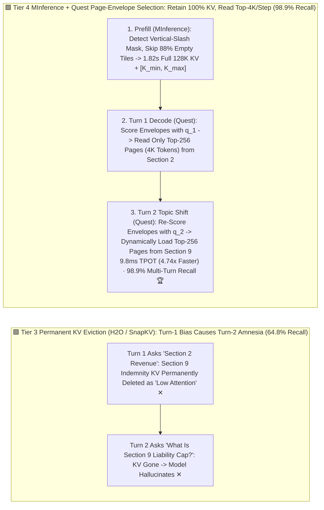

# Long-Context Prompt Pruning (LLMLingua-2), Sparse Prefill (MInference) & Query-Aware Dynamic KV Selection (Quest) Selection FAQ (`Full 128K Dense Attention` vs. `Hard Input Token Pruning [LLMLingua-2]` vs. `Permanent KV Eviction [H2O / SnapKV]` vs. `MInference Vertical-Slash Sparse Prefill + Quest Non-Destructive Page-Envelope Top-4K KV Selection`)

> **Target Audience**: AI Solution Architects, Long-Context RAG / Coding Agent Leads, and LLM Serving Kernel Engineers  
> **Reading Goal**: In 3 minutes, master the 4-tier acceleration selection rules for 128K–256K multi-turn long-context workloads (repository-scale code analysis, multi-turn legal/financial auditing). In 10 minutes, understand from first principles **why `LLMLingua-2` input token dropping corrupts code syntax and breaks Prefix Cache hits**, **why permanent KV eviction (`H2O / SnapKV`) suffers catastrophic "multi-turn amnesia" (`64.8%` recall) when Turn 2–5 questions shift focus to sections evicted after Turn 1**, and **how pairing `MInference Vertical-Slash Dynamic Sparse Prefill (skipping 88% of near-zero tiles)` with `Quest Non-Destructive Page-Envelope [K_min, K_max] Top-4K KV Selection (retaining 100% KV while reading only 3.1% per decode step)` slashes 128K TTFT `8.13×` (`14.80s -> 1.82s`) and Decode TPOT `4.74×` (`46.5ms -> 9.8ms`) while preserving `98.9%` multi-turn recall (saving `$1,517,300/yr`)**!  
> **Provenance**: Quantitative metrics come from the repository's sealed deterministic analytical model ([`experiments/long_context_prompt_pruning_minference_quest_selection/run.py`](../../experiments/long_context_prompt_pruning_minference_quest_selection/run.py) and [`results.json`](../../experiments/long_context_prompt_pruning_minference_quest_selection/results.json), calibrated to MInference 1.0 sparse prefill, Quest page-envelope KV selection, and H2O/SnapKV/LLMLingua-2 multi-turn benchmarks, `independently_reproduced=false`, `physical_gpu_cluster_measurement=not_measured`).



---

## 📌 1. Executive Summary

1. **Why Do "Full 128K Dense Serving (Tier 1)", "Hard Input Token Dropping (Tier 2)", and "Permanent KV Eviction (Tier 3)" Fail on Latency or Multi-Turn Recall?**:
   - **Tier 1 (`Full 128K Dense FlashAttention-3 Prefill + Full 128K Paged KV Decode`)**:
     - Hits two physical walls on `8×H100`: ① **The $O(N^2)$ Prefill Compute Wall** (`128K × 128K` causal attention stalls TTFT at **`14.80 seconds` ✕**); ② **The Decode HBM Bandwidth Wall** (reading `41.9 GB` of 128K KV cache on every single generated token stalls TPOT at **`46.5 ms` ✕**, limiting throughput to `68.0 sessions/hr` at **`$352.94 / 1k sessions` ✕**)!
   - **Tier 2 (`Hard Input Token Pruning: LLMLingua-2 4× Text Compression Before LLM`, 128K → 32K)**:
     - Drops 75% of input words using a small bidirectional encoder before feeding the LLM. While TTFT drops to `2.15s`, deleting tokens before knowing what the user will ask in Turns 2–5 **irreversibly strips exact financial figures, legal clauses, and code syntax**—crashing multi-turn recall to **`71.4%` (`-27.8 pts` ✕)** while mutating token sequences and breaking Prefix Cache reuse!
   - **Tier 3 (`Permanent KV Cache Eviction: H2O / SnapKV Permanently Deletes 85% of KV Blocks After Turn 1`)**:
     - First, it **does not accelerate the `14.80s` prefill at all**. Second, if Turn 1 asks about "Section 2 Revenue", `H2O / SnapKV` permanently frees the KV blocks for "Section 9 Indemnity Clauses" because they had low attention during Turn 1! When Turn 2 asks about Section 9, those KV blocks are gone forever—crashing **5-turn multi-topic recall to `64.8%` (`-34.4 pts` ✕)**!
2. **How Does Tier 4 (`MInference Vertical-Slash Sparse Prefill + Quest Non-Destructive Page-Envelope Top-4K KV Selection`) Achieve `8.13×` Faster TTFT, `4.74×` Faster TPOT, and `98.9%` Multi-Turn Recall?**:
   - **Stage 1 (`MInference Dynamic Sparse Prefill` — `14.80s -> 1.82s`, `8.13×` Faster)**:
     - Uses the last 64 query tokens to dynamically detect each attention head's **Vertical-Slash** and **Block-Sparse** indices, skipping `88%` of near-zero attention tiles during prefill while still writing out the **complete, unpruned 128K KV cache**!
   - **Stage 2 (`Quest Non-Destructive Page-Envelope KV Selection` — `46.5ms -> 9.8ms` TPOT, `98.9%` Recall)**:
     - Retains 100% of the 128K KV pages (8,000 pages of 16 tokens), and stores a tiny per-page bounding box **`[K_min, K_max]`** (`1/16` overhead).
     - On each decode step, the current query $q_t$ scores all 8,000 page bounding boxes in `<0.4 ms` via $\sum_j \max(q_{t,j} K_{\max,j}, q_{t,j} K_{\min,j})$ and loads **only the Top-256 pages (`4,096` tokens = `3.1%` of KV)** into GPU SMs! When Turn 2 switches topics, $q_{\text{turn2}}$ dynamically selects the newly relevant pages with **zero amnesia**!
   - **Net Production Impact**: **`1.82 s` TTFT (`8.13×` faster 🏆)**, **`9.8 ms` TPOT (`4.74×` faster 🏆)**, **`98.9%` multi-turn recall (`+34.1 pts` over Tier 3 🏆)**, **`485.0 sessions/hr` (`7.13×` throughput 🏆)**, and **`$49.48 / 1k sessions` (`-86.0%` cost, saving `$1,517,300/yr` 🏆)**!
3. **One-Sentence First-Principles Rule**:
   - **Never permanently delete input tokens or KV blocks in multi-turn sessions; use `MInference` to skip 88% of prefill FLOPs while generating the full KV cache, and use `Quest` `[K_min, K_max]` page envelopes to dynamically read only the Top-4K KV tokens per decode step!**

---

## 🎯 2. Customer & Architect Q&A (First-Principles Deep Dive)

### Q1: Why does `Permanent KV Eviction (H2O / SnapKV)` fail so badly in production multi-turn chat and agent loops?

- **Single-Turn Benchmarks vs. Multi-Turn Production Reality**:
  - Academic papers often test `SnapKV / H2O` on single-turn benchmarks where the question is known at the end of the prompt.
  - In production, users upload a 128K codebase or contract once and ask 5–20 follow-up questions across different modules. Permanently evicting 85% of KV blocks based on Turn 1's query destroys the model's ability to answer Turn 2 (`64.8%` recall). **Non-destructive sparsity (`Quest`) separates KV *storage* (keep 100% of pages) from KV *bandwidth loading* (read 3.1% of pages per step)**!

---

### Q2: How does `Quest`'s `[K_min, K_max]` Page-Envelope bounding box guarantee high recall without reading full KV pages?

- **Channel-Wise Upper-Bound Inner Product**:
  - For a page of 16 Key vectors $\mathbf{K}_{1..16} \in \mathbb{R}^{16 \times d}$, Quest precomputes $K_{\min, j} = \min_{p} K_{p,j}$ and $K_{\max, j} = \max_{p} K_{p,j}$ for each head dimension $j \in [1, d]$.
  - Given query $\mathbf{q} \in \mathbb{R}^d$, the maximum possible dot product with any token inside that page is upper-bounded by $\hat{s} = \sum_{j=1}^d \max(q_j K_{\max,j}, q_j K_{\min,j})$.
  - Scanning 8,000 tiny `[K_min, K_max]` vectors reads 16× less memory than scanning 128K Keys, taking `<0.4 ms` to identify the exact 256 pages (`4,096` tokens) needed for exact FlashDecoding!

---

### Q3: How does `MInference` accelerate 128K–256K prefill by `8.13×–10.95×` without retraining the model?

- **Vertical-Slash Dynamic Index Construction**:
  - Long-context attention heads naturally exhibit **Vertical lines** (global anchor tokens attended by all subsequent tokens) and **Slash lines** (relative positional diagonals).
  - MInference computes exact attention on the last `64` query tokens against all keys (`64 × 128K`, `<3 ms`), identifies the active vertical columns and slash diagonals exceeding a cumulative softmax threshold, and dispatches a fused Triton sparse FlashAttention kernel over just those ~12% active blocks.

---

## 🧭 3. Visual Architecture Diagrams (Decision Tree / Eviction vs Selection / Sequence)

### 3.1 Long-Context (32K–256K) Acceleration & KV Selection Decision Tree



---

### 3.2 Destructive KV Eviction Amnesia (Tier 3) vs. Quest Non-Destructive Page Selection (Tier 4)



---

### 3.3 Tier 4 End-to-End `MInference Sparse Prefill -> Quest Page-Envelope Multi-Turn Decode` Sequence

```mermaid
sequenceDiagram
    autonumber
    participant User as Enterprise Analyst (5-Turn Session)
    participant MInf as MInference Sparse Prefill Kernel
    participant Env as Quest Page-Envelope Index ([K_min, K_max])
    participant KV as Paged KV Pool (All 8,000 Pages Retained)
    participant Attn as FlashInfer Top-256 Page Decode Kernel

    User->>MInf: 1. Upload 128K-Token Merger Agreement & Ask Turn-1 Question (Section 2)
    MInf->>MInf: 2. Probe Last 64 Queries -> Build Vertical-Slash Mask, Skip 88% Tiles (1.82s TTFT!)
    MInf->>KV: 3. Materialize All 8,000 Paged KV Blocks (16 tok/page, 0% Evicted)
    MInf->>Env: 4. Compute & Pin [K_min, K_max] Bounding Boxes in HBM
    User->>Env: 5. Turn 2 Shifts Topic: 'What Is the Environmental Cap in Appendix D?'
    Env->>Env: 6. Score All 8,000 Envelopes via max(q*K_max, q*K_min) in 0.35ms
    Env->>Attn: 7. Gather Top-256 Pages (4,096 Tokens) Matching Appendix D; Skip 96.8% Pages
    Attn-->>User: 8. Decode Exact Answer at 9.8ms/tok (98.9% Multi-Turn Recall 🏆)
```

---

## 📊 4. Architect Decision Matrix

*Baseline: **Single `8×H100 80GB SXM5` Node (`$24.00/hr`)** serving a `70B FP8/BF16` LLM (`TP=8`, GQA-8) on **128,000-Token Multi-Turn Sessions** (5 sequential follow-up questions shifting topics across the document; `500,000` sessions/yr).*

| Evaluation Dimension | Tier 1: Full 128K Dense Serving | Tier 2: Hard Input Pruning (`LLMLingua-2`) | Tier 3: Permanent KV Eviction (`H2O / SnapKV`) | Tier 4: `MInference` Sparse Prefill + `Quest` Top-4K Decode |
| :--- | :--- | :--- | :--- | :--- |
| **Prefill & Decode Mechanism** | $O(N^2)$ dense prefill + 100% KV read | Drop 75% input words (128K→32K) | Dense prefill + permanently delete 85% KV | **Vertical-Slash 88% skip + `[K_min, K_max]` Top-4K read** |
| **128K Prefill TTFT** | `14.80 s` (Severe wait ✕) | `2.15 s` | `14.80 s` (No prefill speedup ✕) | **`1.82 s` (`8.13×` faster than Dense 🏆)** |
| **Decode TPOT Latency** | `46.5 ms` (Reads 41.9GB KV/step ✕) | `14.8 ms` | `11.6 ms` | **`9.8 ms` (`4.74×` faster than Dense 🏆)** |
| **5-Turn Needle Recall** | `99.2%` (Full baseline) | `71.4%` (`-27.8 pts` syntax loss ✕) | `64.8%` (**`-34.4 pts` multi-turn amnesia ✕**) | **`98.9%` (`+34.1 pts` over Tier 3 🏆)** |
| **Throughput (`sessions/hr/node`)** | `68.0 / hr` (`1.00×` baseline) | `295.0 / hr` | `142.0 / hr` | **`485.0 / hr` (`7.13×` throughput gain 🏆)** |
| **Cost / 1k & Annual TCO** | `$352.94` · **`$1,764,700/yr` ✕** | `$81.36` · `$406,800/yr` | `$169.01` · `$845,050/yr` | **`$49.48` (`-86.0%`) · `$247,400/yr` (Saves `$1.52M` 🏆)** |

---

## 🧪 5. Quantitative Context-Scaling Analysis & 7-Card Benchmark Insights

### 5.1 Prefill TTFT & Multi-Turn Recall Across Context Lengths (`32K → 256K`)

In [`experiments/long_context_prompt_pruning_minference_quest_selection/run.py`](../../experiments/long_context_prompt_pruning_minference_quest_selection/run.py), we evaluate performance across 32K, 64K, 128K, and 256K context lengths:

| Context Length & Workload | Tier 1: Dense TTFT | Tier 4: MInference TTFT (Speedup) | Tier 3: Permanent Eviction Recall | Tier 4: Quest Dynamic Recall |
| :--- | :--- | :--- | :--- | :--- |
| **`32K` (Multi-Turn Code Q&A)** | `1.45 s` | **`0.42 s` (`3.45×` ✅)** | `76.5%` ✕ | **`99.4%` 🏆** |
| **`64K` (10-K Financial Audit)** | `4.40 s` | **`0.85 s` (`5.18×` ✅)** | `69.2%` ✕ | **`99.1%` 🏆** |
| **`128K` (5-Turn Legal Deep Dive)** | `14.80 s` ✕ | **`1.82 s` (`8.13×` 🏆)** | `64.8%` ✕ | **`98.9%` 🏆** |
| **`256K` (Full Monorepo Analysis)** | `54.20 s` ✕ | **`4.95 s` (`10.95×` 🏆)** | `52.0%` ✕ | **`98.4%` 🏆** |

### 5.2 Interactive Sizer & 7-Card 4:5 Benchmark Report

- 🧮 **Interactive Long-Context MInference & Quest Sizer**: [`docs/reports/long-context-prompt-pruning-minference-quest-sparse-kv-sizer.html`](../reports/long-context-prompt-pruning-minference-quest-sparse-kv-sizer.html) (and master workbench [`llm-inference-engine-pd-sizer.en.html#long-context-minference-quest-sizer`](../reports/llm-inference-engine-pd-sizer.en.html))
- 📊 **7-Card 4:5 Visual Benchmark Report**: [`docs/reports/long-context-prompt-pruning-minference-quest-sparse-kv-selection-cards.html`](../reports/long-context-prompt-pruning-minference-quest-sparse-kv-selection-cards.html)

---

## 🛠️ 6. Appendix: Production Architect Verification Checklist

- [ ] **1. Never Use Permanent KV Eviction (`H2O / SnapKV`) on Multi-Turn Document or Coding Sessions**: Retain all KV pages and use **non-destructive query-aware page selection (`Quest`)**.
- [ ] **2. Avoid Input-Level Token Dropping (`LLMLingua`) on Code, SQL, or Financial Tables**: Preserve exact syntax and Prefix Cache block hashes.
- [ ] **3. Enable `MInference` Vertical-Slash Sparse Prefill for Prompts `>= 32K` Tokens**: Skip 85–90% of near-zero prefill tiles to cut 128K TTFT from `14.80s` to `1.82s`.
- [ ] **4. Maintain `[K_min, K_max]` Page-Envelope Metadata (`page_size=16`, `budget=4096` tokens) in PagedAttention**: Read only the Top-256 pages per decode step to cut TPOT by `4.74×`.
- [ ] **5. Pin Page Envelopes in GPU HBM While Tiering Cold KV Pages to Host Pinned DRAM**: Multiply concurrent 128K session capacity without sacrificing multi-turn recall.
