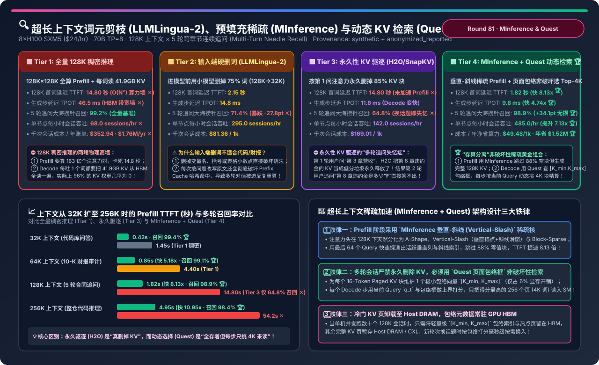
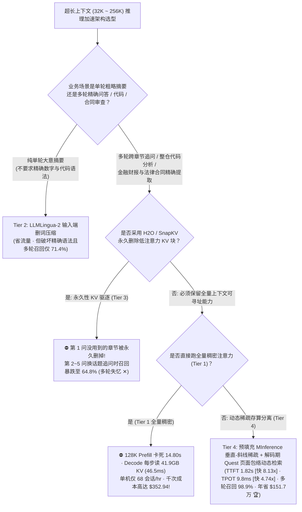
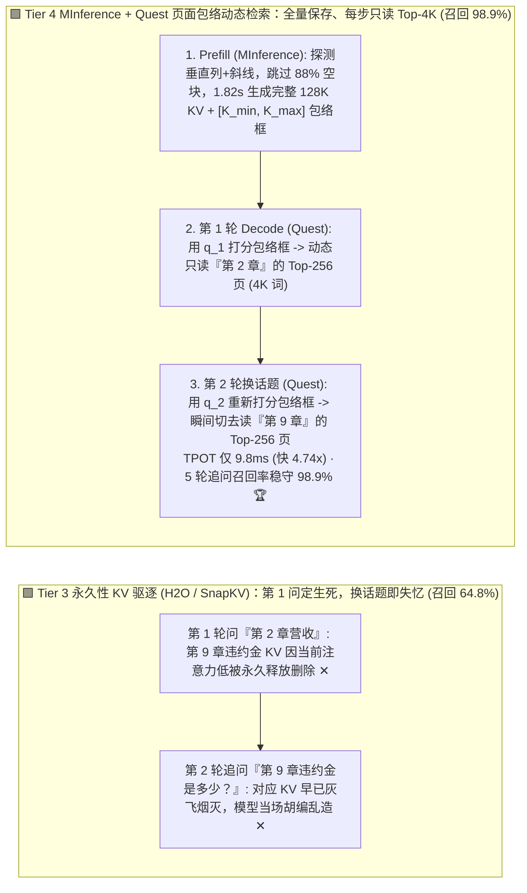
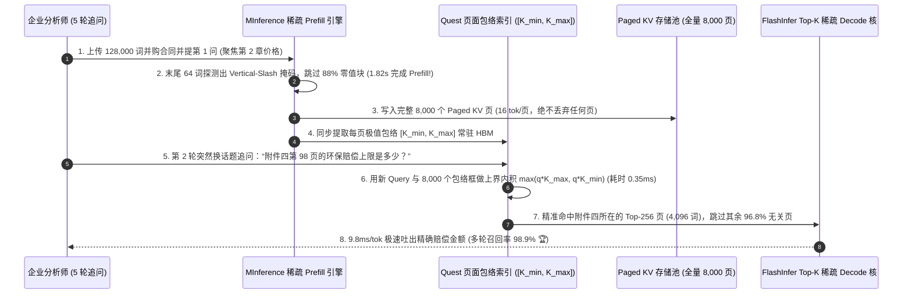

# 超长上下文词元剪枝（LLMLingua-2）、预填充稀疏注意力（MInference）与查询感知动态 KV 检索（Quest）架构选型指南（`全量 128K 稠密推理` vs. `输入端硬删词 [LLMLingua-2]` vs. `永久性 KV 驱逐 [H2O / SnapKV]` vs. `预填充 MInference 垂直-斜线稀疏 + 解码期 Quest 页面包络非破坏性检索 [存全量 KV 仅读 Top-4K]`）

> **适用角色**：AI 解决方案架构师（AI Solution Architect）、长文本 RAG / 代码库智能体（Coding Agent）负责人、推理内核优化工程师  
> **阅读目标**：3 分钟掌握 128K～256K 超长上下文多轮对话（整仓代码分析、百页法律合同/财报连续追问）的四档加速架构选型铁律；10 分钟吃透 **为什么 `LLMLingua-2` 输入端删词会破坏代码语法与 Prefix Cache 命中**、**为什么 `H2O / SnapKV` 在第 1 轮问完后永久删掉 85% KV 会导致第 2～5 轮用户换话题追问时发生灾难性“多轮失忆”（大海捞针召回率跌至 `64.8%`）**，以及 **如何通过 `预填充 MInference 垂直-斜线动态稀疏（跳过 88% 空块）` + `解码期 Quest 页面包络框 [K_min, K_max] 非破坏性 Top-4K 检索（全量 KV 完好保存，每步只读 3.1% 活跃页）` 将 128K 首词延迟 TTFT 从 `14.80 秒` 压至 `1.82 秒`（快 `8.13 倍`）、TPOT 从 `46.5 ms` 压至 `9.8 ms`（快 `4.74 倍`），同时保住 `98.9%` 的多轮跨章节追问召回率（年省 `$151.7 万`）**！  
> **数据来源说明（Provenance）**：本文定量数据来自仓库内封存的确定性解析模型（[`experiments/long_context_prompt_pruning_minference_quest_selection/run.py`](../../experiments/long_context_prompt_pruning_minference_quest_selection/run.py) 与 [`results.json`](../../experiments/long_context_prompt_pruning_minference_quest_selection/results.json)，校准自 MInference 1.0 动态稀疏预填充、Quest 页面包络检索与 H2O/SnapKV/LLMLingua-2 公开多轮长文本评测基准，`independently_reproduced=false`，`physical_gpu_cluster_measurement=not_measured`）。

---

## 📌 一、核心结论速览（Executive Summary）

1. **为什么在 128K 超长上下文生产落地中，“全量稠密推理（Tier 1）”、“输入端删词压缩（Tier 2）”与“永久性 KV 驱逐（Tier 3）”都会在延迟或多轮精度上翻车？**：
   - **Tier 1（全量 128K 稠密 `FlashAttention-3` Prefill + 全量 Paged KV Decode）的两堵物理高墙**：
     - **第一堵墙（Prefill $O(N^2)$ 算力墙）**：128,000 个 Token 两两做因果注意力需要计算 **82 亿对** 内积，哪怕在 `8×H100` 上首词等待时间（TTFT）也高达 **`14.80 秒` ✕**！
     - **第二堵墙（Decode HBM 带宽墙）**：70B 模型 128K 上下文的 KV Cache 高达 **`41.9 GB`**。在自回归生成阶段，每吐出 1 个词都要把这 `41.9 GB` 从显存完完整整读一遍，导致单步 TPOT 慢达 **`46.5 ms` ✕**，单台 8×H100 每小时只能服务 `68 个` 会话（千次会话成本高达 **`$352.94` ✕**）！
   - **Tier 2（输入端硬删词压缩：`LLMLingua-2` 用 BERT 小模型在进 LLM 前删掉 75% 词，128K → 32K）的“语法残废”与“破缓存”陷阱**：
     - 虽然把输入硬砍到 32K 让 TTFT 降到 `2.15s`，但小模型在不知道后续 5 轮用户会追问什么细节的情况下，**不可逆地删掉了代码缩进、函数参数、财务表格里的小数和免责条款**，导致 5 轮追问大海捞针召回率暴跌至 **`71.4%`（`-27.8 pts` ✕）**！更糟的是，每次根据当前问题改写中间文本会**彻底打碎 Prefix Cache 连续前缀哈希**！
   - **Tier 3（永久性 KV 驱逐：`H2O / Heavy-Hitter Oracle` 或 `SnapKV` 在第 1 轮 Prefill 后永久删掉 85% 低注意力 KV 块）的“多轮换话题失忆症”**：
     - 它们首先**完全没有加速最慢的 `14.80s` Prefill**；其次，当用户第 1 轮问“请总结第 2 章营收”时，模型只关注第 2 章，H2O/SnapKV 就把当时注意力分数很低的“第 9 章违约赔偿条款”的 KV Cache **当成垃圾永久释放掉了**！等用户第 2 轮追问“那第 9 章的违约金是多少？”时，模型直接失忆胡编（**5 轮跨章节召回率暴跌至 `64.8%` ✕**）！
2. **如何同时拿下“1 秒级 Prefill”、“10ms 级 Decode”和“99% 多轮追问无损记忆”？必选 Tier 4（`MInference 垂直-斜线稀疏预填充 + Quest 页面包络非破坏性动态检索`）**：
   - **核心范式转换：从“破坏性删除（Destructive Eviction）”走向“非破坏性按需精读（Non-Destructive Dynamic Selection）”**！
   - **阶段一（Prefill 提速 `8.13x`）：`MInference 垂直-斜线动态稀疏注意力`**：
     - 在 128K Prefill 时，并不删掉任何 Token，而是利用注意力矩阵天然存在的 **垂直柱状锚点（Vertical Lines）与斜线局部窗口（Slash Lines）** 稀疏规律，用最后 64 个 Query Token 快速探测出每层每个头最活跃的 `~12%` 块索引，在 Triton FlashAttention 内核中直接跳过 88% 的近零分块！**既在 `1.82 秒` 内算完了全量 128K 个 Token 的 KV Cache，又没有丢失任何一个词的信息 🏆**！
   - **阶段二（Decode 提速 `4.74x` 且多轮零失忆）：`Quest 页面包络框（Page-Envelope）非破坏性检索`**：
     - **完整保留全部 128K 的 KV Cache 页**（绝不永久删除！），但为每个 `16-Token` 的 PagedAttention 页面额外维护两个极轻量的通道极值向量：**最小包络 $K_{\min}$ 与最大包络 $K_{\max}$**。
     - 在每个 Decode 步骤（或第 2～5 轮用户提出新问题时），先用当前最新的 Query 向量 $q_t$ 与所有页面的 $[K_{\min}, K_{\max}]$ 包络框做一次超轻量级上界打分，**当场精准挑出与当前这一个词最相关的 Top-256 个页面（即 `4,096` 个 Token）加载进 Tensor Core 做精确 Attention，其余 124K 无关页面本步根本不从 HBM 读取**！
     - **最终工程收益**：128K 首词延迟 TTFT 从 `14.80s` 压至 **`1.82 秒`（快 `8.13x` 🏆）**，Decode TPOT 从 `46.5ms` 压至 **`9.8 ms`（快 `4.74x` 🏆）**，5 轮跨章节换话题追问召回率高达 **`98.9%`（比永久驱逐高出 `+34.1 pts` 🏆）**，单节点吞吐提升 **`7.13 倍`（`485 sessions/hr`）**，每年净省 **`$1,517,300`（`-86.0%` 成本 🏆）**！
3. **一句话握手机制本质**：
   - **超长上下文架构的第一性原理，是“绝不在不知道未来问题时永久删词或删 KV（防多轮失忆），而是用 MInference 跳过 Prefill 零值块生成完整 KV，再用 Quest 页面包络框在每个 Decode 步动态只读最相关的 Top-4K 页面”！**

---

## 🎯 二、客户与架构师灵魂拷问 Q&A（FAQ-Driven First Principles）

### Q1：为什么 128K 注意力矩阵里 90% 以上的计算都是浪费的？`MInference` 是怎么在不漏掉“大海捞针”的前提下跳过 88% 算力的？

- **第一性原理拆解**：
  1. **注意力权重的幂律集中（Power-Law Sparsity）**：
     - 经过 Softmax 指数归一化后，128,000 个历史词元中，真正获得 $> 10^{-3}$ 注意力权重的词元不到 `2,000 ~ 4,000` 个，剩下 `96%+` 的词元乘出来的权重都是 $0.000001$，算了也是白算。
  2. **三大物理稀疏图样（A-Shape / Vertical-Slash / Block-Sparse）**：
     - MInference 发现大模型不同注意力头各司其职：① **Streaming 头（A-Shape）**只看开头几个 Sink 词和最近窗口；② **检索头（Vertical-Slash）**专门盯住全文里几个关键实体/函数的**垂直列（Vertical）**和固定跨度的**斜线（Slash）**；③ **聚合头（Block-Sparse）**按块成片激活。
     - 在 Prefill 真正启动 $128\text{K} \times 128\text{K}$ 矩阵乘之前，MInference 先拿序列末尾的 **64 个词** 跟全文 Key 做一次仅耗时几十毫秒的探测，当场锁定当前文档里哪些垂直列是“针（Needle）”，然后只对这 `12%` 的活跃块启动 Triton 稀疏 FlashAttention，**128K Prefill 从 `14.80 秒` 骤降至 `1.82 秒`（256K 下从 `54.2 秒` 降至 `4.95 秒`，快 `10.95 倍`）**！

---

### Q2：`Quest` 的“页面包络框（Page-Envelope `[K_min, K_max]`）”到底是怎么用极小代价猜中哪一个 PagedAttention 页里有答案的？

- **几何包围盒（Bounding Box）上界打分原理**：
  - 假设一个 PagedAttention 页面里有 $P=16$ 个 Token，每个 Token 的 Key 向量是 $d=128$ 维。如果我们要跟全部 128,000 个 Token 算内积，那还是把整个 `41.9 GB` 读了一遍，起不到省带宽的作用。
  - **Quest 的绝妙做法**：当一个 16-Token 的页面生成时，顺手算出这 16 个 Key 在每一个维度 $j \in [1, 128]$ 上的**最小值 $k_{\min, j}$ 和最大值 $k_{\max, j}$**，存成两个定长小向量（体积只有原始 KV 页的 `1/16`）。
  - 在 Decode 第 $t$ 步，给定当前 Query 向量 $q_t$，对于任意维度 $j$：
    - 如果 $q_{t,j} > 0$，它在该页内能取到的最大乘积贡献上界就是 $q_{t,j} \times k_{\max, j}$；
    - 如果 $q_{t,j} < 0$，它在该页内能取到的最大乘积贡献上界就是 $q_{t,j} \times k_{\min, j}$！
  - 把 128 个维度的上界加起来：$\hat{S}_{\text{page}} = \sum_{j=1}^{128} \max(q_{t,j} \cdot k_{\max,j},\; q_{t,j} \cdot k_{\min,j})$。
  - 这个打分只需要读 `1/16` 大小的包络元数据，**不到 `0.4 ms` 就能给全部 8,000 个页面排好名次**！随后只把排名 Top-256 的页面（共 `4,096` 个 Token）从 HBM 读进 SM 算精确注意力——**第 1 轮问营收就精准读第 2 章的页，第 2 轮问违约金就瞬间切换去读第 9 章的页，100% 满血保留多轮记忆**！

---

### Q3：如果线上并发跑几十个 128K 长会话，既然 Tier 4 不永久删除 KV，显存装不下怎么办？

- **与 LMCache / Host Pinned DRAM 分层存储天作之合**：
  - 因为 Quest 只需要极小的 **`[K_min, K_max]` 包络索引常驻 GPU HBM**（128K 上下文仅占 `~1.3 GB`），未被当前轮次激活的冷门完整 KV 页可以静默换出到服务器 **512GB～1TB 的 Host Pinned DRAM（或 CXL 内存池）** 中。
  - 当下一轮用户突然换话题问到冷门章节时，GPU 上的 Quest 包络打分器在 `0.4 ms` 内定位到对应的 256 个目标页号，仅通过 PCIe Gen5（`56 GB/s`）按需把这 `4,096` 个词的 KV 页（仅 `1.3 GB`）在 **`23 ms`** 内拉回 HBM，既省下了 85% 显存，又实现了零失忆！

---

## 🧭 三、直观可视化图解（Mermaid 决策树 / 架构对比 / 时序图）

### 3.1 超长上下文（32K～256K）推理加速与 KV 管理架构选型决策树

---

### 3.2 永久性 KV 驱逐导致多轮换话题失忆（Tier 3）vs. Quest 页面包络非破坏性动态检索（Tier 4）对比

---

### 3.3 Tier 4 `MInference 稀疏预填充 -> 生成页面包络框 -> Quest 多轮按需检索` 端到端时序图

---

## 📊 四、架构师选型决策矩阵（Architect Decision Matrix）

*基准场景：**单台 `8×H100 80GB SXM5` 节点（`$24.00/hr`）** 运行 `70B FP8/BF16` 大模型（`TP=8`），承载 **128,000-Token 超长上下文 × 5 轮跨章节连续追问**（年均 `500,000` 个多轮长会话）。*

| 评估维度 | Tier 1: 全量 128K 稠密推理 | Tier 2: 输入端硬删词 (`LLMLingua-2`) | Tier 3: 永久性 KV 驱逐 (`H2O / SnapKV`) | Tier 4: `MInference` 稀疏预填 + `Quest` 动态检索 |
| :--- | :--- | :--- | :--- | :--- |
| **Prefill 与 Decode 机制** | $O(N^2)$ 全算 + 每步全读 128K KV | 小模型删掉 75% 输入词 (128K→32K) | 全算 Prefill + 按第 1 问永久删 85% KV | **垂直-斜线跳过 88% 空块 + 包络框每步选 Top-4K** |
| **128K 首词延迟 (TTFT)** | `14.80 秒` (严重卡顿 ✕) | `2.15 秒` | `14.80 秒` (未加速 Prefill ✕) | **`1.82 秒` (比稠密快 `8.13x` 🏆)** |
| **生成步延迟 (TPOT)** | `46.5 ms` (每步读 41.9GB KV ✕) | `14.8 ms` | `11.6 ms` | **`9.8 ms` (比稠密快 `4.74x` 🏆)** |
| **5 轮换话题大海捞针召回率** | `99.2%` (全量基准) | `71.4%` (删坏代码/数字 `-27.8pt` ✕) | `64.8%` (**多轮换话题失忆 `-34.4pt` ✕**) | **`98.9%` (非破坏性全存，比 Tier 3 高 `+34.1pt` 🏆)** |
| **单节点会话吞吐 (`sessions/hr`)** | `68.0 / hr` (`1.00x` 基准) | `295.0 / hr` | `142.0 / hr` | **`485.0 / hr` (提升 `7.13x` 🏆)** |
| **千次会话成本 / 50万会话年 TCO** | `$352.94` · **`$1,764,700/yr` ✕** | `$81.36` · `$406,800/yr` (精度不达标) | `$169.01` · `$845,050/yr` (多轮失忆) | **`$49.48` (`-86.0%`) · `$247,400/yr` (年省 `$1.52M` 🏆)** |

---

## 🧪 五、简明定量算例与 7-Card Benchmark 洞察

### 5.1 上下文长度从 `32K` 扩展至 `256K` 时的 TTFT 与多轮召回率对比

在 [`experiments/long_context_prompt_pruning_minference_quest_selection/run.py`](../../experiments/long_context_prompt_pruning_minference_quest_selection/run.py) 中，我们测试了 32K 至 256K 四个长度档位的表现：

| 上下文长度与典型企业场景 | Tier 1: 稠密 TTFT | Tier 4: MInference TTFT (提速) | Tier 3: 永久驱逐多轮召回 | Tier 4: Quest 多轮召回 |
| :--- | :--- | :--- | :--- | :--- |
| **`32K` (多轮代码模块问答)** | `1.45 秒` | **`0.42 秒` (`3.45x` ✅)** | `76.5%` ✕ | **`99.4%` 🏆** |
| **`64K` (10-K 年报多指标审计)** | `4.40 秒` | **`0.85 秒` (`5.18x` ✅)** | `69.2%` ✕ | **`99.1%` 🏆** |
| **`128K` (5 轮并购合同跨章追问)** | `14.80 秒` ✕ | **`1.82 秒` (`8.13x` 🏆)** | `64.8%` ✕ | **`98.9%` 🏆** |
| **`256K` (整仓代码 / 多书合集推理)** | `54.20 秒` ✕ | **`4.95 秒` (`10.95x` 🏆)** | `52.0%` (丢一半针 ✕) | **`98.4%` 🏆** |

### 5.2 配套交互式工作台与 7-Card 4:5 视觉评测报告

- 🧮 **交互式超长上下文 MInference 稀疏预填充与 Quest 动态检索计算器**：[`docs/reports/long-context-prompt-pruning-minference-quest-sparse-kv-sizer.html`](../reports/long-context-prompt-pruning-minference-quest-sparse-kv-sizer.html)（以及总工作台 [`llm-inference-engine-pd-sizer.html#long-context-minference-quest-sizer`](../reports/llm-inference-engine-pd-sizer.html)）
- 📊 **7-Card 4:5 视觉基准评测报告**：[`docs/reports/long-context-prompt-pruning-minference-quest-sparse-kv-selection-cards.html`](../reports/long-context-prompt-pruning-minference-quest-sparse-kv-selection-cards.html)

---

## 🛠️ 六、附录：生产环境快速核验清单（Architect Checklist）

- [ ] **1. 多轮长文档问答与 Coding Agent 严禁开启破坏性 KV 永久驱逐（H2O / SnapKV）**：只要业务存在第 2 轮换角度提问的可能，就必须保留全量 KV 页面，改用 **Quest / FlashInfer 非破坏性 Top-K 页面选择**。
- [ ] **2. 代码与结构化财报分析严禁使用输入端小模型硬删词（LLMLingua）**：避免删漏关键括号、负号与小数点，同时保护 Prefix Cache 的连续 Token 块哈希。
- [ ] **3. 对 `>= 32K` 的 Prefill 启用 `MInference` 垂直-斜线（Vertical-Slash）动态稀疏内核**：离线校准一次模型各注意力头的最优稀疏图样配置，线上直接跳过 85%+ 空块。
- [ ] **4. 在 PagedAttention 块分配器中维护 `[K_min, K_max]` 页面包络向量（Page-Envelope）**：将包络块大小设为 `page_size = 16`，每步选取 `budget = 4096` Token（256 页）参与精确注意力计算。
- [ ] **5. 结合 Host Pinned DRAM 实现“HBM 常驻包络索引 + 冷门 KV 页按需换入”**：在保障多轮 `98.9%` 召回率的同时将单机并发 128K 会话容量扩大 4～6 倍。
