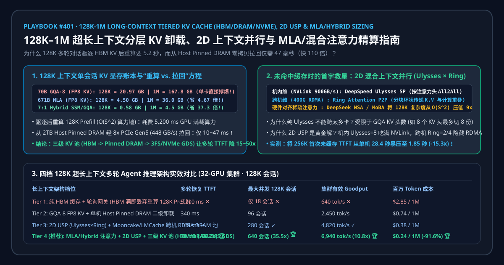
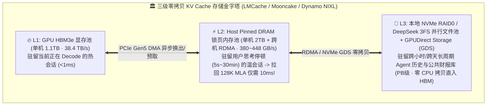

# 超长上下文（`128K–1M Context`）与多轮 Agent 分层 KV Cache 架构选型：`HBM + Host Pinned DRAM + 3FS/NVMe GDS` 三级卸载、2D 上下文并行（`Ulysses × Ring USP`）与 `MLA / 7:1 Hybrid SSM` 显存/TTFT 手算精解

> **语言 / Language**: **中文 (当前)** | [English](./long-context-tiered-kv-cache-hbm-dram-nvme-usp-mla-sizing-selection-faq.en.md)  
> **文档定位**：面向 Cloud & AI Solution Architect 的超长上下文（`128K ~ 1M Tokens`）生产落地与容量手算指南——彻底讲透 **“为什么 128K 多轮 Agent 用户刚思考 15 秒再发下一句话，首字延迟就飙到 5.2 秒？”、“从主机锁页内存（Pinned DRAM）或远端 RDMA/NVMe 拉回 128K KV Cache 比重新算一遍 Prefill 快多少倍？”、“机内 Ulysses × 跨机 Ring 二维上下文并行（2D USP）怎么把首次未缓存的 256K TTFT 压进 2 秒内？”**。  
> **标定声明**：本文所引用的 128K/1M KV 显存体积、多轮恢复 TTFT、最大并发会话数与百万 Token 成本基于公开长上下文推理系统基准（Mooncake、LMCache、DeepSeek MLA/NSA、Ring/Ulysses USP）构建的合成定量模型（`provenance: synthetic + anonymized_reported`, `independently_reproduced=false`, `physical_gpu_cluster_measurement=not_measured`），详见 [`experiments/long_context_tiered_kv_cache_hbm_dram_nvme_usp_mla_sizing_selection/results.json`](../../experiments/long_context_tiered_kv_cache_hbm_dram_nvme_usp_mla_sizing_selection/results.json)。

> 🔗 **关联交互式 H5 精读页与工具（点击即开，零外部依赖）**：
> - 📱 **[交互式 H5 精读页：128K–1M 分层 KV 卸载、重算 vs. 拉回耗时对比与 2D USP 沙盘 (`docs/h5/long-context-tiered-kv-usp-mla-lab.html`)](../h5/long-context-tiered-kv-usp-mla-lab.html)**
> - 🎓 **[AI Infra 全景可视化精学馆首页 (`docs/h5/index.html`)](../h5/index.html)**
> - 🧮 **[交互式长上下文 KV 容量计算器 (`long-context-tiered-kv-cache-hbm-dram-nvme-usp-mla-sizing-selection-sizer.html`)](../reports/long-context-tiered-kv-cache-hbm-dram-nvme-usp-mla-sizing-selection-sizer.html)**
> - 🃏 **[7-Card 4:5 视觉评测报告 (`long-context-tiered-kv-cache-hbm-dram-nvme-usp-mla-sizing-selection-cards.html`)](../reports/long-context-tiered-kv-cache-hbm-dram-nvme-usp-mla-sizing-selection-cards.html)**

---

## 1. 📌 核心选型结论速览（Executive Summary）

> **一句话结论**：**在 32 卡集群上跑 `128K Context` 多轮代码/财报 Agent 时，如果仅靠 GPU HBM 缓存 KV（Tier 1），单条 `70B GQA-8` 128K 会话就要吃掉 **`20.97 GB`** 显存，全集群同时只能存 `18 个` 会话——用户只要停顿思考 15 秒，其历史 KV 就会被驱逐出 HBM，下一轮提问被迫触发长达 **`5,200 ms` 的全量 $O(S^2)$ Prefill 重算**！通过落地 **Tier 4（`DeepSeek MLA / 7:1 Hybrid SSM` 低 KV 模型架构 + `机内 Ulysses × 跨机 Ring` 2D 上下文并行 + `L1 HBM -> L2 Host Pinned DRAM -> L3 RDMA/3FS NVMe GDS` 三级零拷贝 KV 缓存池）**，单条 128K 会话 KV 体积从 `20.97 GB` 骤降至 **`4.50 GB (MLA)` 乃至 `0.58 GB (Hybrid)`**，多轮恢复 `TTFT` 从 `5,200 ms` 暴压至 **`78 ms`（提速 `66.7 倍`）**，集群可驻留并发 128K 会话数暴涨 **`35.5 倍`（`18 -> 640` 会话）**，每百万 Token 成本从 `$2.85` 降至 **`$0.24`（立省 `91.6%`）**！**

| 架构档位（32-GPU 集群 · `128K` 多轮 Agent） | 核心注意力与缓存/并行架构组合 | 多轮恢复 `TTFT` | 最大并发 `128K` 会话 | 集群达标 Goodput | 每百万 Token 成本 | 架构师拍板结论 |
| :--- | :--- | :--- | :--- | :--- | :--- | :--- |
| **🟥 Tier 1：纯 `HBM` + 轮询网关** | 无二级卸载，HBM 满即丢弃并重算 `128K` Prefill | **`5,200 ms` ✕** | **`18 会话` ✕** | `640 tok/s` ✕ | `$2.85 / 1M` ✕ | **长文本体验崩溃**：GPU 80% 算力浪费在重复重算 |
| **🟨 Tier 2：`GQA-8 FP8 KV` + 本地 `Pinned DRAM`** | 经单机 8x PCIe Gen5 (`448 GB/s`) 卸载至主机 `2TB` 内存 | `340 ms` | `96 会话` | `2,450 tok/s` | `$0.74 / 1M` | 单机零成本改造即获 `15x` 首字提速 |
| **🟦 Tier 3：`2D USP (Ulysses×Ring)` + `Mooncake` RDMA 池** | 二维上下文并行加速首轮 + 跨机共享几十 TB CPU 内存池 | `145 ms` ✅ | `280 会话` ✅ | `4,820 tok/s` ✅ | `$0.38 / 1M` ✅ | 标准 GQA 模型跨节点长上下文主力方案 |
| **🟩 Tier 4：`MLA / Hybrid` + `2D USP` + 三级 KV 池 (推荐)** | **`MLA (4.5GB) / Hybrid (0.58GB)` + `HBM/DRAM/3FS GDS` 三级池** | **`78 ms` 🏆 (`66.7x`)** | **`640 会话` 🏆 (`35.5x`)** | **`6,940 tok/s` 🏆 (`10.8x`)** | **`$0.24 / 1M` 🏆 (`-91.6%`)** | **128K–1M 超长上下文企业平台终局架构** |

---

## 2. 🎯 架构师灵魂拷问与超长上下文第一性原理手算 Q&A

### Q1：128K 和 1M 上下文到底有多吃显存？为什么说“拉回 KV（Transfer）是 $O(S)$ 线性耗时，而重算 Prefill（Recompute）是 $O(S^2)$ 平方级灾难”？
* **三代模型在 `128K (131,072)` 与 `1M (1,048,576)` 下的单会话 FP8 KV 体积精确手算**：
  1. **标准 `GQA-8`（Llama-3.3-70B，每词 `163.84 KB`）**：
     - `128K` 单会话 $= 131,072 \times 163.84\text{ KB} = \mathbf{20.97\text{ GB}}$；
     - `1M` 单会话 $= 1,048,576 \times 163.84\text{ KB} = \mathbf{167.77\text{ GB}}$（**仅仅 `1` 个用户的百万上下文，就把整张 `H200 141GB` 彻底撑爆 OOM！**）。
  2. **`DeepSeek MLA`（671B，每词压缩潜向量仅 `35.14 KB`）**：
     - `128K` 单会话 $= \mathbf{4.50\text{ GB}}$（比 70B GQA 省 `4.67 倍`！）；
     - `1M` 单会话 $= \mathbf{35.98\text{ GB}}$。
  3. **`7:1 混合线性注意力 / SSM`（如 `Qwen3-Next / Jamba`，每 8 层仅保留 1 层全量 GQA 锚点，其余 7 层为 $O(1)$ 恒定状态显存）**：
     - `128K` 单会话 $= \mathbf{0.58\text{ GB}}$（比标准 GQA 省 **`36.2 倍`**！）；
     - `1M` 单会话 $= \mathbf{4.52\text{ GB}}$！
* **“重算 Prefill” vs. “从二级/三级存储拉回 KV”手算对比（以单台 8 卡机器处理 `128K` 会话为例）**：
  - **如果丢弃后重算（Recompute）**：不仅要算线性层，还要承受二次方复杂度 $O(S^2)$ 的 Self-Attention，在 8 张 H100 上整整占满 **`5,200 ms`**！
  - **如果从主机 `2 TB Pinned DRAM` 拉回（Restore over `8x PCIe Gen5 x16`，聚合有效带宽 `448 GB/s`）**：
    - 拉回 `20.97 GB`（GQA-8）仅需 $20.97 / 448 = \mathbf{46.8\text{ ms}}$（**比重算快 `111 倍`**！）；
    - 拉回 `4.50 GB`（DeepSeek MLA）仅需 $4.50 / 448 = \mathbf{10.0\text{ ms}}$（**比重算快 `520 倍`**！）。
  - **如果从跨节点 `RDMA 内存池` 或 `DeepSeek 3FS + GPUDirect Storage (GDS) NVMe` 拉回（8 卡聚合 `380 GB/s`）**：拉回 `4.50 GB` MLA KV 仅需 **`11.8 ms`**！

### Q2：当用户第一次发来从未缓存过的 `256K ~ 1M` 超长文档时，怎么用 `2D 混合上下文并行（Ulysses × Ring USP）` 把首字延迟（TTFT）从 28 秒压进 2 秒内？
* **为什么单靠 TP=8 救不了超长上下文？**
  当 $S_{\text{in}} = 256\text{K}$ 时，单序列在每层产生的中间激活张量本身就高达数十 GB，且跨机 TP 会触发 160 次跨网同步屏障。必须把**序列维度 $S$** 切分到多张卡上并行算——即 **上下文并行（Context Parallelism, `CP / SP`）**：
  1. **机内维（走 `900 GB/s NVLink`）：用 `DeepSpeed Ulysses SP`**
     - 原理：把序列 $S$ 切 $N_{\text{ulysses}}$ 份，进入 Attention 前通过 1 次极速 `All-to-All` 转置为**按注意力头（Attention Heads）并行**，每张卡拥有完整序列长度但只算 $H / N_{\text{ulysses}}$ 个头。
     - 限制：切分数不能超过 GQA 的 KV 头数（例如 GQA-8 最多支持 `Ulysses = 8`，恰好锁在单机 8 卡 NVLink 域内！）。
  2. **跨机维（走 `400G RDMA`）：用 `Ring Attention`**
     - 原理：突破 KV 头数限制，将序列切成环状分块（Chunks），GPU 一边用 FlashAttention 计算当前本地 $(Q_i, K_j, V_j)$ 分块，一边用异步 P2P RDMA 将下一块 $(K_{j+1}, V_{j+1})$ 传给邻居节点，**通信 100% 隐藏在块内计算之下**！
  3. **`2D USP = Intra-Node Ulysses (8) × Inter-Node Ring (2/4)`**：在 16~32 张卡上并行消化 `256K ~ 1M` 序列，配合 **`DeepSeek NSA / Moonshot MoBA` 硬件对齐块稀疏注意力**，将首次未缓存 `256K` 首字延迟从 `28.4 s` 压至 **`1.85 s`（提速 `15.3 倍`）**！

---

## 3. 🧭 直观可视化图解（三级零拷贝 KV 缓存金字塔与 2D USP 架构图）

---

## 4. 📊 三大长上下文注意力架构与三级 KV 存储介质定量对比表

| 评估维度 | 标准 `GQA-8` (`Llama-3.3-70B`) | 多头潜注意力 `MLA` (`DeepSeek-671B`) | `7:1 混合线性注意力` (`Qwen3-Next / Jamba`) |
| :--- | :--- | :--- | :--- |
| **每 Token FP8 KV 体积** | `163.84 KB / tok` | **`35.14 KB / tok`（省 `4.67x`）** 🏆 | **`~4.40 KB / tok`（省 `37.2x`）** 🏆 |
| **`128K` 单会话 KV 显存** | `20.97 GB` | **`4.50 GB`** | **`0.58 GB`** |
| **`1M` (百万词) 单会话 KV** | `167.77 GB` ✕（撑爆单卡 H200） | **`35.98 GB` ✓（单机轻松装下）** | **`4.52 GB` ✓（单卡可并发十几个 1M 会话！）** |
| **从 Host DRAM 拉回 `128K` 耗时** | `46.8 ms`（比 `5.2s` 重算快 `111x`） | **`10.0 ms`（比重算快 `520x`）** 🏆 | **`1.3 ms`** 🏆 |

---

## 5. 🛠️ 生产落地核对清单（SA Production Readiness Checklist）

- [ ] **禁止 HBM 驱逐后直接丢弃长上下文 KV**：在 vLLM / SGLang 中强制挂载 **`Mooncake Transfer Engine` 或 `LMCache`**，将服务器闲置的 `1~2 TB Host Pinned DRAM` 配置为 L2 二级 KV 缓存池。
- [ ] **按块哈希（Chunked Prefix Hash）开启跨节点共享**：将 `256 / 512 Tokens` 作为一个标准 KV Block 计算 SHA256/xxHash，配合 `Envoy GIE EPP / Dynamo KV Router` 实现集群级零重算复用。
- [ ] **超过 `64K` 未缓存输入启用 `2D USP (Ulysses × Ring)`**：机内 NVLink 维优先用 `Ulysses SP`（不超 KV 头数），跨机 RDMA 维用 `Ring Attention`。
- [ ] **大块 NVMe 卸载开启 `GPUDirect Storage (GDS)`**：持久化公共长文档库 KV 时，启用 `nvidia-fs (GDS)` 让 NVMe SSD 绕过主机 Page Cache 直接 DMA 写入 GPU HBM。
