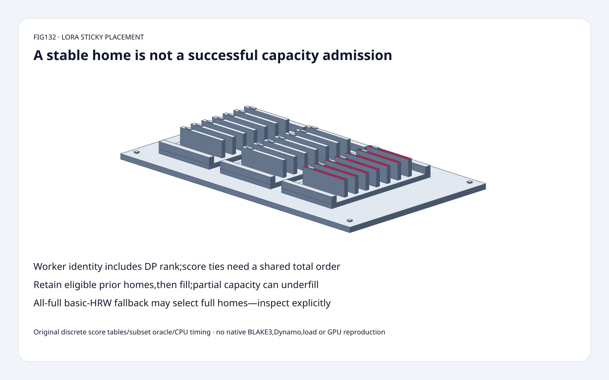
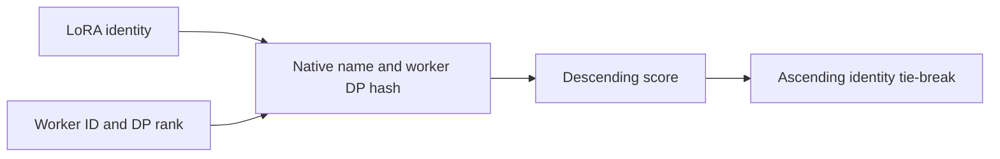
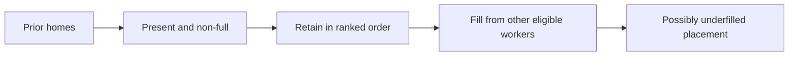
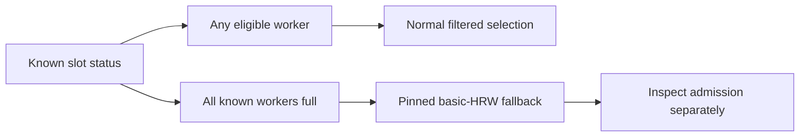

# LoRA placement FAQ: HRW affinity,sticky homes,slot limits and explicit fallback

> **Language**: [中文](lora-hrw-sticky-slot-fallback-placement-selection-faq.md) | English
>
> **Round132 · 2026-11-14 · Day round9** · [SVG](../../assets/svg/lora-hrw-sticky-slot-fallback-placement-selection-faq-summary.svg) · [H5](../reports/lora-hrw-sticky-slot-fallback-placement-sizer.html) · [7 cards](../reports/lora-hrw-sticky-slot-fallback-placement-selection-cards.html) · [Data](../../experiments/lora_hrw_sticky_selection/report.json)
>
> **Synthetic, `independently_reproduced=false`.** Original explicit-score discrete placement model and independent subset oracle;original CPU ranking paths measured separately. No native BLAKE3,Rust/Dynamo,controller,adapter transfer/load,inference or GPU reproduction.

## 1. Executive summary: deterministic homes are not capacity admission

Pinned Dynamo LoRA HRW allocator ranks **(worker_id,dp_rank)** identities.
Its sticky slot-aware variant first retains present non-full prior homes,
then fills from remaining eligible score-ranked workers.

Original four-worker fixture,replica factor2:
fresh natural ranking selects **7:0/7:1**,retaining **0/2** prior homes;
sticky selects **9:0/10:0**,retaining **2/2**.
This trades fresh score preference for reduced placement churn.

Capacity handling has a specific exception:
one non-full worker returns **one** home,not two;
when **all workers are full**,the pinned allocator falls back to basic
HRW and can return **two full** homes.
Candidate-home availability is not proof of successful admission or load.

## 2. Architect Q&A: identity,ties,stickiness and all-full behavior

### Q1: What is being hashed,and what does this model reproduce?

Native source hashes LoRA name bytes,worker_id little-endian bytes and
dp_rank little-endian bytes with BLAKE3,and interprets the first eight
digest bytes as little-endianu64 score.
Ranking is descending score,then ascending worker_id,then dp_rank.
The DP rank is part of identity:7:0 and7:1 are different destinations.

Our original model uses **explicit synthetic integer score tables**,
not another hash masquerading as BLAKE3.
It isolates policy behavior and tests ties directly.
No native hash bit parity,distribution uniformity or collision-rate
claim is made. The November14 tree's latest sidebar CSS update does
not make HRW new;November6 extraction and November11 crate refactoring
are source organization history,not an invention date.

### Q2: Why does a deterministic tie-break matter if hash ties are rare?

Router instances can observe workers in different iteration orders.
A partial comparator that only sorts score permits equal-score workers
to inherit that order. Coordination-free placement then lacks a shared
total order in the tie case.

The original forced-tie fixture sets all four scores100 and reverses
the input;both produce **7:0,7:1,9:0,10:0**.
This is a deterministic contract test,not an observed BLAKE3 collision.
When adding an original new worker11:0 with score110,basic top2 becomes
11:0/7:0;one old home is replaced. Removing an unselected worker leaves
the chosen pair unchanged under fixed pair scores.

### Q3: Does stickiness always retain previous placements?

Only previous homes still present and not full are eligible.
The selected prior set9:0/10:0 is retained despite lower scores.
Mark9:0full and the sticky output becomes **10:0/7:0**:
keep eligible10:0,then fill from top remaining7:0.
Stale prior identities absent from membership are not resurrected.

The output stages retained prior homes before newly filled homes;
it need not be globally descending score.
We compare with an independent exhaustive subset oracle:
maximize retained eligible prior count,then ranked preference.
This is not a global min-cost-flow/controller model or a request-fairness
optimizer. Slot usage/residual accounting and real residency are supplied
by other components,not inferred by the hash.

### Q4: Is the slot-aware path a hard-cap guarantee?

No. Normal selection skips known full workers.
If only10:0 is non-full with requestedR2,the result underfills to
**[10:0]** instead of selecting a known-full second home.
But when no eligible worker remains,the inspected implementation
deliberately falls back to basic HRW.
Our original result exposes
`fallback="all_workers_full_basic_hrw"` and selected-full count2.

This is a version-specific routable-home fallback,not actual free
capacity or permission to ignore admission/eviction policy.
The source can return up to min(R,worker_count),not necessarily just
one worker despite comments about keeping at least one home.
Empty membership and replica factor0 produce an empty original result.

### Q5: Does missing usage mean the worker is known free?

No. In the pinned policy,a missing slot entry is not classified full.
Our record represents that explicitly with both`used`and`capacity`
null and counts unknown-slot workers separately.
Unknown may be eligible under policy;it is not proof of capacity.
Known full meansused>=capacity,including0/0.

Payload sizing is separate. Selected rank16,A/B input/output widths4096,
32selected modules and2bytes/element:
`rank*(input_width+output_width)*modules*element_bytes`
is **8,388,608B** per adapter,**16,777,216B** across two selected replicas.
This is a chosen LoRA A/B tensor payload,not all-layer architecture proof,
native residency,slot capacity,base weights,quantization metadata,
transfer copies or peak HBM. Changing replicas does not prove availability.

## 3. Visual architecture: score identities,retain homes,inspect fallback

## 4. Selection matrix: affinity,placement and admission are different layers

| Choice | Good fit | Gate |
| :--- | :--- | :--- |
| Basic HRW | Stable identity-based preference | No load/residency proof |
| Slot-aware HRW | Skip known full homes if any eligible | Partial underfill/all-full exception |
| Sticky slot-aware HRW | Preserve eligible prior placement | Prior and usage accuracy |
| Total tie order | Independent router iteration orders | Include worker and DP identity |
| Global placement/controller | Cross-adapter constraints | Outside this local allocator model |
| Admission/residency checks | Actual request/load success | Separate native integration |

## 5. Workbench and evidence: eight focused tests,not hash or serving benchmarks

[H5](../reports/lora-hrw-sticky-slot-fallback-placement-sizer.html)
accepts up to64 explicit score/slot records,prior pairs and replica factor.
Compare sticky/natural outcomes;set allused=capacity to inspect the
fallback tag;use paired nulls to retain unknown rather than invent free
capacity. Errors are visible and outputs show selected-full count.

Tests compare exhaustive subset selection across16capacity patterns,
six replica factors and sticky/nonsticky modes;force allscoreties across
24input permutations;check prior replacement,underfill,all-full,unknown,
membership change,invalid identities/slots,Node parity and sealed records.

| Precomputed-score workers,top4 | Original heap topK ms | Original full sort ms |
| :--- | ---: | ---: |
|32|0.013467|0.009800|
|128|0.019833|0.024533|
|512|0.071800|0.111933|
|2048|0.275300|0.522900|

Two warmups,seven alternating repeats,three operations per sample;
medians of repeat means.
The small32-worker case is **slower** for the heap.
Hashing,slot/sticky policy,controller,Rust/Dynamo,adapter transfer/load,
inference and GPU are excluded. This does not justify replacing the
native algorithm or predict end-to-end speed.
Browser inspection was not performed after the prior approval refusal.

## 6. Sources,license and readiness

Dynamo tree`2cac4d767f49b5b000c0f354fe369554744bba2b`,
2026-11-14T00:51:42Z:
[HRW allocator](https://github.com/ai-dynamo/dynamo/blob/2cac4d767f49b5b000c0f354fe369554744bba2b/lib/lora/src/routing/hrw.rs),
[allocator interface](https://github.com/ai-dynamo/dynamo/blob/2cac4d767f49b5b000c0f354fe369554744bba2b/lib/lora/src/routing/mod.rs).
Inspected source files carry Apache-2.0 SPDX headers.
No invented daily popularity rank or new-HRW claim.

[Original code and sealed data](../../experiments/lora_hrw_sticky_selection/README.md).
No upstream implementation copied.
Static Figure-tier original cabinet reuses sixty solids:
base,four feet,three trays,six rails,21cards,21tabs,four fasteners.
Ready for bounded placement-policy teaching and regression fixtures,
not native hash,capacity,adapter residency or production certification.
