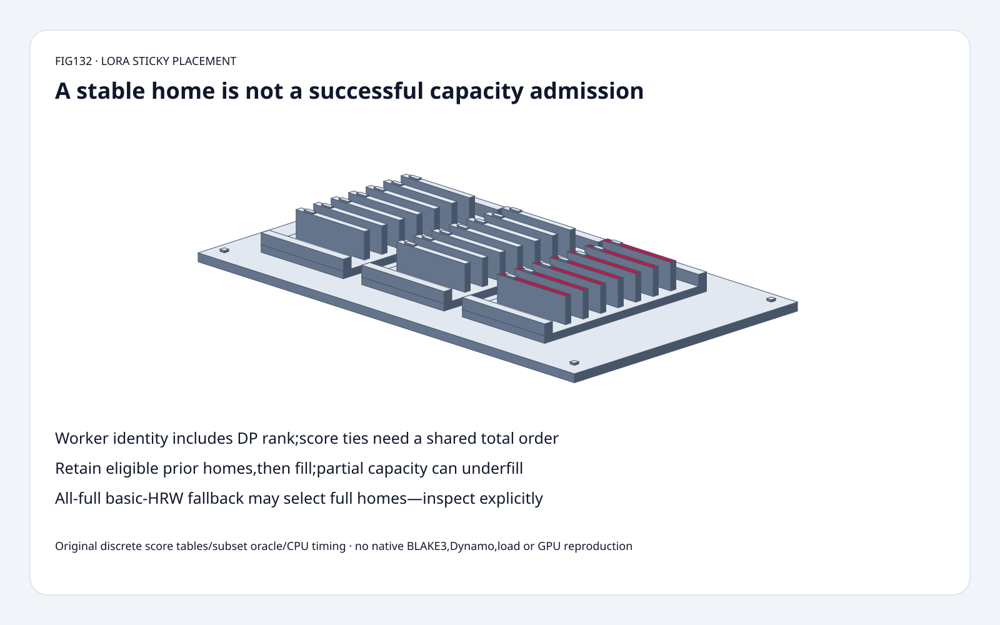
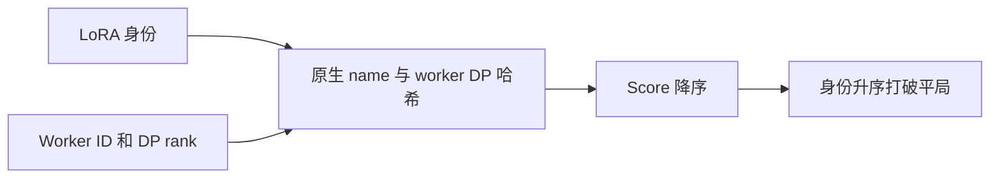
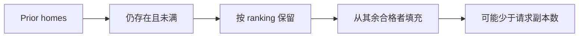

# LoRA 部署 FAQ：HRW 亲和、粘性位置、槽位限制与显式回退

> **语言**：中文 | [English](lora-hrw-sticky-slot-fallback-placement-selection-faq.en.md)
>
> **Round132 · 2026-11-14 · 白班第9轮** · [高清 SVG](../../assets/svg/lora-hrw-sticky-slot-fallback-placement-selection-faq-summary.svg) · [H5](../reports/lora-hrw-sticky-slot-fallback-placement-sizer.html) · [七卡](../reports/lora-hrw-sticky-slot-fallback-placement-selection-cards.html) · [数据](../../experiments/lora_hrw_sticky_selection/report.json)
>
> **synthetic，`independently_reproduced=false`。** 原创显式 score-table 离散放置模型与独立子集 oracle，CPU 排序另标 measured。未复现原生 BLAKE3、Rust/Dynamo、controller、adapter 传输加载、推理或 GPU。

## 1. 结论：确定性 home 不等于容量准入

固定 Dynamo LoRA HRW 分配器按 **(worker_id,dp_rank)** 身份排序。
sticky slot-aware 先保留仍存在、未满的 prior homes，
再从剩余合格 worker 按 score 填充。

原创四 worker、R2 fixture：
fresh natural 选 **7:0/7:1**，保留 prior **0/2**；
sticky 选 **9:0/10:0**，保留 **2/2**。
这是用 fresh score 优先级换取更少位置迁移。

槽位策略存在重要例外：只剩一个未满 worker 时只返回 **1** home；
**全部已满**则回退 basic HRW，可能返回 **2个已满** home。
候选位置可路由，不代表准入或加载成功。

## 2. 架构师问答：身份、平局、粘性与全满回退

### Q1：原生哈希了什么，本模型又复现了什么？

源码以 BLAKE3 处理 LoRA name bytes、worker_id 小端 bytes、
dp_rank 小端 bytes，取 digest 前8bytes解释为 little-endian u64。
按 score 降序、worker_id 升序、dp_rank 升序。
7:0与7:1是不同目的地，不能只按 worker ID 去重。

原创模型使用 **显式 synthetic 整数 score tables**，不以其他哈希冒充 BLAKE3。
只隔离 placement policy，直接强制构造 tie；
不认证 native bit parity、哈希均匀性或碰撞率。
11月14日最新 tree 是 sidebar CSS；11月6日 crate 抽取、
11月11日 crate 重构是组织历史，不是 HRW 发明日期。

### Q2：哈希平局很少，为什么仍需 tie-break？

多个 router 接收到的 worker 迭代顺序不一定一致；
仅比较 score 的排序在同分时可能继承输入顺序，
从而缺少共享全序，破坏 coordination-free placement 的确定性。

原创 fixture 把四个 score 全设100，反转输入后仍是
**7:0、7:1、9:0、10:0**。这是强制 tie 合同测试，
不是观测到 BLAKE3 真碰撞。
加入 score110 的11:0，basic top2变 **11:0/7:0**，
替换一个旧 home；删除未被选中者则固定 score 下结果不变。

### Q3：sticky 总会保留旧位置吗？

只有 membership 内仍存在、且未满的 prior 才合格。
默认 prior9:0/10:0即使 score 较低也保留；
把9:0标满后结果为 **10:0/7:0**：
先保留10:0，再从其他 worker 填7:0。
已经离开 membership 的旧身份不会复活。

输出先 prior 后新补充，不保证整个列表都按全局 score 降序。
独立 exhaustive subset oracle 最大化合格 prior 保留数，
再按 ranking 偏好挑选。它不是 global min-cost-flow/controller、
请求公平性或全局最优负载模型。
真实 usage/residual accounting 与 adapter residency 来自其他组件，
不能由 hash 反推出。

### Q4：slot-aware 是否严格保证不超过容量？

不完全是。正常路径跳过已知 full；
R2只剩10:0未满，返回 **[10:0]**，不会为了凑数选一个满者。
但全部满时，固定实现主动回退 basic HRW。
原创输出显式报告 `fallback="all_workers_full_basic_hrw"`，
以及 selected-full count2。

这是特定版本的 routable-home 回退，不代表有空容量，
也不授权绕过 admission/eviction。
源码可以返回 min(R,worker_count) 个，不只是注释中“至少一个”。
空 membership 或 R0 返回空集合。

### Q5：没有 usage 记录，是否意味着已知空闲？

不是。固定策略中，缺失 slot entry 不被分类为 full。
原创 record 用 used/capacity **同时null** 显示未知，
并单独统计 unknown-slot workers。
策略可将 unknown 视为 eligible，但那不是容量证据；
已知 used>=capacity 才full，包含0/0。

载荷预算独立计算：rank16、A/B输入输出宽4096、
32个选定模块、每元素2bytes：
`rank*(input_width+output_width)*modules*element_bytes`
每 adapter **8,388,608B**，两副本 **16,777,216B**。
这是选定 LoRA A/B 张量载荷，不证明全模型模块数、真实 residency、
slot cap、base weights、量化 metadata、传输副本或 peak HBM。
修改 replicas 不会证明 worker 可用。

## 3. 可视化架构：身份排序、保留 prior、检查回退

## 4. 选型矩阵：affinity、placement 与 admission 不是一层

| 选择 | 适用 | 门槛 |
| :--- | :--- | :--- |
| Basic HRW | 身份稳定偏好 | 不证明负载/residency |
| Slot-aware HRW | 有合格者时跳过已满 | underfill 与全满例外 |
| Sticky slot-aware | 保留合格 prior 减少迁移 | prior/usage 正确性 |
| 完整 tie order | router 输入顺序不同 | worker+DP 身份 |
| Global placement/controller | 跨 adapter 全局约束 | 本模型之外 |
| Admission/residency | 实际 request/load 成功 | 独立原生集成 |

## 5. 工作台与证据：八项测试，不是 serving 或 hash benchmark

[H5](../reports/lora-hrw-sticky-slot-fallback-placement-sizer.html)
允许最多64显式 score/slot records、prior 与 R，
对比 sticky/natural；全设 used=capacity 可观察 fallback，
paired null 保留未知而非伪造空闲。错误可见，输出包含 full计数。

测试覆盖16容量 pattern×6副本因子×sticky/nonsticky 的子集 oracle；
强制 tie 的24排列；prior满后替换、underfill、全满、unknown、
membership、非法身份/slot、Node parity 与 sealed CPU记录。

| 已封存 score 的 worker 数，top4 | 原创 heap topK ms | 原创 full sort ms |
| :--- | ---: | ---: |
|32|0.013467|0.009800|
|128|0.019833|0.024533|
|512|0.071800|0.111933|
|2048|0.275300|0.522900|

2 warmups、7次交替repeat、每样本3操作，取repeat均值中位数。
32-worker小例 heap **更慢**。
不含 hashing、slots/stickiness、controller、Rust/Dynamo、
adapter 传输加载、推理或 GPU，不能推导端到端加速或建议直接替换原生实现。
此前 browser approval 被拒，未绕过或声称视觉验收。

## 6. 来源、许可与就绪边界

Dynamo 固定树 `2cac4d767f49b5b000c0f354fe369554744bba2b`，
2026-11-14T00:51:42Z：
[HRW](https://github.com/ai-dynamo/dynamo/blob/2cac4d767f49b5b000c0f354fe369554744bba2b/lib/lora/src/routing/hrw.rs)、
[allocator interface](https://github.com/ai-dynamo/dynamo/blob/2cac4d767f49b5b000c0f354fe369554744bba2b/lib/lora/src/routing/mod.rs)。
所读源文件有 Apache-2.0 SPDX header；
不虚构当日热门排名或“HRW今日首发”。

[原创代码与数据](../../experiments/lora_hrw_sticky_selection/README.md)，
未复制上游实现。静态 Figure-tier 分拣柜复用原创60 solids：
底座、4脚、3托盘、6导轨、21票卡、21标签、4紧固件。
适合有界 placement-policy 教学与回归，
非 native hash、hard capacity、adapter residency 或生产认证。
