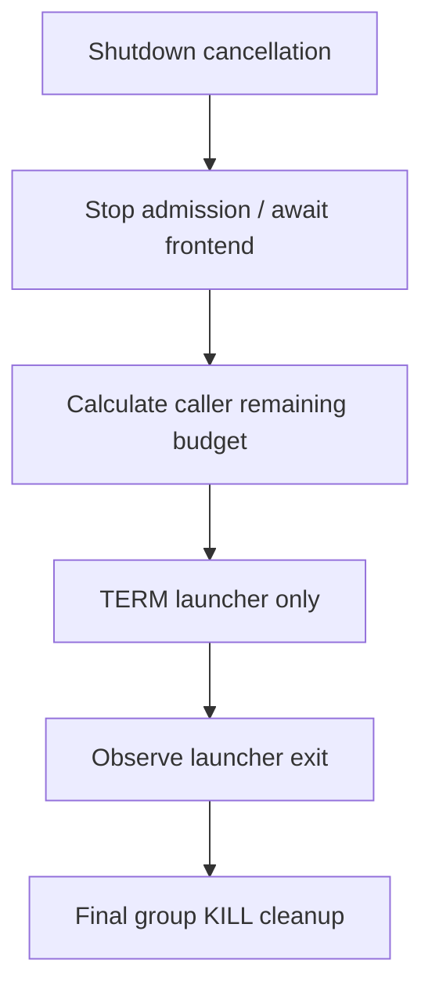
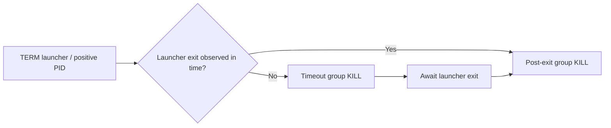
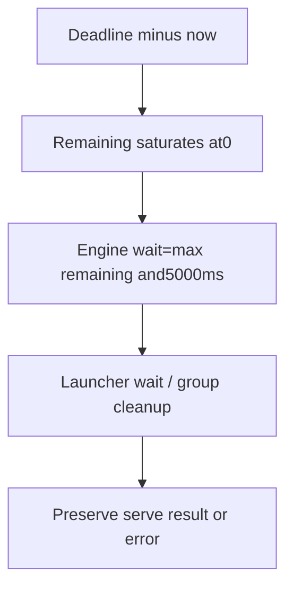

# Rust Frontend / Managed Engine Shutdown FAQ: Drain First,Launcher-only TERM and Cleanup Budget

> **Language**: English · [中文](managed-engine-launcher-sigterm-frontend-drain-budget-selection-faq.md)  
> **Round168/daytime45**: [pinned same-day vLLM change](https://github.com/vllm-project/vllm/commit/ec94b6a7fc3b7141528113fbc89802829a914c25),2026-11-14 06:50:47UTC/14:50:47BJT.No popularity/native performance claim.  
> [H5](../reports/managed-engine-launcher-sigterm-frontend-drain-budget-sizer.html) · [Seven cards](../reports/managed-engine-launcher-sigterm-frontend-drain-budget-selection-cards.html) · [SVG](../../assets/svg/managed-engine-launcher-sigterm-frontend-drain-budget-selection-faq-summary.svg) · [Experiment](../../experiments/managed_engine_drain_selection/README.md)

## Executive Summary

**After stopping admission,await frontend in-flight serving before shutting down the managed engine.Send graceful TERM only to its Python launcher,not the process group.** The Rust change first waits for serve drain,passes remaining budget to engine shutdown,and retains group KILL for timeout and post-launcher stragglers.

Caller `remaining=max(0,deadline-now)` is not a hard global shutdown deadline.The native engine enforces a **5sminimum** wait and polls exit every **200ms**.Timeout KILL is followed by exit waiting;OS/reaping/server elapsed time is not certified by this experiment.

Our finish2s/6s,frontend drain6s,caller10s,launcher exit1safterTERM case completes2/2with drain-first:TERM at6s,group cleanup7s.The legacy early group TERM model completes0/2.**Synthetic,independently_reproduced=false**;no Rust/Python/DP process execution.Original CPUfinish counting is separately measured,not shutdown latency.

## Q1: When must frontend,launcher,workers and process group be distinguished?

| Owner | Shutdown responsibility | Risk when conflated |
| :--- | :--- | :--- |
| API frontend | Stop admission and await in-flight serving | Waiting after the engine can no longer serve |
| Python launcher | Coordinate its drain and worker order | Group TERM bypasses coordination |
| Workers / DP replicas | Continue serving during frontend drain | Early replica exit disrupts remaining requests |
| Dedicated process group | Final descendant cleanup | Launcher exit mistaken for subtree cleanup |
| Headless/external frontend | Not a local Rust API await | No local await mistaken for completed requests |

Scope is the Rust frontend managing a local Python headless engine.Frontend-only branches,distributed-node coordination,external load balancer drain and platform eviction deadlines require separate evidence.

## Q2: Why target one PID with TERM but the group with KILL?

Pinned [managed-engine source](https://github.com/vllm-project/vllm/blob/ec94b6a7fc3b7141528113fbc89802829a914c25/rust/src/managed-engine/src/process.rs) gives the child its own group.TERM uses positive launcher PID;KILL uses a negative group target.Source explains workers exit immediately on TERM,while launcher owns drain/worker sequencing.

Successful observed launcher exit still receives post-exit group cleanup.On timeout,KILL group,await launcher exit,then perform final group cleanup.Empty group/ESRCH is accepted as gone;other signal errors propagate.A graceful log is not an end-to-end request-success counter.

The experiment **never queries PIDs,spawns a process,delivers a signal or kills anything**.TERM/KILL names are JSON events.The legacy ledger reflects the previous early-group/successful-return branch,not an executed Linux reproduction.

## Q3: How does the five-second floor affect remaining budget and error preservation?

Pinned [Rust caller](https://github.com/vllm-project/vllm/blob/ec94b6a7fc3b7141528113fbc89802829a914c25/rust/src/cmd/src/main.rs) sets a deadline after cancellation.Unless the serve task already completed with Server reason,it awaits serve result,computes saturated remaining time,shuts down the engine,then propagates the saved result while preserving Signal/Server/EngineExited outcomes.

Caller10sminus drain6s gives4sremaining,but the engine floor allows5swait.A never-observed-exiting original launcher yields modeled cleanup at11s,one second beyond caller budget.Zero caller budget still yields5sminimum.This is not an immediate-termination contract.

Times are original inputs.The ledger assumes finish-before-stop ties,instant kill/reap and supplied finite frontend completion.Native timeout races,polling,OS reaping,signal errors and server internal limits differ.Modeled end time is not measured SLA.

## Q4: Which states do the workbench and tests cover?

Inputs are bounded nonnegative budget/drain/exit/finish times,1–64requests,0–16assumed stragglers and explicit flags.Headless profiles cannot claim local API drain;observed-exit profiles cannot also claim a live launcher PID.No-PID/already-started branches keep completion and straggler counts null,not fabricated zero.

Eight tests cover order/targeting,minimum wait,budget0,headless,serve error,no-op uncertainty,ties and invalid profiles.65original profiles compare130Python/Node outcomes;another64cases compare sorted-prefix and linear finish counting.Native Rust/Linux tests were read,not run.They test grandchild TERM exclusion,post-exit cleanup and timeout of a TERM-ignoring launcher,not complete DPstreaming requests.

`latency.json` compares binary-prefix counting with linear counting over64/256/1024/4096pre-sorted finish times:two warmups,seven alternating repeats,100counts/sample,median repeat means.Sorting,timeline construction,network,signals and waiting are excluded.This kernel does not optimize measured graceful shutdown.Seven900×1125strict-CSPcards use sealed bars and null unknowns;H5separately uses local inline JS.The original interlock cabinet SVG has no browser acceptance.

## Q5: How should production shutdown budgets be accepted or rolled back?

In a controlled native environment,observe cancellation,admission stop,last request completion,launcher TERM,worker exits,group cleanup and final errors.Test unequal DPfinishes,streaming/long requests,headless,TERM-ignoring launcher,stragglers,ESRCH/I/Oerrors and repeated shutdown.Add minimum wait,polling,server drain and platform termination grace to separate budget accounting.

If boundaries/deadlines remain unverified,retain a reviewed deployment/rollback path and add evidence.Do not call group TERM a graceful fallback or send test signals on a shared machine.The model is not an operations script.

Recheck `python -m unittest discover -s tests -p test_managed_engine_drain_selection.py -q` and `python -m experiments.managed_engine_drain_selection.run --check`.Apache-2.0rights retained;link upstream rather than mirror implementation.AI-assisted original research;native worker/request/shutdown/visual acceptance remains unknown.
