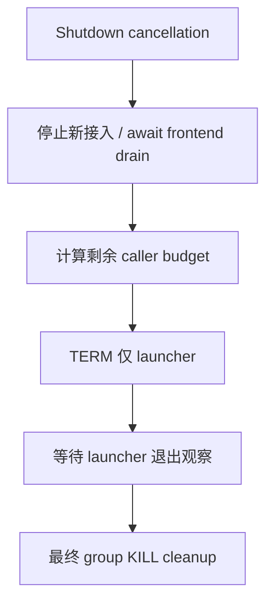
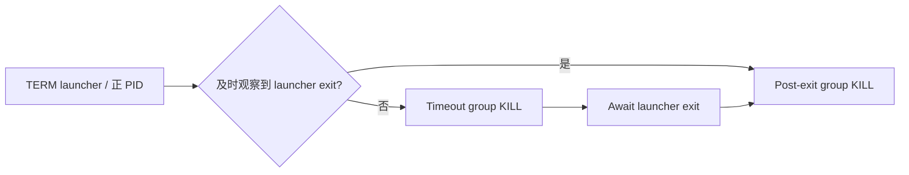
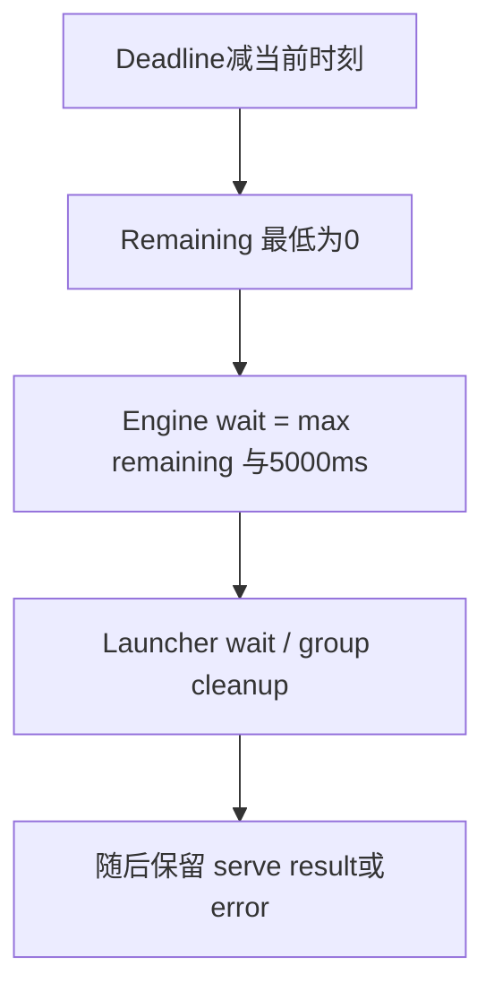

# Rust Frontend / Managed Engine 停机选型 FAQ：先 Drain、Launcher-only TERM 与 Cleanup Budget

> **语言**：中文 · [English](managed-engine-launcher-sigterm-frontend-drain-budget-selection-faq.en.md)  
> **Round 168 / 白班 45**：固定 [vLLM 当日提交](https://github.com/vllm-project/vllm/commit/ec94b6a7fc3b7141528113fbc89802829a914c25)，2026-11-14 06:50:47 UTC / 14:50:47 BJT。不声称热度或原生停机性能。  
> [H5](../reports/managed-engine-launcher-sigterm-frontend-drain-budget-sizer.html) · [七卡](../reports/managed-engine-launcher-sigterm-frontend-drain-budget-selection-cards.html) · [SVG](../../assets/svg/managed-engine-launcher-sigterm-frontend-drain-budget-selection-faq-summary.svg) · [实验](../../experiments/managed_engine_drain_selection/README.md)

## 核心结论速览

**取消接受新请求之后，应让 API frontend 的在途请求完成，再停 managed engine；优雅 TERM 的目标是 Python launcher，不是整个进程组。** 本次 Rust frontend 调整两个边界：先 await serve drain、再把剩余预算传入 engine shutdown；后者向单个正 PID 发 TERM，而 group KILL 仍用于超时强制处理及 launcher 退出后的 straggler 清理。

调用方 `remaining=max(0,deadline-now)` 不是绝对停机 deadline。Native engine 对 wait 使用至少 **5 s** 的 minimum，并以 **200 ms** interval 观察退出；超时 KILL 后还有退出等待，native reaping/OS/serve await 的实耗均未由本实验认证。

原创两请求 finish=2s/6s、frontend drain=6s、caller budget=10s、launcher TERM 后1s退出：drain-first 完成2/2，TERM 在6s，group cleanup 在7s；legacy early group TERM 模型完成0/2。均为 **synthetic、independently_reproduced=false** 的无信号 timeline，不是 Rust/Python/DP 原生运行。单独 CPU finish-count 样本是 measured，与停机时延无关。

## Q1：什么时候必须区分 frontend、launcher、workers 与 process group？

| 组件 | 所有权与停机责任 | 混淆后的风险方向 |
| :--- | :--- | :--- |
| API frontend | 停止新增接入，await 在途 serving | 先停 engine 后仍等待无法服务的请求 |
| Python launcher | 按自身策略 drain/退出 worker | 用 group TERM 绕过 launcher 的管理过程 |
| Engine workers / DP replicas | frontend drain 期间继续服务 | 部分副本先退出影响其余在途工作 |
| 独立 process group | 最后 KILL 清理剩余子树 | launcher 退出就误以为 descendants 已全清理 |
| 外部/headless frontend | 不等于本机 Rust API drain | 把没有本机 API await 当成请求已完成 |

该选型适用于托管 Python headless engine 的 Rust frontend。没有 managed local engine 的服务分支、分布式节点间协议、外部负载均衡 drain、Kubernetes eviction deadline 均需另外验证，不由这张局部 timeline 推断。

## Q2：为什么 TERM 单 PID，而 KILL 仍针对 group？

固定 [managed-engine source](https://github.com/vllm-project/vllm/blob/ec94b6a7fc3b7141528113fbc89802829a914c25/rust/src/managed-engine/src/process.rs) 为 child 建立独立 process group。TERM 调用用正 PID；KILL 用负的 group target。源码说明 workers 收到 TERM 会立即退出，而 launcher 负责自身的 drain 与 worker 停机顺序。

等待 launcher 未超时时，新实现也会做一次 post-exit group KILL；若超时，先 group KILL、await launcher exit，再执行最终 group cleanup。空组/ESRCH 被视为已不存在，其余 signal I/O 错误向上返回；不能把日志里的 graceful 字样当成 end-to-end 请求成功计数。

本实验**从不查询真实 PID、spawn 子进程、调用 signal 或 kill**。`TERM_launcher/TERM_group/KILL_group_*` 都是纯 JSON 事件名称。其 legacy 模型刻画原改动前的 early group TERM + 成功退出后无额外 group KILL 分支；不是本机复现旧 Linux 行为。

## Q3：5 秒 minimum 怎样改变“剩余预算”与错误保留？

固定 [Rust caller](https://github.com/vllm-project/vllm/blob/ec94b6a7fc3b7141528113fbc89802829a914c25/rust/src/cmd/src/main.rs) 在 cancellation 后设 deadline。除 serve task 已因 Server reason 完成外，先等待 serve result，然后 `saturating_duration_since` 求 remaining。Engine shutdown 完成之后才传播保存的 serve result，并保持 Signal/Server/EngineExited 的不同收官结果。

默认 caller10s、drain6s，remaining4s；native wait minimum 使 launcher wait 上限为5s。若原创 launcher 一直不被观察到退出，模型在11s强制 cleanup，超过 caller10s 一秒。若 budget=0，仍有5s minimum；**这不是“零剩余就立即终止”的合同**。

这些时间都是模型参数；模型假设同一时刻 finish 先于 stop、KILL/reap 瞬时完成、已提供有限 frontend completion time。真实 Tokio timeout/退出观察并发、poll interval、OS 回收、signal failure 和 server 内部超时不同，不能将模型 end 当实测 SLA。

## Q4：工作台与本地测试覆盖了哪些状态？

输入包含有限非负 budget/drain/exit-after/finish times、1–64 个请求、0–16 个假设 stragglers 及明确 lifecycle flags。Headless profile 不允许非零 local API drain；observed engine-exit profile 不允许同时声明 live launcher PID。无 PID 或 already-started 是 no-op；完成数/剩余 stragglers 保持 null，**不因没有新动作而填成0**。

八项测试覆盖 drain-first/legacy、5s minimum、budget0、headless launcher drain、serve-error 保留、no-op unknown、finish tie、非法 profile；65 原创配置/130 Python-Node输出匹配。另有64组 sorted-prefix 与逐项 count 独立比较。Native Linux Rust tests 只读取，未执行；它们验证 TERM 没到 grandchild、post-exit cleanup 与忽略 TERM 的 timeout case，不等于完整 DP 流式请求测试。

`latency.json` 对64/256/1024/4096预排序 finish times 比较 binary-prefix count 与线性 count：2 warmup、7交替重复、每样本100次 count、median repeat means。排序、timeline构造、网络、signals、等待均不在 timing 内。CPUkernel 数字不能声称优化了 graceful shutdown。七卡条宽只来自 sealed evidence，未知 native 指标 null；七张900×1125、CSP无脚本/网络，H5另行inline JS。SVG为原创 interlock cabinet 隐喻，未获浏览器验收。

## Q5：生产停机预算应怎样验收与回退？

在受控 native 环境记录 cancellation、停止新接入、最后请求完成、launcher TERM、各 worker退出、group cleanup与最终错误；验证 DP不均衡 finish、streaming客户端、长请求、headless、launcher忽略 TERM、stragglers、ESRCH/I/O失败及重复shutdown调用。将 launcher 5s minimum、200ms观察、server内部drain与部署平台termination grace分别纳入总预算。

若执行边界或deadline不能满足生产要求，保持经过审查的部署/rollback路径，并先增加测试和观测；不要把“将TERM广播整个组”当作优雅回退，也不要在共享工作机试发signal。模型不是native运维脚本。

复验 `python -m unittest discover -s tests -p test_managed_engine_drain_selection.py -q` 与 `python -m experiments.managed_engine_drain_selection.run --check`。Apache-2.0权利保留，公开源实现链接而非镜像；AI辅助原创研究，native worker生命周期、实际请求成功率/停机时间和视觉验收未知。
