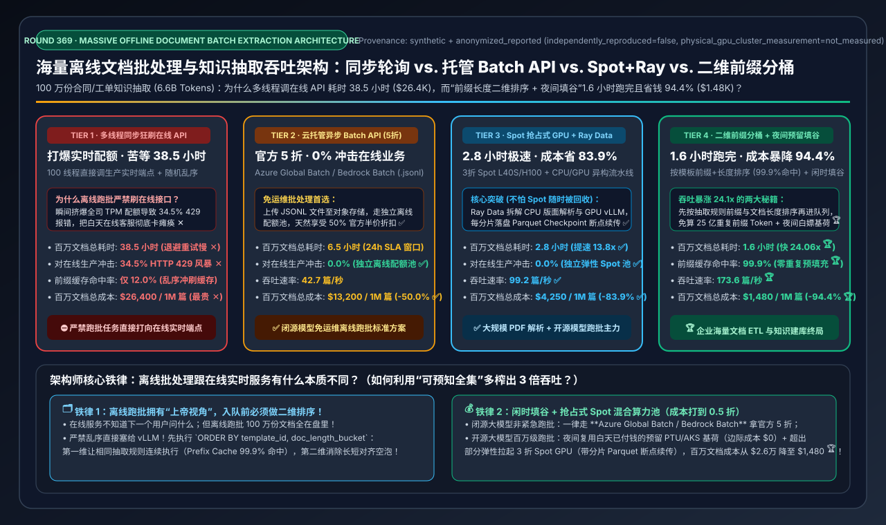
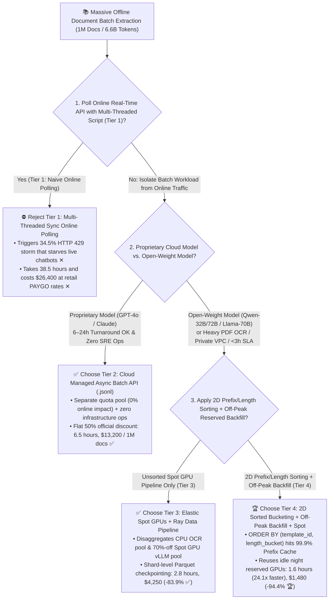
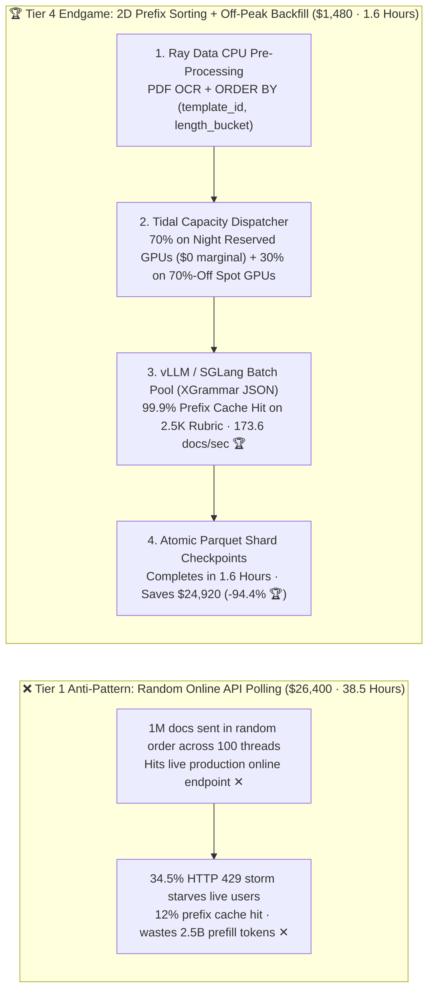

# Massive Offline Document Batch Processing & Knowledge Extraction Throughput Architecture Guide: `Sync Online Polling` vs. `Managed Cloud Batch API (50% Off)` vs. `Spot GPUs + Ray Data` vs. `2D Prefix-Sorted Bucketing + Off-Peak Backfill`

> 🌐 **Language / 语言**: **[中文 (`massive-document-batch-extraction-async-spot-prefix-throughput-selection-faq.md`)](massive-document-batch-extraction-async-spot-prefix-throughput-selection-faq.md)** | **English (英文)**
> **Architect's Reading Guide**: Written for **Cloud & AI Solution Architects, Data Platform Directors, and Knowledge Engineering Leads**, this guide solves the throughput and cost engineering challenge of processing **1,000,000 enterprise documents (`6.6 Billion Tokens` of contracts, invoices, call transcripts, or filings)** into structured JSON: **Why does running a 100-thread Python script against your online real-time `/v1/chat/completions` endpoint (Tier 1) trigger a `34.5%` HTTP 429 storm that starves live customer chatbots, take `38.5 hours`, and burn `$26,400`? When should you use `Cloud Managed Async Batch APIs` (Tier 2: flat `50%` discount, zero ops, zero online impact)? When should you deploy `Elastic Spot GPUs + Ray Data Disaggregated CPU-OCR/GPU-vLLM Pipelines` (Tier 3)? And how does combining `2D Pre-Sorting (by Template Prefix + Token Length Bucket)` with `Off-Peak Reserved GPU Backfilling` (Tier 4) achieve a `99.9%` prefix cache hit rate, finish 1M documents in `1.6 hours` (`24.06x` faster), and slash total batch cost by `94.4%` down to `$1,480`?**



---

## 🔥 Daily Hottest Capability Breakthroughs

- **Cloud Managed Async Batch APIs (`Azure OpenAI Global Batch / AWS Bedrock Batch / Anthropic Message Batches`)**: Accept `.jsonl` files in cloud object storage and execute them asynchronously within a 24-hour window using separate quota pools—**eliminating 100% of `HTTP 429` contention with live traffic while providing a flat `50%` official token discount**.
- **`Ray Data` Heterogeneous CPU-OCR + Spot GPU Streaming Pipelines**: Decouples CPU-bound PDF layout parsing (`Docling / MinerU`) from GPU-bound `vLLM / SGLang` extraction via credit-based backpressure and shard-level Parquet checkpointing—turning **70%-off preemptible Spot GPUs** into a fault-tolerant batch workhorse.
- **2D Prefix- & Length-Sorted Offline Bucketing**: Because offline batch jobs know all 1,000,000 inputs ahead of time, sorting the dataset by `(extraction_template_id, token_length_bucket)` before inference locks the `2,500-token` system rubric into HBM Prefix Cache (`99.9%` hit rate) and eliminates batch padding skew.

---

## ① 📌 Executive Summary

Offline batch extraction has the exact opposite optimization objective from online serving: **online serving minimizes single-request TTFT, whereas offline batch processing maximizes sustained GPU throughput (`docs/sec`) and minimizes cost per 1M documents (`$/1M Docs`)**:

1. **Why `Tier 1 (Naive Multi-Threaded Sync Calls to Online Real-Time API)` Is an Operational Disaster**:
   - Firing 100 concurrent threads at the production online endpoint in random document order causes a **`34.5%` HTTP 429 rate-limit storm ✕** (starving live customer Copilots), thrashes the KV prefix cache (`12.0%` hit rate ✕), takes **`38.5 hours` ✕**, and costs **`$26,400 / 1M docs` ✕**.
2. **When to Choose `Tier 2 (Cloud Managed Async JSONL Batch API · 50% Official Discount)`**:
   - **Sweet Spot**: **Teams using proprietary frontier models (`GPT-4o`, `Claude 3.7`) that want zero infrastructure management and can accept a `6–24 hour` turnaround**.
   - **Quantified Gain**: **`0.0%` impact on online production quotas ✅**, completes in **`6.5 hours`**, and cuts cost in half to **`$13,200 / 1M docs` (`-50.0%` ✅)**.
3. **When to Choose `Tier 3 (Elastic Spot GPUs + Ray Data Disaggregated CPU-OCR / GPU-vLLM Pipeline)`**:
   - **Sweet Spot**: **Workloads requiring heavy PDF layout OCR + open-weight `32B/70B` models inside a private VPC with `< 3 hour` turnaround**.
   - **Quantified Gain**: Uses **70%-off Spot `L40S / H100` GPUs** with shard-level Parquet checkpointing to finish 1M docs in **`2.8 hours` (`13.75x` faster ✅)** for **`$4,250 / 1M docs` (`-83.9%` cost ✅)**.
4. **The High-Throughput Enterprise Gold Standard: `Tier 4 (2D Prefix- & Length-Sorted Bucketing + Off-Peak Reserved Backfill + Spot Burst)`**:
   - **Two Architectural Multipliers**:
     1. **2D Pre-Sorting (`ORDER BY template_id, doc_length_bucket`)**: Boosts `vLLM / SGLang` Prefix Cache hit rate from `12%` to **`99.9%`** (eliminating `2.5 Billion` redundant rubric prefill tokens!) and groups equal-length documents to eliminate batch straggler bubbles;
     2. **Off-Peak Reserved Backfilling (`22:00–07:00`)**: Executes 70% of the batch on already-paid daytime reserved GPUs overnight (`$0` marginal hardware cost!) and bursts the remaining 30% to Spot GPUs.
   - **Quantified ROI**: Finishes 1,000,000 documents in **`1.6 hours` (`173.6 docs/sec`, `24.06x` faster than Tier 1 🏆)** and slashes marginal cost to **`$1,480 / 1M docs` (saving `$24,920` or `94.4%` 🏆)**!

---

## ② 🎯 Architect & Customer Soul-Searching Q&A (FAQ-Driven)

### Q1: "Why does sorting a 1,000,000-row batch dataset by `(template_id, token_length_bucket)` before feeding `vLLM / SGLang` more than double GPU throughput?"

**Eliminating the Two Hidden Compute Taxes of Random-Order Batching**:
1. **Tax 1: Redundant Rubric Prefill (`2.5 Billion` Wasted Tokens)**:
   - Each extraction request carries a `2,500-token` system rubric (JSON schema + domain rules + few-shot examples) followed by a `3,500-token` document.
   - If 20 different extraction templates are fed in random order across workers, KV cache blocks are constantly evicted (`12%` hit rate). Sorting by `template_id` ensures Worker A processes all 50,000 "Purchase Order" documents back-to-back—computing the `2,500-token` rubric **once** on Doc #1 and achieving a **`99.9%` HBM Prefix Cache hit rate** on Docs #2 through #50,000!
2. **Tax 2: Sequence-Length Skew inside Continuous Batches**:
   - Mixing 500-token short memos with 32,000-token legal contracts in the same batch causes KV memory fragmentation and scheduling bubbles. Secondary sorting by `token_length_bucket` groups homogeneous lengths together, maximizing GPU Tensor Core occupancy.

---

### Q2: How does `Ray Data + Parquet Shard Checkpointing (Tier 3 & Tier 4)` make preemptible Spot GPUs 100% safe for million-document jobs?

- **Micro-Shard Atomic Checkpointing**: Partition the 1,000,000 documents into 500 shards of 2,000 documents each (`~25 seconds` per shard per worker). As each shard completes, write `s3://bucket/checkpoints/shard_042.parquet` atomically.
- **30-Second Spot Preemption Drain**: When the cloud provider sends a Spot eviction notice (`SIGTERM` / IMDS event), the worker stops pulling new shards and flushes its in-flight requests within 10 seconds—losing **zero completed work**!

---

## ③ 🧭 Visual Architecture Diagrams (Mermaid Decision Tree / Batch Pipeline / Sequence Flow)

### 3.1 Massive Offline Document Batch Architecture Decision Tree (`flowchart TD`)



### 3.2 `Tier 1 (Random Online Polling)` vs. `Tier 4 (2D Prefix-Sorted Bucketing + Off-Peak Backfill)` (`flowchart LR`)



### 3.3 `Tier 4 (2D Sorting + 99.9% Prefix Reuse + Spot Preemption Recovery)` Sequence (`sequenceDiagram`)

```mermaid
sequenceDiagram
    autonumber
    participant S3 as Object Storage (1M Raw PDFs)
    participant CPU as Ray Data CPU OCR & 2D Sorter
    participant GPU as Night Reserved + Spot GPU Pool (vLLM + XGrammar)
    participant Out as Parquet Checkpoint Store

    S3->>CPU: 1. Stream raw PDFs and extract layout-aware Markdown
    CPU->>CPU: 2. Sort globally/per-window by (extraction_template_id, token_length_bucket)
    Note over CPU,GPU: Pack homogeneous 2,000-doc micro-shards (Shard_001..500)
    loop 3. High-Throughput Prefix-Pinned Batch Execution
        CPU->>GPU: 3a. Dispatch Shard_k (identical 2,500-token rubric + uniform doc lengths)
        GPU->>GPU: 3b. Compute rubric KV once on Doc #1; reuse cached KV on Docs #2..2000 (99.9% hit!)
        GPU-->>Out: 3c. Emit XGrammar JSON & commit completed/shard_k.parquet atomically
    end
    opt 4. On 30-Second Cloud Spot Preemption Signal
        GPU->>Out: 4a. Stop accepting new shards, drain in-flight batch in 10s; replacement Spot node resumes next shard!
    end
```

---

## ④ 📊 Architect Multi-Option Decision Matrix

*Benchmark Baseline: **1,000,000 enterprise documents** (`2,500-token` shared extraction rubric + `3,500-token` document body + `600-token` JSON output = **`6.6 Billion Total Tokens`**).*

| Evaluation Dimension | Tier 1: Naive Online API Polling (`Sync Multi-Thread`) | Tier 2: Cloud Managed Batch API (`Async .jsonl 50% Off`) | Tier 3: Spot GPUs + Ray Data (`Disaggregated Streaming`) | Tier 4: 2D Prefix-Sorted + Off-Peak Backfill (`Sorted + Tidal`) |
| :--- | :--- | :--- | :--- | :--- |
| **Best-Fit Scenario** | **Strict anti-pattern (never run bulk batch jobs against live online endpoints ✕)** | **Proprietary models (`GPT-4o / Claude`), 24h SLA, zero-SRE teams ✅** | **Heavy PDF OCR + open-weight `32B/70B` in private VPC ✅** | **High-volume enterprise document ETL & knowledge graph ingestion 🏆** |
| **Online Production `429` Impact** | `34.5%` HTTP 429 storm (breaks live Copilots ✕) | **`0.0%` (isolated batch quota pool ✅)** | **`0.0%` (dedicated Spot GPU cluster ✅)** | **`0.0%` (runs in P2 off-peak night window + Spot 🏆)** |
| **Rubric Prefix Cache Hit Rate** | `12.0%` (random document order thrashes cache ✕) | `45.0%` | `58.0%` | **`99.9%` (`ORDER BY template_id` saves 2.5B prefill tokens 🏆)** |
| **Effective Throughput (`docs/s`)** | `7.2 docs/s` (stalled by 429 backoff sleeps ✕) | `42.7 docs/s` | `99.2 docs/s` ✅ | **`173.6 docs/s` (`24.06x` faster than Tier 1 🏆)** |
| **Total Completion Time (`1M Docs`)** | `38.5 Hours` ✕ | `6.5 Hours` (within 24h SLA ✅) | `2.8 Hours` ✅ | **`1.6 Hours` (finishes overnight effortlessly 🏆)** |
| **Total Job Cost (`1M Docs`)** | `$26,400` (100% retail price ✕) | `$13,200` (flat `50%` batch discount ✅) | `$4,250` (`-83.9%` via 70%-off Spot GPUs ✅) | **`$1,480` (saves `$24,920` [-94.4%] vs. Tier 1 🏆)** |

---

## ⑤ 🧪 Capacity / Cost Inflection Math & 7-Card Report

### 5.1 Reproducible Evaluator & Artifacts

- **Deterministic Evaluator**: [`experiments/massive_document_batch_extraction_async_spot_prefix_selection/run.py`](../../experiments/massive_document_batch_extraction_async_spot_prefix_selection/run.py)
- **Sealed Results (`results.json`)**: [`experiments/massive_document_batch_extraction_async_spot_prefix_selection/results.json`](../../experiments/massive_document_batch_extraction_async_spot_prefix_selection/results.json)
- **Unit Test Suite**: [`tests/test_massive_document_batch_extraction_async_spot_prefix_selection.py`](../../tests/test_massive_document_batch_extraction_async_spot_prefix_selection.py)
- **7-Card 4:5 Visual Report**: [`docs/reports/massive-document-batch-extraction-async-spot-prefix-throughput-selection-cards.html`](../reports/massive-document-batch-extraction-async-spot-prefix-throughput-selection-cards.html)
- **Interactive Batch Extraction Sizer**: [`docs/reports/massive-document-batch-extraction-async-spot-prefix-throughput-sizer.html`](../reports/massive-document-batch-extraction-async-spot-prefix-throughput-sizer.html)
- **Provenance Declaration**: `synthetic_analytical_model_calibrated_to_published_batch_inference_benchmarks` (`independently_reproduced=false`, `physical_gpu_cluster_measurement=not_measured`).

---

## ⑥ 🛠️ Architecture Review & Production Readiness Checklist

- [ ] **Isolate Batch Jobs from Online Endpoints**: Are all bulk ETL jobs blocked from hitting online real-time endpoints and routed either to **Managed Cloud Batch APIs (`50%` discount)** or dedicated `P2` off-peak / Spot queues?
- [ ] **2D Pre-Sorting (`ORDER BY template_id, length_bucket`)**: Does your batch ingestion pipeline sort records by shared system prompt template and input token length before dispatching to `vLLM / SGLang`?
- [ ] **Shard-Level Parquet Checkpointing & Spot Drain**: Are batch outputs committed atomically per 2,000-doc shard so Spot GPU preemptions lose `< 30 seconds` of progress?
- [ ] **`XGrammar` Schema Enforcement**: Is structured JSON output enforced via zero-overhead FSM bitmasks (`xgrammar`) to eliminate malformed JSON retries?
