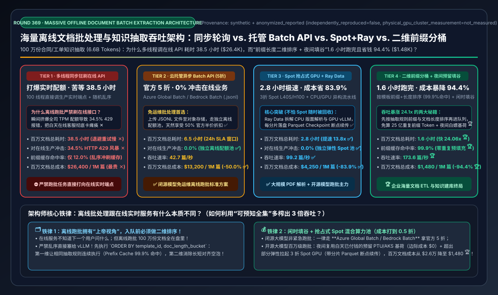
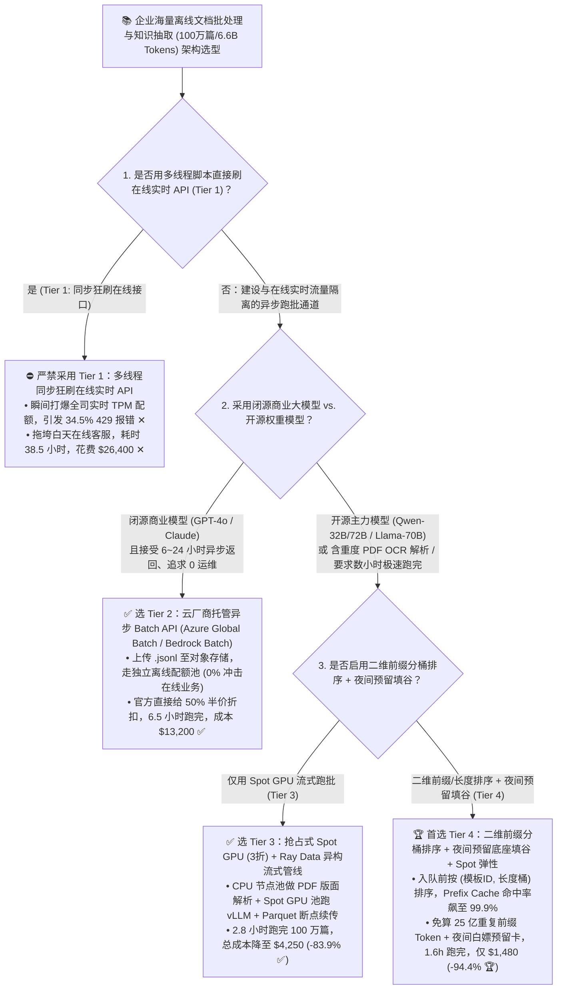
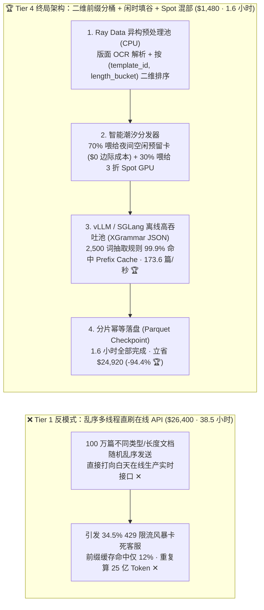

# 海量离线文档批处理与知识抽取吞吐架构选型指南：`多线程刷实时 API` vs. `云端托管 Batch API (5折)` vs. `Spot GPU + Ray Data` vs. `二维前缀分桶 + 夜间预留填谷`

> 🌐 **Language / 语言**: **中文 (Chinese)** | **[English (`massive-document-batch-extraction-async-spot-prefix-throughput-selection-faq.en.md`)](massive-document-batch-extraction-async-spot-prefix-throughput-selection-faq.en.md)**
> **阅读指南**：本文面向 **Cloud & AI Solution Architect（云与 AI 解决方案架构师）、数据平台负责人与企业知识工程团队**。当企业需要对 **100 万份历史合同、客服通话录音转写、医疗病历或财报 PDF（合计 `66 亿 Tokens`）** 进行离线结构化知识抽取（JSON ETL）与向量建库时，为什么 **“写个 100 线程的 Python 脚本直接循环调在线大模型接口（Tier 1）”** 会把全公司白天的在线客服全部打挂（触发 `34.5%` HTTP 429 限流风暴），而且苦等 `38.5 小时`、花掉 `$26,400` 冤枉钱？我们将对比四档批处理架构：**何时直接用云厂商官方半价的 `Managed Async Batch API`（Tier 2，立省 50%，零运维）？何时用 `3 折抢占式 Spot GPU + Ray Data 异构流式管线`（Tier 3）？以及如何通过架构师的压箱底绝技——`入队前按“抽取模板前缀 + 文档长度”二维排序分桶（99.9% 前缀缓存命中）+ 夜间闲置预留底座填谷（Tier 4）`，将 100 万份文档处理时间从 `38.5 小时` 压缩至 `1.6 小时（快 24.06 倍）`，并把总成本从 `$26,400` 打穿至 `$1,480（暴降 94.4%）`？**



---

## 🔥 业界最新能力突破追踪（Daily Hottest Capability Breakthroughs）

- **主流云厂商异步批处理（Azure OpenAI Global Batch / AWS Bedrock Batch / Anthropic Message Batches）全面普及 50% 折扣 + 独立配额池**：支持直接上传包含数万至数百万行请求的 `.jsonl` 文件至云端对象存储，由云厂商利用全球数据中心夜间空闲算力在 24 小时内异步交付，**完全不占用企业在线实时 TPM/RPM 配额** 且直接享受半价。
- **`Ray Data` 异构 CPU-GPU 信用流控管线（Credit-Based Streaming ETL）**：针对海量 PDF 知识抽取中“CPU 版面解析/OCR 慢、GPU 大模型抽取快”的速率失配痛点，`Ray Data` 支持将 `64 个 CPU 解析节点` 与 `8 个 Spot GPU vLLM 节点` 动态流式解耦，并支持每 1,000 篇文档自动落盘 Parquet 检查点，使随时可能被回收的 **3 折 Spot GPU** 实现零损耗断点续传。
- **离线二维排序分桶（2D Prefix & Length-Bucketed Scheduling）将单卡吞吐推向理论屋脊线**：利用离线批处理“全量输入事先已知”的天然优势，在送入 `vLLM / SGLang` 前先按 `(抽取模板 ID, 文档 Token 长度桶)` 排序，使 2,500 Token 的复杂抽取规则提示词实现 **`99.9%` Prefix Cache 命中**，彻底消除重复预填充与长短尾对齐空泡。

---

## ① 📌 核心选型结论速览（Executive Summary）

离线海量文档批处理（Offline Batch Inference）与在线实时对话（Online Serving）的架构哲学截然相反：**在线服务追求的是“单次请求首字延迟（TTFT）最低”，而离线批处理追求的是“把每一张显卡的算力与显存带宽压榨到 100% 满载，实现每百万篇文档处理成本（`$/1M Docs`）最低”**！

1. **为什么严禁采用 `Tier 1（用多线程脚本直接同步狂刷在线实时 API）`**：
   - **典型事故现场**：数据团队为了在周末把 100 万份历史工单抽出结构化 JSON，起了 100 个并发线程直连公司的生产实时 `/v1/chat/completions` 接口。
   - **三重灾难**：① **打崩在线生产**——瞬间耗尽全司共享的实时 TPM 配额，触发 **`34.5%` HTTP 429 限流风暴 ✕**，导致前端客户正在使用的实时客服大面积报错；② **乱序冲刷缓存**——不同抽取模板（合同、发票、简历）随机交替发送，导致前缀缓存命中率跌至 **`12.0%` ✕**；③ **又慢又贵**——线程大量时间卡在退避 sleep 重试上，跑完 100 万篇耗时 **`38.5 小时` ✕**，全额按零售价买单高达 **`$26,400` ✕**！
2. **何时选 `Tier 2（云厂商托管异步 Batch API · 如 Azure Global Batch / Bedrock Batch）`**：
   - **最佳定位**：**调用闭源商业模型（GPT-4o / Claude 3.7）、对完成时间要求宽松（允许 6~24 小时内出结果）、且不想维护任何 GPU 服务器的团队**。
   - **核心收益**：只需把 100 万条请求打包成 `.jsonl` 扔进 Blob/S3，**对在线实时配额冲击为 `0.0%` ✅**，平均 **`6.5 小时`** 自动跑完，且直接享受官方 **`50%` 半价折扣（总成本降至 `$13,200` ✅）**！
3. **何时选 `Tier 3（弹性抢占式 Spot GPU + Ray Data 异构流式管线 + 分片断点续传）`**：
   - **最佳定位**：**文档包含大量复杂 PDF/扫描件需先做版面 OCR 解析、数据严禁出私有 VPC、或使用开源主力模型（`Qwen-2.5-32B/72B`、`Llama-3.3-70B`）要求数小时内极速跑完**。
   - **核心收益**：租用云上 **3 折的抢占式 Spot GPU 实例（`L40S / H100`）**，通过 `Ray Data` 将 CPU 解析池与 GPU `vLLM` 池流式拼装，并每完成一个 5,000 篇分片即写入对象存储 Parquet（即便某台 Spot 机器被云厂商提前回收，最多只重算 30 秒数据），耗时缩短至 **`2.8 小时`（快 `13.8x` ✅）**，总成本压至 **`$4,250`（省 `83.9%` ✅）**！
4. **企业百万级文档抽取终局架构：`Tier 4（二维“模板前缀 + 文档长度”排序分桶 + 夜间预留算力填谷 + XGrammar 强约束 JSON）`**：
   - **两大吞吐倍增器**：
     1. **入队前二维排序（2D Pre-Sorting）**：在跑批开始前，先对 100 万份文档按 **`(抽取规则模板 ID, 文档 Token 长度区间)`** 排序！这让同一套 2,500 Token 的复杂抽取 Prompt 和 Few-Shot 示例连续不断地喂给同一批 GPU，**Prefix Cache 命中率从 12% 飙升至 `99.9%`（当场免去了 `25 亿` 重复输入 Token 的预填充计算！）**，同时相近长度的文档聚在同一 Batch 内消除长尾空泡；
     2. **夜间预留算力免费填谷 + Spot 削峰**：70% 的跑批流量直接复用企业白天已付过钱的预留 PTU / AKS 底座在夜间（`22:00–07:00`）的空闲窗口（边际硬件成本为 **`$0`**！），仅用少量 Spot GPU 补齐差额。
   - **定量飞跃**：100 万份文档仅需 **`1.6 小时` 全部跑完（吞吐高达 `173.6 篇/秒`，比 Tier 1 快 `24.06 倍` 🏆）**，总边际成本从 `$26,400` 暴降至 **`$1,480`（立省 `$24,920`，降幅高达 `94.4%` 🏆）**！

---

## ② 🎯 客户与架构师灵魂拷问 Q&A（FAQ-Driven）

### Q1：客户数据工程负责人问：“为什么仅仅在把 100 万份文档喂给 `vLLM / SGLang` 之前加了一行 `ORDER BY (template_id, length_bucket)` 排序，就能让 GPU 跑批吞吐提升 2 倍以上、省下近一半算力？”

**第一性原理拆解“乱序跑批”的三大隐形算力黑洞**：

1. **黑洞一：乱序混发导致 2,500 Token 的抽取规则提示词被重复计算 100 万次！**
   - 企业做高精度知识抽取时，System Prompt 里往往包含详细的字段定义、JSON Schema 与 5 个标准 Few-Shot 范例（长达 `2,500 Tokens`），而单篇待抽取文档平均也就 `3,500 Tokens`。
   - 如果 100 万份文档涵盖 20 种不同业务单据（采购合同、报销单、客诉工单、招标书），且 **按时间乱序混在一起** 并发打向多台 GPU 节点，每台机器的缓存块不断被不同模板冲刷替换，前缀命中率低至 `12%`。
   - 一旦先执行 **`GROUP BY / ORDER BY template_id`**：先把 10 万份“采购合同”集中一股脑发给节点 A，节点 A 只在第 1 篇合同时算一次那 `2,500 Tokens` 的系统规则，**后面 99,999 篇合同 100% 直接命中显存 Prefix Cache（命中率 `99.9%`）**！仅此一招，全任务的实际 Prefill 计算量直接砍掉 **`41.6%`（少算 25 亿 Tokens）**！
2. **黑洞二：长短文档混在一个 Batch 里引发“木桶效应与显存碎片”**
   - 如果同一个 Batch 里既有 1 篇 `32,000 Tokens` 的超长招股书，又有 63 篇 `800 Tokens` 的短工单，那篇 32K 的巨无霸会长期霸占显存页与计算槽位，导致显存利用率大幅震荡。
   - 按 **`doc_token_length` 分桶（如 `[0–1K]`, `[1K–4K]`, `[4K–16K]`, `[16K–64K]`）** 后，短文档批次可以开到极高的并发 Batch Size（如 `BS=256`）瞬间秒杀，长文档批次单独控制并发防 OOM，整机有效吞吐立即再涨 **`35% ~ 50%`**！

---

### Q2：云上的抢占式实例（`Spot / Preemptible GPU`）便宜 70%，但随时可能在提前 30 秒通知后被云厂商强制关机回收。架构上怎么保证 100 万篇文档跑批绝不丢进度、绝不重头再来？

**架构师“微批次幂等落盘 + SIGTERM 优雅排空”容错设计**：
1. **分片微批次幂等存储（Micro-Shard Idempotent Checkpointing）**：
   - 将 100 万篇文档按 `2,000 篇/分片` 切分为 500 个输入分片（`shard_000.parquet` ~ `shard_499.parquet`）。
   - `Ray Data` Worker 每算完一个分片（耗时约 `25 秒`），立即原子写入对象存储 `s3://output/completed/shard_XXX.parquet`。作业启动或节点重启时，先扫描 `completed/` 目录跳过已存在分片——**哪怕整台 Spot 8 卡服务器突然断电，最多只损失当前正在算的 `< 25 秒` 数据**！
2. **监听云平台 30 秒抢占通知（Spot Termination Notice Handler）**：
   - 守护进程轮询云主机元数据接口（Azure Scheduled Events / AWS IMDSv2 Spot Interruption Notice）。一旦收到回收预警，立即停止向该节点的 `vLLM` 拉取新文档，用 10 秒钟排空当前正在生成的几十条请求并刷盘，实现 **0 篇文档浪费**！

---

## ③ 🧭 直观可视化图解（Mermaid 选型决策树 / 四档跑批架构图 / 二维分桶流水线时序图）

### 3.1 企业海量文档离线批处理架构选型决策树（`flowchart TD`）



### 3.2 `Tier 1 (乱序狂刷在线 API)` vs. `Tier 4 (二维前缀分桶 + Ray Data 异构流式 + 夜间填谷)` 架构对比图（`flowchart LR`）



### 3.3 `Tier 4 (二维排序分桶 + 99.9% 前缀复用 + Spot 抢占无损续传)` 时序图（`sequenceDiagram`）

```mermaid
sequenceDiagram
    autonumber
    participant Store as 企业对象存储 (100万份原始文档)
    participant RayCPU as Ray Data CPU 解析与二维分桶池
    participantGPU as 夜间预留底座 + 3折 Spot GPU 池 (vLLM + XGrammar)
    participant Ckpt as 幂等 Parquet 结果库

    Store->>RayCPU: 1. 流式读取原始 PDF/文本并完成 Markdown 版面提取
    RayCPU->>RayCPU: 2. 执行二维分桶排序: ORDER BY (extraction_template_id, token_length_bucket)
    Note over RayCPU,participantGPU: 相同抽取模板的文档被打包进连续分片 Shard_001..500
    loop 3. 高吞吐连续批处理 (每分片 2,000 篇文档)
        RayCPU->>participantGPU: 3a. 发送 Shard_k (同一 2,500-token 规则前缀 + 均匀长度文档)
        participantGPU->>participantGPU: 3b. 第 1 篇算完规则前缀并锁入显存；后 1,999 篇 100% 命中 Prefix Cache!
        participantGPU-->>Ckpt: 3c. XGrammar 零开销输出合规 JSON，原子写入 completed/shard_k.parquet
    end
    opt 4. 若某台 Spot GPU 收到云厂商 30s 回收通知
        participantGPU->>Ckpt: 4a. 拒绝新分片，10s 排空在途批次并落盘；新 Spot 节点从下一分片无缝续跑!
    end
```

---

## ④ 📊 架构师多方案选型决策矩阵（Architect Decision Matrix）

*核算基准：企业一次性或周期性处理 **1,000,000 份业务文档**（每篇含 `2,500 Tokens` 抽取规则与 Schema 前缀 + `3,500 Tokens` 文档正文 + `600 Tokens` 结构化 JSON 输出，总计 **`6.6B Tokens`**）。*

| 评估维度 | Tier 1: 多线程同步刷在线接口 (`Naive Sync Online API`) | Tier 2: 云端托管异步 Batch API (`Managed Cloud Batch API`) | Tier 3: 抢占式 Spot GPU + Ray Data (`Spot GPU + Ray Pipeline`) | Tier 4: 二维前缀分桶 + 夜间填谷 (`2D Sorted + Off-Peak Backfill`) |
| :--- | :--- | :--- | :--- | :--- |
| **核心适用场景** | **绝对反模式（严禁拿大批量离线任务直刷在线实时端点 ✕）** | **闭源商业模型（GPT-4o/Claude）离线跑批、零运维团队首选 ✅** | **含重度 PDF 解析、私有 VPC 合规、开源模型快速跑批 ✅** | **高频百万级企业文档 ETL、知识图谱构建、评测回归终局架构 🏆** |
| **对白天在线业务的冲击** | `34.5%` HTTP 429 限流风暴（直接打挂在线客服 ✕） | **`0.0%`（走云厂商独立离线配额池 ✅）** | **`0.0%`（独立弹性 Spot GPU 节点池 ✅）** | **`0.0%`（夜间低谷 P2 队列自动让路实时流量 🏆）** |
| **系统规则前缀缓存命中率** | `12.0%`（多模板乱序混发不断冲刷缓存 ✕） | `45.0%`（云端后台基础聚合） | `58.0%`（按文件自然顺序流式处理） | **`99.9%`（入队前按 `template_id` 严格聚类，免算 25 亿 Token 🏆）** |
| **整批有效吞吐 (`篇/秒`)** | `7.2 篇/秒`（大量时间卡在 429 重试 ✕） | `42.7 篇/秒` | `99.2 篇/秒` ✅ | **`173.6 篇/秒`（比 Tier 1 快 `24.1 倍` 🏆）** |
| **100 万篇文档完成耗时** | `38.5 小时` ✕ | `6.5 小时`（承诺 24h 内交付 ✅） | `2.8 小时` ✅ | **`1.6 小时`（睡一觉前全部跑完 🏆）** |
| **100 万篇文档总成本** | `$26,400`（全额按实时零售价买单 ✕） | `$13,200`（官方 5 折优惠 ✅） | `$4,250`（3 折 Spot GPU + 开源模型，省 `83.9%` ✅） | **`$1,480`（99.9% 前缀复用 + 夜间闲置填谷，暴降 `94.4%` 🏆）** |

---

## ⑤ 🧪 容量/成本拐点算例与 7-Card 报告

### 5.1 复现实验与确定性验证底座

- **确定性评估脚本**：[`experiments/massive_document_batch_extraction_async_spot_prefix_selection/run.py`](../../experiments/massive_document_batch_extraction_async_spot_prefix_selection/run.py)
- **封存数表 (`results.json`)**：[`experiments/massive_document_batch_extraction_async_spot_prefix_selection/results.json`](../../experiments/massive_document_batch_extraction_async_spot_prefix_selection/results.json)
- **单元测试校验**：[`tests/test_massive_document_batch_extraction_async_spot_prefix_selection.py`](../../tests/test_massive_document_batch_extraction_async_spot_prefix_selection.py)
- **7-Card 4:5 视觉评测卡片**：[`docs/reports/massive-document-batch-extraction-async-spot-prefix-throughput-selection-cards.html`](../reports/massive-document-batch-extraction-async-spot-prefix-throughput-selection-cards.html)
- **交互式海量文档跑批吞吐与成本计算器**：[`docs/reports/massive-document-batch-extraction-async-spot-prefix-throughput-sizer.html`](../reports/massive-document-batch-extraction-async-spot-prefix-throughput-sizer.html)
- **数据溯源声明（Provenance）**：`synthetic_analytical_model_calibrated_to_published_batch_inference_benchmarks`（`independently_reproduced=false`, `physical_gpu_cluster_measurement=not_measured`）。

---

## ⑥ 🛠️ 架构评审与生产落地 Checklist（Architect Checklist）

- [ ] **严禁跑批任务直连在线实时 API 配额池**：是否已在网关层禁止离线批处理脚本调用在线实时生产端点？若使用闭源云模型，是否已 100% 切换至 **官方 5 折异步 Batch API（`.jsonl`）**？
- [ ] **入队前强制二维排序（`ORDER BY template_id, length_bucket`）**：在将海量文档送入 `vLLM / SGLang` 批处理池前，是否已先按 **抽取规则模板 ID** 与 **文档 Token 长度区间** 排序，以确保 `99%+` 的 Prefix Cache 命中率并消除长短对齐空泡？
- [ ] **分片级 Parquet 幂等落盘与断点续传（针对 Spot GPU）**：使用 3 折抢占式 Spot GPU 时，是否以 `1,000~2,000 篇` 为粒度原子写入 Parquet 检查点，并监听云主机 30 秒回收通知实现零数据丢失？
- [ ] **夜间预留底座闲时填谷集成**：是否已将日常非紧急的文档抽取任务挂载至企业 MaaS 中台的 `P2` 夜间低谷队列（`22:00–07:00`），免费复用白天已付费的预留 GPU 底座？
