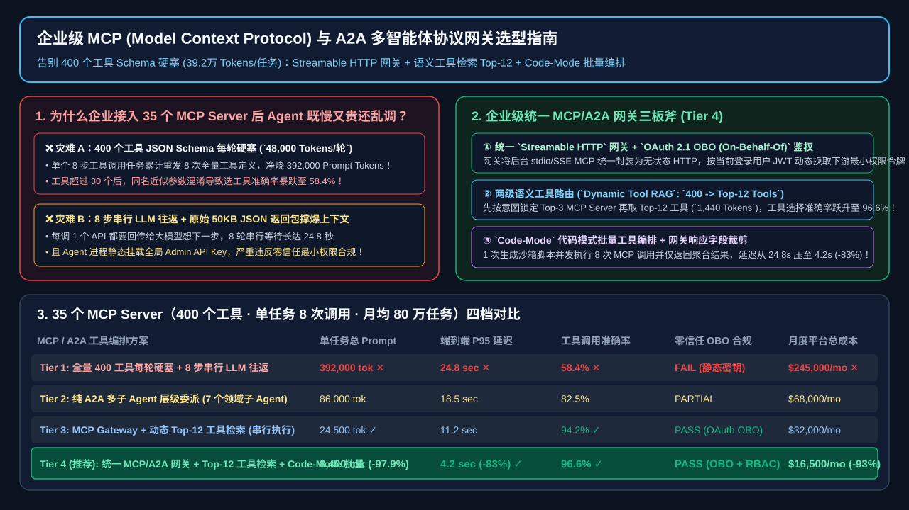

# Enterprise MCP (`Model Context Protocol`) & A2A Multi-Agent Gateway Guide: 400-Tool Schema Dump vs. Dynamic Tool RAG vs. Unified `Streamable HTTP` MCP Gateway + `Code-Mode` Orchestration

> **Language**: [中文](./mcp-model-context-protocol-a2a-multi-agent-gateway-tool-routing-selection-faq.md) | **English (Current)**  
> **Audience**: Cloud & AI Infrastructure Solution Architects and Enterprise AI Agent Platform Engineers  
> **Provenance**: `synthetic + anonymized_reported` (`independently_reproduced=false`, `physical_gpu_cluster_measurement=not_measured`)

---

## 1. 📌 Executive Summary

> **Bottom Line**: **When connecting enterprise AI Agents to `35` internal MCP servers (`400` total tools across GitHub, Jira, ServiceNow, Salesforce, Snowflake, and Datadog; `800,000` multi-step tasks/month), injecting all `400` tool JSON schemas (`48,000 tokens`) across `8` sequential LLM tool-calling turns (`Tier 1`) burns `392,000` prompt tokens per task, degrades tool-selection accuracy to `58.4%`, takes `24.8s` P95 latency, and costs `$245,000/month`. Deploying a Unified `Streamable HTTP` MCP/A2A Gateway + `OAuth 2.1 On-Behalf-Of (OBO)` Auth + Hierarchical `Top-12` Semantic Tool Retrieval (`Dynamic Tool RAG`) + Programmatic `Code-Mode` Multi-Tool Orchestration (`Tier 4`) slashes per-task prompt tokens by `97.9%` (`8,400 tokens`), lifts tool call accuracy to `96.6%` (`+38.2 pts`), cuts P95 latency by `83.1%` (`4.2s`), and reduces monthly platform TCO by `93.3%` (`$16,500/month`).**

- **Interactive MCP & A2A Gateway Latency & TCO Sizer**: [Open Interactive Sizer (`mcp-model-context-protocol-a2a-multi-agent-gateway-tool-routing-sizer.html`)](../reports/mcp-model-context-protocol-a2a-multi-agent-gateway-tool-routing-sizer.html)
- **7-Card 4:5 Visual Report**: [Open 7-Card Report (`mcp-model-context-protocol-a2a-multi-agent-gateway-tool-routing-selection-cards.html`)](../reports/mcp-model-context-protocol-a2a-multi-agent-gateway-tool-routing-selection-cards.html)

---

## 2. 📊 4-Tier Enterprise MCP & A2A Orchestration Matrix (`400 Tools` · `8 Calls/Task` · `800K Tasks/Mo`)

| Metric | Tier 1: All `400` Tools Injected + 8 Sequential Turns | Tier 2: Pure `A2A` Sub-Agent Delegation | Tier 3: `MCP Gateway` + `Top-12` Tool RAG (Sequential) | Tier 4 (Recommended): `MCP/A2A Gateway` + `Top-12` Tool RAG + `Code-Mode` Batching |
| :--- | :--- | :--- | :--- | :--- |
| **Total Prompt Tokens / Task** | `392,000` ✕ | `86,000` | `24,500` ✓ | **`8,400` ✓ (`-97.9%` vs Tier 1)** |
| **End-to-End Task P95 Latency** | `24.8 sec` ✕ | `18.5 sec` | `11.2 sec` | **`4.2 sec` ✓ (`-83.1%`)** |
| **Tool & Parameter Accuracy** | `58.4%` ✕ | `82.5%` | `94.2%` ✓ | **`96.6%` ✓ (`+38.2 pts`)** |
| **Zero-Trust `OAuth OBO` Auth** | `FAIL` ✕ (Static keys) | `PARTIAL` | `PASS` (`OBO`) | **`PASS` ✓ (`OAuth 2.1 OBO + RBAC`)** |
| **Monthly Platform TCO** | `$245,000 / mo` ✕ | `$68,000 / mo` | `$32,000 / mo` | **`$16,500 / mo` ✓ (`-93.3%`)** |

---

## 3. 🛠️ Production Readiness Checklist

- [ ] **Cap Tools in Context at `<= 15` via Two-Stage Semantic Tool RAG** at the MCP Gateway so LLMs never suffer from schema bloat or tool-name collisions.
- [ ] **Standardize on Stateless `Streamable HTTP` MCP Transport + `OAuth 2.1 On-Behalf-Of (OBO)` Token Exchange**, and use **Programmatic `Code-Mode` Orchestration** to batch multi-step read/filter workflows in 2 LLM turns instead of 8–15 sequential round-trips.
