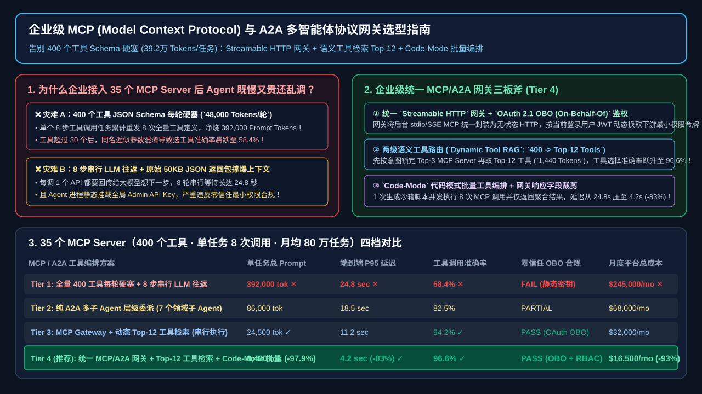
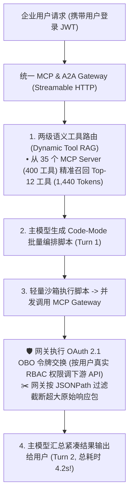

# 企业级 MCP（Model Context Protocol）与 A2A 多智能体协议网关选型：全量 400 工具硬塞 vs. `语义工具检索剪枝 (Dynamic Tool RAG)` vs. `统一 MCP Gateway (Streamable HTTP + OAuth 2.1 + Code Mode)` 指南

> **语言 / Language**: **中文 (当前)** | [English](./mcp-model-context-protocol-a2a-multi-agent-gateway-tool-routing-selection-faq.en.md)  
> **定位**：面向 Cloud & AI Infrastructure Solution Architect 与企业 Agent 中台负责人的大规模工具生态集成架构（`MCP: Model Context Protocol` 纵向调工具 vs. `A2A: Agent2Agent` 横向智能体协同）、无状态 `Streamable HTTP` 传输层、`OAuth 2.1 On-Behalf-Of (OBO)` 零信任鉴权、两级语义工具路由（`Dynamic Tool RAG`）与代码模式批量编排（`Code-Mode Tool Orchestration`）白皮书  
> **合规与来源声明**：`synthetic + anonymized_reported`（`independently_reproduced=false`，`physical_gpu_cluster_measurement=not_measured`；完全面向通用企业级 MCP/A2A 智能体网关架构设计）

---

## 1. 📌 核心选型结论速览（Executive Summary）

> **一句话结论**：**当企业把内部 35 个业务系统（`GitHub`、`Jira`、`ServiceNow`、`Salesforce`、`Datadog`、`Snowflake` 等共 `400 个` MCP 工具）接入统一智能体平台时，千万不要把全部 400 个工具的 JSON Schema 在每轮对话中全量塞给大模型并走串行单步工具调用（Tier 1）——那会导致每次 8 步排障任务白白重发 8 遍 `48,000 Tokens` 的工具定义（单任务狂烧 **`392,000 Tokens`**）、选工具准确率跌至 **`58.4%`**，且 8 轮串行 LLM 往返耗时高达 **`24.8 秒`**！生产环境标准架构是构建“统一 `Streamable HTTP` MCP/A2A 网关 + `OAuth 2.1 OBO` 身份传递 + 动态 `Top-12` 语义工具检索（Tool RAG）+ `Code-Mode` 沙箱批量工具编排（Tier 4）”：将单任务总消耗 Token 从 `392,000` 骤降至 **`8,400`（立省 `97.9%`）**、工具选择与传参准确率推升至 **`96.6%`（提升 `+38.2 pts`）**、端到端 P95 延迟从 `24.8s` 砍至 **`4.2 秒`（降低 `83.1%`）**，月度平台总成本降低 **`93.3%`（`$16,500/月`）**！**

- **交互式企业 MCP 与 A2A 网关容量与延迟计算器**：[打开交互式计算器 (`mcp-model-context-protocol-a2a-multi-agent-gateway-tool-routing-sizer.html`)](../reports/mcp-model-context-protocol-a2a-multi-agent-gateway-tool-routing-sizer.html)
- **7-Card 4:5 视觉评测报告**：[打开 7-Card 报告 (`mcp-model-context-protocol-a2a-multi-agent-gateway-tool-routing-selection-cards.html`)](../reports/mcp-model-context-protocol-a2a-multi-agent-gateway-tool-routing-selection-cards.html)

---

## 2. 🎯 客户与架构师灵魂拷问 Q&A（Deep-Dive Architecture FAQ）

### Q1：`MCP (Model Context Protocol)` 与 `A2A (Agent2Agent Protocol)` 是竞争关系还是互补关系？架构师如何切分两者的边界？
两者处于完全正交的两个架构平面，企业级标准是**“横向走 A2A，纵向走 MCP”**：
1. **纵向（Agent $\leftrightarrow$ 确定性工具/数据源）：统一用 `MCP`**
   - 将所有 REST/gRPC API、数据库查询、知识库检索封装为标准 `MCP Tools / Resources`，由统一 **MCP Gateway** 托管 schema 注册、流控、审计与 `OAuth 2.1 On-Behalf-Of (OBO)` 用户级权限传递。
2. **横向（Orchestrator Agent $\leftrightarrow$ 跨部门自治子 Agent）：统一用 `A2A`**
   - 当任务跨越完全独立的安全域或长达数分钟的多轮自主推演（如“安全应急主 Agent 委派法务合规子 Agent 审查合同条款”）时，子 Agent 仅通过 `A2A AgentCard` 暴露高层能力，**绝不把子 Agent 内部那 80 个底层 MCP 工具暴露给顶层主 Agent**！

### Q2：为什么在多步工具调用（8~15 次 API 调用）中，`Code-Mode`（代码模式批量编排）比传统 `JSON Tool Calling` 快 5 倍、省 90% Token？
- **传统逐轮 JSON Tool Calling 的结构性瓶颈**：要查“过去 24 小时报错的 5 个服务各自的最近 1 次 Git Commit 作者”，传统模式需要 `1 次查服务 + 5 次查日志 + 5 次查 Git = 11 轮` 串行 LLM 往返，且每次 API 返回的 `50 KB` 原始 JSON 全被塞进大模型上下文窗口！
- **`Code-Mode`（由大模型写一段 15 行异步 Python/TS 脚本在沙箱内一次性调完 MCP 工具）**：
  - **第 1 轮 LLM**：接收精简后的 `Top-12` 工具 TypeScript/Python 签名，直接输出一段带 `asyncio.gather()` 循环与字段过滤的调用脚本；
  - **沙箱执行（耗时 `0.6s`）**：在安全沙箱内并发调用网关上的 8 个 MCP 工具，50KB 的中间原始 JSON 留在沙箱内存里被脚本提取过滤为 `300 Bytes` 摘要，完全不进大模型上下文；
  - **第 2 轮 LLM**：拿到干净的 `300 Bytes` 执行结果直接总结输出，端到端仅需 **2 轮 LLM（`4.2 秒`）**！

---

## 3. 🧭 直观可视化图解（Mermaid 企业级 MCP/A2A 网关与 Code-Mode 编排流）

---

## 4. 📊 架构师多方案选型决策矩阵（`400` 个 MCP 工具 · 单任务 `8` 次调用 · 月均 `80 万`任务）

| 评估维度 | Tier 1：全量 400 工具每轮硬塞 + 8 步串行往返 | Tier 2：纯 `A2A` 多子 Agent 层级委派 | Tier 3：`MCP Gateway` + 动态 `Top-12` 工具检索（串行） | Tier 4（推荐）：统一 `MCP/A2A` 网关 + `Top-12` 检索 + `Code-Mode` 批量编排 |
| :--- | :--- | :--- | :--- | :--- |
| **单任务累计 Prompt Tokens** | `392,000 Tokens` ✕（重发 8 遍 48K） | `86,000 Tokens` | `24,500 Tokens` ✓ | **`8,400 Tokens` ✓（降低 `97.9%`）** |
| **8 步工具任务端到端 `P95`** | `24.8 秒` ✕ | `18.5 秒` | `11.2 秒` | **`4.2 秒` ✓（降低 `83.1%`）** |
| **工具选择与参数准确率** | `58.4%` ✕（工具过多严重混淆） | `82.5%` | `94.2%` ✓ | **`96.6%` ✓（提升 `+38.2 pts`）** |
| **零信任用户级鉴权合规** | `FAIL` ✕（共用静态 Admin Key） | `PARTIAL` | `PASS` (`OAuth 2.1 OBO`) | **`PASS` ✓（`OBO JWT + RBAC` 强审计）** |
| **月度 Agent 平台总成本** | `$245,000 / 月` ✕ | `$68,000 / 月` | `$32,000 / 月` | **`$16,500 / 月` ✓（节省 `93.3%`）** |

---

## 5. 🛠️ 架构评审与生产落地 Checklist

- [ ] **单次喂给大模型的工具定义（Tools in Context）严格限制在 `12 ~ 15 个`以内**：当平台总工具数 `> 25` 时，必须在 MCP Gateway 层开启基于 Embedding + BM25 的动态工具检索（Dynamic Tool RAG）。
- [ ] **全面淘汰生产环境中的本地 `stdio` 与旧版有状态双通道 `HTTP+SSE` MCP 传输**：生产集群统一升级至 MCP `Streamable HTTP` 规范，方便接入企业级 L7 负载均衡与 `OAuth 2.1 On-Behalf-Of (OBO)` 零信任身份网关！
