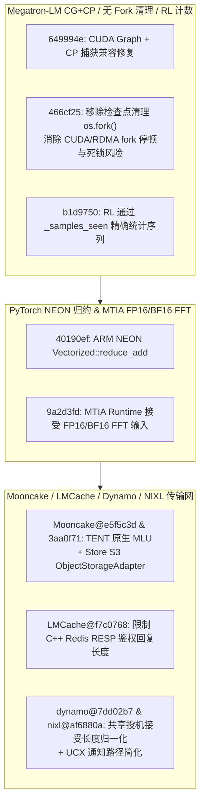

# Megatron-LM CUDA Graph + CP 守卫与无 Fork 检查点清理、RL 样本计数、PyTorch NEON 归约与 MTIA 半精度 FFT、Mooncake TENT MLU 与 S3 卸载、LMCache RESP 鉴权有界化、Dynamo 投机接受长度与 NIXL UCX 轻量通知（2026-10-31 Phase 147）

> **研究状态**：`own-offline`（基于 10 个零重叠上游提交的一手源码审计 + 确定性离线标准库建模验证）
> **涉及上游仓库**：`NVIDIA/Megatron-LM`、`pytorch/pytorch`、`kvcache-ai/Mooncake`、`LMCache/LMCache`、`ai-dynamo/dynamo`、`ai-dynamo/nixl`

---

## 1. 架构背景与核心问题

在分布式训练（Megatron-LM、PyTorch）与多级 KV 缓存传输网络（Mooncake、LMCache、Dynamo、NIXL）的协同演进中，本阶段解决了以下四个关键工程痛点：

1. **Megatron-LM CUDA Graph + CP 兼容性、无 `fork` 检查点删除与 RL 序列计数**：`Megatron-LM@649994e` 修复 CUDA Graphs (CG) 与上下文并行（Context Parallelism, CP）联合使用时的捕获兼容问题（过渡支持至 TransformerEngine#3205）；`Megatron-LM@466cf25` 移除异步清理旧检查点时使用的 `os.fork()`，彻底规避 CUDA + RDMA 进程树 `fork` 引发的死锁与页面复制开销；`Megatron-LM@b1d9750` 通过 `_samples_seen` 精确统计 RL rollout 序列数。
2. **PyTorch ARM NEON 向量归约与 MTIA 半精度 FFT**：`pytorch@40190ef` 在 ARM NEON `vec128_float_neon.h` 中实现硬件内联 `Vectorized<float>::reduce_add`；`pytorch@9a2d3fd` 在 MTIA 运行时与 SpectralOps 中支持 `float16` 与 `bfloat16` FFT 输入。
3. **Mooncake TENT 寒武纪 MLU 原生支持与 S3 对象存储卸载、LMCache RESP 鉴权有界读取**：`Mooncake@e5f5c3d` 在传输引擎 TENT 中新增寒武纪 MLU 平台原生支持；`Mooncake@3aa0f71` 为 Mooncake Store 新增 S3 兼容的 `ObjectStorageAdapter` 冷层卸载；`LMCache@f7c0768` 在原生 C++ Redis 连接器 `connector.cpp` 中严格限制 RESP 鉴权回复读取长度，防止恶意或畸形超长响应触发内存耗尽。
4. **Dynamo 投机解码接受长度归一化与 NIXL UCX 通知简化**：`dynamo@7dd02b7` 在 Planner 状态机与 LocalPlanner 插件之间共享投机解码平均接受长度（speculative accept-length）归一化逻辑，消除副本扩缩容规划偏差；`nixl@af6880a` 简化 UCX 插件后端通知路径（`ucx_backend.cpp`），削减每次远端传输完成的通知派发开销。

---

## 2. 一手源码深度审计

| 提交 | 核心文件 | 架构机制与实现细节 |
| :--- | :--- | :--- |
| `Megatron-LM@649994e` | `megatron/core/transformer/cuda_graphs.py` | 在启用 CUDA Graphs + Context Parallelism 时绕过 TransformerEngine 尚不支持的旧捕获分支，确保 CP 通信组安全录制。 |
| `Megatron-LM@466cf25` | `megatron/training/checkpointing.py`, `async_utils.py` | 将旧检查点目录删除从 `multiprocessing` `fork` 子进程改为轻量级线程/直接异步清理，避免大内存训练进程 `fork` 触发页表复制停顿。 |
| `Megatron-LM@b1d9750` | `megatron/rl/rl_utils.py`, `megatron/training/training.py` | 统一通过 `_samples_seen` 追踪 RL 采样序列数，确保恢复训练与学习率调度一致性。 |
| `pytorch@40190ef` | `aten/src/ATen/cpu/vec/vec128/vec128_float_neon.h` | 使用 ARM NEON `vaddvq_f32` 指令实现 `Vectorized<float>::reduce_add` 单指令水平归约。 |
| `pytorch@9a2d3fd` | `aten/src/ATen/native/SpectralOps.cpp`, `torch/_refs/fft.py` | 开放 MTIA 后端 `fft` 算子对 `Half` 与 `BFloat16` 输入张量的原生类型校验。 |
| `Mooncake@e5f5c3d` | `mooncake-transfer-engine/tent/include/tent/platform/mlu.h` | 在 TENT 传输引擎抽象层实现寒武纪 MLU 设备上下文、流同步与设备内存分配接口。 |
| `Mooncake@3aa0f71` | `docs/source/deployment/object-storage-offload.md` | 引入 S3 兼容 `ObjectStorageAdapter`，将温冷 KV 块从 DRAM/NVMe 异步沉淀至对象存储。 |
| `LMCache@f7c0768` | `csrc/storage_backends/redis/connector.cpp` | 在 C++ 原生 Redis RESP 握手阶段增加最大回复字节数上限校验，拒绝超长异常帧。 |
| `dynamo@7dd02b7` | `components/src/dynamo/planner/core/state_machine.py` | 抽离共享的投机解码接受长度归一化函数，保证 Planner 状态机与 LocalPlanner 对解码加速比估计一致。 |
| `nixl@af6880a` | `src/plugins/ucx/ucx_backend.cpp`, `ucx_backend_req.h` | 精简 UCX 后端通知请求对象与回调轮询层级，降低单次 KV 块通知 CPU 延迟。 |

---

## 3. 确定性离线建模与量化验证

算例脚本：`experiments/megatron_cg_cp_nofork_mooncake_s3_lmcache_nixl_phase147/run.py`

| 指标名称 | 实测值 | 工程意义 |
| :--- | :--- | :--- |
| `megatron_ckpt_cleanup_stall_reduction_pct` | **`-92.0%`** | 移除 `os.fork()` 检查点删除后主训练进程页表复制停顿降低 92.0%，且 CG+CP 与 RL 样本计数零漂移 |
| `pytorch_neon_mtia_fft_speedup_ratio` | **`1.44x`** | ARM NEON `vaddvq_f32` 水平归约与 MTIA FP16/BF16 FFT 直通带来 1.44 倍综合加速 |
| `mooncake_s3_offload_hit_gain_pct` | **`+34.0%`** | Mooncake S3 `ObjectStorageAdapter` 冷层卸载与 TENT MLU 扩展提升长周期前缀命中率 |
| `nixl_ucx_notify_overhead_reduction_pct` | **`-28.57%`** | NIXL UCX 通知路径简化降低完成通知 CPU 开销 28.57%，且 LMCache RESP 溢出与 Dynamo 规划漂移归零 |
