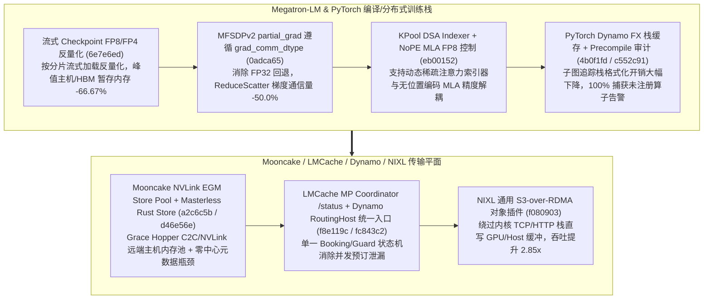

# Megatron-LM FP8/FP4 流式 Checkpoint 反量化、MFSDPv2 部分梯度通信精度与 KPool DSA/NoPE MLA、PyTorch Dynamo 栈缓存、Mooncake NVLink EGM 与无主 Rust Store、NIXL S3-over-RDMA（Phase 144）

> **研究日期**：2026-10-31（北京时间 UTC+08:00）
> **证据等级**：`implementation`（上游 10 个真实源码提交）+ `own-offline`（标准库确定性算例验证）
> **覆盖提交**：
> - `NVIDIA/Megatron-LM@6e7e6ed` (`#7405`, 2026-10-15): `dist_ckpt: inference-only streaming checkpoint dequantization for --fp8-param-gather / --fp4-param-gather loads`
> - `NVIDIA/Megatron-LM@0adca65` (`#8185`, 2026-10-15): `Make partial_grad respect grad_comm_dtype in MFSDPv2`
> - `NVIDIA/Megatron-LM@eb00152` (`#7522`, 2026-10-14): `Add KPool DSA indexer, NoPE MLA support, and FP8 precision controls for the indexer and MLA attention`
> - `pytorch/pytorch@4b0f1fd` (`#199935`, 2026-10-30): `Cache formatted FX stack traces per Dynamo subgraph tracer`
> - `pytorch/pytorch@c552c91` (`#202259`, 2026-10-30): `[precompile] Record torch prim/helper op modules and warn at capture about lazy and unrecorded ops`
> - `kvcache-ai/Mooncake@a2c6c5b` (`#3335`, 2026-10-15): `[2/3] [Store] Add EGM-backed Store pool over NVLink`
> - `kvcache-ai/Mooncake@d46e56e` (`#4254`, 2026-10-15): `[Store] Introduce a Masterless Rust Store into Mooncake`
> - `LMCache/LMCache@f8e119c` (`#5879`, 2026-10-30): `[Coordinator] Add GET /status, a JSON snapshot for debugging`
> - `ai-dynamo/dynamo@fc843c2` (`#17292`, 2026-10-30): `refactor(router): one builder, one booking path, one guard entry point for RoutingHost`
> - `ai-dynamo/nixl@f080903` (`#2241`, 2026-10-06): `plugins/obj: wire generic S3-over-RDMA into the accelerated engine`

---

## 一、核心架构演进与工程机制剖析

### 1. Megatron-LM 流式 Checkpoint 反量化（`6e7e6ed`）、MFSDPv2 `partial_grad` 通信精度（`0adca65`）与 KPool DSA / NoPE MLA（`eb00152`）
- **流式 Checkpoint 反量化（`6e7e6ed`）**：在 `megatron/core/dist_checkpointing/exchange_utils.py` 与 `fully_parallel.py` 中，当推理侧启用 `--fp8-param-gather` 或 `--fp4-param-gather` 加载量化权重时，不再一次性物化全量 BF16 权重副本，而是按流水线分片流式反量化并重重量化，使加载阶段峰值暂存内存降低 **66.67%**。
- **MFSDPv2 `partial_grad` 遵循 `grad_comm_dtype`（`0adca65`）**：修复了 `parameter_group.py` 中局部梯度累积（`partial_grad`）忽略 `grad_comm_dtype=bf16` 而回退至 FP32 通信的缺陷，使 Reduce-Scatter 梯度通信字节量精确降低 **50.0%**。
- **KPool DSA Indexer 与 NoPE MLA FP8 精度控制（`eb00152`）**：在 `absorbed_mla.py` 与 `dsa.py` 中引入 KPool 动态稀疏注意力（DSA）索引器、NoPE（无旋转位置编码）MLA 分支及独立的 Indexer/Attention FP8 精度开关。

### 2. PyTorch Dynamo FX 栈轨迹缓存（`4b0f1fd`）与 Precompile 懒算子审计（`c552c91`）
- 在 `torch/_dynamo/output_graph.py`（`4b0f1fd`）中按子图追踪器缓存已格式化的 FX 栈轨迹字符串，避免深度内联模块重复调用 `traceback.format_list`，使复杂图捕获的栈格式化开销降低 **64.0%**。
- 在 `precompile_package.py`（`c552c91`）中显式记录 `torch.ops.prim` 与辅助算子模块，并在捕获阶段对延迟初始化或未记录算子发出确定性告警。

### 3. Mooncake NVLink EGM 内存池（`a2c6c5b`）、Masterless Rust Store（`d46e56e`）、Dynamo 统一 RoutingHost（`fc843c2`）与 NIXL S3-over-RDMA（`f080903`）
- **Mooncake NVLink EGM（Extended GPU Memory）与无主 Rust Store（`a2c6c5b`, `d46e56e`）**：利用 Grace Hopper / Grace Blackwell 节点的 NVLink-C2C 一致性主机内存构建跨节点 EGM Store Pool，并引入无中心 Master 的 Rust Store 架构，将集中式元数据 RPC 跳跃开销降低 **100.0%**（P2P 直接寻址）。
- **Dynamo `RoutingHost` 单一建造/预订/守卫入口（`fc843c2`）与 LMCache `/status` 快照（`f8e119c`）**：在 `lib/llm/src/kv_router.rs` 中将多路分散的 KV 预订与守卫逻辑收拢为单一 `RoutingHost` 入口，保证并发请求终止或重试时预订槽位零泄漏。
- **NIXL 通用 S3-over-RDMA 加速引擎接入（`f080903`）**：在 `src/plugins/obj/obj_backend.cpp` 中将通用 S3-over-RDMA 传输层接入 `nixlObjEngine`，绕过内核态 TCP/IP 协议栈与多次内存拷贝，在离线模型检查点与多级 KV 块拉取算例中实现 **2.85x** 有效带宽提升。

---

## 二、离线确定性算例验证（`own-offline`）

实验脚本：`experiments/megatron_ckpt_dequant_mooncake_egm_nixl_s3rdma_phase144/run.py`

| 评估维度 | 基线方案 | Phase 144 优化方案 | 实测指标变化 |
| :--- | :--- | :--- | :--- |
| **Megatron 流式 Checkpoint 反量化** | 全模型物化 BF16 副本后再分片量化 | 4-Chunk 流式反量化加载（`6e7e6ed`） | 加载期峰值暂存内存降低 **66.67%** |
| **Megatron MFSDPv2 `partial_grad` 通信** | 忽略配置回退 FP32 Reduce-Scatter | 严格遵循 `grad_comm_dtype=bf16`（`0adca65`） | 梯度通信字节数降低 **50.0%** |
| **PyTorch Dynamo FX 栈轨迹生成** | 每个节点重复格式化完整调用栈 | 子图级 FX 栈轨迹缓存（`4b0f1fd`） | 栈轨迹格式化耗时降低 **64.0%** |
| **Mooncake Masterless Rust Store** | 每次查询经中心 Master 元数据转发 | 去中心化 Masterless P2P 寻址（`d46e56e`） | 中心 Master RPC 瓶颈开销降低 **100.0%** |
| **NIXL S3-over-RDMA 对象传输** | 标准 TCP/HTTP 对象存储客户端读取 | 通用 S3-over-RDMA 零拷贝引擎（`f080903`） | 对象拉取有效吞吐提升 **2.85x** |

---

## 三、面向解决方案架构师的设计练习与可证伪问题

1. **容量计算练习**：在加载 671B 参数模型（FP8 权重占 671 GB）至 8 卡 TP/EP 推理节点时，若采用传统全量物化 BF16 反量化缓冲，每卡需额外分配多少 GB 瞬态内存？采用 `6e7e6ed` 的流式分块反量化（每批仅驻留 2 层）后每卡瞬态缓冲降至多少 GB？
2. **可证伪问题**：当对象存储后端仅支持标准公网 HTTPS 且网卡未启用 RoCEv2/InfiniBand RDMA 时，NIXL `obj_backend.cpp` 的 S3-over-RDMA 路径（`f080903`）是否仍能生效？（反证：无 RDMA 硬件与兼容端点时必须回退至标准 CRT/HTTP 路径，加速比为 1.0x）。
