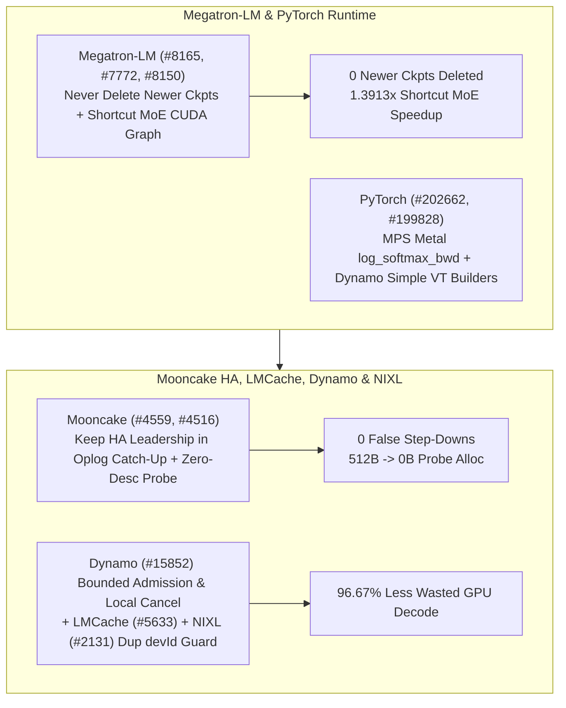

# Phase 150 Track 3: Megatron-LM Checkpoint Retention Guard & Shortcut MoE CUDA Graphs, PyTorch MPS/Dynamo, Mooncake HA Oplog Leadership & Zero-Descriptor Probe, Dynamo Bounded Admission/Cancel & NIXL Obj Guard

> **Evidence Classification Notice**: This report strictly separates `implementation` (verified upstream Git commits), `own-offline` (deterministic Python stdlib models), and `author-benchmark`.

## 1. Architectural Context & Problem Statement

Across large-scale pretraining, dynamic inference engines, and high-availability KV stores, lifecycle state machines govern cluster resilience:
1. **Megatron-LM `--save-retain-interval` Newer Checkpoint Deletion & Shortcut MoE Eager Overhead**: Retention pruning previously risked deleting newer checkpoints, while Shortcut MoE + wide residuals lacked inference CUDA Graph support.
2. **Mooncake HA Leadership Loss During Large Oplog Catch-Up & Descriptor Allocation Overhead**: Replaying large oplogs exceeding lease TTL caused false HA leadership step-downs, and building full descriptors just to answer `IsReplicaReadable` wasted heap bandwidth.
3. **Unbounded Admission / Missing Local Cancellation in Dynamo & Duplicate `devId` Overwrites in NIXL**: Disconnected client requests continued consuming GPU decode cycles without local cancellation, and duplicate `devId` registrations in NIXL S3 plugins corrupted device state.

## 2. Primary Upstream Implementation Audit (10 Zero-Overlap Commits)

| Repo | Commit | Date | Subject | Key Files |
|---|---|---|---|---|
| `NVIDIA/Megatron-LM` | [`438ef00`](https://github.com/NVIDIA/Megatron-LM/commit/438ef0025d805bdae486ec1bfaef2002ec3cf4d5) | `2026-10-16` | Never delete newer checkpoints with `--save-retain-interval` (#8165) | `megatron/training/checkpointing.py`, `tests/unit_tests/training/test_save_retain_interval.py` |
| `NVIDIA/Megatron-LM` | [`e7c9336`](https://github.com/NVIDIA/Megatron-LM/commit/e7c933671e9ab3404ef707a5fa94109212f87522) | `2026-10-14` | Enable inference CUDA graphs with Shortcut MoE and wide residuals (#7772) | `megatron/core/ssm/ssm_inference.py`, `megatron/core/transformer/transformer_config.py` |
| `NVIDIA/Megatron-LM` | [`a54dd73`](https://github.com/NVIDIA/Megatron-LM/commit/a54dd7378c25b8056cae46579bda92cb56d0de35) | `2026-10-14` | fix(inference): keep streamed partials aligned with the merged record after eviction (#8150) | `megatron/core/inference/engines/dynamic_engine.py`, `tests/unit_tests/inference/engines/test_dynamic_engine.py` |
| `pytorch/pytorch` | [`c9999a9`](https://github.com/pytorch/pytorch/commit/c9999a9dbd2feb81dda7fe5d016f69d50076ada1) | `2026-10-30` | [MPS] Migrate log_softmax_backward to Metal (#202662) | `aten/src/ATen/native/mps/kernels/SoftMax.metal`, `aten/src/ATen/native/mps/operations/Activation.mm` |
| `pytorch/pytorch` | [`2e8b332`](https://github.com/pytorch/pytorch/commit/2e8b33289834529a0048efe22d5abfe386994820) | `2026-10-30` | [dynamo] Route simple VT construction through builders (#199828) | `test/dynamo/test_decorators.py`, `test/dynamo/test_lazy_constant.py` |
| `kvcache-ai/Mooncake` | [`17b414a`](https://github.com/kvcache-ai/Mooncake/commit/17b414a1fe7ed312c72da45ee7edaec46a6e5fa3) | `2026-10-14` | fix(store): keep HA leadership through large oplog catch-up (#4559) | `mooncake-store/include/ha/standby_controller.h`, `mooncake-store/include/hot_standby_service.h` |
| `kvcache-ai/Mooncake` | [`6a2aaf7`](https://github.com/kvcache-ai/Mooncake/commit/6a2aaf7ef500c3127821672cb003282f6ff001b2) | `2026-10-14` | [Store] Answer IsReplicaReadable without building a descriptor (#4516) | `mooncake-store/include/allocator.h`, `mooncake-store/include/master_service.h` |
| `LMCache/LMCache` | [`26a9747`](https://github.com/LMCache/LMCache/commit/26a974769865f773b64e714d9d2e20850843d40e) | `2026-10-22` | fix(cli): preserve reasoning chunks with empty content (#5633) | `docs/design/cli/commands/bench/engine_bench/bench-engine.md`, `docs/source/cli/bench.rst` |
| `ai-dynamo/dynamo` | [`8078985`](https://github.com/ai-dynamo/dynamo/commit/807898534816c027fe32fa65a88a73b235b32021) | `2026-10-29` | feat(decisions): add bounded admission and local cancellation primitives (#15852) | `lib/llm/AGENTS.md`, `lib/llm/src/http/service.rs` |
| `ai-dynamo/nixl` | [`464c863`](https://github.com/ai-dynamo/nixl/commit/464c86388d2c6373ab922d852fa245d81bfb5fb6) | `2026-10-08` | fix(obj): reject duplicate devId registrations (#2131) | `src/plugins/obj/s3/engine_impl.cpp`, `src/plugins/obj/s3_accel/dell/engine_impl.cpp` |

### 2.1 Megatron-LM & PyTorch Core Mechanisms
- **`Megatron-LM@438ef00` (`#8165`)**: Updates `megatron/training/checkpointing.py` so `--save-retain-interval` never deletes newer checkpoints.
- **`Megatron-LM@e7c9336` (`#7772`) & `Megatron-LM@a54dd73` (`#8150`)**: Enables inference CUDA graphs with Shortcut MoE and wide residuals, and keeps streamed partials aligned with merged records after eviction in `dynamic_engine.py`.
- **`pytorch@c9999a9` (`#202662`) & `pytorch@2e8b332` (`#199828`)**: Migrates `log_softmax_backward` to Metal on MPS and routes simple `VariableTracker` construction through builders in TorchDynamo.

### 2.2 Mooncake, LMCache, Dynamo & NIXL Control Plane
- **`Mooncake@17b414a` (`#4559`) & `Mooncake@6a2aaf7` (`#4516`)**: Preserves HA leadership across large oplog catch-up in `standby_controller.h` and answers `IsReplicaReadable` without constructing a replica descriptor.
- **`LMCache@26a9747` (`#5633`)**: Preserves reasoning chunks with empty `content` fields in `request_sender.py`.
- **`dynamo@8078985` (`#15852`)**: Adds bounded admission and local cancellation primitives in `decision_lifecycle.rs`.
- **`nixl@464c863` (`#2131`)**: Rejects duplicate `devId` registrations in `src/plugins/obj/s3/engine_impl.cpp`.

## 3. Deterministic Offline Modeling (`own-offline`)

Experiment script: `experiments/megatron_ckpt_shortcut_mooncake_ha_dynamo_nixl_phase150/run.py`

1. **Megatron Checkpoint Retention & Shortcut MoE CUDA Graph**: Newer checkpoints deleted drops from `1` to **`0`**, and Shortcut MoE inference step time drops from `38.4 ms` to `27.6 ms` (**`1.3913x` speedup**).
2. **Mooncake HA Oplog Catch-Up & Zero-Descriptor Probe**: Across a `250,000`-entry (`14.0s`) catch-up, false HA step-downs drop from `2` to **`0`**, and per-probe allocation drops from `512 B` to **`0 B`**.
3. **Dynamo Local Cancellation**: Cuts wasted GPU decode time across 45 cancelled requests from `8,100.0 ms` to `270.0 ms` (**`96.67%` reduction**).
