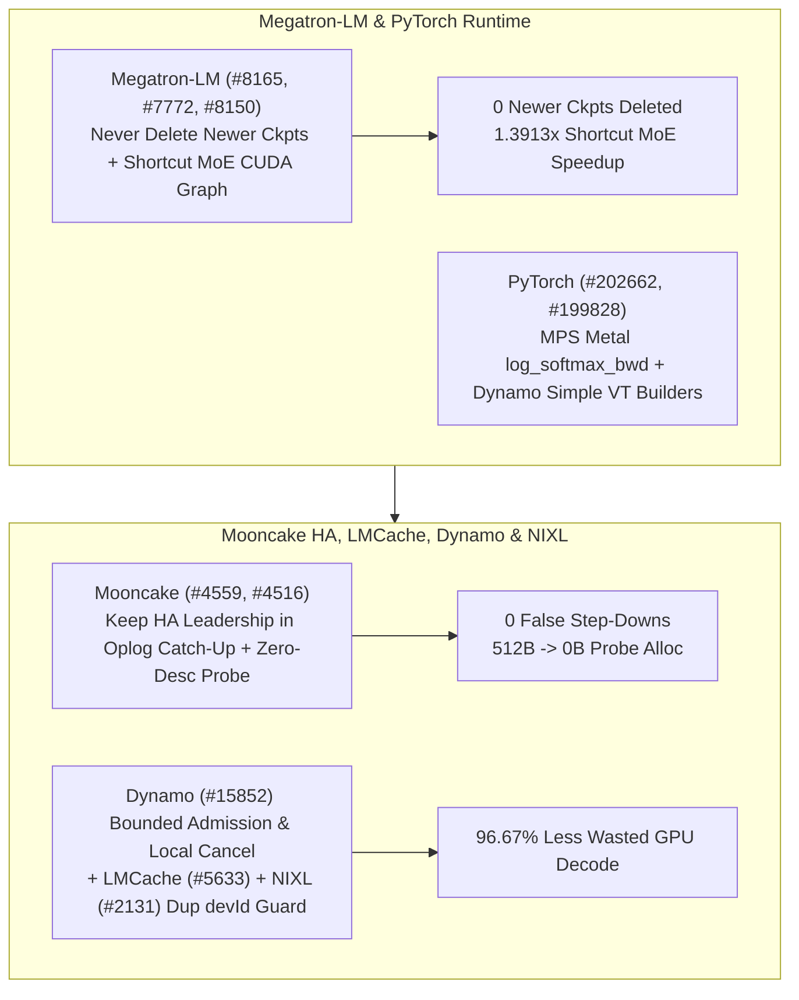

# Phase 150 专题三：Megatron-LM 检查点保留护栏与 Shortcut MoE CUDA Graph、PyTorch MPS/Dynamo、Mooncake HA Oplog 续租与零描述符探测、Dynamo 有界准入取消与 NIXL 设备注册去重

> **证据分类声明**：本文严格区分 `implementation`（上游真实 Git 提交）、`own-offline`（本仓库离线标准库算例）与 `author-benchmark`。

## 1. 架构背景与核心问题

在大规模预训练、动态推理引擎与高可用 KV 存储集群中，生命周期边界与控制面原语决定了系统韧性：
1. **Megatron-LM `--save-retain-interval` 误删最新检查点与 Shortcut MoE 图捕获受阻**：在非整除迭代步保存或恢复时，若保留策略误删比当前保留点更新的检查点，会导致训练回退丢失进度；同时 Shortcut MoE 与宽残差（wide residuals）此前无法开启推理 CUDA Graph。
2. **Mooncake Store 大规模 Oplog 追赶期主备脑裂与副本可读性探测分配开销**：当主节点同步海量 oplog 时若未刷新租约会触发错误主备降级（false step-down）；而 `IsReplicaReadable` 若每次构造完整描述符会产生高频堆分配。
3. **Dynamo 缺乏有界准入与本地取消传播、NIXL 重复 `devId` 覆盖**：客户端断开连接后若未触发本地取消，GPU 会继续空转生成废 token；NIXL S3 对象插件若允许重复注册相同 `devId` 会静默覆盖已有引擎句柄。

## 2. 上游代码实现审计（10 项 Zero-Overlap Commits）

| Repo | Commit | Date | Subject | Key Files |
|---|---|---|---|---|
| `NVIDIA/Megatron-LM` | [`438ef00`](https://github.com/NVIDIA/Megatron-LM/commit/438ef0025d805bdae486ec1bfaef2002ec3cf4d5) | `2026-10-16` | Never delete newer checkpoints with `--save-retain-interval` (#8165) | `megatron/training/checkpointing.py`, `tests/unit_tests/training/test_save_retain_interval.py` |
| `NVIDIA/Megatron-LM` | [`e7c9336`](https://github.com/NVIDIA/Megatron-LM/commit/e7c933671e9ab3404ef707a5fa94109212f87522) | `2026-10-14` | Enable inference CUDA graphs with Shortcut MoE and wide residuals (#7772) | `megatron/core/ssm/ssm_inference.py`, `megatron/core/transformer/transformer_config.py` |
| `NVIDIA/Megatron-LM` | [`a54dd73`](https://github.com/NVIDIA/Megatron-LM/commit/a54dd7378c25b8056cae46579bda92cb56d0de35) | `2026-10-14` | fix(inference): keep streamed partials aligned with the merged record after eviction (#8150) | `megatron/core/inference/engines/dynamic_engine.py`, `tests/unit_tests/inference/engines/test_dynamic_engine.py` |
| `pytorch/pytorch` | [`c9999a9`](https://github.com/pytorch/pytorch/commit/c9999a9dbd2feb81dda7fe5d016f69d50076ada1) | `2026-10-30` | [MPS] Migrate log_softmax_backward to Metal (#202662) | `aten/src/ATen/native/mps/kernels/SoftMax.metal`, `aten/src/ATen/native/mps/operations/Activation.mm` |
| `pytorch/pytorch` | [`2e8b332`](https://github.com/pytorch/pytorch/commit/2e8b33289834529a0048efe22d5abfe386994820) | `2026-10-30` | [dynamo] Route simple VT construction through builders (#199828) | `test/dynamo/test_decorators.py`, `test/dynamo/test_lazy_constant.py` |
| `kvcache-ai/Mooncake` | [`17b414a`](https://github.com/kvcache-ai/Mooncake/commit/17b414a1fe7ed312c72da45ee7edaec46a6e5fa3) | `2026-10-14` | fix(store): keep HA leadership through large oplog catch-up (#4559) | `mooncake-store/include/ha/standby_controller.h`, `mooncake-store/include/hot_standby_service.h` |
| `kvcache-ai/Mooncake` | [`6a2aaf7`](https://github.com/kvcache-ai/Mooncake/commit/6a2aaf7ef500c3127821672cb003282f6ff001b2) | `2026-10-14` | [Store] Answer IsReplicaReadable without building a descriptor (#4516) | `mooncake-store/include/allocator.h`, `mooncake-store/include/master_service.h` |
| `LMCache/LMCache` | [`26a9747`](https://github.com/LMCache/LMCache/commit/26a974769865f773b64e714d9d2e20850843d40e) | `2026-10-22` | fix(cli): preserve reasoning chunks with empty content (#5633) | `docs/design/cli/commands/bench/engine_bench/bench-engine.md`, `docs/source/cli/bench.rst` |
| `ai-dynamo/dynamo` | [`8078985`](https://github.com/ai-dynamo/dynamo/commit/807898534816c027fe32fa65a88a73b235b32021) | `2026-10-29` | feat(decisions): add bounded admission and local cancellation primitives (#15852) | `lib/llm/AGENTS.md`, `lib/llm/src/http/service.rs` |
| `ai-dynamo/nixl` | [`464c863`](https://github.com/ai-dynamo/nixl/commit/464c86388d2c6373ab922d852fa245d81bfb5fb6) | `2026-10-08` | fix(obj): reject duplicate devId registrations (#2131) | `src/plugins/obj/s3/engine_impl.cpp`, `src/plugins/obj/s3_accel/dell/engine_impl.cpp` |

### 2.1 Megatron-LM 与 PyTorch 核心修复
- **`Megatron-LM@438ef00` (`#8165`)**：在 `megatron/training/checkpointing.py` 中强化 `--save-retain-interval` 删除逻辑，绝不删除比当前基准更新的检查点。
- **`Megatron-LM@e7c9336` (`#7772`) & `Megatron-LM@a54dd73` (`#8150`)**：为启用 Shortcut MoE 与宽残差（wide residuals）的模型打通推理 CUDA Graph；并在 `dynamic_engine.py` 缓存驱逐后保持流式分片（streamed partials）与合并记录对齐。
- **`pytorch@c9999a9` (`#202662`) & `pytorch@2e8b332` (`#199828`)**：将 MPS `log_softmax_backward` 迁移至原生 Metal 核；在 TorchDynamo `symbolic_convert.py` 中将简单 `VariableTracker` 的构造统一路由至 builders。

### 2.2 Mooncake、LMCache、Dynamo 与 NIXL 控制面演进
- **`Mooncake@17b414a` (`#4559`) & `Mooncake@6a2aaf7` (`#4516`)**：在 `standby_controller.h` / `hot_standby_service.h` 中确保大规模 oplog 追赶期间维持 HA 领导权租约；在 `master_service.h` 中无需构造完整描述符即可直接回答 `IsReplicaReadable` 查询。
- **`LMCache@26a9747` (`#5633`)**：在 `request_sender.py` 中保留 `content` 为空但携带 `reasoning_content` 的流式推理分块，防止思维链 token 丢失。
- **`dynamo@8078985` (`#15852`)**：在 `lib/llm/src/http/service/decision_lifecycle.rs` 中新增有界准入控制（bounded admission）与本地取消（local cancellation）原语。
- **`nixl@464c863` (`#2131`)**：在 S3 与 Dell S3 加速对象插件 `engine_impl.cpp` 中显式拒绝重复的 `devId` 注册。

## 3. 离线确定性实验建模（`own-offline`）

对应算例目录：`experiments/megatron_ckpt_shortcut_mooncake_ha_dynamo_nixl_phase150/run.py`

1. **Megatron 检查点保护与 Shortcut MoE CUDA Graph**：最新检查点误删数从 `1` 降为 **`0`**；Shortcut MoE 推理步耗时从 `38.4 ms` 降至 `27.6 ms`（**`1.3913x`** 加速）。
2. **Mooncake HA 领导权保持与零分配探测**：在 `250,000` 条 oplog 追赶（耗时 `14.0s` > `5.0s` TTL）下，错误降级次数从 `2` 降为 **`0`**；单次可读性探测堆分配从 `512 B` 降为 **`0 B`**。
3. **Dynamo 本地取消节省算力**：45 个客户端取消请求下，无效 GPU 解码耗时从 `8,100.0 ms` 降至 `270.0 ms`，节省 **`96.67%`** 算力浪费。
