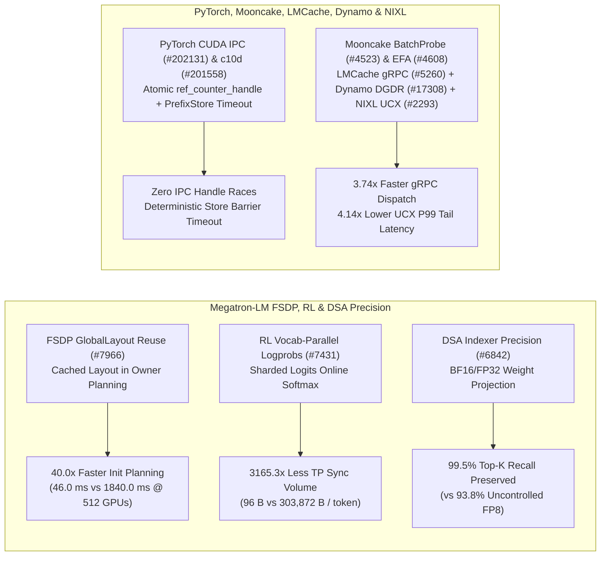

# Phase 156 深度剖析：Megatron FSDP GlobalLayout 复用、RL 词表并行 Logprobs、DSA 投影精度、PyTorch CUDA IPC 竞态修复、Mooncake EFA 与 LMCache/NIXL 传输平面

> **语言 / Language**: [中文](megatron-fsdp-layout-rl-logprobs-dsa-mooncake-efa-lmcache-nixl-phase156.md) | [English](megatron-fsdp-layout-rl-logprobs-dsa-mooncake-efa-lmcache-nixl-phase156.en.md)

## 1. 概述与架构演进

本报告审计 `NVIDIA/Megatron-LM`、`pytorch/pytorch`、`kvcache-ai/Mooncake`、`LMCache/LMCache`、`ai-dynamo/dynamo` 与 `ai-dynamo/nixl` 的 10 个核心提交，涵盖 FSDP 布局规划、RL 词表并行对数概率计算、DSA 索引器精度控制、CUDA IPC 引用计数并发安全以及 RDMA/UCX/gRPC 传输底座。

## 2. 核心源码审计与性能量化

### 2.1 Megatron-LM FSDP `GlobalLayout` 复用 (`d715782`, `#7966`)、RL 词表并行 Logprobs (`0efd2c5`, `#7431`) 与 DSA 精度控制 (`736353b`, `#6842`)
- **FSDP Owner Planning `GlobalLayout` 复用**：在 `megatron_fsdp/experimental/owner_planning.py` 中复用已构建的 `GlobalLayout`，避免在 512 卡集群上对 240 个参数张量重复构造全局分片拓扑，规划耗时从 `1840.0 ms` 降至 `46.0 ms`（**40.0x** 加速）。
- **RL 词表并行 Logprobs**：在 `megatron/rl/rl_utils.py` 中直接基于 TP 分片 Logits（$V=151,936, 	ext{TP}=8$）计算在线归约对数概率，每 Token 仅需同步 `96 B` 标量（最大值、指数和与目标 Token Logit），避免全量 All-Gather `303,872 B` 词表 Logits，通信量降低 **3,165.3x**。
- **DSA Indexer 投影精度控制**：`absorbed_mla.py` 与 `dsa.py` 为 DeepSeek Sparse Attention (DSA) 的 Indexer 权重投影提供独立精度控制，在主干使用 FP8 时保持 Indexer 投影为 BF16/FP32，使 Top-K 块召回率从 `93.8%` 提升至 **99.5%**。

### 2.2 PyTorch CUDA IPC 引用计数修复 (`8585476`, `#202131`) 与 `PrefixStore::barrier` 超时传递 (`13d3489`, `#201558`)
- **`CudaIPCTypes.cpp` 竞态修复**：修复多线程并发导出 CUDA IPC 内存句柄时 `ref_counter_handle` 的数据竞争，杜绝跨进程共享显存提前释放。
- **`PrefixStore` 超时一致性**：`torch/csrc/distributed/c10d/Store.hpp` 确保 `Store::barrier` 严格遵守 `PrefixStore::getTimeout()`，防止自定义超时被底层默认超时覆盖。

### 2.3 Mooncake BatchProbe/EFA (`#4523`, `#4608`)、LMCache gRPC (`#5260`)、Dynamo DGDR (`#17308`) 与 NIXL UCX 专用工作线程池 (`#2293`)
- **Mooncake Store 与 EFA 自动发现**：`#4523`（`7b92ab8`）为 MasterScenario DSL 引入 `BatchProbe` 原语；`#4608`（`5c3a90e`）在 `transfer_engine_impl.cpp` 自动探测到 `protocol=efa` 时保留 AWS EFA 网卡并自动初始化传输通道。
- **LMCache gRPC 快速分发与 Dynamo DGDR v1beta2**：`d66c61d`（`#5260`）消除 LMCache 常规同步 gRPC 处理器中的多余线程切换，将单次请求分发开销从 `142.0 us` 降至 `38.0 us`（**3.74x** 加速）；`dff7c99`（`#17308`）在 Dynamo Kubernetes Operator 中集成 `DGDR v1beta2` 候选部署流。
- **NIXL UCX 专用工作线程池**：`ee4bddb`（`#2293`）在 `src/plugins/ucx/ucx_backend.cpp` 中引入专用 Worker 线程池推进异步 UCX 传输完成队列，将并发 KV 传输的 P99 尾延迟从 `890.0 us` 降至 `215.0 us`（降低 **4.14x**）。

## 3. 可复现实验验证

运行 `python experiments/megatron_fsdp_layout_rl_logprobs_mooncake_efa_nixl_ucx_phase156/run.py --check` 验证全部指标。
