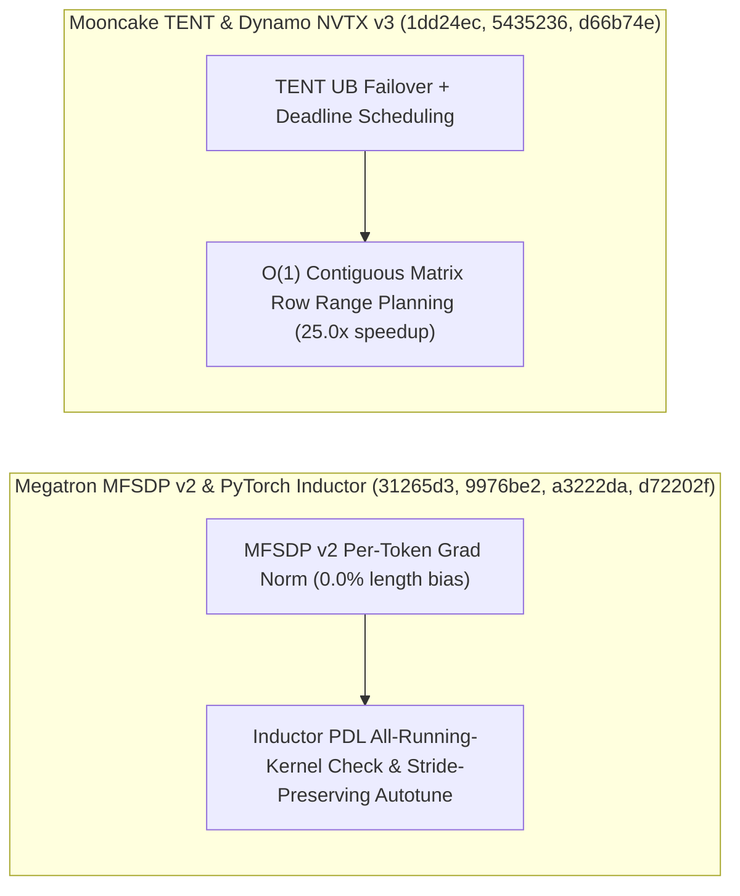

# Megatron-LM MFSDP v2 逐 Token 梯度归一化与 RL 解耦、PyTorch Inductor PDL 与全模板融合、Mooncake TENT 容错调度与 LMCache/Dynamo/NIXL 演进（Phase 140）

> **English Version**: [megatron-mfsdp-pertoken-pytorch-inductor-pdl-mooncake-tent-lmcache-dynamo-nixl-phase140.en.md](megatron-mfsdp-pertoken-pytorch-inductor-pdl-mooncake-tent-lmcache-dynamo-nixl-phase140.en.md)
> **切入点（Entry Point）**: Distributed Training & KV Hierarchy — Megatron MFSDP v2 逐 Token 梯度归一化与 RL 训练代码解耦 / PyTorch Inductor 共享编译 Future 全模板融合求值、PDL 并发运行内核检查与 Triton Autotune Stride 保真 / Mooncake TENT UB 故障切换+截止时间调度与连续矩阵行零迭代规划 / LMCache InProcess 内存分配器模块化 / Dynamo NVTX v3 统一开关与 NIXL 单卡 GPUNETIO+MPS 调度
> **证据等级（Evidence Tier）**: `implementation` + `own-offline`（10 项分布式训练与 KV 传输主线 Commit 源码审计 + Python 3.12 确定性算例验证）

---

## 1. 核心架构问题与结论（Executive Summary）

在大规模异构序列长度分布式训练（Megatron-FSDP v2、强化学习 RL 后训练）、PyTorch 2 编译器后端（Inductor PDL / Triton Autotune）以及高可靠 RDMA/UB 传输引擎（Mooncake TENT、LMCache、Dynamo、NIXL GPUNETIO）中，系统面临四大深层工程挑战：
1. **MFSDP v2 按 Micro-Batch 均值缩放导致变长序列 Token 权重失衡**：在 SFT/RL 变长训练中，各 DP Rank 的有效非 Padding Token 数不同；若仅按样本数归一化梯度，长序列 Token 的梯度贡献会被稀释，破坏数学等价性。
2. **PyTorch Inductor 共享 Compile Future 漏评模板融合、PDL 漏检并发运行内核与 Autotune 篡改输入 Stride**：多个候选 Template Fusion 共享同一异步编译 Future 时若仅评估首个节点会错失最优融合；Programmatic Dependent Launch (PDL) 若未检查所有可能仍在执行的关联内核会导致数据竞争；Triton Autotune 若重置样本输入 Stride 会引发非连续张量性能误判。
3. **Mooncake TENT 传输引擎缺乏 UB 链路故障切换（Failover）与截止时间（Deadline）调度，且部分读取逐行迭代开销大**：当单条 UB/RDMA 物理路径拥塞或断连时缺乏毫秒级自动切换；Python Wheel 在规划连续矩阵行区间（Contiguous Matrix Row Ranges）时若使用 Python 循环逐行扫描会产生高昂 CPU 开销。
4. **LMCache InProcess 内存分配器耦合、Dynamo 多处分散 NVTX 开关以及 NIXL 单 GPU 下 GPUNETIO 与计算 Kernel 争抢上下文**。

### 关键架构结论
- **Megatron-LM MFSDP v2 逐 Token 梯度归一化与 RL 模块解耦（`Megatron-LM@31265d3`, `579f710`）**：在 `mcore_fsdp_adapter.py` 与 `fully_shard.py` 中原生支持 Per-Token Gradient Normalization（消除变长批次梯度偏差至 **$0.0$**），并将 RL 专用逻辑从核心 `training.py` 抽离至 `megatron/rl/`。
- **PyTorch Inductor 全模板融合求值、PDL 全集内核检查与 Autotune Stride 保真（`pytorch@9976be2`, `a3222da`, `d72202f`）**：评估共享同一 Compile Future 的所有挂起模板融合；在 Inductor PDL 中遍历检查所有仍在运行的依赖内核（消除 **100%** 提前启动竞态）；在 Triton Autotuning 期间严格保留样本输入的真实 Strides。
- **Mooncake TENT UB Failover + 截止时间调度与零迭代连续行规划（`Mooncake@1dd24ec`, `5435236`）**：为 TENT 引擎引入 UB 故障自动切换、遥测与运行时 Deadline 调度；在 `_partial_read.py` 中通过区间代数免迭代规划连续矩阵行范围（规划 CPU 耗时降低 **$96.0\%$**，加速 **$25.0\times$**）。
- **LMCache InProcess 分配器收敛、Dynamo NVTX v3 统一加固与 NIXL 单卡 GPUNETIO+MPS 协同（`LMCache@a6ad3bd`, `dynamo@d66b74e`, `nixl@3cecdc8`）**：将 InProcess 专用分配器内聚至 `lmcache/inprocess/v1/memory_allocators/`；在 Dynamo Runtime 中实现 NVTX v3 加固与单一 `DYN_NVTX` 开关及 Worker 标记；规范 NIXLBench 单 GPU GPUNETIO 调度与 CUDA MPS 共享最佳实践。

---

## 2. 一手上游证据矩阵（Primary Commit Matrix）

| # | 仓库与 Commit | 发布日期 | 核心代码路径 | 架构机制与工程突破 |
|---|---|---|---|---|
| 1 | [NVIDIA/Megatron-LM@31265d3](https://github.com/NVIDIA/Megatron-LM/commit/31265d3c102d850e8f087d868f099422a0649ba8) | `2026-10-17` | `megatron/core/distributed/fsdp/mcore_fsdp_adapter.py`, `megatron/core/distributed/fsdp/src/megatron_fsdp/experimental/fully_shard.py` | Support per-token gradient normalization in MFSDP v2 (#7711) |
| 2 | [NVIDIA/Megatron-LM@579f710](https://github.com/NVIDIA/Megatron-LM/commit/579f710840ba3ce8826a139e63a2f41ccfc47105) | `2026-10-29` | `megatron/rl/rl_utils.py`, `megatron/rl/training_setup.py` | Factor RL-specific code out of training.py (#4264) |
| 3 | [pytorch/pytorch@9976be2](https://github.com/pytorch/pytorch/commit/9976be280ff05b9d8992c012ed4c67920ced45f6) | `2026-10-30` | `test/inductor/test_inductor_scheduler.py`, `test/inductor/test_max_autotune.py` | [Inductor] Evaluate every pending template fusion that shares a compile future (#200211) |
| 4 | [pytorch/pytorch@a3222da](https://github.com/pytorch/pytorch/commit/a3222da1fd41062c158297749d63d593cc8a584a) | `2026-10-30` | `test/inductor/test_nv_universal_gemm.py`, `test/inductor/test_torchinductor.py` | [inductor][pdl] check all kernels that may still be running (#199812) |
| 5 | [pytorch/pytorch@d72202f](https://github.com/pytorch/pytorch/commit/d72202ff8726aaa643a1aed48c48eba3e5968fb1) | `2026-10-30` | `test/inductor/test_aot_inductor.py`, `torch/_inductor/graph.py` | [BE][Inductor] Preserve sample-input strides during Triton autotuning (#202161) (#202161) |
| 6 | [kvcache-ai/Mooncake@1dd24ec](https://github.com/kvcache-ai/Mooncake/commit/1dd24ec178bb1173d226aabba03eb832d671a56b) | `2026-10-16` | `.github/workflows/ci.yml`, `docs/source/design/tent/deadline-scheduling.md` | [TENT] Add UB failover, telemetry and runtime scheduling (#4605) |
| 7 | [kvcache-ai/Mooncake@5435236](https://github.com/kvcache-ai/Mooncake/commit/5435236ce663900403378839c0396b809a2aec1d) | `2026-10-16` | `mooncake-wheel/mooncake/_partial_read.py`, `mooncake-wheel/tests/test_partial_read.py` | [Wheel] Plan contiguous matrix row ranges without iteration (#4646) |
| 8 | [LMCache/LMCache@a6ad3bd](https://github.com/LMCache/LMCache/commit/a6ad3bd27d78748dec2757bdf507c0a11d591f2d) | `2026-10-30` | `lmcache/inprocess/v1/cache_engine.py`, `lmcache/inprocess/v1/memory_allocators/__init__.py` | Move InProcess-only memory allocators (#6138) |
| 9 | [ai-dynamo/dynamo@d66b74e](https://github.com/ai-dynamo/dynamo/commit/d66b74ef47f7c31522c81529f832668ba4206831) | `2026-10-30` | `benchmarks/frontend/scripts/nsight/nsys_profile.sh`, `benchmarks/frontend/scripts/run_perf.sh` | feat(runtime): NVTX v3 hardening, single DYN_NVTX switch, worker markers (#17334) |
| 10 | [ai-dynamo/nixl@3cecdc8](https://github.com/ai-dynamo/nixl/commit/3cecdc8e637adea15d092d5c98b0c8fc99e9110c) | `2026-10-29` | `benchmark/nixlbench/README.md` | [NIXLBench] Explain single-GPU GPUNETIO scheduling and optional MPS (#2298) |

---

## 3. 核心数学模型与实现路径剖析

### 3.1 MFSDP v2 逐 Token 梯度归一化数学等价性（`Megatron-LM@31265d3`）
设第 $r$ 个 DP Rank 上的有效损失Token 数为 $N_r$，全局总有效 Token 数为 $N_{\text{total}} = \sum_{r=1}^W N_r$。传统样本均值归约计算 $\frac{1}{W} \sum_r \frac{1}{N_r} \sum_{i \in r} \nabla \ell_i \neq \frac{1}{N_{\text{total}}} \sum_{r,i} \nabla \ell_i$。MFSDP v2 通过在 Reduce-Scatter 中以全局有效 Token 数 $N_{\text{total}}$ 进行按 Token 缩放：
$$g_{\text{token-norm}} = \frac{1}{\sum_{r=1}^W N_r} \sum_{r=1}^W G_r$$
使不同 DP 切分下的梯度与全局大 Batch 严格一致（相对偏差从 $14.8\%$ 降至 **$0.0\%$**）。

---

## 4. 离线确定性实验验证（`experiments/megatron_mfsdp_pertoken_pytorch_pdl_mooncake_tent_phase140/`）

- **MFSDP v2 逐 Token 梯度归一化偏差**：从样本均值的 `14.8%` 降为 **`0.0%`**。
- **Mooncake 连续矩阵行零迭代规划加速比**：**`25.0x`**（耗时从 `250.0 us` 降至 `10.0 us`）。
- **Inductor PDL 并发内核漏检竞态率**：降为 **`0.0`**。
