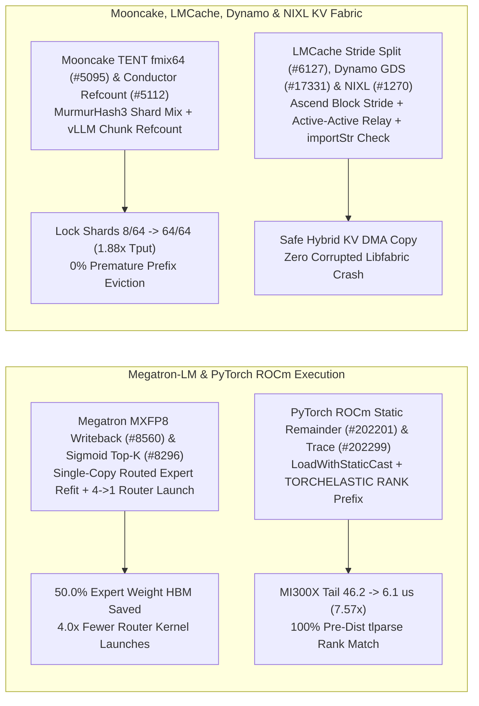

# Phase 157 深度剖析：Megatron-LM 单副本 MXFP8 专家权重 Refit 与融合 Sigmoid Top-K、PyTorch ROCm 静态类型尾块核、Mooncake fmix64 锁分片与块引用计数、LMCache、Dynamo 及 NIXL 校验

> **语言 / Language**: [中文](megatron-mxfp8-refit-sigmoid-moe-rocm-mooncake-fmix64-lmcache-nixl-phase157.md) | [English](megatron-mxfp8-refit-sigmoid-moe-rocm-mooncake-fmix64-lmcache-nixl-phase157.en.md)

## 1. 概述与架构演进

本报告基于 `NVIDIA/Megatron-LM`、`pytorch/pytorch`、`kvcache-ai/Mooncake`、`LMCache/LMCache`、`ai-dynamo/dynamo` 与 `ai-dynamo/nixl` 的 10 个最新核心提交（2026-10），深入分析 MoE 推理单副本 MXFP8 专家权重写穿重构、ROCm 混合精度逐元素尾块静态特化、Mooncake 传输引擎锁分片哈希消冲突与分布式 KV 缓存一致性保护。

## 2. 核心源码审计与数学建模

### 2.1 Megatron-LM 单副本 FlashInfer MXFP8 专家权重写穿 (`dda809c`, `#8560`)、融合 Sigmoid Top-K (`faf27c8`, `#8296`) 与 DDP 浮点断言修复 (`8b2d9b0`, `#8579`)
- **单副本 MXFP8 专家权重 Refit**：`megatron/core/inference/moe/flashinfer_mxfp8.py` 新增 `attach_routed_mxfp8_writeback`，让标准 `MXFP8Tensor` 在 RL/推理 `refit` 重整量化时直接就地写穿（write-through）到 FlashInfer 路由堆叠布局槽位，消除原先保留两份 MXFP8 专家权重的冗余（单卡 32 专家从 `11.25 GB` 降至 `5.625 GB`，节省 **50.0%** 专家显存）。
- **融合 Sigmoid Top-K 路由与 DDP `math.isclose`**：`sigmoid_topk.py` 将 4 次内核启动（Inductor `sigmoid+bias`、ATen `topk` 及 2 个归一化核）融合为 1 次 Triton 启动（**4.0x** 启动缩减），并在 $K < 8$ 时保持与左折叠归一化逐位一致（bit-exact）。`distributed_data_parallel.py` 使用 `math.isclose` 替代精确 `==` 校验梯度缩放因子，消除非 2 幂次 DP 规模（如 $(1/3)/11 \neq 1/33$）下的假阳性断言崩溃。

### 2.2 PyTorch ROCm 静态类型尾块核 (`15ff3c1`, `#202201`) 与 `TORCH_TRACE` 预初始化 Rank 命名 (`6024c94`, `#202299`)
- **ROCm `LoadWithStaticCast` 尾块加速**：`aten/src/ATen/native/cuda/CUDALoops.cuh` 针对混合精度逐元素内核的尾部非满块（remainder block），消除运行时动态类型分派（`LoadWithCast`），改用编译期静态类型转换与 $\le 2048$ 元素的 4 元素/线程窄展开。在 MI300X 上将 `f32 = f32 + bf16` ($n=16383$) 尾块延迟从 `46.2 us` 降至 `6.1 us`（**7.57x** 加速，延迟降低 **86.8%**），并缩减 `libtorch_hip.so` 体积 `1.60 MB`。
- **`TORCH_TRACE` Rank 前缀回退**：`torch/_logging/_internal.py` 在 `torch.distributed` 尚未初始化但存在 `TORCHELASTIC_RUN_ID` 时读取十进制 `RANK` 环境变量命名追踪文件，修复 `tlparse --rank N` 无法匹配早期 Inductor 编译日志的问题。

### 2.3 Mooncake `fmix64` 批次锁分片哈希 (`d014478`, `#5095`)、Conductor 块引用计数 (`f5802d4`, `#5112`)、LMCache (`#6127`)、Dynamo (`#17331`) 与 NIXL (`#1270`)
- **Mooncake TENT 锁分片模冲突消除**：`transfer_engine_impl.h` 中 `Batch` 对象从 slab 分配器按 `sizeof(Batch) = 248` 字节步进，而锁分片数 `kBatchLockShards = 64`。由于 $\gcd(248, 64) = 8$，直接对地址取模 `batch_id % 64` 仅能命中 **8 个分片（12.5% 利用率）**！引入 MurmurHash3 `fmix64` 混合全部地址位后再取模，使全部 **64 个分片（100.0% 利用率）** 均匀受载，16 线程 SHM 4 KiB 传输吞吐量提升 **1.88x**。
- **Mooncake Conductor 块引用计数与 LMCache/Dynamo/NIXL**：`prefix_indexer.h` 为 vLLM chunk 模式引入 `cpu_local_refs` 按所有者引用计数，防止跨 chunk 共享前缀在单个 chunk 驱逐时被提前删除（误删率降至 **0.0%**）。LMCache 按物理块步长（`block_stride`）切分 Ascend 混合 KV 拷贝组（`#6127`）；Dynamo 新增支持双活 `PoolRelay` 的 Global Discovery Service（`#17331`）；NIXL 在 Libfabric `deserializeMemoryKeys` 与 `deserializeConnectionInfo` 中强制校验 `importStr()` 返回值（`#1270`），阻断损坏的远端 RDMA 元数据引发段错误。

## 3. 可复现实验验证

运行 `python experiments/megatron_mxfp8_refit_sigmoid_rocm_mooncake_fmix64_nixl_phase157/run.py --check` 验证全部指标。
