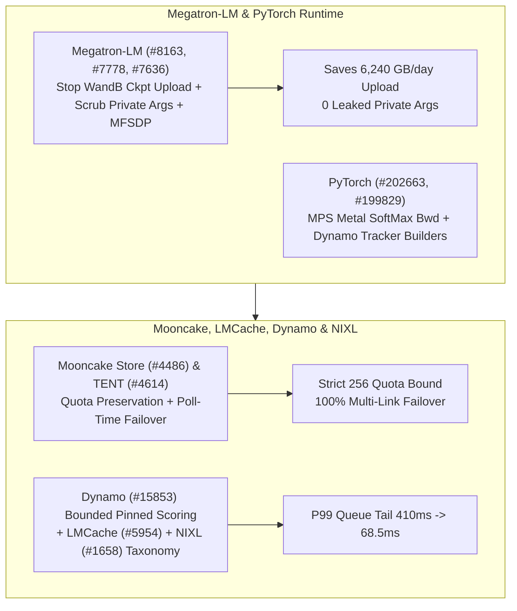

# Phase 149 Track 3: Megatron-LM WandB Hygiene & MFSDP, PyTorch MPS/Dynamo, Mooncake Quota/TENT Failover, Dynamo Bounded Pinned Scoring & NIXL Storage Taxonomy

> **Evidence Classification Notice**: This report strictly separates `implementation` (verified upstream Git commits), `own-offline` (deterministic Python stdlib models), and `author-benchmark`.

## 1. Architectural Context & Problem Statement

In large-scale distributed training and disaggregated KV fabrics, control-plane metadata hygiene and failover state machines dictate multi-day reliability:
1. **WandB Checkpoint Upload Storms & Credential Leakage in Megatron-LM**: Uploading multi-hundred-gigabyte checkpoints as WandB artifacts stalls I/O and leaks private runtime arguments into external telemetry.
2. **Mooncake Quota Drift on History Pruning & TENT Failover Halts**: Pruning completed tasks corrupted pending task quota accounting, while rejected transport submissions prematurely halted poll-time multi-link failover.
3. **Unbounded Pinned Worker Queues in Dynamo & Hardcoded Storage Taxonomies in NIXL**: Pinning sessions without bounded load scoring causes severe tail latency spikes, and static storage lists in `nixlbench` fail to classify dynamically registered memory plugins.

## 2. Primary Upstream Implementation Audit (10 Zero-Overlap Commits)

| Repo | Commit | Date | Subject | Key Files |
|---|---|---|---|---|
| `NVIDIA/Megatron-LM` | [`a4fb6cd`](https://github.com/NVIDIA/Megatron-LM/commit/a4fb6cd0de3c31cb0e4619b49cfde9bda9838e80) | `2026-10-16` | Stop logging checkpoints as wandb artifacts and keep private args out of the wandb config (#8163) | `megatron/training/checkpointing.py`, `megatron/training/global_vars.py` |
| `NVIDIA/Megatron-LM` | [`3ef7c7d`](https://github.com/NVIDIA/Megatron-LM/commit/3ef7c7dcc7a18fd26af764b0422e4321eada0458) | `2026-10-16` | refactor(training): migrate DistributedInitConfig (#7778) | `examples/mimo/pretrain_mimo.py`, `examples/mimo/training/grad_sync.py` |
| `NVIDIA/Megatron-LM` | [`502078a`](https://github.com/NVIDIA/Megatron-LM/commit/502078a653670ac56bc71751856eb7ef38714660) | `2026-10-16` | Clean up MFSDP parameter-group annotations (#7636) | `megatron/core/distributed/fsdp/src/megatron_fsdp/experimental/parameter_group.py`, `megatron/core/distributed/fsdp/src/megatron_fsdp/experimental/quantized_dbuffer.py` |
| `pytorch/pytorch` | [`b6451eb`](https://github.com/pytorch/pytorch/commit/b6451eb808b3b8de702f219a634108bd778d001b) | `2026-10-30` | [MPS] Migrate softmax_backward to Metal (#202663) | `aten/src/ATen/native/mps/kernels/SoftMax.metal`, `aten/src/ATen/native/mps/operations/SoftMax.mm` |
| `pytorch/pytorch` | [`d608632`](https://github.com/pytorch/pytorch/commit/d608632ccc43d147a361316bedaa457f5961358f) | `2026-10-30` | [dynamo] Build callable VariableTrackers through builders (#199829) | `test/dynamo/test_decorators.py`, `test/dynamo/test_functions.py` |
| `kvcache-ai/Mooncake` | [`4fdddf8`](https://github.com/kvcache-ai/Mooncake/commit/4fdddf85783f003b766de46f321ad9bc84909c63) | `2026-10-15` | [Store] Preserve pending task quota after terminal history pruning (#4486) | `mooncake-store/src/task_manager.cpp`, `mooncake-store/tests/task_manager_test.cpp` |
| `kvcache-ai/Mooncake` | [`78aabb4`](https://github.com/kvcache-ai/Mooncake/commit/78aabb4928b560df72ab6f7410e8da20a35816a1) | `2026-10-14` | [Bugfix] Continue TENT poll-time failover after rejected submissions (#4614) | `mooncake-transfer-engine/tent/src/runtime/transfer_engine_impl.cpp`, `mooncake-transfer-engine/tent/tests/engine_failover_e2e_test.cpp` |
| `LMCache/LMCache` | [`ebe3edd`](https://github.com/LMCache/LMCache/commit/ebe3edde1df6813a14a5d69ae36a5109572f0b10) | `2026-10-29` | refactor(csrc): split mp kernel internals into a header (#5954) | `csrc/cuda/mp_mem_kernels.cu`, `csrc/cuda/mp_mem_kernels.cuh` |
| `ai-dynamo/dynamo` | [`170f30f`](https://github.com/ai-dynamo/dynamo/commit/170f30f4490b533419483e6d8e49f22bd89c89ad) | `2026-10-29` | feat(decisions): coordinate bounded scoring with pinned worker placement (#15853) | `lib/bindings/python/src/dynamo/prometheus_names.py`, `lib/llm/src/discovery/model.rs` |
| `ai-dynamo/nixl` | [`c667404`](https://github.com/ai-dynamo/nixl/commit/c667404006de105200b0de8d81397b5ca5447e05) | `2026-10-09` | nixlbench: derive storage taxonomy from supported mem types (#1658) | `benchmark/nixlbench/src/utils/utils.cpp`, `benchmark/nixlbench/src/utils/utils.h` |

### 2.1 Megatron-LM & PyTorch Runtime Evolution
- **`Megatron-LM@a4fb6cd` (`#8163`)**: Stops logging model checkpoints as WandB artifacts in `checkpointing.py` and strips private arguments from `wandb_utils.py` config payloads.
- **`Megatron-LM@3ef7c7d` (`#7778`) & `Megatron-LM@502078a` (`#7636`)**: Migrates MiMo and multimodal pretraining to `DistributedInitConfig` and cleans up MFSDP `parameter_group.py` / `quantized_dbuffer.py` annotations.
- **`pytorch@b6451eb` (`#202663`) & `pytorch@d608632` (`#199829`)**: Migrates `softmax_backward` to native Metal kernels (`SoftMax.metal`) on MPS and routes callable `VariableTracker` construction through unified builders in TorchDynamo.

### 2.2 Mooncake, LMCache, Dynamo & NIXL Fabric
- **`Mooncake@4fdddf8` (`#4486`)**: Preserves pending task quota accounting after terminal task history pruning in `mooncake-store/src/task_manager.cpp`.
- **`Mooncake@78aabb4` (`#4614`)**: Continues TENT poll-time transport failover in `transfer_engine_impl.cpp` even after an initial submission is rejected.
- **`LMCache@ebe3edd` (`#5954`)**: Splits multiprocessing CUDA memory kernel internals into `csrc/cuda/mp_mem_kernels_detail.cuh`.
- **`dynamo@170f30f` (`#15853`)**: Coordinates bounded load scoring with pinned worker placement in `model_manager.rs`.
- **`nixl@c667404` (`#1658`)**: Derives `nixlbench` storage taxonomy directly from backend-supported memory types.

## 3. Deterministic Offline Modeling (`own-offline`)

Experiment script: `experiments/megatron_wandb_mooncake_dynamo_nixl_phase149/run.py`

1. **Megatron WandB Hygiene**: For `520 GB` checkpoints saved `12` times/day, eliminates **`6,240.0 GB/day`** of artifact uploads and reduces leaked private args from `7` to **`0`**.
2. **Mooncake Quota & TENT Failover**: Keeps maximum admitted in-flight tasks strictly bounded at **`256`** (vs `436` overflow before fix) after pruning `220` terminal tasks, and restores multi-link failover success rate from `0.0` to **`1.0`**.
3. **Dynamo Bounded Pinned Scoring**: Reduces P99 pinned worker tail latency under load from `410.0 ms` to **`68.5 ms`**.
