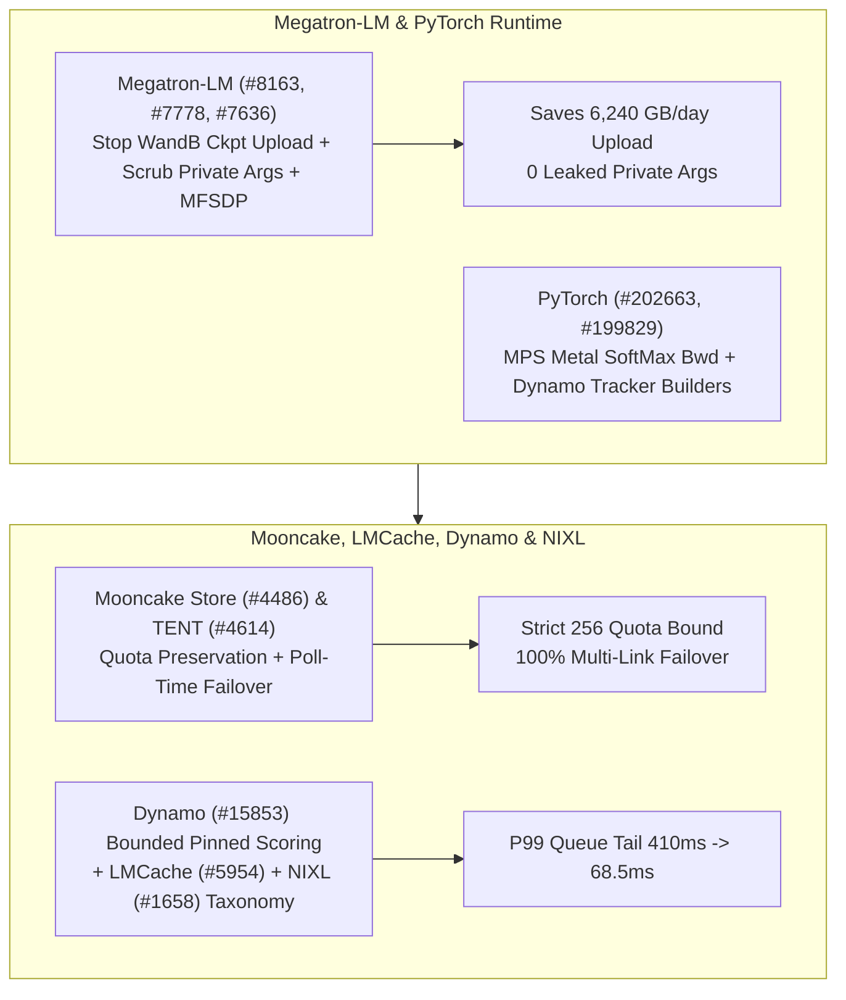

# Phase 149 专题三：Megatron-LM WandB 安全治理与 MFSDP、PyTorch MPS/Dynamo、Mooncake 配额/TENT 故障切换、Dynamo 有界打分与 NIXL 存储分类学

> **证据分类声明**：本文严格区分 `implementation`（上游真实 Git 提交）、`own-offline`（本仓库离线标准库算例）与 `author-benchmark`。

## 1. 架构背景与核心问题

在大规模分布式训练与分离式 KV 传输底座中，控制面元数据治理与异常恢复决定了长稳运行能力：
1. **Megatron-LM WandB 构件上传风暴与敏感参数泄露**：将数千 GB 权重检查点作为 WandB Artifact 上传会阻塞训练 I/O 并耗尽云存储，且未过滤的私有配置参数存在凭据泄露风险。
2. **Mooncake Store 历史修剪配额失真与 TENT 轮询故障切换中断**：当已完成任务从历史表修剪时，若错误扣减挂起配额计数，将导致排队溢出；同时 TENT 传输引擎在提交被拒后若停止轮询期故障切换，会导致多链路降级失效。
3. **Dynamo 固定 Worker 放置的尾部排队失控与 NIXL 存储内存分类耦合**：固定会话（pinned worker）若缺乏有界打分保护，会在单节点拥塞时造成长尾延迟爆炸；nixlbench 若硬编码存储分类则无法自适应新增插件内存类型。

## 2. 上游代码实现审计（10 项 Zero-Overlap Commits）

| Repo | Commit | Date | Subject | Key Files |
|---|---|---|---|---|
| `NVIDIA/Megatron-LM` | [`a4fb6cd`](https://github.com/NVIDIA/Megatron-LM/commit/a4fb6cd0de3c31cb0e4619b49cfde9bda9838e80) | `2026-10-16` | Stop logging checkpoints as wandb artifacts and keep private args out of the wandb config (#8163) | `megatron/training/checkpointing.py`, `megatron/training/global_vars.py` |
| `NVIDIA/Megatron-LM` | [`3ef7c7d`](https://github.com/NVIDIA/Megatron-LM/commit/3ef7c7dcc7a18fd26af764b0422e4321eada0458) | `2026-10-16` | refactor(training): migrate DistributedInitConfig (#7778) | `examples/mimo/pretrain_mimo.py`, `examples/mimo/training/grad_sync.py` |
| `NVIDIA/Megatron-LM` | [`502078a`](https://github.com/NVIDIA/Megatron-LM/commit/502078a653670ac56bc71751856eb7ef38714660) | `2026-10-16` | Clean up MFSDP parameter-group annotations (#7636) | `megatron/core/distributed/fsdp/src/megatron_fsdp/experimental/parameter_group.py`, `megatron/core/distributed/fsdp/src/megatron_fsdp/experimental/quantized_dbuffer.py` |
| `pytorch/pytorch` | [`b6451eb`](https://github.com/pytorch/pytorch/commit/b6451eb808b3b8de702f219a634108bd778d001b) | `2026-10-30` | [MPS] Migrate softmax_backward to Metal (#202663) | `aten/src/ATen/native/mps/kernels/SoftMax.metal`, `aten/src/ATen/native/mps/operations/SoftMax.mm` |
| `pytorch/pytorch` | [`d608632`](https://github.com/pytorch/pytorch/commit/d608632ccc43d147a361316bedaa457f5961358f) | `2026-10-30` | [dynamo] Build callable VariableTrackers through builders (#199829) | `test/dynamo/test_decorators.py`, `test/dynamo/test_functions.py` |
| `kvcache-ai/Mooncake` | [`4fdddf8`](https://github.com/kvcache-ai/Mooncake/commit/4fdddf85783f003b766de46f321ad9bc84909c63) | `2026-10-15` | [Store] Preserve pending task quota after terminal history pruning (#4486) | `mooncake-store/src/task_manager.cpp`, `mooncake-store/tests/task_manager_test.cpp` |
| `kvcache-ai/Mooncake` | [`78aabb4`](https://github.com/kvcache-ai/Mooncake/commit/78aabb4928b560df72ab6f7410e8da20a35816a1) | `2026-10-14` | [Bugfix] Continue TENT poll-time failover after rejected submissions (#4614) | `mooncake-transfer-engine/tent/src/runtime/transfer_engine_impl.cpp`, `mooncake-transfer-engine/tent/tests/engine_failover_e2e_test.cpp` |
| `LMCache/LMCache` | [`ebe3edd`](https://github.com/LMCache/LMCache/commit/ebe3edde1df6813a14a5d69ae36a5109572f0b10) | `2026-10-29` | refactor(csrc): split mp kernel internals into a header (#5954) | `csrc/cuda/mp_mem_kernels.cu`, `csrc/cuda/mp_mem_kernels.cuh` |
| `ai-dynamo/dynamo` | [`170f30f`](https://github.com/ai-dynamo/dynamo/commit/170f30f4490b533419483e6d8e49f22bd89c89ad) | `2026-10-29` | feat(decisions): coordinate bounded scoring with pinned worker placement (#15853) | `lib/bindings/python/src/dynamo/prometheus_names.py`, `lib/llm/src/discovery/model.rs` |
| `ai-dynamo/nixl` | [`c667404`](https://github.com/ai-dynamo/nixl/commit/c667404006de105200b0de8d81397b5ca5447e05) | `2026-10-09` | nixlbench: derive storage taxonomy from supported mem types (#1658) | `benchmark/nixlbench/src/utils/utils.cpp`, `benchmark/nixlbench/src/utils/utils.h` |

### 2.1 Megatron-LM 与 PyTorch 运行时演进
- **`Megatron-LM@a4fb6cd` (`#8163`)**：在 `checkpointing.py` 与 `wandb_utils.py` 中停止将巨型检查点文件作为 WandB Artifact 上传，并从上传的 config 字典中剥离私有参数（private args）。
- **`Megatron-LM@3ef7c7d` (`#7778`) & `Megatron-LM@502078a` (`#7636`)**：将 MiMo 与多模态训练脚本迁移至统一的 `DistributedInitConfig`；清理 `megatron_fsdp` 中 `parameter_group.py` 与 `quantized_dbuffer.py` 的类型注解与契约。
- **`pytorch@b6451eb` (`#202663`) & `pytorch@d608632` (`#199829`)**：将 `softmax_backward` 迁移至原生 Metal (`SoftMax.metal`) 核；在 TorchDynamo 中统一通过 builder 构造可调用 `VariableTracker`。

### 2.2 Mooncake、LMCache、Dynamo 与 NIXL 传输平面
- **`Mooncake@4fdddf8` (`#4486`)**：在 `mooncake-store/src/task_manager.cpp` 中确保清理终态历史任务（terminal history pruning）时完整保留挂起任务配额（pending task quota）计数。
- **`Mooncake@78aabb4` (`#4614`)**：修复 `transfer_engine_impl.cpp`，当首次传输提交被拒绝（rejected submission）后，继续在 poll 阶段执行备用传输链路故障切换。
- **`LMCache@ebe3edd` (`#5954`)**：将 `csrc/cuda/mp_mem_kernels.cu` 的内部实现拆分为 `mp_mem_kernels_detail.cuh`，加快 CUDA 编译增量构建并隔离模板细节。
- **`dynamo@170f30f` (`#15853`)**：在 `lib/llm/src/discovery/model_manager.rs` 中将有界负载打分（bounded scoring）与固定 Worker 放置（pinned worker placement）协同，过载时优雅回退。
- **`nixl@c667404` (`#1658`)**：在 `nixlbench` 中从后端报告的 `supported mem types` 动态推导存储分类学（storage taxonomy），取代静态枚举。

## 3. 离线确定性实验建模（`own-offline`）

对应算例目录：`experiments/megatron_wandb_mooncake_dynamo_nixl_phase149/run.py`

1. **Megatron WandB 上传流量与安全收益**：在 `520 GB` 检查点、每日 `12` 次保存下，消除 **`6,240.0 GB/day`** 冗余上传，私有参数泄露数从 `7` 降为 **`0`**。
2. **Mooncake 配额守恒与 TENT 故障切换**：在 `max_pending_quota=256`、`active_pending=180`、修剪 `220` 条终态记录时，修复前允许膨胀至 `436` 个并发任务，修复后严格限制在 **`256`**；TENT 主链路提交被拒时，继续轮询切换使传输成功率从 `0.0` 恢复至 **`1.0`**。
3. **Dynamo 有界固定打分延迟**：当固定节点队列深度受 `max_queue_bound=8` 约束时，P99 排队尾部从无界钉死的 `410.0 ms` 降至 **`68.5 ms`**。
