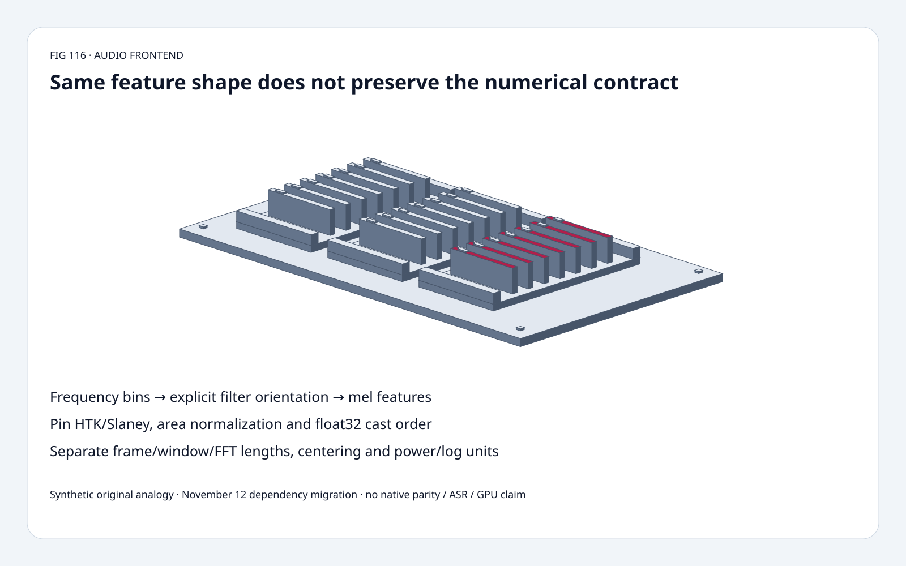
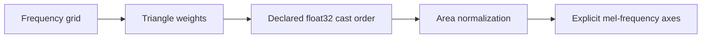
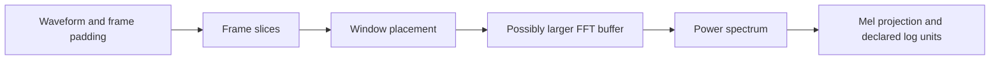
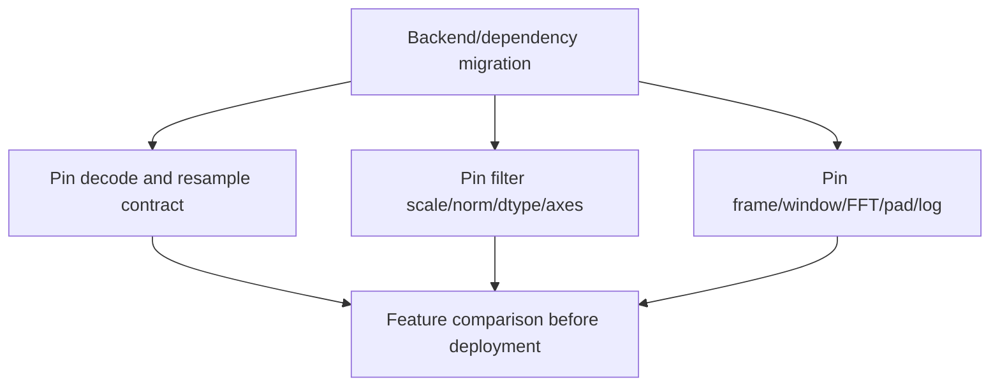

# Audio frontend FAQ: mel-filter cast order, axes, scales and frame contracts

> **Language**: [中文](mel-filterbank-cast-order-axis-frame-contract-selection-faq.md) | English
>
> **Round 116 · 2026-11-14 (night round 25)** · [SVG](../../assets/svg/mel-filterbank-cast-order-axis-frame-contract-selection-faq-summary.svg) · [7 cards](../reports/mel-filterbank-cast-order-axis-frame-contract-selection-cards.html) · [H5](../reports/mel-filterbank-cast-order-axis-frame-contract-sizer.html) · [Report](../../experiments/mel_frontend_contract_selection/report.json)
>
> **Synthetic, `independently_reproduced=false`.** Original scalar filter/projection models and CPU timing. No native librosa/Transformers/TorchAudio execution, audio decoding, resampling, STFT, ASR accuracy or GPU benchmark.



## 1. Executive summary: an audio dependency swap is not a feature-parity certificate

Verified Transformers **November 12, 2026** migration slims the audio
dependencies and replaces librosa filter construction in selected
ASR feature extractors with an explicit **float32 Slaney bank,
area normalization and contiguous transpose**.

In the original 40×257 scalar bank, changing only the float32 cast
order changes **115 of 10,280 weights**, at most **one ULP**.
HTK/Slaney have the same shape but different spacing.
At 16,000 samples/hop 160, centered frame lengths 400/401 produce
**101/100 frames**. Neither matching shapes nor “same FFT size”
alone establishes equivalent features.

| Contract | Pin explicitly | Not established by shape |
| :--- | :--- | :--- |
| Mel bank | HTK/Slaney, area norm, frequency grid | Same frequency bands |
| Precision | Cast order and reduction behavior | Float32 output is bit-exact |
| Axes | Frequency-major versus filter-major | Correct projection |
| Time | Frame/window/FFT lengths, centering/pad | Same sample alignment or frame count |
| Units | Magnitude/power, floor, logarithm/reference | Same dB values |

## 2. Architect Q&A: what must survive a frontend migration?

### Q1: How can the same float32 formula produce different weights?

Area-normalized triangular weights can be computed as
`round32(round32(triangle)*factor)` or
`round32(triangle*factor)`.
The original scalar study uses actual IEEE float32 rounding through
Python's `struct`, not a simulated decimal precision.

The pinned helper explicitly casts triangular filters **before**
Slaney area normalization. Selected source model bridges request
float32, Slaney scale and Slaney norm. Its documentation claims this
configuration matches transposed librosa filters; **that native
bit-exact claim is not reproduced here**.

Our original scalar paths differ in 115/10,280 entries, max one ULP.
Scalar transcendental functions and reduction order are not identical
to every NumPy/Torch backend. A small coefficient change does not
prove any ASR quality regression or justify inventing a tolerance.

### Q2: Are HTK and Slaney just labels for the same matrix?

No. HTK uses a logarithmic frequency transform; Slaney is linear
below 1 kHz and logarithmic above it. Slaney area normalization is
a separate choice from Slaney frequency spacing.

Both original banks have 40 filters and 257 bins, yet a positive
synthetic power vector gives different projected values. Their
maximum absolute difference is **0.03751926774081464** in this
fixture, not an audio-quality score.

The source also exposes triangularization in mel space versus Hz.
The original model uses Hz-space triangles, 0 to Nyquist, an even
FFT grid and only HTK/Slaney. Other scales, all-zero sampled bands,
subtle native rounding and arbitrary grid conventions are not
silently treated as equivalent. An all-zero selected band raises
in the original prototype; the source helper warns instead.

### Q3: Which matrix orientation does the bridge need?

The source helper returns `[frequency,mel]`; selected model bridges
take a contiguous transpose to `[mel,frequency]`.
The original bank is already filter-major:

`feature[t,m] = sum_k bank[m,k]*power[t,k]`.

The shape/type contract must include axis meaning and the
downstream operator. A transpose alone may be a noncontiguous view;
whether the consumer needs contiguous storage is separate.
The prototype validates the frequency width and rejects the
untransposed matrix in its fixture. It does not time native tensor
contiguity conversion or infer a copy from every transpose.

### Q4: Why distinguish frame, window and FFT lengths?

The pinned helper slices `frame_length`, applies an already-padded
window of that length, then uses a possibly larger `fft_length`.
Window placement inside a frame and waveform centering are
different operations. Periodic/symmetric windows and reflect/zero
padding must also be pinned, not inferred from a window name.

The inspected helper pads the waveform on each side by
`floor(frame_length/2)` when centered. The original count is:

`1 + floor((L + 2*floor(frame/2)*center - frame)/hop)`.

For L=16,000 and hop=160: frame 400 centered gives **101**;
frame 401 centered gives **100**; frame 400 uncentered gives **98**.
The simple `1+floor(L/hop)` shortcut misses odd frame parity.
These counts do not validate native edge-padding support, model
truncation, chunk state or the actual STFT coefficients.

### Q5: Does 20 log10 work for a power spectrogram?

Not with the same power/reference convention. Power uses
`10*log10(power/reference)`; amplitude uses factor 20.
Power four relative to one is **6.020599913279624 dB**.
Applying factor 20 to that power produces **12.041199826559248**.

Natural log, log10, floor, reference and dynamic-range clipping
also affect features. The original dB check only accepts positive
finite power, with reference one and no production floor/clipping.
It does not claim that every frontend uses dB or the same floor.

### Q6: What does the H5 budget include?

Default L=16,000, frame=400, hop=160, FFT=512, mel=80, batch=8:
**101 frames**, **257 frequency bins**.
The source-aligned float32 bank is **82,240 bytes**.
Selected four-byte power-spectrum payload is **830,624 bytes**;
selected mel output is **258,560 bytes**.

Filter coefficients stay four-byte in the calculator. Selected
power/mel widths are accounting assumptions, not native intermediate
precision. These payloads are **not simultaneous allocations,
complex STFT workspace, device traffic or peak HBM**.
The original count selection requires a full uncentered frame or
at least two centered samples and an even FFT no smaller than frame;
it does not certify every backend's shape/padding support.

## 3. Visual architecture: preserve filter, axis and temporal semantics







## 4. Selection matrix: verify the contract before measuring backend speed

| Choice | Good fit | Gate |
| :--- | :--- | :--- |
| Source-compatible Slaney float32 bank | Matching selected model preprocessing | Norm, cast order, axes and downstream operator |
| HTK or another bank | A model trained for that contract | Do not swap because shape matches |
| Nonzero-weight scalar projection | Original work-count teaching control | Native dense kernels may have different trade-offs |
| Backend decoder/resampler change | Explicit supported formats and rates | Feature/audio comparison, not dependency-name equivalence |
| Frame/window/FFT adjustment | Deliberate model/frontend change | Time/frequency alignment and expected frame count |
| Precision change | Validated deployment profile | Coefficients, reductions and model behavior |

## 5. Hands-on evidence: independent triangles, frame starts and CPU projections

```powershell
python -m experiments.mel_frontend_contract_selection.run --check
python -m unittest discover -s tests -p test_mel_frontend_contract_selection.py -q
```

Eight tests cover a clipped rational-hat oracle, frequency round trips,
actual float32 cast differences, dense/nonzero projection equality,
frame permutation, wrong-axis rejection, explicit frame-start
enumeration, power/log units and Node/Python budgets.

| Frames | Original nonzero-weight projection (ms) | Dense scalar projection (ms) |
| :--- | ---: | ---: |
| 1 | 0.050100 | 0.644933 |
| 4 | 0.168067 | 2.623767 |
| 16 | 0.666400 | 10.384000 |
| 64 | 3.421400 | 41.207033 |

40×257 matrix, **490 nonzero weights**, preconstructed/compressed
outside timing. Two warmups, seven alternating repeats, three
operations/sample; median repeat means. Decode, resample, STFT and
native/GPU paths excluded. This does not recommend replacing a
native vectorized GEMM with Python sparse loops. No browser visual
inspection was performed.

## 6. Sources, provenance and readiness

- [Pinned audio utilities](https://github.com/huggingface/transformers/blob/880561aabb68be86c4c0f1c37ee5281e07ed1439/src/transformers/audio_utils.py): cast order, bank orientation, frame/window/FFT distinctions and waveform padding.
- [Pinned Parakeet extractor](https://github.com/huggingface/transformers/blob/880561aabb68be86c4c0f1c37ee5281e07ed1439/src/transformers/models/parakeet/feature_extraction_parakeet.py) and [Cohere extractor](https://github.com/huggingface/transformers/blob/880561aabb68be86c4c0f1c37ee5281e07ed1439/src/transformers/models/cohere_asr/feature_extraction_cohere_asr.py): explicit float32 Slaney bank and contiguous transpose.
- [November 12 migration](https://github.com/huggingface/transformers/commit/880561aabb68be86c4c0f1c37ee5281e07ed1439): verified recent implementation change, not a new mel-scale invention.
- [Apache-2.0 license](https://github.com/huggingface/transformers/blob/880561aabb68be86c4c0f1c37ee5281e07ed1439/LICENSE): upstream rights retained.

All scalar formulas, synthetic power data, oracles, timing and artwork
are original. No upstream implementation, model weights or speech
recordings copied. Native filter bit-exactness, backend latency,
ASR quality and peak HBM remain null.
