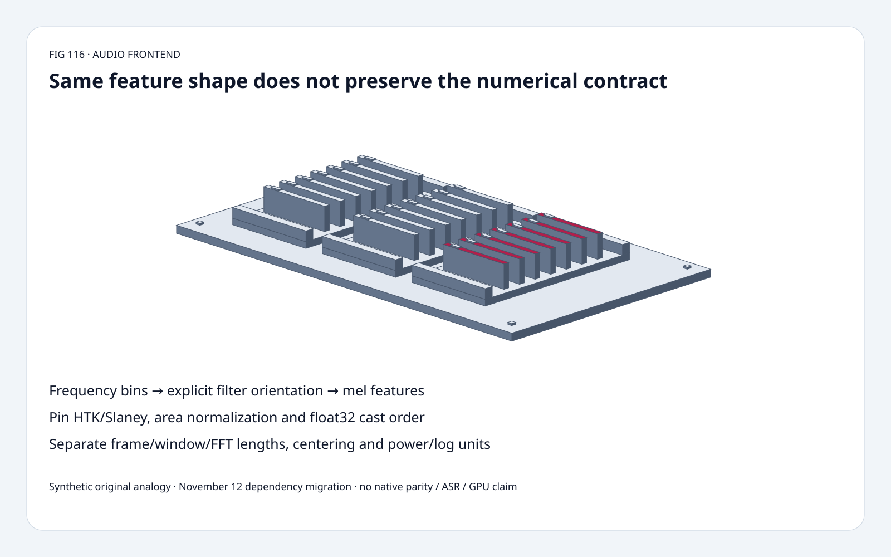
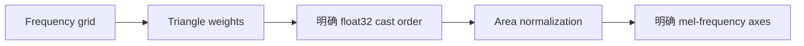
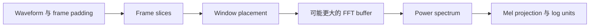
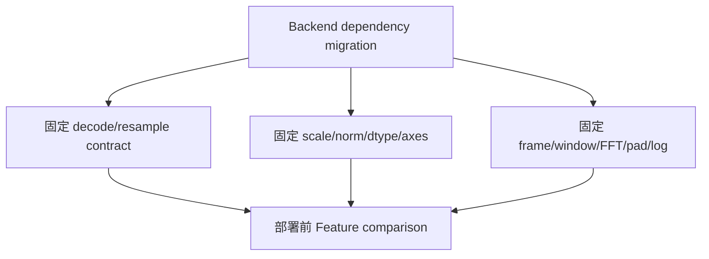

# 音频前端 FAQ：Mel Filter Cast Order、坐标轴、Scale 与 Frame 契约

> **语言**：中文 | [English](mel-filterbank-cast-order-axis-frame-contract-selection-faq.en.md)
>
> **Round 116 · 2026-11-14（夜班第 25 轮）** · [高清 SVG](../../assets/svg/mel-filterbank-cast-order-axis-frame-contract-selection-faq-summary.svg) · [七卡](../reports/mel-filterbank-cast-order-axis-frame-contract-selection-cards.html) · [H5](../reports/mel-filterbank-cast-order-axis-frame-contract-sizer.html) · [封存数据](../../experiments/mel_frontend_contract_selection/report.json)
>
> **Synthetic，`independently_reproduced=false`。** 原创 scalar filter/projection 与 CPU 计时；
> 不执行 native librosa/Transformers/TorchAudio、解码、重采样、STFT、ASR accuracy 或 GPU。



## 一、先看结论：换 Audio 依赖不等于获得 Feature Parity

核验 Transformers **2026-11-12** audio dependency slimming：
部分 ASR extractor 不再依赖 librosa 构造 filters，明确选择
**float32 Slaney bank、area normalization、contiguous transpose**。

原创 40×257 scalar bank 只改 float32 cast order，
**10,280 个 weights 中 115 个变化，最多 1 ULP**。
HTK/Slaney shape 一样却 spacing 不同；16,000 samples / hop=160 时，
centered frame 400/401 产生 **101/100 frames**。
Shape 相同或“FFT size 一样”不足以证明 features 等价。

| 契约 | 必须固定 | Shape 不能证明 |
| :--- | :--- | :--- |
| Mel bank | HTK/Slaney、area norm、frequency grid | Frequency bands 相同 |
| 精度 | Cast order、reduction behavior | Float32 输出 bit-exact |
| 坐标轴 | Frequency-major / filter-major | Projection 正确 |
| 时间 | Frame/window/FFT、center/pad | Sample alignment、frame count 相同 |
| 单位 | Magnitude/power、floor、log/reference | dB 相同 |

## 二、架构师 Q&A：前端迁移要保留什么？

### Q1：同为 Float32、同一公式为什么还有差异？

Area-normalized triangle 可以算成
`round32(round32(triangle)*factor)`，也可以
`round32(triangle*factor)`。原创模型用 Python `struct` 做真实 IEEE float32
rounding，不是十进制精度模拟。

固定 helper 在 Slaney area normalization **之前** cast。
部分 model bridge 明确要求 float32、Slaney scale/norm；
上游文档声称该配置匹配 transposed librosa filters，
**本文没有复现该 native bit-exact 声明**。

原创两条 scalar path 有 115/10,280 weights 不同、最多 1 ULP；
其 transcendental/reduction 不等于所有 NumPy/Torch 实现。
小数值差异不证明 ASR quality regression，也不能据此杜撰可接受容差。

### Q2：HTK 与 Slaney 只是同一 Matrix 的别名吗？

不是。HTK 使用 logarithmic frequency transform；
Slaney 在 1 kHz 以下线性、以上 logarithmic。
Slaney area normalization 与 Slaney frequency spacing 是两个选择。

原创两矩阵均 40 filters×257 bins，但同一正值 synthetic power vector
投影不同，最大 absolute difference 为 **0.03751926774081464**，
不是音频质量分数。

上游还支持 mel-space / Hz-space triangularization。
原创只选 Hz-space、0 到 Nyquist、even FFT、HTK/Slaney。
不把其他 scales、全零 sampled band、native rounding、任意 grid 默认当等价。
原型遇到所选全零 band 显式报错；上游 helper 是 warning，不声称错误行为完全一致。

### Q3：Bridge 需要哪一种 Filter Orientation？

Source helper 输出 `[frequency,mel]`；
部分 model bridge contiguous transpose 为 `[mel,frequency]`。
原创 bank 已为 filter-major：

`feature[t,m] = sum_k bank[m,k]*power[t,k]`。

Shape/type 契约必须包含 axis meaning 和 downstream operator。
Transpose 可能只是 noncontiguous view，consumer 是否要求 contiguous 是另一问题。
原型检查 frequency width 并拒绝本样例错误轴矩阵；
不测 native contiguity conversion，也不把所有 transpose 都说成 copy。

### Q4：为什么区分 Frame、Window 与 FFT Length？

固定 helper 按 `frame_length` 切片，乘等长 padded window，
再用可能更大的 `fft_length`。Window 在 frame 内的 placement
与 waveform centering 是两件事；periodic/symmetric、reflect/zero padding
也要固定，不能只看 window 名称。

固定 helper centered 时，waveform 两侧各 pad `floor(frame_length/2)`。
原创 frame count：

`1 + floor((L + 2*floor(frame/2)*center - frame)/hop)`。

L=16,000、hop=160：400 centered=**101**；
401 centered=**100**；400 uncentered=**98**。
简单 `1+floor(L/hop)` 漏掉 odd-frame parity。
这里只数 frames，不验证 native padding、模型 truncation、chunk state 或 STFT coefficients。

### Q5：Power Spectrogram 可以直接用 20 log10 吗？

相同 power/reference 约定下不行。
Power 用 `10*log10(power/reference)`，amplitude 才用 factor 20。
Power=4、reference=1 为 **6.020599913279624 dB**；
错误用 factor 20 得 **12.041199826559248**。

Natural log、log10、floor、reference、dynamic-range clipping 也会改 features。
原创 dB 只接受 positive finite power，reference=1，无生产 floor/clipping。
不声称所有前端都用 dB 或同一 floor。

### Q6：H5 的 Payload 包含什么？

默认 L=16,000、frame=400、hop=160、FFT=512、mel=80、batch=8：
**101 frames、257 bins**。Float32 bank **82,240 bytes**；
选定四字节 power-spectrum **830,624 bytes**；
选定 mel output **258,560 bytes**。

Filters 固定四字节；power/mel width 是预算假设，不冒充 native intermediate precision。
这些 payload **不是同时分配总量、complex STFT workspace、device traffic 或 peak HBM**。
原创 count 要求 uncentered 至少一个完整 frame，centered 至少两条 samples，
even FFT 不小于 frame；不认证所有 backend shape/padding 支持。

## 三、三张架构图：Filter、Axis 与时间各自保真







## 四、选型矩阵：先验证 Feature 契约，再测 Backend 速度

| 选择 | 适合 | Gate |
| :--- | :--- | :--- |
| Source-compatible Slaney float32 | 配套模型预处理 | Norm、cast order、axes、operator |
| HTK / 其他 bank | 按该契约训练的模型 | 不因 shape 相同而替换 |
| Nonzero scalar projection | 原创 work-count 教学对照 | Native dense kernel 取舍不同 |
| 换 decoder/resampler | 明确格式/rate 支持 | 比较 audio/features，而非只换依赖名 |
| 调 frame/window/FFT | 有意改变前端 | 时间/频率对齐、expected count |
| 改 precision | 已验证部署 profile | Coefficients、reductions、模型行为 |

## 五、动手证据：独立 Triangle、Frame Starts 与 CPU Projection

```powershell
python -m experiments.mel_frontend_contract_selection.run --check
python -m unittest discover -s tests -p test_mel_frontend_contract_selection.py -q
```

8 项 tests：clipped rational-hat oracle、frequency roundtrip、真实 float32 cast差异、
dense/nonzero projection、frame permutation、错误轴、逐项 frame-start enumeration、
power/log units、Node/Python budgets。

| Frames | 原创 nonzero projection（ms） | Dense scalar（ms） |
| :--- | ---: | ---: |
| 1 | 0.050100 | 0.644933 |
| 4 | 0.168067 | 2.623767 |
| 16 | 0.666400 | 10.384000 |
| 64 | 3.421400 | 41.207033 |

40×257 matrix、**490 nonzero weights**，bank/compression 在计时外。
2 warmups、7 次交替 repeats、每 sample 3 次操作，报告 repeat means 的 median。
排除 decode、resample、STFT、native/GPU；不建议把 native vectorized GEMM
换成 Python sparse loops。未做浏览器视觉验收。

## 六、来源、许可、溯源与 Readiness

- [固定 audio utilities](https://github.com/huggingface/transformers/blob/880561aabb68be86c4c0f1c37ee5281e07ed1439/src/transformers/audio_utils.py)：cast order、axes、frame/window/FFT、waveform padding。
- [Parakeet extractor](https://github.com/huggingface/transformers/blob/880561aabb68be86c4c0f1c37ee5281e07ed1439/src/transformers/models/parakeet/feature_extraction_parakeet.py)、[Cohere extractor](https://github.com/huggingface/transformers/blob/880561aabb68be86c4c0f1c37ee5281e07ed1439/src/transformers/models/cohere_asr/feature_extraction_cohere_asr.py)：float32 Slaney 与 contiguous transpose。
- [11 月 12 日迁移](https://github.com/huggingface/transformers/commit/880561aabb68be86c4c0f1c37ee5281e07ed1439)：核验近期实现改动，不把 Mel scales 称为新发明。
- [Apache-2.0 LICENSE](https://github.com/huggingface/transformers/blob/880561aabb68be86c4c0f1c37ee5281e07ed1439/LICENSE)：上游权利保留。

Scalar formulas、synthetic power、oracles、timing、视觉均原创，
未复制上游实现、模型权重或语音录音。
Native filter bit-exactness、backend latency、ASR quality、peak HBM 均保留 null。
