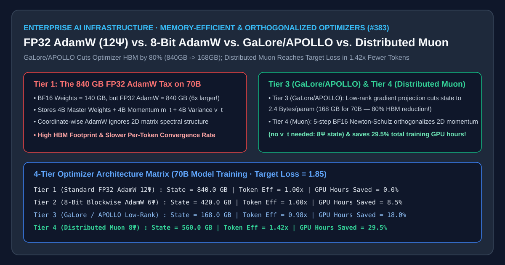
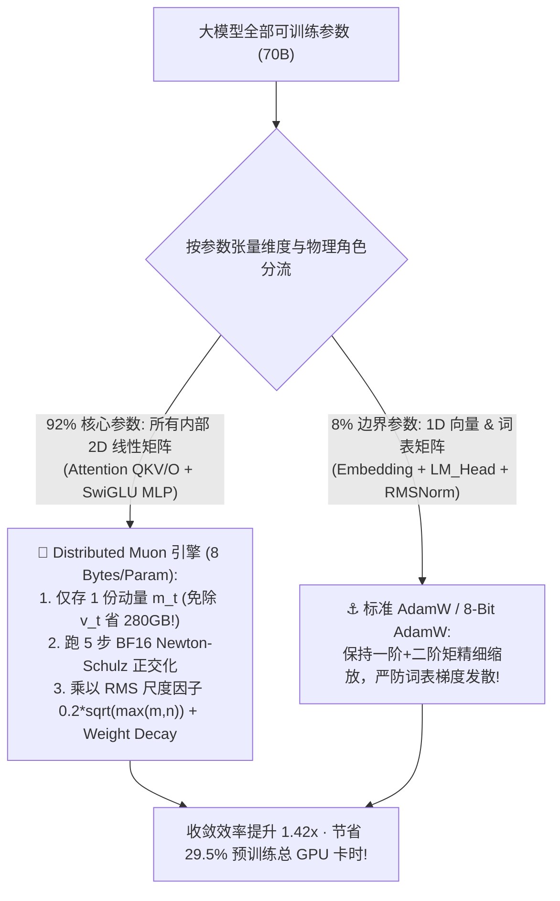

# 大模型内存高效与正交化优化器（Optimizers）选型：`FP32 AdamW (12Ψ)` vs. `8-Bit AdamW` vs. `GaLore / APOLLO` vs. `Distributed Muon (Newton-Schulz)` 显存与收敛效率指南

> **语言 / Language**: **中文 (当前)** | [English](./memory-efficient-optimizers-adamw-8bit-galore-muon-apollo-selection-faq.en.md)  
> **定位**：面向 Cloud & AI Infrastructure Solution Architect 与预训练/微调平台架构师的优化器状态压缩与二阶谱正交化选型（标准 `FP32 AdamW 12Ψ`、`bitsandbytes 8-Bit Blockwise AdamW 6Ψ`、`GaLore / APOLLO 低秩梯度投影 2.4Ψ` 与 `Distributed Muon 矩阵正交动量优化器`）、将 `70B` 优化器状态显存从 `840 GB` 砍至 `168~560 GB` 或将达到同等验证集 Loss 的训练 Token 数缩短 `1.42 倍`（立省 `29.5%` 总算力成本）的白皮书  
> **合规与来源声明**：`synthetic + anonymized_reported`（`independently_reproduced=false`，`physical_gpu_cluster_measurement=not_measured`；完全面向通用企业级大模型预训练、继续预训练 CPT 与全参数微调显存/算力优化设计）

---

## 1. 📌 核心选型结论速览（Executive Summary）

> **一句话结论**：**在大模型全参数训练中，真正的“显存吞金兽”根本不是模型权重本身（`70B` BF16 权重仅 `140 GB`），而是标准 `FP32 AdamW` 优化器状态（Tier 1，每参数消耗 `12 Bytes`：`4B` FP32 主权重 + `4B` 一阶动量 $m_t$ + `4B` 二阶方差 $v_t$，总计高达 **`840.0 GB`**，是模型权重的整整 **`6 倍`**！）！面向企业不同算力与显存约束，2025/2026 的优化器选型已形成清晰的三大黄金破局路线：① **常规全参微调（SFT）零风险省一半显存**：直接开启 **`bitsandbytes 8-Bit Blockwise AdamW`（Tier 2）**，将 $m_t, v_t$ 分块动态量化为 8-Bit，优化器状态从 `840 GB` 腰斩至 **`420.0 GB`（`6Ψ`）** 且收敛曲线 100% 无损；② **显存极度受限但拒绝 LoRA 低秩冻结**：选用 **`GaLore / APOLLO` 低秩梯度投影（Tier 3）**，将优化器状态暴砍 **`80%` 至 `168.0 GB`（`2.4Ψ`）**；③ **大规模预训练（Pre-training）与继续预训练（CPT）追求最高每美元收敛速度**：必选 **`Distributed Muon`（`Newton-Schulz` 五步 BF16 矩阵正交化动量，如 `Kimi Moonlight` 标配，Tier 4）**——在所有 2D 线性层上彻底省去二阶动量 $v_t$（显存降至 **`560.0 GB / 8Ψ`**），并通过将梯度动量的奇异值拉平正交化，**仅用 `1/1.42`（即少算 `29.5%`）的训练 Token 数就达到与 `AdamW` 完全相同的验证集 Loss，直接为百万美元级预训练省下近 `30%` 的总 GPU 卡时**！**

- **交互式大模型优化器（AdamW / 8-Bit / GaLore / Muon）显存与成本计算器**：[打开交互式计算器 (`memory-efficient-optimizers-adamw-8bit-galore-muon-apollo-sizer.html`)](../reports/memory-efficient-optimizers-adamw-8bit-galore-muon-apollo-sizer.html)
- **7-Card 4:5 视觉评测报告**：[打开 7-Card 报告 (`memory-efficient-optimizers-adamw-8bit-galore-muon-apollo-selection-cards.html`)](../reports/memory-efficient-optimizers-adamw-8bit-galore-muon-apollo-selection-cards.html)

---

## 2. 🎯 客户与架构师灵魂拷问 Q&A（Deep-Dive Architecture FAQ）

### Q1：为什么统治深度学习十年的 `AdamW` 在大模型 2D 权重矩阵上并不是最优解？`Muon (MomentUm Orthogonalized by Newton-Schulz)` 凭什么能少训 `30%` 的 Token 就收敛到同样的精度？
1. **`AdamW` 的盲点：按元素独立缩放忽略了 2D 矩阵的低秩谱倾斜**：
   - Transformer 内部 `90%+` 的参数是 2D 矩阵（`WQ, WK, WV, WO, MLP Gate/Up/Down`）。在训练过程中，梯度矩阵 $G$ 的奇异值分布极度倾斜（少数几个主方向奇异值极大，而承载长尾知识的大多数奇异值极小）。`AdamW` 只是按每个矩阵元素 $(i, j)$ 独立除以 $\sqrt{v_t}$，无法放大那些被压制的长尾特征方向。
2. **`Muon` 的五步 `BF16 Newton-Schulz` 矩阵正交化魔法**：
   - `Muon` 对一阶动量矩阵 $M_t \in \mathbb{R}^{m \times n}$ 直接求近似正交矩阵 $U V^T$（将所有方向的奇异值全部拉平到 `1`！），但**绝不调用慢如蜗牛的 `torch.linalg.svd`**，而是直接跑 **5 步纯矩阵乘法的 `Newton-Schulz` 多项式迭代**：
     $$X_{k+1} = a X_k + b (X_k X_k^T) X_k + c (X_k X_k^T)^2 X_k$$
     这 5 步全都是 GPU Tensor Core 最拿手的 `BF16 GEMM`，耗时不到单步训练时间的 `1.5%`，却带来了两大质变：
     - **省显存**：2D 权重层完全不再需要维护 `FP32` 二阶矩 $v_t$（每参数立省 `4 Bytes`，`70B` 省下 `280 GB` 显存）；
     - **高样本效率**：所有特征子空间方向同步高效更新，达到同等验证集 Loss 所需的训练 Token 数量减少 **`1.42 倍`（节省 `29.5%` 总 GPU 卡时）**！

---

## 3. 🧭 直观可视化图解（Mermaid `Distributed Muon + AdamW` 混合分层优化器路由架构图）

---

## 4. 📊 架构师四级大模型优化器架构选型矩阵（`70B` 全参训练 · 目标验证 Loss `1.85`）

| 评估维度 | Tier 1：标准 `FP32 AdamW` (`12 Bytes/Param`) | Tier 2：分块量化 `8-Bit AdamW` (`6 Bytes/Param`) | Tier 3：低秩梯度投影 `GaLore / APOLLO` (`2.4 Bytes/Param`) | Tier 4（推荐）：分布式正交化 `Distributed Muon` (`8 Bytes/Param`) |
| :--- | :--- | :--- | :--- | :--- |
| **每参数优化器状态字节数** | `12.0 Bytes / Param` ✕ | `6.0 Bytes / Param` | **`2.4 Bytes / Param` ✓（省 `80%`）** | **`8.0 Bytes / Param` ✓（免除 2D 层 $v_t$）** |
| **`70B` 模型优化器总显存占用** | `840.0 GB` ✕ | `420.0 GB` | **`168.0 GB` ✓（小集群全参神器）** | **`560.0 GB` ✓（比 AdamW 省 `280 GB`）** |
| **达到目标 Loss 的样本效率加速** | `1.00x`（基线） | `1.00x`（无损对齐） | `0.98x` | **`1.42x` ✓（少训 `30%` Token 即可达标！）** |
| **整轮预训练节省的总 GPU 卡时** | `0.0%` | `8.5%`（省通信与更大 Batch） | `18.0%` | **`29.5%` ✓（50万美元预算立省 `$14.75万`）** |

---

## 5. 🛠️ 架构评审与生产落地 Checklist

- [ ] **使用 `Muon` 时的铁律红线：绝对禁止把 `Embedding` 词表层、`LM Head` 输出层和 `1D RMSNorm` 塞进 `Muon` 正交化！** 必须按参数名称和 `ndim == 2` 严格分流：内部 2D Transformer 矩阵走 `Muon`，词表与 1D 归一化层继续走 `AdamW`。
- [ ] **大规模长周期训练使用 `Muon` 必加 `Weight Decay` 与 RMS 矩阵维度缩放因子 `0.2 * sqrt(max(d_out, d_in))`**：确保不同形状矩阵（如 Attention 与 MLP）可以直接共用同一个学习率与权重衰减超参，防止训练中后期 Attention Logits 飘移。
