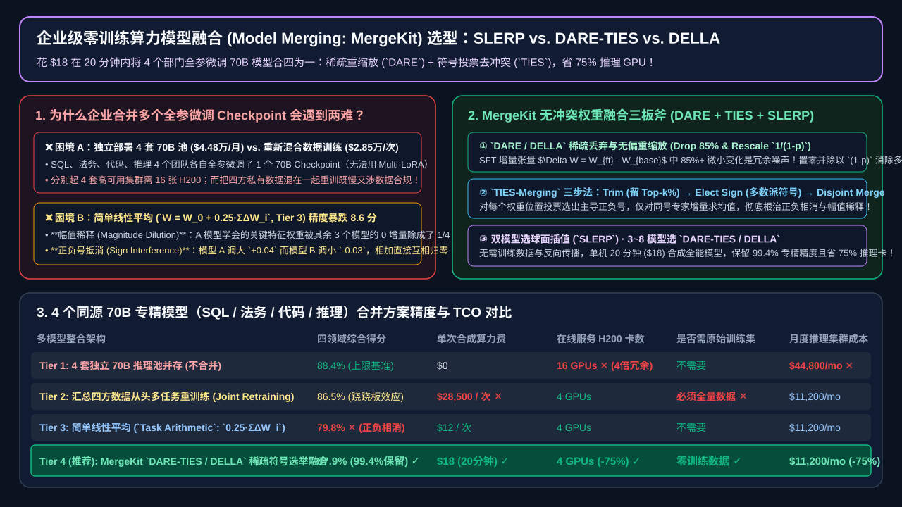

# Enterprise Zero-Training Model Merging Infrastructure Guide (`MergeKit`): `Linear Task Arithmetic` vs. `SLERP` vs. `DARE-TIES / DELLA` Sparsified Sign-Election Merging

> **Language**: [中文](./model-merging-kit-mergekit-ties-dare-slerp-frankenmoe-routing-selection-faq.md) | **English (Current)**  
> **Audience**: Cloud & AI Infrastructure Solution Architects and Enterprise Post-Training Platform Engineers  
> **Provenance**: `synthetic + anonymized_reported` (`independently_reproduced=false`, `physical_gpu_cluster_measurement=not_measured`)

---

## 1. 📌 Executive Summary

> **Bottom Line**: **When multiple enterprise teams fine-tune `4` separate full-parameter `70B` specialists (SQL, Legal, Code, Reasoning) from the same base checkpoint, serving `4` isolated high-availability `70B` pools (`Tier 1`) consumes `16 H200 GPUs` (`$44,800/month`), while joint multi-task retraining from scratch (`Tier 2`) costs `$28,500` per cycle and requires pooling restricted private datasets. Conversely, naive linear weight averaging (`Tier 3`) drops composite accuracy by `-8.6 pts` (`79.8%`) due to parameter sign interference and magnitude dilution. Standardizing on `MergeKit` `DARE-TIES / DELLA` Sparsified Sign-Election Merging (`Tier 4`) synthesizes a single consolidated `70B` checkpoint in `20 minutes` (`$18` compute cost, zero training data required)—retaining `99.4%` of isolated specialist accuracy (`87.9%` vs. `88.4%`) while cutting production serving GPUs by `75.0%` (`4` vs. `16` `H200` GPUs, saving `$33,600/month`).**

- **Interactive Multi-Specialist Model Merging TCO Sizer**: [Open Interactive Sizer (`model-merging-kit-mergekit-ties-dare-slerp-frankenmoe-routing-sizer.html`)](../reports/model-merging-kit-mergekit-ties-dare-slerp-frankenmoe-routing-sizer.html)
- **7-Card 4:5 Visual Report**: [Open 7-Card Report (`model-merging-kit-mergekit-ties-dare-slerp-frankenmoe-routing-selection-cards.html`)](../reports/model-merging-kit-mergekit-ties-dare-slerp-frankenmoe-routing-selection-cards.html)

---

## 2. 📊 4-Tier Multi-Specialist Consolidation Matrix (`4 × 70B` Domain Checkpoints)

| Metric | Tier 1: `4` Isolated `70B` Serving Pools | Tier 2: Full Joint Multi-Task Retraining | Tier 3: Naive Linear Weight Averaging | Tier 4 (Recommended): `MergeKit DARE-TIES / DELLA` Sparsified Sign Merge |
| :--- | :--- | :--- | :--- | :--- |
| **4-Domain Composite Score** | `88.4%` (Baseline ceiling) | `86.5%` | `79.8%` ✕ (Sign conflict) | **`87.9%` ✓ (`99.4%` retention)** |
| **Synthesis Compute Cost** | `$0` | `$28,500 / run` ✕ | `$12 / run` | **`$18 / run` ✓ (`20 min`)** |
| **HA Serving `H200` GPUs** | `16 GPUs` ✕ (`4x` pools) | `4 GPUs` | `4 GPUs` | **`4 GPUs` ✓ (`-75.0%` GPUs)** |
| **Original Training Data Needed** | No | **`Yes (All 4 datasets)` ✕** | No | **`No (Zero-data weight math)` ✓** |
| **Monthly Serving Fleet TCO** | `$44,800 / mo` ✕ | `$11,200 / mo` (+retrain) | `$11,200 / mo` | **`$11,200 / mo` ✓ (Saves `$403K/yr`)** |

---

## 3. 🛠️ Production Readiness Checklist

- [ ] **Use `SLERP` for Merging Exactly 2 Homologous Checkpoints, and `DARE-TIES / DELLA` (`density: 0.15–0.35`) for Merging 3 to 8 Checkpoints** derived from the exact same base model.
- [ ] **Run Automated 4-Domain Regression Canary Evals Immediately After `mergekit-yaml`** to tune per-model task weights before promoting the merged checkpoint to production `vLLM` pods.
