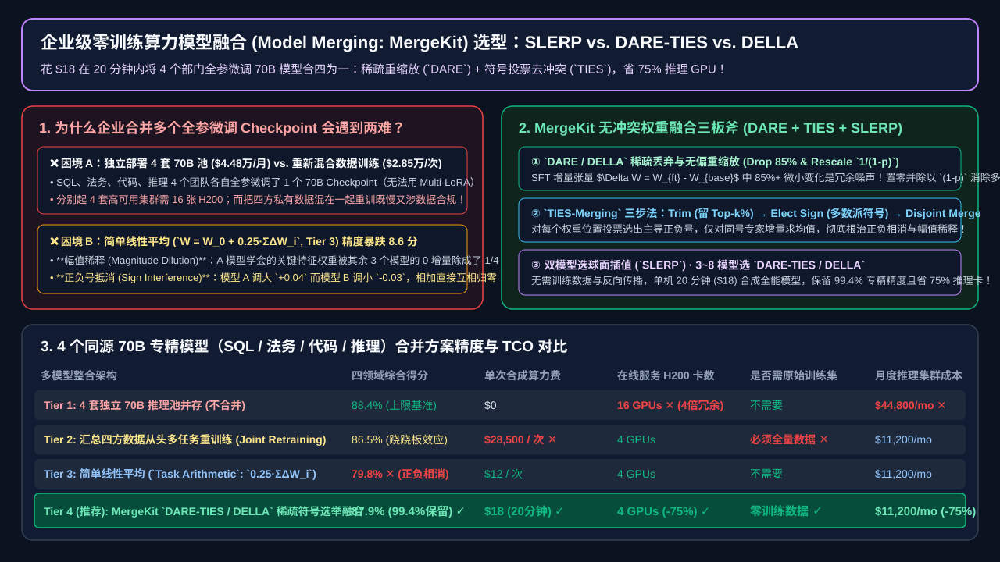
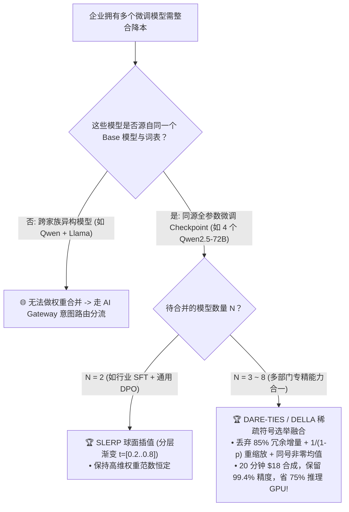

# 企业级零训练算力模型融合（Model Merging: `MergeKit`）选型：线性加权 `Task Arithmetic` vs. `SLERP 球面插值` vs. `DARE-TIES / DELLA 稀疏去冲突融合` 多领域能力合成指南

> **语言 / Language**: **中文 (当前)** | [English](./model-merging-kit-mergekit-ties-dare-slerp-frankenmoe-routing-selection-faq.en.md)  
> **定位**：面向 Cloud & AI Infrastructure Solution Architect 与企业大模型后训练负责人的多团队全参数微调模型零训练算力整合（`MergeKit`）、两模型球面插值（`SLERP`）、多模型稀疏重缩放与符号投票合并（`DARE-TIES / DELLA`）以及推理 GPU 显存缩减 `75%` 架构白皮书  
> **合规与来源声明**：`synthetic + anonymized_reported`（`independently_reproduced=false`，`physical_gpu_cluster_measurement=not_measured`；完全面向通用企业级多领域微调模型整合与降本架构设计）

---

## 1. 📌 核心选型结论速览（Executive Summary）

> **一句话结论**：**当企业内部多个业务部门基于同一个开源基座（如 `Qwen2.5-72B` 或 `Llama-3.3-70B`）各自通过全参数微调（Full SFT/DPO）训出了 `4 个`专精模型（SQL 专家、法务专家、代码专家、推理专家）时，架构师不必为这 4 个模型分别维持 4 套独立的 `70B` 高可用 GPU 池（Tier 1，消耗 `16 张 H200`、月烧 `$44,800`），也无需每次迭代都花 `$28,500` 把四方敏感私有数据混在一起从头做多任务重训练（Tier 2）！但也绝不能直接把 4 个模型的权重做简单算术平均（Tier 3，因正负号抵消与幅值稀释导致评测暴跌 `8.6 分`）。生产级零成本神兵是使用 `MergeKit` 执行 `DARE-TIES / DELLA` 稀疏符号选举融合（Tier 4）：无需任何训练数据与反向传播，仅在单台机器上花 **`20 分钟`（`$18` 算力费）** 即可合成 1 个全能 `70B` 模型——保留各领域专精最高分 **`99.4%`（`87.9%` vs. `88.4%`）** 的同时，将线上推理 GPU 卡数直接从 `16 张` 砍至 **`4 张`（立省 `75.0%`，每年省下 `$40.3 万` 推理费）**！**

- **交互式多模型零训练融合收益计算器**：[打开交互式计算器 (`model-merging-kit-mergekit-ties-dare-slerp-frankenmoe-routing-sizer.html`)](../reports/model-merging-kit-mergekit-ties-dare-slerp-frankenmoe-routing-sizer.html)
- **7-Card 4:5 视觉评测报告**：[打开 7-Card 报告 (`model-merging-kit-mergekit-ties-dare-slerp-frankenmoe-routing-selection-cards.html`)](../reports/model-merging-kit-mergekit-ties-dare-slerp-frankenmoe-routing-selection-cards.html)

---

## 2. 🎯 客户与架构师灵魂拷问 Q&A（Deep-Dive Architecture FAQ）

### Q1：为什么简单把 4 个微调模型的参数求平均（$W = W_{\text{base}} + \frac{1}{4}\sum \Delta W_i$）会让模型变蠢？`DARE-TIES / DELLA` 是怎么解决的？
设第 $k$ 个专精模型相对于原始基座 $W_{\text{base}}$ 的任务向量（Task Vector）为 $\tau_k = W_k - W_{\text{base}}$：
1. **痛点一（参数碰撞与冗余噪声）**：研究发现，全参数 SFT 产生的 $\tau_k$ 中 **高达 `85% ~ 90%` 的微小权重变动都是冗余噪声**！`DARE (Drop And REscale)`（以及按幅值概率丢弃的 `DELLA`）直接将 `85%` 的微小增量置零，并把留下的 `15%` 关键增量乘以无偏缩放系数 $\frac{1}{1-p}$（即 $\div 0.15$），不仅单模型能力丝毫无损，还让 4 个模型的非零坐标几乎不再重叠碰撞！
2. **痛点二（正负号相消与零值稀释）**：对于少数仍然重叠的坐标，若模型 A 为 `+0.06`、模型 B 为 `-0.05`，直接相加就抵消成了 `0`；若模型 A 为 `+0.08` 而其余 3 个模型为 `0`，求平均后被稀释成了 `+0.02`！
   - **`TIES-Merging` 的三步根治法**：① **Trim**（裁剪掉微小噪音）；② **Elect Sign**（按总幅值投票选出该权重的多数派正负号 $\gamma = \text{sgn}(\sum \tau_k)$）；③ **Disjoint Merge**（剔除方向相反的异见者，且**只除以非零同号模型的个数**而非总模型数 $N$）！

### Q2：在 `MergeKit` 中，`Linear`、`SLERP`、`DARE-TIES / DELLA` 与 `FrankenMoE (Upcycled MoE)` 分别在什么条件下选？
- **恰好合并 `2 个`同源模型（如 `Domain-SFT + General-RL`）**：首选 **`SLERP`（球面线性插值）**——在高维超球面上沿测地线弧线插值，避免欧氏直线中点处权重范数缩水。
- **合并 `3 ~ 8 个`同源不同领域专精模型**：首选 **`dare_ties` 或 `della`**（设置 `density: 0.2 ~ 0.35`）。
- **当各领域参数改动极其剧烈、连 `DARE-TIES` 都会产生轻微干扰时**：使用 `mergekit-moe` 将 4 个模型的 FFN 层直接组装为一个 **`4-Expert MoE`（共享 Attention 层，用 50 条样本花 5 分钟初始化 Router 门控）**！

---

## 3. 🧭 直观可视化图解（Mermaid `MergeKit` 多模型融合选型决策树）

---

## 4. 📊 架构师多方案选型决策矩阵（整合 `4 个` 同源 `70B` 领域专精模型）

| 评估维度 | Tier 1：4 套独立 `70B` 推理池并存（不合并） | Tier 2：汇总四方数据从头多任务重训练 (`Joint SFT`) | Tier 3：简单线性平均 (`Task Arithmetic`) | Tier 4（推荐）：`MergeKit DARE-TIES / DELLA` 稀疏符号选举融合 |
| :--- | :--- | :--- | :--- | :--- |
| **四领域综合评测平均得分** | `88.4%`（各专精模型上限） | `86.5%`（数据配比跷跷板） | `79.8%` ✕（正负相消严重退化） | **`87.9%` ✓（保留专精上限的 `99.4%`）** |
| **单次版本合成算力成本** | `$0` | `$28,500 / 次` ✕（极慢极贵） | `$12 / 次` | **`$18 / 次` ✓（单机 20 分钟出炉）** |
| **高可用在线服务所需 `H200`** | `16 GPUs` ✕（4 套双副本池） | `4 GPUs` | `4 GPUs` | **`4 GPUs` ✓（立砍 `75.0%` 推理卡）** |
| **是否需要访问四方原始训练集** | 不需要 | **`必须汇总全量隐私数据` ✕** | 不需要 | **`零训练数据（仅需权重文件）` ✓** |
| **月度推理集群总成本 (TCO)** | `$44,800 / 月` ✕ | `$11,200 / 月`（另加每次重训费） | `$11,200 / 月`（精度不可用） | **`$11,200 / 月` ✓（每年净省 `$40.3 万`）** |

---

## 5. 🛠️ 架构评审与生产落地 Checklist

- [ ] **严格遵循“同祖同宗（Same Pretrained Base & Tokenizer）”前提**：只有从同一个基础模型版本（如 `Qwen2.5-72B-Instruct`）派生出的多个 Checkpoint 才能处于同一个线性模式连通盆地（Mode Connectivity Basin），支持 `DARE-TIES` 融合。
- [ ] **使用分层渐变权重（Layer-Wise Gradient Weights）**：在 `mergekit-yaml` 中为浅层（语法感知）、中层（逻辑推理）与深层（输出格式）设置平滑过渡的领域权重曲线，比全层固定权重再涨 `+0.8 ~ 1.2` 分！
