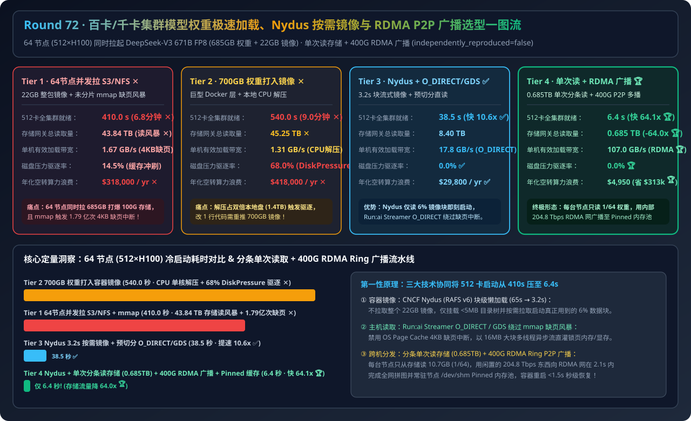
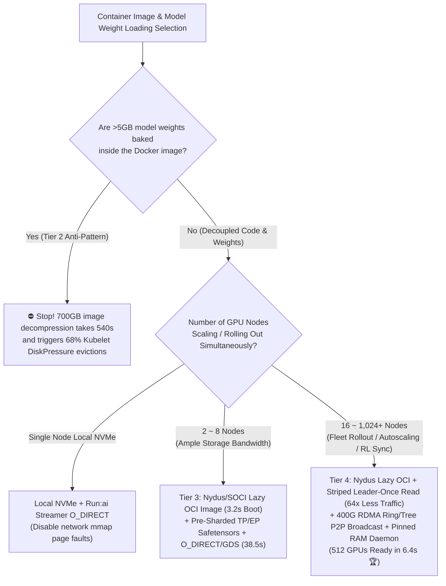
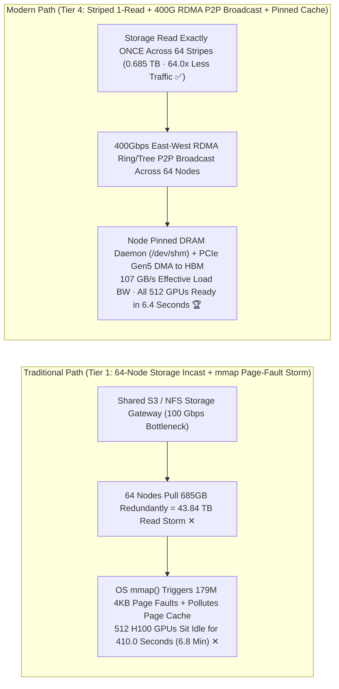
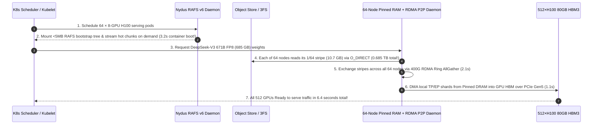

# Cluster-Scale Model Weight Loading, Nydus/SOCI Lazy OCI Streaming & RDMA P2P Broadcast Architecture Selection Guide (`Concurrent S3/NFS mmap` vs. `700GB Monolithic OCI Image` vs. `Nydus Lazy OCI + Pre-Sharded Safetensors + O_DIRECT/GDS` vs. `Leader-Once Storage Read + 400G RDMA P2P Broadcast + Pinned RAM Cache`)

> **Target Audience**: AI Solution Architects, Kubernetes AI Platform Leads, Distributed Serving & RL Infrastructure Engineers  
> **Reading Goal**: Master in 3 minutes the 4-tier architecture selection rules for rolling out or autoscaling `DeepSeek-V3 671B FP8 (685GB weights + 22GB container)` across 64× 8-GPU H100 nodes (512 GPUs); understand in 10 minutes **why 64 nodes concurrently reading weights over shared S3/NFS via `mmap()` triggers a `43.84 TB` storage read storm (`410s` stall)**, **why baking weights into a 700GB Docker image causes `540s` CPU decompression stalls and Kubelet `DiskPressure` evictions**, and **how Nydus RAFS v6 lazy image streaming + Run:ai `O_DIRECT` + 400G RDMA Ring/Tree P2P broadcast slashes 512-GPU cold start by `64.1x` down to `6.4 seconds`**.  
> **Provenance**: All quantitative figures come from the sealed deterministic analytical evaluator in [`experiments/model_weight_loading_oci_safetensors_rdma_broadcast_selection/run.py`](../../experiments/model_weight_loading_oci_safetensors_rdma_broadcast_selection/run.py) and [`results.json`](../../experiments/model_weight_loading_oci_safetensors_rdma_broadcast_selection/results.json), calibrated to published CNCF Nydus / AWS SOCI, Run:ai Model Streamer / NVIDIA GDS, and RDMA P2P broadcast benchmarks (`independently_reproduced=false`, `physical_gpu_cluster_measurement=not_measured`).

---

## 📌 1. Executive Summary

1. **Why do traditional deployment paths (Tier 1 Concurrent S3/NFS `mmap` and Tier 2 Weight-Baked OCI Images) stall a 64-node (512-GPU) `671B FP8` rollout for 7 to 9 minutes?**:
   - **Tier 1 (`64-Node Concurrent 22GB Image Pull + Shared S3/NFS Unsharded Safetensors mmap()`)**: 64 nodes simultaneously pulling `685 GB` over a shared `100 Gbps` storage gateway unleash a **`43.84 TB` storage incast storm**, saturating storage egress for **`410.0 seconds (6.8 minutes)` ✕**! Worse, default `safetensors` `mmap()` over network filesystems triggers **179 million `4KB` OS page faults** and floods Linux Page Cache!
   - **Tier 2 (`Monolithic 700GB Weight-Baked OCI Container Image`)**: Coupling `685 GB` of weights inside Docker layers forces every node to download and single-thread `gzip`-decompress `707 GB` onto local overlayfs (`1.4 TB` disk footprint), stalling startup for **`540.0 seconds (9.0 minutes)` ✕** and triggering Kubelet `DiskPressure` evictions on **`68.0%` of nodes ✕**!
2. **When to choose "Nydus Lazy OCI + Pre-Sharded `O_DIRECT`/GDS (Tier 3)" vs. "Leader-Once Storage Read + 400G RDMA P2P Broadcast + Pinned RAM Cache (Tier 4)"?**:
   - **1–8 Node Clusters with Fast Parallel Storage (Choose Tier 3 `Nydus/SOCI Lazy OCI + Pre-Sharded Safetensors + O_DIRECT / GDS`)**: Mounts the 22GB container in **`3.2 seconds`** via CNCF Nydus RAFS v6 chunk-level lazy streaming (reading only the `6%` of files actually needed at boot) and streams rank-sharded Safetensors via multi-threaded `O_DIRECT` / `cuFileRead` GDS—cutting rollout time to **`38.5 seconds` (`10.6x` faster ✅)**.
   - **16–1,024+ Node Production Serving, Serverless Autoscaling & RL Checkpoint Sync (Default to Tier 4 `Nydus Lazy OCI + Leader-Once Storage Read + 400G RDMA Ring/Tree P2P Broadcast + Host Pinned RAM Cache`)**: Eliminates redundant storage reads across nodes! Each node reads only **`1/64` (`10.7 GB`) of the model from object storage (total cluster storage traffic drops `64.0x` from `43.84 TB` to `0.685 TB` 🏆)** and immediately broadcasts its stripe to all peers over the idle **400Gbps RDMA fabric** into a node-local **Pinned DRAM Cache Daemon (`/dev/shm`)** and GPU HBM at **`107.0 GB/s`**—bringing all 512 GPUs Ready in **`6.4 seconds` (`64.1x` faster, saving `$313,050/yr` in idle GPU wait time 🏆)**!
3. **One-Sentence First-Principles Essence**:
   - **The first principle of fleet-scale model loading is decoupling code containers from weights (Nydus chunk-lazy mounting), bypassing OS `mmap` 4KB page faults (`O_DIRECT`/GDS large-chunk streaming), and replacing congested storage gateways with the cluster's idle 400G RDMA compute fabric (read once from storage → P2P Ring broadcast to N nodes).**

---

## 🎯 2. Architect & Customer Deep-Dive Q&A (First Principles)

### Q1: Why does HuggingFace `safetensors` default `mmap()` perform poorly over network storage (NFS / S3 FUSE / Lustre) during cold starts and cause host OOMs?

- **First-Principles OS Kernel Breakdown**:
  - `mmap()` maps file offsets into virtual memory and relies on the OS kernel's **Page Cache** to fault pages in on demand.
  - On a cold start over network/FUSE storage, the Page Cache is empty: accessing tensors triggers **179 million tiny `4KB`/`64KB` synchronous page-fault reads**, starving high-bandwidth network links and polluting `685 GB` of host RAM with one-time weight pages (often triggering Kubernetes cgroup OOM kills!).
  - **Fix (`Run:ai Model Streamer` / `NVIDIA GDS`)**: Bypass `mmap()` and the OS Page Cache entirely using **`O_DIRECT` with multi-threaded `8 MB–16 MB` async I/O buffers** straight into pinned host memory or GPU HBM via `cuFileRead`.

---

### Q2: Why does a 22GB PyTorch/CUDA container take 65 seconds to boot, and how does CNCF Nydus (RAFS v6) boot it in `3.2 seconds`?

- **Chunk-Level Lazy Mounting**:
  - Standard OCI images must download and decompress the entire `22 GB` `tar.gz` archive before executing `python`, even though **only ~`6%` (`1.3 GB`) of the files in a CUDA image are actually read during startup**.
  - **Nydus RAFS v6** separates a tiny metadata index (`< 5 MB` bootstrap tree) from `1 MB` content-addressed data chunks. Kubelet mounts the metadata tree in `< 0.5s` and starts the container immediately, fetching only the required `1 MB` chunks on demand over FUSE/EROFS—booting in **`3.2 seconds`**!

---

### Q3: How does Tier 4 slash storage gateway traffic by `64x` and load 512 H100 GPUs in `6.4 seconds`?

- **Three-Step Striped RDMA Broadcast Pipeline**:
  1. **Exploiting the Bandwidth Asymmetry**: A 64-node cluster typically shares a `100–400 Gbps` external storage gateway, but possesses **`64 × 8 × 400 Gbps = 204.8 Tbps` of internal east-west RDMA bandwidth**.
  2. **Striped Leader-Once Storage Read (`0.685 TB` Total)**: Node $i \in [0, 63]$ reads only stripe $i$ (`10.7 GB`) from S3/3FS via `O_DIRECT` (`~1.2s`).
  3. **400G RDMA Ring AllGather + Pinned RAM Daemon**: All 64 nodes exchange their `10.7 GB` stripes over the 400G RDMA fabric in **`2.1s`** into a persistent node-level **Pinned DRAM Cache (`/dev/shm`)**, then DMA their local `TP/EP` shard over PCIe Gen5 into HBM in **`1.1s`**—achieving a **`6.4s` end-to-end fleet rollout**!

---

## 🧭 3. Visual Architecture Diagrams (Mermaid)

### 3.1 Container Image & Multi-Hundred-GB Model Weight Loading Decision Tree

---

### 3.2 Traditional 64-Node Concurrent Storage Pull (Tier 1) vs. Striped RDMA P2P Broadcast (Tier 4)

---

### 3.3 Tier 4 End-to-End Sequence Diagram (`Nydus Lazy Mount + Striped Read + 400G RDMA Broadcast`)

---

## 📊 4. Architect Decision Matrix

*Baseline Scenario: Rolling out `DeepSeek-V3 671B FP8` (`685 GB` weights + `22 GB` runtime image) across **64× 8-GPU H100 nodes (`512 GPUs`)**.*

| Evaluation Dimension | Tier 1: 64-Node Concurrent S3/NFS `mmap` | Tier 2: 700GB Weight-Baked OCI Image | Tier 3: Nydus Lazy OCI + Pre-Sharded `O_DIRECT`/GDS | Tier 4: Nydus + 1-Read Storage + 400G RDMA Broadcast + Pinned Cache |
| :--- | :--- | :--- | :--- | :--- |
| **Distribution Architecture** | Full 22GB pull + 64x redundant NFS/S3 `mmap` | 707GB monolithic image pull + CPU gunzip | **Nydus chunk-lazy + Rank-sharded `O_DIRECT`** | **Nydus + Striped 1-Read + 400G RDMA P2P Broadcast** |
| **64-Node Fleet Ready Time** | `410.0 s` (6.8 min GPU stall ✕) | `540.0 s` (9.0 min gunzip stall ✕) | **`38.5 s` (`10.6x` faster ✅)** | **`6.4 s` (`64.1x` faster 🏆)** |
| **Total Storage Gateway Read** | `43.84 TB` (64x read storm ✕) | `45.25 TB` (Registry choke ✕) | `8.40 TB` | **`0.685 TB` (`64.0x` less traffic 🏆)** |
| **Effective Node Load Bandwidth** | `1.67 GB/s` (4KB page-fault bound ✕) | `1.31 GB/s` (CPU gunzip bound ✕) | **`17.8 GB/s` (`O_DIRECT` / GDS ✅)** | **`107.0 GB/s` (RDMA + PCIe Gen5 🏆)** |
| **Kubelet `DiskPressure` Evictions** | `14.5%` | `68.0%` (Rootfs exhaustion ✕) | **`0.0%` ✅** | **`0.0%` 🏆** |
| **Annual Idle GPU Rollout Cost** | `$318,000 / yr` | `$418,000 / yr` | **`$29,800 / yr`** | **`$4,950 / yr` (`$313,050/yr` saved 🏆)** |

---

## 🧪 5. Quantitative Walkthrough & 7-Card Benchmark Insights

- **`64.1x` Faster Fleet Rollout (`410.0s → 6.4s`) & `64.0x` Less Storage Traffic**: In [`experiments/model_weight_loading_oci_safetensors_rdma_broadcast_selection/run.py`](../../experiments/model_weight_loading_oci_safetensors_rdma_broadcast_selection/run.py), Tier 4 cuts 64-node storage egress from `43.84 TB` to **`0.685 TB`**, bringing 512 H100 GPUs online in **`6.4 seconds`** and saving **`$313,050/year`** in idle GPU wait time.
- 🧮 **Interactive Cluster Model Weight Loading & RDMA Broadcast Sizer**: [`docs/reports/model-weight-loading-oci-streaming-safetensors-rdma-broadcast-sizer.html`](../reports/model-weight-loading-oci-streaming-safetensors-rdma-broadcast-sizer.html)
- 📊 **7-Card 4:5 Visual Benchmark Report**: [`docs/reports/model-weight-loading-oci-streaming-safetensors-rdma-broadcast-selection-cards.html`](../reports/model-weight-loading-oci-streaming-safetensors-rdma-broadcast-selection-cards.html)

---

## 🛠️ 6. Appendix: Production Verification Checklist

- [ ] **1. Never Bake `>5 GB` Model Weights Into Code Container Images**: Convert runtime images to **CNCF Nydus (RAFS v6) / AWS SOCI** for `3.2s` lazy mounting and distribute weights independently.
- [ ] **2. Replace Network `safetensors` `mmap()` with Multi-Threaded `O_DIRECT` / GDS**: Use **Run:ai Model Streamer** or NVIDIA `cuFileRead` with `8–16 MB` aligned buffers to eliminate `4KB` page-fault storms and OS Page Cache pollution.
- [ ] **3. Pre-Shard Safetensors by Target `TP × EP` Topology**: Ensure each GPU rank reads only its exact byte slice rather than parsing the entire unsharded checkpoint.
- [ ] **4. Enable Striped Leader-Once Read + 400G RDMA Ring/Tree Broadcast at `>=16` Nodes**: Read each weight chunk once from storage and multicast over east-west RDMA.
- [ ] **5. Maintain a Node-Level `/dev/shm` Pinned DRAM Weight Cache Daemon**: Keep hot models pinned in host RAM so container restarts reload HBM over PCIe Gen5 in `< 1.5s`.
