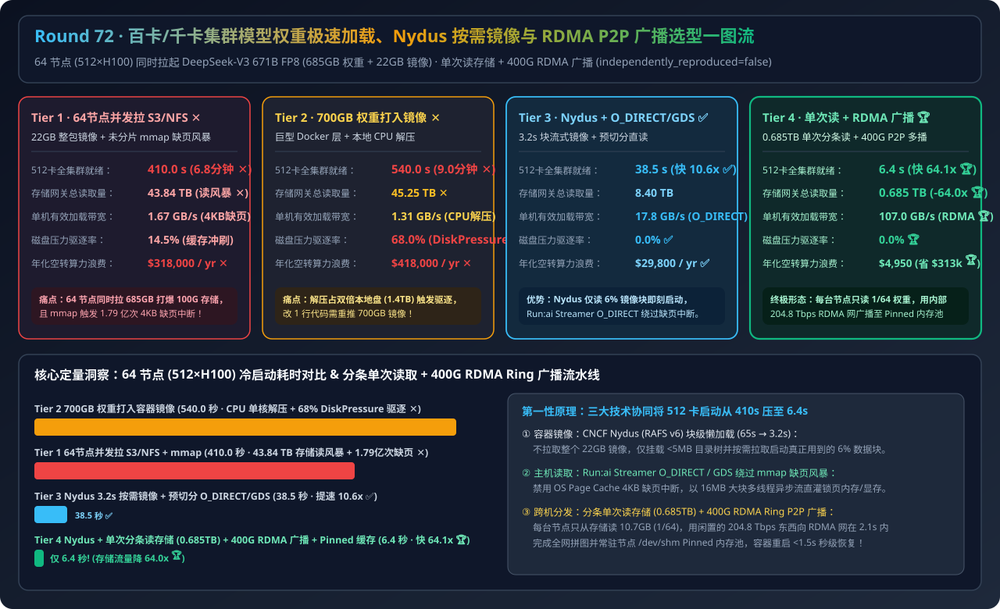
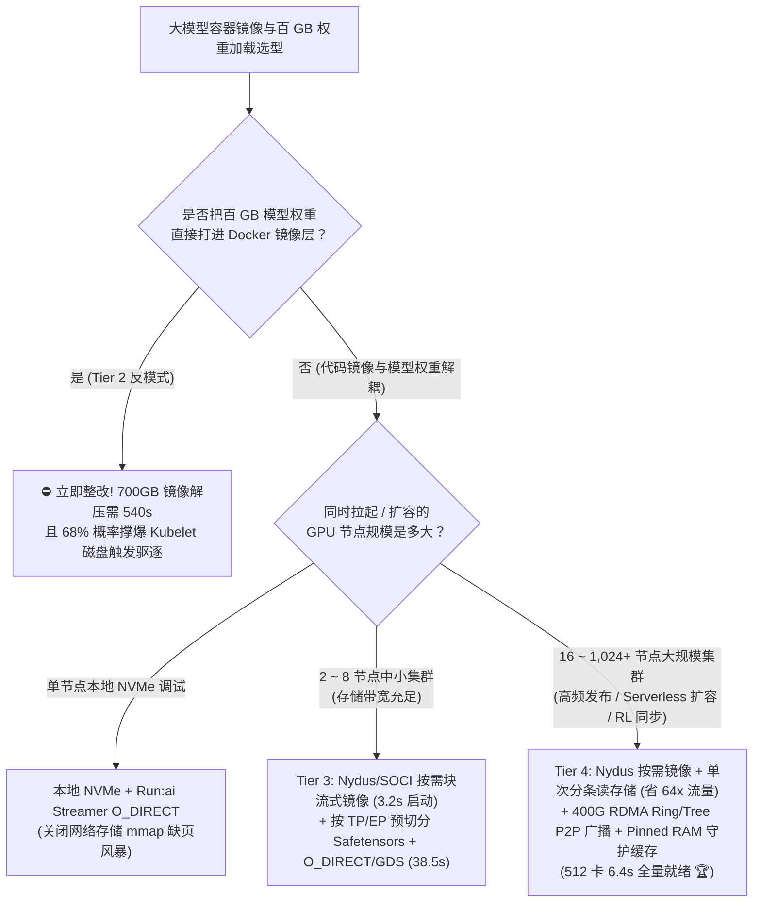
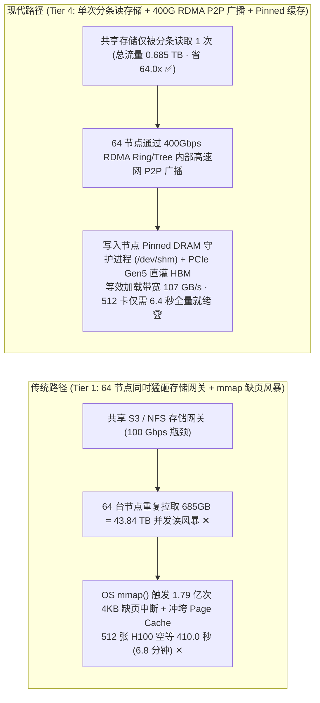
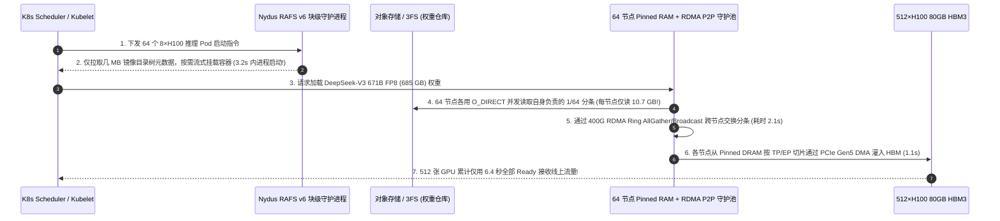

# 百卡/千卡 GPU 集群大模型权重极速加载、Nydus/SOCI 按需流式镜像与 RDMA P2P 环状多播架构选型指南（`S3/NFS 并发直拉 mmap` vs. `700GB 巨型容器镜像` vs. `Nydus 按需镜像 + 预切分 Safetensors + O_DIRECT/GDS` vs. `单次存储读取 + 400G RDMA Ring/Tree P2P 广播 + Pinned RAM 守护缓存`）

> **适用角色**：AI 解决方案架构师（AI Solution Architect）、Kubernetes AI 平台与容器基础设施负责人、分布式推理与 RL 架构师  
> **阅读目标**：3 分钟掌握 64 节点（512 卡 H100）同时拉起 `DeepSeek-V3 671B FP8 (685GB 权重 + 22GB 镜像)` 的四档选型铁律，10 分钟吃透 **为什么 64 节点并发从 S3/NFS `mmap()` 读权重会引发 `43.84 TB` 存储读风暴并卡死 `410 秒`**、**为什么把几百 GB 模型权重打进 Docker 镜像会触发 `540 秒` 单核解压与 Kubelet `DiskPressure` 驱逐雪崩**、以及 **如何通过 Nydus RAFS v6 按需块流式镜像 + Run:ai `O_DIRECT` 流式读取 + 400G RDMA Ring/Tree P2P 跨机广播将 512 卡全集群冷启动压缩 `64.1 倍` 至 `6.4 秒`**，并能直接拿着架构图与 7-Card 报告向客户宣讲。  
> **数据来源说明（Provenance）**：本文定量数据来自仓库内封存的确定性解析模型（[`experiments/model_weight_loading_oci_safetensors_rdma_broadcast_selection/run.py`](../../experiments/model_weight_loading_oci_safetensors_rdma_broadcast_selection/run.py) 与 [`results.json`](../../experiments/model_weight_loading_oci_safetensors_rdma_broadcast_selection/results.json)，校准自 CNCF Nydus / AWS SOCI、Run:ai Model Streamer / NVIDIA GDS 与 Dragonfly / NCCL RDMA Broadcast 公开基准，`independently_reproduced=false`，`physical_gpu_cluster_measurement=not_measured`）。

---

## 📌 一、核心结论速览（Executive Summary）

1. **为什么 64 台 8×H100 节点（512 张 GPU）同时滚动发布或弹性扩容 `671B FP8 (685GB)` 时，传统方案（Tier 1 并发拉 S3/NFS 与 Tier 2 权重打入 Docker 镜像）会卡死 7～9 分钟？**：
   - **Tier 1（64 节点并发拉取 22GB 镜像 + 共享 S3/NFS `mmap()` 读未分片 Safetensors）的双重灾难**：64 台机器同时向共享对象存储/NAS 请求 `685 GB` 权重，瞬间制造 **`43.84 TB` 的并发读风暴（Storage Incast）**，将 `100 Gbps` 存储出口网关彻底打满阻塞 **`410.0 秒（6.8 分钟）` ✕**！雪上加霜的是，Python `safetensors` 默认使用操作系统 `mmap()` 映射文件，在网络文件系统上触发 **1.79 亿次 `4KB` 缺页中断（Page Faults）** 并把主机 Page Cache 冲刷殆尽！
   - **Tier 2（把 685GB 模型权重直接 `COPY` 进巨型 Docker/OCI 容器镜像）的反模式灾难**：不仅每次改一行 Python 代码都要重新推送 `707 GB` 镜像，而且 Containerd 拉取后需在节点本地盘执行 CPU `gzip` 解压（落盘占用 `2 × 707 GB = 1.4 TB`），耗时高达 **`540.0 秒（9.0 分钟）` ✕**，并在 **`68.0%`** 的节点上触发 Kubelet `DiskPressure` 驱逐崩溃！
2. **什么时候选“Nydus 按需镜像 + 预切分 `O_DIRECT/GDS`（Tier 3）”，什么时候必须上“单次存储读取 + 400G RDMA P2P 环状广播 + Pinned RAM 守护缓存（Tier 4）”？**：
   - **1～8 节点中小规模集群或本地高性能并行存储（首选 Tier 3 `Nydus/SOCI 按需块流式镜像 + 预切分 TP/EP Safetensors + Run:ai O_DIRECT / GDS`）**：代码容器采用 **CNCF Nydus（RAFS v6）** 按需挂载（容器启动仅需读取 `6%` 热点块，耗时从 `65s` 压至 **`3.2 秒` ✅**）；模型权重按 `TP/EP` Rank 预切分并通过多线程 `O_DIRECT` / `cuFileRead` GDS 绕过 OS Page Cache 直灌显存，64 节点拉起耗时缩短至 **`38.5 秒`（提速 `10.6x` ✅）**。
   - **64～1,024+ 节点大规模推理集群、秒级 Serverless 扩缩容与 RL 权重同步（必选 Tier 4 `Nydus 按需镜像 + 单次存储分条读取 + 400G RDMA Ring/Tree P2P 跨机广播 + 节点 Pinned DRAM 守护进程`）**：彻底消灭 64 节点重复读存储！由 **8 台分条 Leader 节点从存储中各读 1/8 权重（全集群总存储读取量仅 `0.685 TB`，存储压力暴降 `64.0 倍` 🏆）**，随后利用空闲的 **400Gbps RDMA 计算网络** 以 Ring/Tree P2P 拓扑向全部 64 台节点的 **`/dev/shm` Pinned DRAM 缓存守护进程** 与 GPU HBM 并发广播，单节点等效加载带宽飙至 **`107.0 GB/s`**，512 卡全集群端到端 Ready 仅需 **`6.4 秒`（提速 `64.1 倍`，年省 `$313,050` 闲置算力费 🏆）**！
3. **一句话握手机制本质**：
   - **大规模集群模型加载的第一性原理，是“代码镜像与模型权重彻底解耦（Nydus 块级懒加载）+ 绕过内核 `mmap` 4KB 缺页中断（`O_DIRECT`/GDS 大块并发流）+ 用闲置的 400G RDMA 计算网络替代拥塞的共享存储网关（1 次读存储 → P2P Ring 广播至 N 台节点）”！**

---

## 🎯 二、客户与架构师灵魂拷问 Q&A（FAQ-Driven First Principles）

### Q1：HuggingFace `safetensors` 号称支持零拷贝 `mmap()` 极速加载，为什么在 Kubernetes 网络存储（NFS / FUSE S3 / Lustre）上反而比普通读取慢好几倍，甚至把节点搞 OOM？

- **通俗大白话解释**：
  - `mmap()` 之所以在**第二次**本地读取时快，是因为文件已经缓存在 Linux 内核的 **Page Cache（页缓存）** 里了。
  - 但在容器冷启动或网络存储（S3 FUSE / NFS）首次加载 `685 GB` 权重时，Page Cache 是空的！当 PyTorch 逐个张量访问 `mmap` 指针时，CPU 会按 **`4 KB`（或 `64 KB`）微页粒度连续触发上亿次缺页异常（Major Page Fault）**，每次只向网络存储发起一个极小的同步读请求，根本无法吃满高带宽网络！
  - 更糟的是，内核会把这 `685 GB` 只读一次的权重全部塞进主机内存 Page Cache，不仅挤占了业务容器内存（极易触发宿主机 Cgroup OOM 误杀），而且在 `TP=8` 未预切分时，8 个进程还会把整个大文件重复读 8 遍！
  - **破局方案（Run:ai Model Streamer / NVIDIA GDS）**：彻底禁用网络存储上的 `mmap()`，改用 **`O_DIRECT`（直接 I/O，绕过 OS Page Cache）+ `2 MB ~ 16 MB` 大块多线程异步并发读取**，直接写入预先锁页的 Host Pinned Memory 或通过 GPUDirect Storage (`cuFileRead`) DMA 直传 GPU HBM。

---

### Q2：为什么容器启动个 `22 GB` 的 PyTorch + CUDA 镜像要花 60 多秒？CNCF Nydus / AWS SOCI 是怎么做到“3.2 秒不拉完镜像就直接启动容器”的？

- **第一性原理拆解**：
  1. **传统 OCI 镜像的 `tar.gz` 死结**：传统容器必须先把 `22 GB` 的 `.tar.gz` 压缩包完整下载到本地磁盘，再用 CPU 解压成成千上万个小文件后，才允许执行 `python server.py`。但统计表明：**容器启动运行真正读取的文件只占整个 `22 GB` 镜像的 `5% ~ 8%`（约 `1.3 GB`）**，其余 92% 的 CUDA 静态库、头文件和文档根本没用上！
  2. **Nydus RAFS v6（Registry Acceleration File System）块级按需流式挂载**：
     - 将容器镜像转换为带 **`1 MB` 数据块索引树（Bootstrap Metadata，仅几 MB）** 的 RAFS 格式。
     - 容器启动时，Kubelet 只下载几 MB 的目录树元数据（耗时 `< 0.5s`）就立即启动进程；当 Python `import torch` 真正访问某几个 `.so` 动态库时，才通过 FUSE / EROFS 内核态按需拉取对应的 `1 MB` 数据块——**将 22GB 镜像启动时间从 `65 秒` 压缩 `20 倍` 至 `3.2 秒`**！

---

### Q3：当 64 台甚至 512 台 GPU 节点同时扩容或加载新 Checkpoint 时，Tier 4 是如何把存储网关流量砍掉 `64 倍` 并在 `6.4 秒` 内灌满全部 512 张 H100 的？

- **第一性原理拆解（Leader-Once Read + 400G RDMA Ring/Tree Broadcast）**：
  1. **瓶颈转移洞察**：一个 64 节点的 GPU 集群，通常共享一个 `100 Gbps ~ 400 Gbps` 的外部对象存储/NAS 网关，但集群内部的 **GPU 东西向 RDMA 计算网络总带宽高达 `64 × 8 × 400 Gbps = 204.8 Tbps`（是外部存储网关的 500 倍以上）**！
  2. **三步协同流水线**：
     - **Step 1 分条单次读取（Stripe Leader Read）**：将 `685 GB` 权重切分为 8 个 `85.6 GB` 分条（或 64 个 `10.7 GB` 分条），由集群内的 Leader 节点各自从存储网关读取 **唯一 1 次**（全网存储总读取量仅 **`0.685 TB`**，而非 `43.84 TB`！）。
     - **Step 2 400G RDMA 环状/树状 P2P 极速广播**：每个节点一边用 `O_DIRECT` 读入本地分条，一边立即通过 **400Gbps RoCEv2/IB RDMA Write（或 NCCL `ncclBroadcast`）** 以流水线环状拓扑转发给其余 63 台节点。
     - **Step 3 节点级 Pinned DRAM 守护进程缓存（`/dev/shm` Host Memory Cache）**：权重块常驻在宿主机的 Pinned Memory 共享内存池中。若同一节点上的推理容器重启、切换角色或跑多副本，直接从本机内存以 **`> 200 GB/s` PCIe Gen5 DMA** 零网络开销秒级重灌显存！

---

## 🧭 三、直观可视化图解（Mermaid 决策树 / 拓扑对比 / 时序图）

### 3.1 大模型容器镜像与百 GB 权重加载架构选型决策树

---

### 3.2 传统 64 节点并发拉存储（Tier 1 读风暴）vs. 单次读取 + 400G RDMA P2P 广播（Tier 4）对比

---

### 3.3 Tier 4 `Nydus 懒加载镜像 + 单次存储读取 + 400G RDMA 广播` 端到端时序图

---

## 📊 四、架构师选型决策矩阵（Architect Decision Matrix）

*基准场景：**64 台 `8×H100` 节点（共 `512 张 GPU`）** 同时滚动更新或冷启动加载 `DeepSeek-V3 671B FP8`（`685 GB` 权重 + `22 GB` 容器镜像）。*

| 评估维度 | Tier 1: 64节点并发拉 S3/NFS + `mmap()` | Tier 2: 700GB 权重打入巨型 OCI 镜像 | Tier 3: Nydus 懒加载 + 预切分 `O_DIRECT`/GDS | Tier 4: Nydus + 单次读存储 + 400G RDMA 广播 + Pinned 缓存 |
| :--- | :--- | :--- | :--- | :--- |
| **镜像与权重分发机制** | 整包拉 22GB 镜像 + 64节点重复读存储 | 707GB 巨型镜像拉取 + 本地 CPU 解压 | **Nydus 按需块流式 + Rank 预切分直读** | **Nydus + 单次分条读存储 + 400G RDMA P2P 广播** |
| **64节点全集群就绪耗时** | `410.0 s` (6.8 分钟空转 ✕) | `540.0 s` (9.0 分钟解压卡死 ✕) | **`38.5 s` (提速 `10.6x` ✅)** | **`6.4 s` (提速 `64.1x` 🏆)** |
| **存储网关总读取流量** | `43.84 TB` (64 倍重复读风暴 ✕) | `45.25 TB` (Registry 带宽打爆 ✕) | `8.40 TB` | **`0.685 TB` (流量锐减 `64.0x` 🏆)** |
| **单节点有效权重加载带宽** | `1.67 GB/s` (`mmap` 4KB 缺页瓶颈 ✕) | `1.31 GB/s` (CPU 单核 gzip 瓶颈 ✕) | **`17.8 GB/s` (`O_DIRECT` / GDS ✅)** | **`107.0 GB/s` (RDMA + PCIe Gen5 🏆)** |
| **Kubelet 磁盘压力驱逐率** | `14.5%` (Page Cache / 临时目录争抢) | `68.0%` (`DiskPressure` 驱逐雪崩 ✕) | **`0.0%` ✅** | **`0.0%` 🏆** |
| **年化滚动发布/扩容空转成本** | `$318,000 / yr` | `$418,000 / yr` | **`$29,800 / yr`** | **`$4,950 / yr` (年省 `$313,050` 🏆)** |

---

## 🧪 五、简明定量算例与 7-Card Benchmark 洞察

### 5.1 512 卡 H100 集群冷启动与滚动发布账单对比

在 [`experiments/model_weight_loading_oci_safetensors_rdma_broadcast_selection/run.py`](../../experiments/model_weight_loading_oci_safetensors_rdma_broadcast_selection/run.py) 中，我们对 64 节点（512 卡）集群进行了定量核算：
- **存储网关读取流量暴降 `64.0 倍`（`43.84 TB → 0.685 TB`）**：通过让 64 台节点各自只从对象存储读取 `1/64`（`10.7 GB`）权重分条，再利用集群内部闲置的 `400 Gbps` RDMA 网络做 Ring AllGather/Broadcast，彻底消除了外部存储网关的 Incast 拥塞。
- **全集群就绪时间从 `410.0 秒` 缩短至 `6.4 秒`（快 `64.1 倍`）**：每天执行 4 次滚动更新或潮汐弹性扩缩容时，每年可将 512 张 H100 等待加载的空转算力浪费从 `$318,000` 压降至 **`$4,950`（净省 `$313,050 / 年` 🏆）**。

### 5.2 配套交互式工作台与 7-Card 4:5 视觉评测报告

- 🧮 **交互式集群权重加载与 RDMA 广播计算器**：[`docs/reports/model-weight-loading-oci-streaming-safetensors-rdma-broadcast-sizer.html`](../reports/model-weight-loading-oci-streaming-safetensors-rdma-broadcast-sizer.html)（以及总工作台 [`llm-inference-engine-pd-sizer.html`](../reports/llm-inference-engine-pd-sizer.html)）
- 📊 **7-Card 4:5 视觉基准评测报告**：[`docs/reports/model-weight-loading-oci-streaming-safetensors-rdma-broadcast-selection-cards.html`](../reports/model-weight-loading-oci-streaming-safetensors-rdma-broadcast-selection-cards.html)

---

## 🛠️ 六、附录：生产环境快速核验清单（Architect Checklist）

- [ ] **1. 严禁将 `> 5 GB` 模型权重直接打包进代码 Docker 镜像层**：代码容器镜像仅保留 CUDA/PyTorch 运行时并通过 **CNCF Nydus (RAFS v6) / AWS SOCI** 开启块级按需流式挂载；模型权重通过独立卷或 P2P 守护进程注入。
- [ ] **2. 在网络文件系统与对象存储上禁用 `safetensors` 默认 `mmap()`**：集成 **Run:ai Model Streamer** 或 NVIDIA GDS (`cuFileRead`)，采用 `O_DIRECT` + `8~16 MB` 大块多线程并发流式读取，彻底消灭 `4KB` 缺页中断风暴与主机 Page Cache 污染。
- [ ] **3. 模型入库时按目标推理并行度（`TP × EP`）预切分 Safetensors**：避免 `TP=8` 的 8 个进程同时打开并解析同一个未分片的百 GB 文件，让每个 Rank 仅按字节偏移读取专属分片。
- [ ] **4. 16 节点以上集群开启单次存储读取 + RDMA Ring/Tree P2P 广播**：部署节点级 P2P 分发守护进程（如基于 Dragonfly RDMA / Kraken / NCCL Broadcast），确保同一份权重从后端存储最多只被读取 1 次。
- [ ] **5. 配置宿主机 `/dev/shm` Pinned Memory 权重热缓存池**：在 GPU 节点预留 `128 GB ~ 256 GB` 主机锁页内存缓存热点模型权重，使容器崩溃重启或同机扩缩容在 **`< 1.5 秒`** 内通过 PCIe Gen5 DMA 直接恢复。
