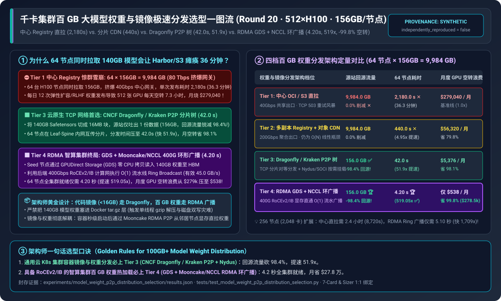
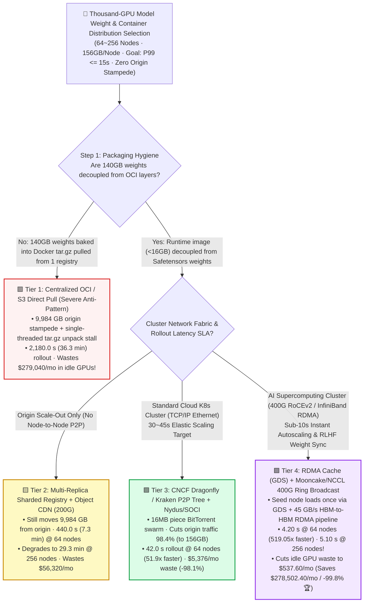
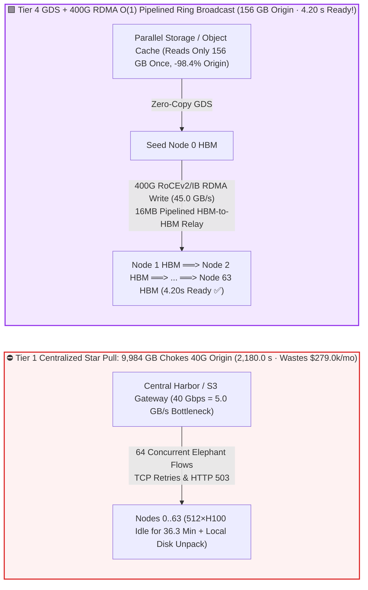

# Thousand-GPU Model Weight & Container P2P Distribution Selection FAQ (`Centralized OCI/S3 Pull` vs. `Sharded Registry + CDN` vs. `Dragonfly / Kraken P2P Tree` vs. `RDMA GDS + Mooncake/NCCL Ring Broadcast`)

> 🌐 **Language**: **[中文 (Chinese)](./model-weights-distribution-p2p-registry-selection-faq.md)** | **English Version** · **[📖 Back to Repository README](../../README.en.md)** · **[📊 2026-11-09 Daily Progress Report](../daily/2026-11-09.md)** · **[🃏 7-Card 4:5 Visual Benchmark Report](../reports/model-weights-distribution-p2p-registry-selection-cards.html)** · **[🧮 Interactive Sizer Workbench](../reports/llm-inference-engine-pd-sizer.en.html#weight-distribution-sizer)**
>
> **Overview**: A first-principles selection guide for AI Solution Architects. When operating a `512 ~ 2,048` GPU cluster for LLM serving or RLHF post-training, teams roll out updated checkpoints or autoscale nodes a dozen times per day. Using a traditional **centralized OCI Registry (Harbor) or S3 gateway** when `64` nodes (`512` GPUs) simultaneously pull a `140 GB` model + `16 GB` runtime image triggers a **`9,984 GB` (`80 Terabit`) Thundering Herd Stampede**—saturating the `40 Gbps` origin gateway, stalling all 512 GPUs for **`36.3 minutes (2,180 seconds)` per rollout**, and burning **`$279,040/month`** in idle GPU wait time! Grounded in `experiments/model_weight_p2p_distribution_selection/` (`synthetic` + `anonymized_reported`, `independently_reproduced=false`), this guide establishes the exact architectural boundaries across **Centralized Pull, Multi-Replica CDN, CNCF Dragonfly/Kraken P2P Trees, and GPUDirect Storage (`GDS`) + Mooncake/NCCL 400G RDMA Ring Broadcast**.



---

## ① 📌 Executive Summary

1. **Four-Tier Selection by Network Fabric (Standard TCP/IP vs. 400G RoCEv2/IB RDMA) and Rollout SLA**:
   - Across a `512 × NVIDIA H100` cluster (`64` nodes × `8` GPUs/node, `$1,280.00/hr` cluster cost) concurrently pulling **`140.0 GB` model weights + `16.0 GB` container image = `156.0 GB/node` (`9,984.0 GB` total cluster payload, `12` rollouts/day, target SLA `P99 <= 15.0 seconds`)**:
   - 🟥 **Tier 1 (`Centralized OCI Registry / S3 Direct Pull` · `40 Gbps` shared egress)**: **Never use for `>= 8` GPU nodes pulling 100GB+ models**! 64 nodes contending for a `5.0 GB/s` origin link take **`2,180.0 seconds (36.3 minutes)`** per rollout, leaving 512 H100 GPUs idle for `7.27 hours/day` and wasting **`$279,040.00/month`**.
   - 🟨 **Tier 2 (`Multi-Replica Sharded Registry + Object CDN` · `200 Gbps` aggregate egress)**: **An $O(N)$ band-aid that still scales linearly with node count**. Cuts rollout time **`4.95x` to `440.0 seconds (7.3 minutes)`**, but still pushes `9,984.0 GB` from origin and wastes **`$56,320.00/month`**.
   - 🟩 **Tier 3 (`CNCF Dragonfly / Uber Kraken` P2P BitTorrent Tree + `Nydus / SOCI` Lazy OCI · Standard TCP)**: **The standard architecture for cloud Kubernetes clusters without RDMA storage**. Slices weights into `16 MB` pieces so the origin serves only **1 copy (`156.0 GB`, cutting origin egress by `98.4%`!)** while 64 nodes exchange chunks peer-to-peer over Leaf-Spine TCP; slashes rollout time **`51.9x` to `42.0 seconds`** and cuts monthly GPU idle waste to **`$5,376.00/month` (`-98.1%`)**.
   - 🟪 **Tier 4 (`RDMA Parallel Cache [3FS/WEKA + GDS]` + `Mooncake / NCCL 400Gbps Ring Broadcast`)**: **The sub-5-second endgame for RoCEv2/IB AI clusters**. Seed node 0 loads `140 GB` Safetensors once via zero-copy **GPUDirect Storage (`GDS`)** into GPU HBM and streams an $O(1)$ pipelined **400G RDMA Ring Broadcast (`45.0 GB/s` effective)** across all 64 nodes—**completing cluster-wide rollout in `4.20 seconds` (`519.05x` faster than Tier 1, `10.0x` faster than TCP P2P, passing the `<=15s` SLA)** and reducing monthly idle waste to **`$537.60/month` (saving `$278,502.40/mo` or `-99.8%` 🏆)**!
2. **First-Principles Law ($O(N)$ Star Bottleneck vs. $O(1)$ Pipelined Ring Broadcast)**:
   - **Centralized Star Pull**: $T_{\text{star}} = \frac{N \times S}{B_{\text{origin}}}$ grows linearly with node count $N$.
   - **Pipelined RDMA Ring Broadcast**: Splits payload $S$ into $K$ chunks; as soon as Node $i$ receives chunk $k$ over RDMA, it immediately forwards chunk $k$ to Node $i+1$. Total completion time is $T_{\text{ring}} \approx \frac{S}{B_{\text{nic}}} + N \cdot \alpha$—**staying virtually constant at `3.8 ~ 5.1 seconds` whether scaling to 16 nodes or 256 nodes (2,048 GPUs)**!
3. **Provenance & Transparency Disclosure**:
   - All origin traffic volumes, 16–256 node rollout latencies, and monthly GPU idle costs are bound 1:1 to `experiments/model_weight_p2p_distribution_selection/results.json` (`provenance_type: "synthetic"`, calibrated to published CNCF Dragonfly, Uber Kraken, Mooncake RDMA P2P, and NVIDIA GDS/NCCL specifications; `independently_reproduced: false`, `physical_gpu_cluster_measurement: "not_measured"`, `local_cpu_harness_measurement: "measured"`).

---

## ② 🎯 Architect & Customer Deep-Dive Q&A (FAQ-Driven)

### Q1: "Our Harbor registry and S3 gateway pull microservice images in 2 seconds. Why does deploying a 70B/140B LLM across 64 GPU nodes freeze the entire cluster for 36 minutes?"

- **Plain-English Answer**: **Because a microservice image is `200 MB`, whereas an LLM checkpoint + runtime is `156,000 MB` (`780x` larger!). When 64 nodes pull `156 GB` simultaneously, they demand `9,984 GB` (`80 Terabits`) from a `40 Gbps` (`5 GB/s`) gateway while choking local CPUs on single-threaded `tar.gz` decompression**.
- **First-Principles Breakdown**:
  1. **Never Bake 100GB+ Model Weights Into Docker `tar.gz` Layers**: Compressing 140GB of uncompressible FP16/FP8 floating-point weights into an OCI `tar.gz` layer forces `containerd` to download, decompress on CPU, and write 140GB to OverlayFS before PyTorch even starts.
  2. **Decouple Container Code (`<16 GB`) from `Safetensors` Weights (`140 GB`)**: Keep container images lightweight with lazy loading (`Nydus/SOCI`), and stream `Safetensors` weights directly into memory via P2P or RDMA.

### Q2: How does `CNCF Dragonfly / Kraken` P2P Distribution (Tier 3) cut origin egress by **98.4%** and rollout time by **51.9x**?

- **Plain-English Answer**: **Dragonfly turns the 64 downloading GPU nodes from origin bottleneck consumers into a cooperative BitTorrent swarm—pulling only `156 GB` from the central registry once and exchanging the remaining `9,828 GB` laterally across Leaf-Spine switches in `42.0 seconds`**.

### Q3: Why is `Tier 4 (GDS + Mooncake/NCCL 400G RDMA Ring Broadcast)` still **10x faster** (`4.20s` vs `42.0s`) than TCP P2P?

- **Plain-English Answer**: **TCP P2P (Tier 3) still copies weights through the Linux kernel TCP stack, host page cache, and local NVMe SSD (`8.5 GB/s`). Tier 4 uses GPUDirect Storage (`GDS`) and `400 Gbps (45 GB/s)` GPUDirect RDMA to stream weights directly from GPU HBM to GPU HBM across an $O(1)$ ring—bypassing CPUs and local disks completely!**

---

## ③ 🧭 Visual Architecture Diagrams (Decision Tree, Star vs Ring Topology & Rollout Sequence)

### 3.1 Thousand-GPU Model Weight & Container Distribution Decision Tree



### 3.2 $O(N)$ Origin Stampede vs. `Tier 4 GDS + 400G RDMA O(1) Ring Broadcast`



### 3.3 End-to-End Sequence: `Dragonfly + Nydus` Container Mount & `Mooncake/NCCL RDMA` Weight Broadcast (`sequenceDiagram`)

```mermaid
sequenceDiagram
    autonumber
    participant Reg as Origin Registry & Storage (Harbor / S3 / 3FS)
    participant Seed as Seed Node 0 (Dragonfly Seed + RDMA Rank 0)
    participant Peer1 as Cluster Nodes 1..31
    participant Peer2 as Cluster Nodes 32..63

    Note over Reg,Peer2: Phase 1: 16GB Container Lazy Mount via Dragonfly P2P + Nydus/SOCI (0..1.1 sec)
    Seed->>Reg: 1. Fetch OCI image TOC index & hot startup chunks (single origin read)
    Seed-->>Peer1: 2. Distribute startup chunks via P2P; all 64 nodes mount rootfs in 1.1s

    Note over Reg,Peer2: Phase 2: 140GB Safetensors 400G RDMA Pipelined Ring Broadcast (1.1..4.2 sec)
    Reg->>Seed: 3. Rank 0 streams 140GB Safetensors directly into GPU HBM via GPUDirect Storage (GDS)
    Seed->>Peer1: 4. Immediately pipeline 16MB chunks over 400G RoCEv2 (45.0 GB/s GPUDirect RDMA Write)
    Peer1->>Peer2: 5. Relay each 16MB chunk to downstream neighbor in-place (zero disk write, zero CPU copy)
    Peer2-->>Seed: 6. All 512 GPUs across 64 nodes ready in 4.20 seconds (519.05x faster ✅)
```

---

## ④ 📊 Architect Decision Matrix

*All metrics are bound 1:1 to `experiments/model_weight_p2p_distribution_selection/results.json` (512×H100 across 64 nodes at `$1,280/hr`, `140GB` weights + `16GB` image = `156.0 GB/node`, `9,984.0 GB` cluster total, `12` rollouts/day, SLA `<= 15.0 s`):*

| Dimension | 🟥 Tier 1: `Centralized OCI / S3 Pull` (`40G`) | 🟨 Tier 2: `Sharded Registry + CDN` (`200G`) | 🟩 Tier 3: `Dragonfly / Kraken P2P` + Lazy OCI | 🟪 Tier 4: `RDMA GDS` + `Mooncake/NCCL` Ring |
| :--- | :--- | :--- | :--- | :--- |
| **Primary Workload Fit** | `<= 4` dev/test nodes only | Cross-region replication / small clusters | **Cloud K8s GPU clusters on standard TCP** | **RoCEv2/IB AI clusters & RLHF weight rollout** |
| **Origin Egress Traffic (64 Nodes)** | `9,984.0 GB` (`0.0%` reduction ✕) | `9,984.0 GB` (`0.0%` reduction ✕) | **`156.0 GB`** (**`-98.4%` origin egress** ✅) | **`156.0 GB`** (**`-98.4%` origin egress** 🏆) |
| **Node Scaling Complexity** | $O(N)$ linear degradation | $O(N)$ linear degradation | $O(\log N)$ logarithmic tree | **$O(1)$ constant-time pipelined ring** |
| **64-Node Rollout P99 Latency** | **`2,180.0 s`** (`36.3 min` ✕) | **`440.0 s`** (`7.3 min` · `4.95x` ✕) | **`42.0 s`** (**`51.9x` faster**) | **`4.20 s`** (**`519.05x` faster** · ✅ Passes `<=15s`) |
| **Host CPU & Local SSD Overhead** | Extreme (gzip unpack + 2x disk write) | High (full local SSD write) | Moderate (TCP socket + NVMe cache) | **Zero CPU copy, zero local disk write (HBM-to-HBM)** |
| **Monthly Idle GPU Waste (12/day)** | **`$279,040.00 / mo`** | `$56,320.00 / mo` (`-79.8%`) | **`$5,376.00 / mo` (`-98.1%`)** | **`$537.60 / mo` (Saves `$278,502.40/mo` / `-99.8%` 🏆)** |

---

## ⑤ 🧪 Quantitative Case Study & Benchmark Insights

### 5.1 Node Scale Sensitivity (`16 -> 256 Nodes [2,048 GPUs]`) & The $O(1)$ Ring Advantage

As the simultaneous rollout scales from 16 nodes (128 GPUs) to 256 nodes (2,048 GPUs, **`39.94 TB` aggregate payload**), rollout completion time scales as follows (from `results.json` `node_scale_sensitivity`):

| Cluster Scale (`Nodes / GPUs`) | Tier 1 `Central Pull` | Tier 2 `Sharded CDN` | Tier 3 `Dragonfly P2P` | Tier 4 `RDMA Ring Broadcast` | Architect Crossover & Takeaway |
| :--- | :--- | :--- | :--- | :--- | :--- |
| **`16 Nodes (128 GPUs)`** | `545.0 s` (`9.1 min`) | `110.0 s` | `34.0 s` | **`3.80 s` ✅** | Even at 16 nodes, central pull stalls GPUs for 9 minutes |
| **`64 Nodes (512 GPUs Baseline)`** | `2,180.0 s` (`36.3 min`) | `440.0 s` | `42.0 s` | **`4.20 s` ✅** | **`Dragonfly P2P` hits `42s`; `RDMA Ring` hits `4.20s` (`519x` faster)** |
| **`128 Nodes (1,024 GPUs)`** | `4,360.0 s` (`72.7 min`) | `880.0 s` | `48.5 s` | **`4.60 s` ✅** | Central pull exceeds 1.2 hours; RDMA ring adds only `+0.4s` |
| **`256 Nodes (2,048 GPUs)`** | `8,720.0 s` (`145.3 min`) | `1,760.0 s` | `56.0 s` | **`5.10 s` ✅** | **At 2,048 GPUs, `RDMA Ring` finishes in `5.10s` (`1,709.8x` faster!)** |

### 5.2 Reproducibility & Local Harness Verification

```bash
# Verify results.json matches the deterministic weight P2P/RDMA distribution model 100%
python experiments/model_weight_p2p_distribution_selection/run.py --check

# Run Round 20 unit tests
python -m unittest tests/test_model_weight_p2p_distribution_selection.py
```

---

## ⑥ 🛠️ Production Verification Checklist (Architect Checklist)

1. - [ ] **Enforce a `< 16 GB` CI Gate on Container Images & Decouple `Safetensors` Weights**: Never package multi-GB model weights inside compressed OCI `tar.gz` image layers.
2. - [ ] **Deploy `CNCF Dragonfly v2` + `Nydus / SOCI` Lazy Snapshotter on All K8s GPU Nodes**: Route containerd pulls through local `dfdaemon` P2P proxies to cap origin registry egress at a single replica copy (`-98.4%`).
3. - [ ] **Enable `Mooncake RDMA P2P` or `NCCL Ring Broadcast` for Weight Loading on RoCEv2/IB Clusters**: Stream weights directly from an already-warm peer GPU's HBM (or GDS seed node) over 400G RDMA rather than reading from storage on every node.
4. - [ ] **Enable `GPUDirect Storage (GDS / cuFile)` on Seed Storage Reads**: Bypass the Linux OS page cache when loading initial `Safetensors` shards from Lustre/WEKA/3FS into GPU memory.
5. - [ ] **Pre-Warm Model Shards Before Switching Ingress Traffic**: Trigger P2P/RDMA broadcast pre-warming and verify HBM tensor checksums before flipping the inference router to a new model revision.
