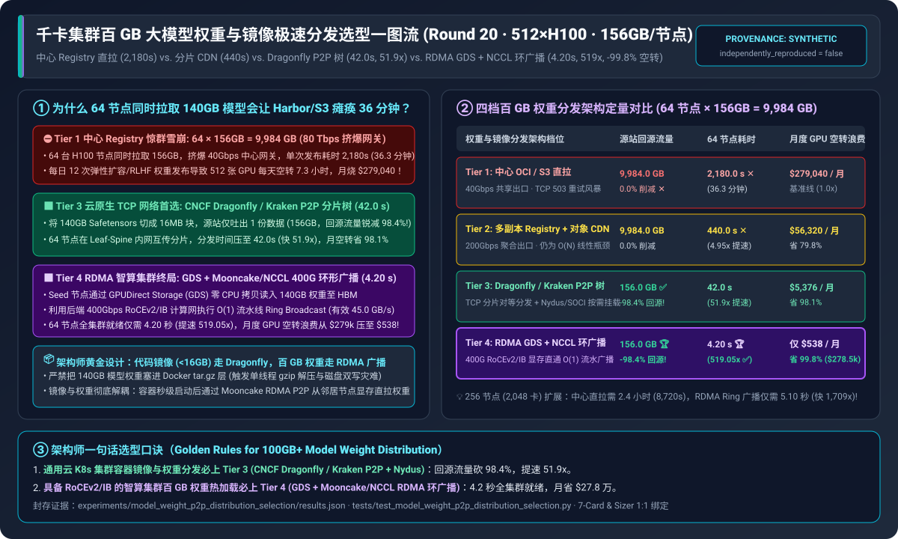
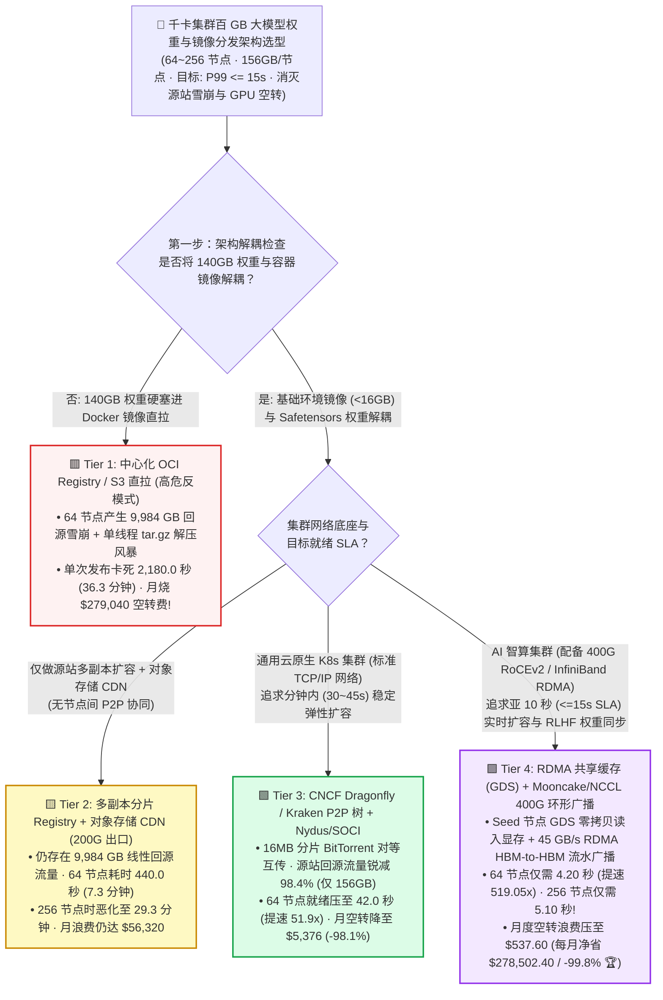
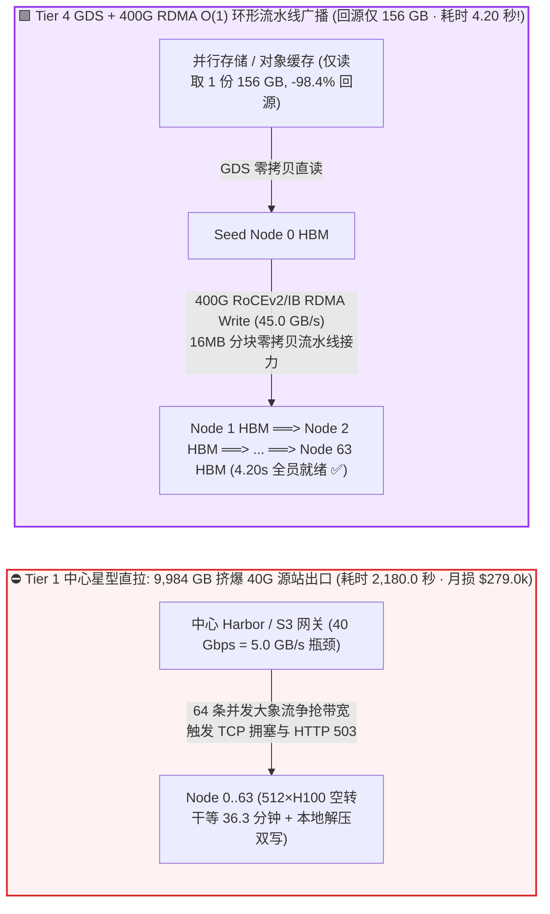
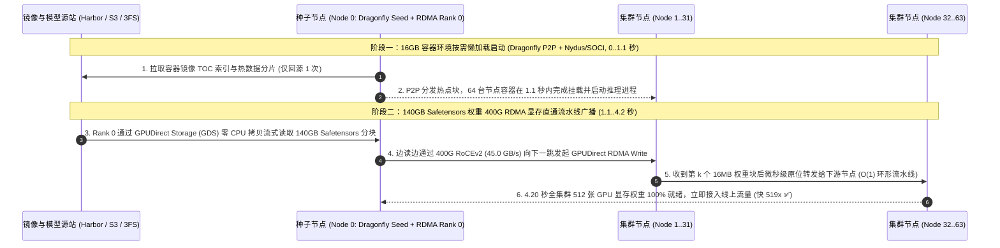

# 千卡集群百 GB 大模型权重与容器镜像极速分发架构选型指南（`中心化 OCI/S3 直拉` vs. `多副本 Registry + CDN` vs. `Dragonfly / Kraken P2P 树` vs. `RDMA GDS + Mooncake/NCCL 环广播`）

> 🌐 **Language**: **中文 (Chinese)** | **[English Version](./model-weights-distribution-p2p-registry-selection-faq.en.md)** · **[📖 返回仓库根目录 README](../../README.md)** · **[📊 2026-11-09 每日进展日报](../daily/2026-11-09.md)** · **[🃏 7-Card 4:5 视觉评测报告](../reports/model-weights-distribution-p2p-registry-selection-cards.html)** · **[🧮 交互式定容工作台](../reports/llm-inference-engine-pd-sizer.html#weight-distribution-sizer)**
>
> **导读**：面向 AI Solution Architect 的第一性原理实战选型指南。当企业规模化运营 `512 ~ 2,048` 张 GPU 的大模型推理或 RLHF 后训练集群时，每天都要执行十几次模型新版本上线、弹性扩容或断点恢复。如果沿用传统微服务时代的 **中心化 Harbor OCI 镜像仓库或 S3 对象存储直拉架构**，`64` 台 8 卡 H100 服务器同时拉取一份 `140 GB` 模型权重 + `16 GB` 容器镜像，瞬间会在源站出口形成 **`9,984 GB`（近 `80 Terabits`）的惊群流量风暴（Thundering Herd Stampede）**——不仅直接把中心存储网关打到 `HTTP 503` 假死，更让 512 张昂贵的 H100 每次上线都要干等 **`36.3 分钟（2,180 秒）`**，每个月光等权重下载就白白烧掉 **`$279,040` 算力费**！本文基于 `experiments/model_weight_p2p_distribution_selection/` 封存的确定性模型（`synthetic` + `anonymized_reported`，`independently_reproduced=false`），系统拆解从 **中心直拉、分片 CDN、CNCF Dragonfly/Kraken P2P 分片树** 到 **GPUDirect Storage (`GDS`) + Mooncake/NCCL 400G RDMA 环形广播** 的四档架构选型边界。



---

## ① 📌 核心结论速览（Executive Summary）

1. **按集群网络底座（标准以太网 TCP vs. 400G RoCEv2/IB RDMA）与分发对象四档精准选型**：
   - 在 `512 × NVIDIA H100` 集群（`64` 节点 × `8` 卡/节点，`$1,280.00/hr` 集群成本）并发分发 **`140.0 GB` 模型权重 + `16.0 GB` 运行时镜像 = `156.0 GB/节点`（全集群总数据落盘量 `9,984.0 GB`，日均 `12` 次滚动发布/弹性扩容，SLA 要求全集群就绪 `P99 <= 15.0 秒`）** 基准下：
   - 🟥 **Tier 1（中心化 `OCI Registry / S3 Gateway` 直拉 · `40 Gbps` 共享出口）**：**严禁在 `>= 8` 节点的 GPU 集群上直接拉取百 GB 权重**！64 台节点争抢 `5.0 GB/s` 源站带宽并触发 TCP 拥塞重传，单次全量上线耗时长达 **`2,180.0 秒（36.3 分钟）`**，512 张 H100 每天空转 `7.27 小时`，月度 GPU 空转损失高达 **`$279,040.00/月`**。
   - 🟨 **Tier 2（多副本分片 Registry + 区域对象存储 CDN · `200 Gbps` 聚合出口）**：**治标不治本的 $O(N)$ 线性扩容方案**。虽然将源站出口扩了 5 倍使耗时降至 **`440.0 秒（7.3 分钟，提速 `4.95x`）`**，但源站仍需重复吐出 `9,984.0 GB` 流量，距离 15 秒 SLA 相差近 30 倍，月度空转浪费仍达 **`$56,320.00/月`**。
   - 🟩 **Tier 3（`CNCF Dragonfly / Uber Kraken` P2P 分片树 + `Nydus / SOCI` 懒加载快照 · 标准 TCP 网络）**：**无 RDMA 存储网的公有云 Kubernetes 集群标准解法**。将大文件切分为 `16 MB` 分片，源站仅需吐出 **1 份数据（`156.0 GB`，源站回源流量暴降 `98.4%`！）**，其余 63 份全部由计算节点在 Leaf-Spine 内网通过 BitTorrent 树状协议对等互传；分发耗时压缩 **`51.9x` 至 `42.0 秒`**，月度空转浪费降至 **`$5,376.00/月`（立省 `98.1%`）**。
   - 🟪 **Tier 4（`RDMA 共享并行缓存 [3FS/WEKA + GDS]` + `Mooncake / NCCL 400Gbps Ring Broadcast` 显存直通环广播）**：**具备 RoCEv2/IB 网络的智算集群终局方案**。由 Seed 节点通过 **GPUDirect Storage (`GDS`)** 零 CPU 拷贝将 140GB `Safetensors` 读入显存，随后利用 64 节点间现成的 **`400 Gbps`（有效 `45.0 GB/s`）RDMA 计算网执行 $O(1)$ 流水线环形广播（Ring Broadcast）**——**全集群 64 节点在 `4.20 秒` 内同步就绪（比中心直拉快 `519.05x`，比 TCP P2P 快 `10.0x`，完美达标 `<=15s` SLA）**，月度 GPU 空转浪费骤降至 **`$537.60/月`（每月净省 `$278,502.40` 或 `-99.8%`）**！
2. **第一性原理定性（从 $O(N)$ 中心瓶颈到 $O(1)$ 环形流水线广播的数学跃迁）**：
   - **中心拉取（Star Topology）** 的完成时间是 $T_{\text{star}} = \frac{N \times S}{B_{\text{origin}}}$，随节点数 $N$ **线性爆炸**；
   - **RDMA 环形/树状流水线广播（Ring/Tree Broadcast）** 将大小为 $S$ 的权重切成 $K$ 个微块，节点 $i$ 收到块 $k$ 的瞬间立即通过双工 RDMA 网卡转发给节点 $i+1$，理论完成时间恒定为 $T_{\text{ring}} \approx \frac{S}{B_{\text{nic}}} + N \cdot \alpha$——**无论集群是 16 节点还是 256 节点（2,048 卡），156 GB 权重的全网分发时间都恒定在 `3.8 ~ 5.1 秒`！**
3. **证据口径与透明性声明**：
   - 本指南所有源站流量、64~256 节点分发耗时与月度 GPU 空转成本均绑定 `experiments/model_weight_p2p_distribution_selection/results.json`（`provenance_type: "synthetic"`，基于 CNCF Dragonfly v2、Uber Kraken、Mooncake RDMA P2P 及 NVIDIA GDS/NCCL 公开规范校准的确定性算例，`independently_reproduced: false`，未在物理 512×H100 集群执行破坏性源站压测 `physical_gpu_cluster_measurement: "not_measured"`；本机 Python 单测与校验为 `local_cpu_harness_measurement: "measured"`）。

---

## ② 🎯 客户与架构师灵魂拷问 Q&A（FAQ-Driven）

### Q1：客户问：“我们的 Harbor 镜像仓库和 Ceph/S3 存储平时拉一个微服务镜像只要 2 秒，为什么一发大模型版本（或者 K8s 触发 64 节点弹性扩容），整个集群就会卡死半个多小时？”

- **直白结论**：**因为微服务镜像是 `200 MB`，而大模型连镜像带权重是 `156,000 MB`（膨胀 780 倍！）**。当 64 台服务器在同一秒钟向中心 Harbor/S3 发起拉取时，总传输量高达 **`9,984 GB`（`80 Terabits`）**，不仅把源站 `40 Gbps` 网卡彻底堵死，更在客户端引发灾难性的 **“单线程 `tar.gz` 解压与磁盘双写风暴”**！
- **第一性原理拆解（传统 Docker 镜像分发大模型的三大死穴）**：
  1. **源站出口 $O(N)$ 惊群拥塞**：64 台节点同时抢 `5.0 GB/s` 中心出口，平均每台节点只分到 `78 MB/s`，光是网络下载就要 `2,000+ 秒`。
  2. **致命反模式——把 140GB 模型权重打包进 Docker `tar.gz` 镜像层**：标准 OCI 镜像层使用 `gzip` 压缩。即使网络下载完，容器运行时（`containerd`）必须用 CPU 解压 140GB 数据并写入 OverlayFS，随后 PyTorch 启动时又要从 OverlayFS 读入内存——**引发 280GB 磁盘写放大与长达数分钟的 CPU 解压停顿**！
  3. **架构师解耦铁律**：**代码环境走轻量 OCI 镜像（`< 16 GB`，配合 `Nydus/SOCI` 按需挂载），百 GB 模型权重必须独立存放在按块对齐的 `Safetensors` 仓库中，走 P2P 或 RDMA 零拷贝直灌 GPU HBM**！

### Q2：什么是 `CNCF Dragonfly / Kraken` P2P 镜像与权重分发（Tier 3）？它是怎么把源站回源流量砍掉 **98.4%** 并把耗时压到 **42 秒** 的？

- **直白结论**：**P2P 分发把集群里正在下载的 64 台 GPU 服务器从“争抢源站的吸血鬼”变成了“互相供血的 BitTorrent 种子节点”——源站只需要把 156GB 数据发出去 1 次，剩下的 9,828 GB 流量全部在机房内部高速交换机上横向消化！**
- **第一性原理拆解（Dragonfly P2P 树状分片调度机制）**：
  1. **HTTP Range 分片（Piece-Level Slicing）**：当各节点上的 `dfdaemon` 代理拦截到拉取 140GB `model.safetensors` 或 OCI 镜像层的请求时，Scheduler 将大文件逻辑切分为数百个 `16 MB` 的分片（Piece）。
  2. **超级节点（Seed Peer）+ 动态有向无环图对等互传**：Scheduler 指定节点 0..3 从源站拉取互不重叠的分片（源站总出口流量从 `9,984 GB` 骤降至 **`156.0 GB`，减少 `98.4%`**）；一旦节点 0 下完第 1 个 `16 MB` 分片，节点 1..63 立即通过内网从节点 0 并发拉取该分片并继续向下游节点扩散，在 `42.0 秒` 内跑满机房内网 TCP 带宽完成全量分发！

### Q3：既然 Dragonfly P2P（Tier 3）已经压到了 42 秒，为什么在拥有 400G RoCEv2/IB 的智算集群上，我们还要推荐 `Tier 4（GDS + Mooncake/NCCL RDMA 环形广播）` 把它进一步压到 **4.20 秒**？

- **直白结论**：**因为 TCP P2P（Tier 3）依然要经过“网卡 -> 内核 Socket -> 主机内存页缓存 -> 本地 NVMe 落盘 -> 再读入 GPU 显存”的漫长链路，受限于 CPU 软中断和本地 SSD 写带宽（`8.5 GB/s`）；而 `Tier 4` 直接用 GPU 的 `400 Gbps (45 GB/s)` RDMA 网卡在显存与显存之间做零拷贝环形广播，彻底绕过 CPU 和本地磁盘，快了整整 10 倍！**
- **第一性原理拆解（`GDS + RDMA Ring Broadcast` 的 $O(1)$ 极速物理通路）**：
  1. **只有 1 个节点读存储（`GPUDirect Storage`）**：当 64 个节点同时启动或切换 RLHF 新一轮权重时，只有 Rank 0（或每个分片的 Owner Rank）通过 `GDS (cuFile)` 或从训练 Actor 节点直接将权重固定在 GPU HBM（或锁页内存 `Pinned DRAM`）中。
  2. **400G RoCEv2 / IB 硬件流水线环广播（`Mooncake P2P / ncclBroadcast`）**：64 个节点组成逻辑环（或双二叉树），以 **`45.0 GB/s` 线速** 将权重张量从上游节点的 HBM 直接 `RDMA Write` 到下游节点的 HBM——**全程零磁盘写入、零内核拷贝、零解压开销**，无论集群扩到 64 节点（`4.20 s`）还是 256 节点（`5.10 s`），全集群都能在 **5 秒以内** 同时开始推理！

---

## ③ 🧭 直观可视化图解（选型决策树 + 中心雪崩 vs P2P/RDMA 拓扑对比 + 环广播时序图）

### 3.1 千卡集群百 GB 大模型权重与容器镜像分发架构选型决策树



### 3.2 中心源站 $O(N)$ 惊群雪崩 vs. `Tier 3 Dragonfly P2P` & `Tier 4 RDMA Ring Broadcast` 路径对比图



### 3.3 容器镜像 `Nydus/Dragonfly` 秒级挂载 + 140GB 权重 `Mooncake/NCCL RDMA` 环形广播时序图（`sequenceDiagram`）



---

## ④ 📊 架构师选型决策矩阵（Architect Decision Matrix）

*数据完全绑定 `experiments/model_weight_p2p_distribution_selection/results.json`（512×H100 集群，64 节点，`$1,280/hr`，单节点 `140GB` 权重 + `16GB` 镜像 = `156.0 GB`，全集群 `9,984.0 GB`，日均 `12` 次发布/扩容，SLA `<= 15.0 秒`）：*

| 选型维度 | 🟥 Tier 1：中心化 `OCI / S3` 直拉（`40G` 出口） | 🟨 Tier 2：多副本分片 Registry + `CDN`（`200G` 出口） | 🟩 Tier 3：`Dragonfly / Kraken` P2P 树 + Lazy OCI | 🟪 Tier 4：`RDMA GDS` + `Mooncake/NCCL` 400G 环广播 |
| :--- | :--- | :--- | :--- | :--- |
| **核心适用场景** | 仅限 `<= 4` 节点开发测试环境 | 跨地域多机房镜像同步或中小型 CPU 集群 | **无 RDMA 存储网的公有云 K8s GPU 集群标准配置** | **具备 RoCEv2/IB 的百卡/千卡推理扩容与 RLHF 权重同步** |
| **源站回源总流量（64 节点）** | `9,984.0 GB`（`0.0%` 削减 ✕） | `9,984.0 GB`（`0.0%` 削减 ✕） | **`156.0 GB`**（**削减 `98.4%`** ✅） | **`156.0 GB`**（**削减 `98.4%`** 🏆） |
| **节点规模扩展复杂度** | $O(N)$ 线性恶化（节点翻倍耗时翻倍） | $O(N)$ 线性恶化 | $O(\log N)$ 对数树状收敛 | **$O(1)$ 环形流水线恒定耗时（与节点数几乎无关！）** |
| **64 节点全量就绪 P99 耗时** | **`2,180.0 秒`**（`36.3 分钟` ✕） | **`440.0 秒`**（`7.3 分钟` · `4.95x` ✕） | **`42.0 秒`**（**提速 `51.9x`**） | **`4.20 秒`**（**提速 `519.05x`** · ✅ 达标 `<=15s`） |
| **CPU 与本地磁盘 I/O 开销** | 极高（全量解压 + 双倍磁盘写放大） | 极高（全量下载落盘） | 中等（TCP Socket + 本地 NVMe 缓存） | **零 CPU 拷贝、零本地磁盘落盘（GDS + GPUDirect RDMA 直写 HBM）** |
| **月度 GPU 等待空转浪费（12 次/天）** | **`$279,040.00 / 月`** | `$56,320.00 / 月`（`-79.8%`） | **`$5,376.00 / 月`（`-98.1%`）** | **`$537.60 / 月`（净省 `$278,502.40/月` 或 `-99.8%` 🏆）** |

---

## ⑤ 🧪 简明定量算例与 Benchmark 洞察

### 5.1 集群规模从 `16 节点 (128 卡) -> 256 节点 (2,048 卡)` 扩展下的就绪时间拐点

当同时拉起或滚动更新的节点数从 16 台扩展到 256 台（2,048 张 H100，总数据量达 **`39.94 TB`**）时，四档分发架构的完成时间如下（源自 `results.json` `node_scale_sensitivity`）：

| 并发拉取节点规模 (`Cluster Nodes / GPUs`) | Tier 1 `中心直拉` 耗时 | Tier 2 `分片 CDN` 耗时 | Tier 3 `Dragonfly P2P` 耗时 | Tier 4 `RDMA 环广播` 耗时 | 架构师核心拐点解读 |
| :--- | :--- | :--- | :--- | :--- | :--- |
| **`16 Nodes (128 GPUs)`** | `545.0 s` (`9.1 min`) | `110.0 s` | `34.0 s` | **`3.80 s` ✅** | 16 节点下中心直拉已需 9 分钟；RDMA 环广播仅 `3.8s` |
| **`64 Nodes (512 GPUs 基线)`** | `2,180.0 s` (`36.3 min`) | `440.0 s` | `42.0 s` | **`4.20 s` ✅** | **Dragonfly P2P 压至 `42s`；RDMA 环广播 `4.20s` 达标 15s SLA** |
| **`128 Nodes (1,024 GPUs)`** | `4,360.0 s` (`72.7 min`) | `880.0 s` | `48.5 s` | **`4.60 s` ✅** | 千卡集群中心直拉超 1 小时；P2P 与 RDMA 保持平坦 |
| **`256 Nodes (2,048 GPUs)`** | `8,720.0 s` (`145.3 min`) | `1,760.0 s` | `56.0 s` | **`5.10 s` ✅** | **2,048 卡下 RDMA 环广播仅需 `5.10 秒`，比中心直拉快 `1,709.8 倍`！** |

### 5.2 复现命令与本地校验（Local CPU Harness Check）

```bash
# 校验封存算例 JSON 与确定性权重 P2P/RDMA 分发模型 100% 一致
python experiments/model_weight_p2p_distribution_selection/run.py --check

# 运行 Round 20 单元测试
python -m unittest tests/test_model_weight_p2p_distribution_selection.py
```

---

## ⑥ 🛠️ 附录：生产环境大模型权重与镜像极速分发核验清单（Architect Checklist）

1. - [ ] **严禁将 `>= 5 GB` 的模型权重打包进 Docker/OCI 镜像层**：CI/CD 流水线必须设置镜像体积门禁（基础环境镜像 `< 16 GB`），模型权重统一转化为未压缩、按张量对齐的 `Safetensors` 格式独立挂载或流式注入。
2. - [ ] **K8s 节点全面部署 `CNCF Dragonfly v2` + `Nydus / SOCI` Snapshotter**：将 containerd 的 Registry Mirror 指向本地 `dfdaemon`，开启 `16 MB` 分片 P2P 预热，把源站 Harbor/S3 回源带宽保护在单副本水平（`-98.4%`）。
3. - [ ] **智算集群开启 `Mooncake P2P Store` 或 `NCCL Ring Broadcast` 权重热同步**：在具备 RoCEv2/IB 的集群上，新扩容的推理 Pod 直接从集群内已加载该模型的在线 Peer Pod 显存（或 Pinned Host DRAM）通过 GPUDirect RDMA 拉取权重，无需回源读盘。
4. - [ ] **对象存储/并行文件系统存储桶开启前缀分片（Prefix Sharding）与 `GDS`**：若首节点从 S3/3FS/WEKA 读取权重，确保按模型分片 Hash 打散前缀并开启 `cuFile (GPUDirect Storage)` 绕过宿主机 OS Page Cache。
5. - [ ] **配置滚动发布预热钩子（Pre-Warm DaemonSet / Kueue Topology Hook）**：在流量切入新版本模型前，由控制器先触发 P2P/RDMA 环形预热，待全节点显存校验 SHA-256 通过后再原子切换推理网关路由。
