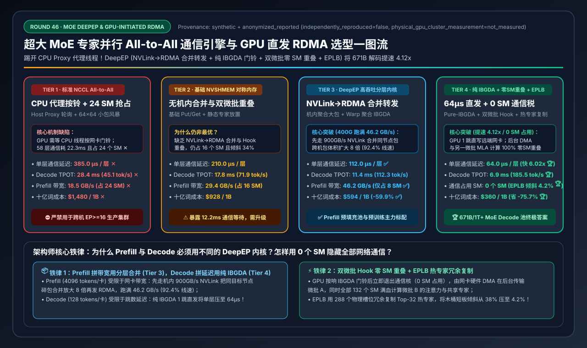
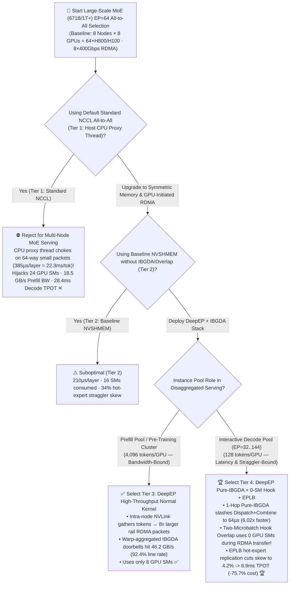
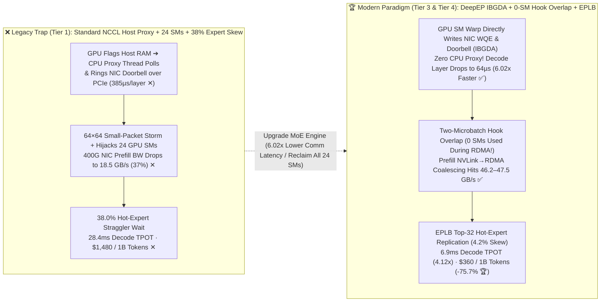

# Large-Scale MoE Expert Parallelism All-to-All Engine & GPU-Initiated RDMA (`DeepEP` / `IBGDA`) Architecture Selection Guide (`Standard NCCL Host Proxy` vs. `Baseline NVSHMEM` vs. `DeepEP NVLink→RDMA Forwarding` vs. `DeepEP Low-Latency Pure-IBGDA + 0-SM Hook Overlap + EPLB`)

> **Reader's Guide**: Built for **AI Solution Architects and Distributed LLM Inference/Training Engineers**, this guide explains from first principles: **why serving a 671B Mixture-of-Experts model (`DeepSeek-V3/R1`, 58 MoE layers, 256 routed experts, Top-8 routing) across 64 GPUs (`EP=64`) with standard `NCCL All-to-All` (Tier 1) stalls for 22.3ms per token on CPU proxy doorbell bottlenecks while burning 24 GPU SMs per chip on communication; how `IBGDA (GPUDirect Async Kernel-Initiated RDMA)` lets GPU SMs ring NIC MMIO doorbells directly without any Host CPU proxy thread; why Prefill requires `DeepEP High-Throughput NVLink-to-RDMA Asymmetric Forwarding` (Tier 3) to reach 46.2 GB/s (`92.4%` line rate); and how `DeepEP Low-Latency Pure-IBGDA + Two-Microbatch 0-SM Hook Overlap + EPLB Dynamic Expert Load Balancing` (Tier 4) crushes per-layer Dispatch+Combine latency from 385µs down to 64µs (`6.02x` faster), cuts Decode TPOT from 28.4ms to 6.9ms (`4.12x` faster), and reclaims all 24 GPU SMs for compute.**



---

## ① 📌 Executive Summary

1. **Why Standard `NCCL All-to-All` (Tier 1) Collapses on Multi-Node MoE (`EP=64`)**:
   - In a `671B MoE` model (`58` MoE layers, `256` routed experts, `Top-8` routing) deployed across 8 nodes (`64 GPUs, EP=64`), every single token must traverse **2 All-to-All collectives per layer** (`Dispatch` to target expert GPUs + `Combine` back to source GPUs) = **`116` cross-network All-to-All steps per generated token**!
   - Under **Standard `NCCL All-to-All` (Tier 1)**, three bottlenecks compound simultaneously:
     1. **Host CPU Proxy Thread Doorbell Bottleneck**: GPU kernels cannot ring RDMA NIC doorbells directly in standard NCCL; instead, the GPU flags a host memory buffer and waits for a **CPU proxy thread** to poll the flag and issue PCIe MMIO doorbell writes across 64 tiny peer streams. Per-layer `Dispatch + Combine` takes **`385.0 µs` (`22.3 ms` across 58 layers ✕)**!
     2. **64×64 Small-Packet Fragmentation**: Direct 64-to-64 tiny transfers cap 400Gbps (`50 GB/s`) RDMA NIC throughput at just **`18.5 GB/s` (`37.0%` utilization ✕)** during Prefill.
     3. **24 GPU SMs Hijacked by Communication Kernels**: NCCL dedicates **`24 SMs/GPU` (`18%` of the chip)** to communication copy/sync loops, starving GEMM compute and—combined with **`38.0%` hot-expert straggler skew**—inflating Decode TPOT to **`28.4 ms` (`45.1 tok/s/GPU` ✕)**!
2. **Prefill High-Throughput Gold Standard (`Tier 3: DeepEP NVLink→RDMA Forwarding`) vs. Decode Ultra-Low-Latency Gold Standard (`Tier 4: DeepEP Pure-IBGDA + 0-SM Hook Overlap + EPLB`)**:
   - **For Prefill Pools & Pre-Training (`4,096 tokens/rank`, Bandwidth-Bound), deploy `Tier 3 (DeepEP High-Throughput Normal Kernel: Intra-Node NVLink Gather → Rail-Local RDMA Coalesced Forwarding + Warp-Aggregated IBGDA)`**: Coalesces tokens destined for the same remote node over `900 GB/s` intra-node NVLink first, turning 64 tiny cross-node flows into **8 large rail-aligned RDMA transfers** and pushing 400G NIC throughput to **`46.2 GB/s` (`92.4%` line rate ✅)** using only **`8 SMs`**!
   - **For Interactive Decode Pools (`128 tokens/rank`, Latency-Bound), standardize on `Tier 4 (DeepEP Low-Latency Pure-IBGDA Kernel + Two-Microbatch 0-SM Hook Overlap + EPLB Dynamic Expert Load Balancer)`**:
     - **Pure GPU-Initiated RDMA (`IBGDA`)** bypasses both the Host CPU proxy thread and the extra intra-node NVLink hop, letting GPU SM warps write WQEs and ring ConnectX-7 doorbells directly—slashing per-layer Dispatch+Combine latency **`6.02x` from `385.0 µs → 64.0 µs` 🏆**!
     - **Background RDMA Hook + Two-Microbatch Overlap (`0 SMs` Used)**: Once the GPU rings the IBGDA doorbell (`<2 µs`), the communication kernel exits immediately; the NIC DMA engine transfers Microbatch-A in the background using **`0 GPU SMs`** while all 132 GPU SMs compute Microbatch-B's MLA Attention and Shared Expert! Paired with **EPLB redundant hot-expert replication** (cutting straggler skew from `38.0% → 4.2%`), Decode TPOT drops to **`6.9 ms` (`4.12x` faster 🏆)**, throughput jumps to **`185.5 tok/s/GPU` 🏆**, and cost per 1B tokens drops **`-75.7%` (`$1,480 → $360` 🏆)**!
3. **First-Principles Rule**:
   - **Prefill is Bandwidth-Bound** (coalesce over NVLink before crossing RDMA); **Decode is Latency-Bound** (use direct 1-hop `Pure-IBGDA` + background `0-SM Hook Overlap` + `EPLB` hot-expert replication).

---

## ② 🎯 Architect & Customer FAQ (First-Principles Q&A)

### Q1: Why does standard NCCL work great for 70B Dense `TP=8` AllReduce, yet stall for 22.3ms/token and waste 24 SMs on 671B MoE `EP=64` All-to-All?

**Plain-Language First Principles**:
- In Dense `TP=8`, GPUs exchange one contiguous multi-megabyte tensor inside a single NVSwitch node. In `671B MoE EP=64`, each GPU routes `128` tokens (Top-8 experts each) across **64 separate GPUs across 8 servers**—generating $64 \times 64 = 4,096$ tiny multi-kilobyte packets twice per layer (`116` times per token)!
- Standard **NCCL (Tier 1)** relies on a **Host CPU proxy thread** to poll GPU flags and ring RDMA NIC doorbells over PCIe (`385.0 µs/layer × 58 layers = 22.3 ms/token` stall) while tying up **`24 GPU SMs`** in polling loops.

---

### Q2: How does `IBGDA (GPUDirect Async Kernel-Initiated RDMA)` work, and why does `DeepEP` provide two separate kernels—a `Normal Kernel` for Prefill (Tier 3) and a `Low-Latency Kernel` for Decode (Tier 4)?

**Plain-Language First Principles**:
- **What is `IBGDA`?** Mapping the RDMA NIC's Queue Pair (QP) Work Queue and MMIO Doorbell registers directly into GPU-accessible BAR memory (`NVSHMEM_IB_ENABLE_IBGDA=1`) so a GPU SM warp can construct RDMA `WRITE` descriptors and ring the NIC doorbell directly in hardware—**zero CPU proxy involvement, zero OS jitter**.
- **Why Prefill Needs `Tier 3 (NVLink → RDMA Coalesced Forwarding)`**: With `4,096` tokens/GPU in Prefill, sending $64 \times 64$ direct RDMA streams causes small-packet overhead and switch queue micro-bursts. Tier 3 first aggregates tokens destined for the same target node over `900 GB/s` intra-node NVLink, increasing RDMA packet size by **$8\times$** and achieving **`46.2 GB/s` (`92.4%` of 400G line rate ✅)**.
- **Why Decode Needs `Tier 4 (Pure-IBGDA Direct 1-Hop)`**: With only `128` tokens/GPU in Decode, bandwidth is abundant and hop latency dominates. Tier 4 skips intra-node NVLink forwarding and fires **1-hop Pure-IBGDA RDMA writes** directly to target expert GPUs, cutting per-layer latency to **`64.0 µs` (`6.02x` faster than Tier 1 🏆)**.

---

### Q3: How does DeepEP's "Hook-Based 0-SM Overlap" hide 100% of RDMA communication without using a single GPU SM, and how does `EPLB` eliminate the 38% hot-expert straggler bottleneck?

**Plain-Language First Principles**:
1. **Two-Microbatch Hook Overlap (`0 SMs` for Communication)**:
   - Instead of keeping a communication kernel spinning on 16–24 SMs waiting for packets to arrive, `DeepEP Low-Latency` splits the batch into **Microbatch A** and **Microbatch B**.
   - The GPU spends `<2 µs` issuing `IBGDA` doorbell writes for Microbatch A and **exits the communication kernel immediately**. While the ConnectX-7 NIC DMA engine transfers Microbatch A across the network in the background (**consuming `0 GPU SMs`**), **all 132 GPU SMs** run Microbatch B's MLA Attention and Shared Expert! Once compute finishes, a lightweight `recv_hook()` verifies completion in registers.
2. **EPLB (Expert Parallelism Load Balancer)**:
   - Real-world prompts disproportionately trigger "hot experts" (causing a `38.0%` straggler wait across 64 GPUs). **EPLB** provisions `288` physical expert slots for the `256` logical experts—dynamically replicating the Top-32 hottest experts across nodes to slash load skew from `38.0%` down to **`4.2%` 🏆**!

---

## ③ 🧭 Visual Architecture Diagrams (Mermaid Decision Tree / Forwarding Topology / Sequence Diagram)

### 3.1 Large-Scale MoE All-to-All Engine Selection Decision Tree (`flowchart TD`)



### 3.2 Standard `NCCL Host Proxy` vs. `DeepEP Pure-IBGDA + 0-SM Hook Overlap + EPLB` (`flowchart LR`)



### 3.3 End-to-End `DeepEP Low-Latency Pure-IBGDA` + Two-Microbatch `0-SM Hook` Overlap Flow (`sequenceDiagram`)

```mermaid
sequenceDiagram
    autonumber
    participant SMs as All 132 GPU Compute SMs
    participant IBGDA as GPU IBGDA Doorbell Issuer
    participant NIC as 400G RDMA NIC DMA Engine (0 SMs)
    participant RemoteHBM as Remote Expert GPU HBM

    SMs->>IBGDA: 1. Compute Microbatch-A router gate; issue dispatch_async(Microbatch-A) in <2µs
    IBGDA->>NIC: 2. GPU Warp writes WQE & rings NIC MMIO Doorbell directly (Zero Host CPU Proxy!)
    Note over SMs,NIC: 3. 🔥 Zero-SM Overlap: Comm kernel exits immediately; all 132 SMs switch to Microbatch-B!
    par Background NIC Hardware DMA Transfer (Uses 0 GPU SMs)
        NIC->>RemoteHBM: 4a. NIC DMA engine pushes Microbatch-A FP8 tokens to remote HBM (32µs)
    and Full-Chip 132-SM Compute (100% Hides RDMA Latency)
        SMs->>SMs: 4b. All 132 GPU SMs execute Microbatch-B MLA Attention & Shared Expert at 100% speed!
    end
    SMs->>NIC: 5. Call recv_hook() to confirm Microbatch-A arrival with zero spinning stall
    SMs->>SMs: 6. Run EPLB-balanced Expert FFNs (4.2% skew) & Combine -> 6.9ms Total Decode TPOT 🏆
```

---

## ④ 📊 Architect Decision Matrix

*Benchmark Profile: `64-GPU H800/H100 Cluster` (`8 Nodes × 8 GPUs`, intra-node NVSwitch + `8×400Gbps` InfiniBand/RoCEv2 NICs per node, `50.0 GB/s` theoretical line rate per NIC) running `DeepSeek-V3/R1 671B` (`58` MoE layers, `EP=64`).*

| Selection Dimension / Tier | Tier 1: Standard `NCCL All-to-All` (`Host CPU Proxy`) | Tier 2: Baseline `NVSHMEM` Symmetric (`No IBGDA/Overlap`) | Tier 3: `DeepEP` High-Throughput (`NVLink→RDMA` Forwarding) | Tier 4: `DeepEP` Low-Latency `Pure-IBGDA` + `0-SM Hook` + `EPLB` |
| :--- | :--- | :--- | :--- | :--- |
| **RDMA Initiation & Forwarding Path** | GPU flags RAM $\rightarrow$ CPU proxy thread rings NIC doorbell | Symmetric Put/Get without rail coalescing or doorbell batching | **Intra-node NVLink gather $\rightarrow$ Rail-local IBGDA large packets** | **1-Hop Pure GPU-Initiated RDMA (`IBGDA`) + Background DMA Hook** |
| **Compute-Comm Overlap & Balancing** | Synchronous blocking + static experts (`38%` skew) | Sequential comm-then-compute + static experts | **TMA async copy + Prefill chunked pipeline overlap** | **Two-Microbatch Ping-Pong Hook (`0 SMs`) + `EPLB` hot-expert replication** |
| **Decode Dispatch+Combine / Layer** | `385.0 µs / layer` (`22.3ms` total ✕) | `210.0 µs / layer` | **`112.0 µs / layer`** ✅ | **`64.0 µs / layer` (`6.02x` faster than Tier 1)** 🏆 |
| **Decode Latency (TPOT ms)** | `28.4 ms` ✕ | `17.8 ms` | **`11.4 ms`** ✅ | **`6.9 ms` (`4.12x` faster than Tier 1)** 🏆 |
| **Prefill 400G NIC Bus Bandwidth** | `18.5 GB/s` (`37.0%` util ✕) | `29.4 GB/s` (`58.8%`) | **`46.2 GB/s` (`92.4%` line rate ✅)** | **`47.5 GB/s` (`95.0%` line rate 🏆)** |
| **GPU SMs Consumed by Comm** | `24 SMs / GPU` (Steals 18% compute ✕) | `16 SMs / GPU` | **`8 SMs / GPU`** ✅ | **`0 SMs / GPU` (Zero SM tax during overlap!)** 🏆 |
| **Hot-Expert Straggler Skew (%)** | `38.0%` ✕ | `34.0%` | **`18.5%`** ✅ | **`4.2%` (EPLB redundant slot balancing)** 🏆 |
| **Decode Throughput (tok/s/GPU)** | `45.1 tok/s/GPU` ✕ | `71.9 tok/s/GPU` | **`112.3 tok/s/GPU`** ✅ | **`185.5 tok/s/GPU` (`4.11x` higher capacity)** 🏆 |
| **Cluster Cost per 1B Tokens** | `$1,480.00 / 1B tokens` ✕ | `$928.00 / 1B tokens` | **`$594.00 / 1B tokens`** ✅ | **`$360.00 / 1B tokens` (`-75.7%` cost)** 🏆 |

---

## ⑤ 🧪 Quantitative Case Study & 7-Card Benchmark Insights

### 5.1 Reproducible Evaluator & Sealed Artifacts

All metrics in this guide are generated by the deterministic evaluator and verified via unit tests:
- **Evaluator Script**: [`experiments/moe_deepep_ibgda_alltoall_selection/run.py`](../../experiments/moe_deepep_ibgda_alltoall_selection/run.py)
- **Sealed Output**: [`experiments/moe_deepep_ibgda_alltoall_selection/results.json`](../../experiments/moe_deepep_ibgda_alltoall_selection/results.json)
- **Unit Test Suite**: [`tests/test_moe_deepep_ibgda_alltoall_selection.py`](../../tests/test_moe_deepep_ibgda_alltoall_selection.py)
- **7-Card 4:5 Visual Report**: [`docs/reports/moe-deepep-ibgda-nvshmem-alltoall-engine-selection-cards.html`](../reports/moe-deepep-ibgda-nvshmem-alltoall-engine-selection-cards.html)
- **Interactive Sizer Workbench**: [`docs/reports/llm-inference-engine-pd-sizer.en.html#moe-deepep-ibgda-sizer`](../reports/llm-inference-engine-pd-sizer.en.html) (Standalone: [`docs/reports/moe-deepep-ibgda-nvshmem-alltoall-sizer.html`](../reports/moe-deepep-ibgda-nvshmem-alltoall-sizer.html))
- **Provenance**: `synthetic_analytical_model_calibrated_to_anonymized_published_benchmarks` (`independently_reproduced=false`, `physical_gpu_cluster_measurement=not_measured`).

### 5.2 Key Quantitative Insights

1. **Eliminating the Host CPU Proxy Thread via `Pure-IBGDA` Saves `18.6 ms` per Token**:
   $$\text{58-Layer All-to-All Time}: 22.33\text{ ms (Tier 1 NCCL)} \rightarrow 3.71\text{ ms (Tier 4 Pure-IBGDA, 6.02x Faster)}$$
   Hiding that `3.71 ms` behind Microbatch-B compute via `0-SM Hook Overlap` reclaims all `24 GPU SMs` previously wasted on communication polling.
2. **Coalesced `NVLink → RDMA` Forwarding Lifts 400G NIC Efficiency from `37.0%` to `92.4%–95.0%`**:
   $$\text{Prefill All-to-All BW}: 18.5\text{ GB/s (Tier 1)} \rightarrow 46.2\text{ GB/s (Tier 3)} \rightarrow 47.5\text{ GB/s (Tier 4)}$$

---

## ⑥ 🛠️ Appendix: Production Architect Checklist

- [ ] **1. Enable Kernel-Mode `IBGDA` (`NVSHMEM_IB_ENABLE_IBGDA=1` & `PeerMappingOverride=1`)**: Configure `options nvidia NVreg_RegistryDwords="PeerMappingOverride=1"` and `NVSHMEM_IB_ENABLE_IBGDA=1` so GPU SMs can map and ring ConnectX-7 MMIO doorbells directly.
- [ ] **2. Bind `DeepEP Normal Kernel` to Prefill Pools and `DeepEP Low-Latency Kernel` to Decode Pools**: Use hierarchical NVLink-to-RDMA coalescing on Prefill nodes (`4,096` tokens/rank) and 1-hop Pure-IBGDA on Decode nodes (`128` tokens/rank).
- [ ] **3. Enable Two-Microbatch Hook Overlap (`--enable-two-batch-overlap`)**: Overlap Microbatch-A's background RDMA DMA transfer (`0 SMs`) with Microbatch-B's MLA Attention and Shared Expert compute.
- [ ] **4. Deploy `EPLB` with `+12.5%` Redundant Physical Expert Slots (`288` Slots for `256` Experts)**: Replicate the Top-32 hottest routed experts across ranks to cap load imbalance below `5%`.
- [ ] **5. Quantize `Dispatch` Payloads to `FP8 E4M3` Before Crossing RDMA**: Halve All-to-All wire bytes during `Dispatch` by transmitting `1-byte FP8` activations plus block scales.
- [ ] **6. Isolate `IBGDA` Queue Pairs on Dedicated Lossless RoCE Priority / InfiniBand VL**: Protect latency-sensitive MoE All-to-All traffic from background storage or checkpointing traffic.
