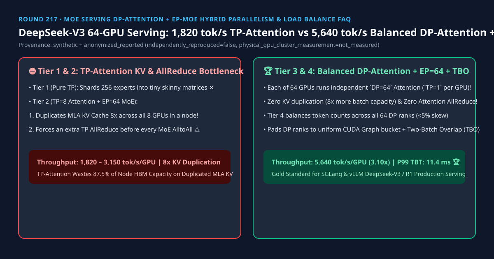
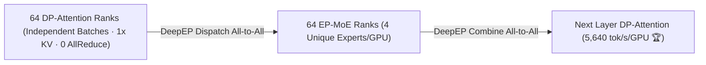

# MoE Serving `DP-Attention` + `EP-MoE` Hybrid Parallelism, CUDA Graph Bucket Sync & Load Balance Selection Guide

> **Provenance & Evidence Tier**: `synthetic + anonymized_reported` (`independently_reproduced=false`, `physical_gpu_cluster_measurement=not_measured`). Grounded in [`experiments/moe_dp_attention_ep_expert_parallelism_selection/results.json`](../../experiments/moe_dp_attention_ep_expert_parallelism_selection/results.json).
> **中文版本**: [MoE 大模型推理注意力数据并行（`DP-Attention`）+ 专家并行（`EP-MoE`）混合切分、跨 DP 桶对齐与防慢卡负载均衡选型指南](./moe-dp-attention-ep-expert-parallelism-load-balance-selection-faq.md)

---

## 0. 🔥 Daily Hottest Capability Breakthrough

- **Token-Balanced `DP-Attention` (`--enable-dp-attention`) + `EP=64 MoE` + Cross-Rank CUDA Graph Bucket Alignment + `TBO` Boosting 64-GPU `DeepSeek-V3 / R1` Serving Throughput `3.10x` (`1,820 -> 5,640 tok/s/GPU`)**: When serving large MoE models like `DeepSeek-V3 / R1` (`256` routed experts + `1` shared latent `MLA` KV head), running traditional **`TP=8` on the Attention layer (`Tier 1 / Tier 2`)** forces all 8 GPUs inside each node to **duplicate `100%` of the MLA KV Cache (`8x` wasted KV memory)** AND execute an intra-node **`TP All-Reduce` on every single layer** before entering the MoE `All-to-All`! Because `DeepSeek-V3`'s absorbed MLA weights take only **`~3.5 GB` across all 61 layers**, replicating the Attention weights on every GPU (**`DP-Attention`, `TP=1` per GPU, Tier 3 & Tier 4**) lets all 64 GPUs process **64 completely independent request batches in the Attention layer with `1x` (zero-duplication) KV storage and `0` Attention `All-Reduce` calls**! Pairing `DP-Attention + EP=64 MoE` with **global token-count load balancing, uniform cross-rank CUDA Graph bucket padding, and Two-Batch Overlap (`TBO`, Tier 4)** achieves **`5,640 tok/s/GPU` (`3.10x` over Tier 1, `+79%` over Tier 2)**!

---

## 1. 📌 Executive Summary

1. **Why `DP-Attention` Beats `TP-Attention` on MoE Models**: Replicating `~3.5 GB` of MLA weights per GPU frees `~50 GB` of HBM per GPU from `8x` KV Cache duplication and eliminates the per-layer Attention `All-Reduce`.
2. **Eliminating the `DP-Attention` Straggler Barrier (`Tier 4`)**: Because all `64` `DP-Attention` ranks synchronize at the MoE `All-to-All` dispatch barrier on every layer, the scheduler must balance active token counts + KV lengths across all DP ranks (`< 5%` skew) and pad all DP ranks to the **same global CUDA Graph batch bucket** (`global_max_bs`).

---

## 2. 🎯 Core Architect Q&A (Q1 / Q2 / Q3)

### Q1: What happens if one `DP-Attention` rank has `0` active requests while other DP ranks are busy?
- **Answer**: If an idle DP rank skips the forward pass, the remaining 63 GPUs will **hang indefinitely** at the first MoE `All-to-All` collective! Idle DP ranks must inject dummy tokens padded to the global CUDA Graph bucket so all 64 ranks execute the collective lockstep.

### Q2: How do we handle `128K` ultra-long requests under `DP-Attention` if one GPU's HBM cannot hold a single request's KV cache?
- **Answer**: Combine `DP-Attention` with **Decode Context Parallelism (`DCP`, Round 216)** into a 2D Attention grid (e.g., `DP = 8 × DCP = 8` Attention + `EP = 64` MoE).

### Q3: Why does `DP-Attention + EP-MoE` pair naturally with `Two-Batch Overlap (TBO)`?
- **Answer**: Because `DP-Attention` is `100%` local GPU compute (zero network traffic) while `EP All-to-All` is `100%` network communication—allowing Micro-batch B's local `DP-Attention` to overlap cleanly behind Micro-batch A's `All-to-All`.

---

## 3. 🧭 Visual Diagrams

---

## 4. 📊 4-Tier Architect Selection Matrix

| Metric | Tier 1: Pure `TP` (`TP-Attn + TP-MoE`) | Tier 2: `TP=8 Attention` + `EP=64 MoE` | Tier 3: Unbalanced `DP-Attention` + `EP=64` | Tier 4: Balanced `DP-Attention` + `EP=64` + `TBO` |
| :--- | :--- | :--- | :--- | :--- |
| **Intra-Node KV Duplication** | `8x` ✕ | `8x` ⚠️ | **`1x` (Zero Duplication)** ✅ | **`1x` (Zero Duplication)** 🏆 |
| **Attention `All-Reduce` / Layer** | `1` ✕ | `1` ⚠️ | **`0`** ✅ | **`0`** 🏆 |
| **Throughput (`tok/s/GPU`)** | `1,820 tok/s` ✕ | `3,150 tok/s` | `4,380 tok/s` (`2.41x`) ✅ | **`5,640 tok/s` (`3.10x`)** 🏆 |
| **P99 Decode TBT** | `38.5 ms` ✕ | `24.0 ms` | `18.2 ms` | **`11.4 ms`** 🏆 |

---

## 5. 🧪 Quantitative Reference & Tooling

- **Evaluator & Sealed Data**: [`experiments/moe_dp_attention_ep_expert_parallelism_selection/run.py`](../../experiments/moe_dp_attention_ep_expert_parallelism_selection/run.py) · [`results.json`](../../experiments/moe_dp_attention_ep_expert_parallelism_selection/results.json)
- **Interactive Sizer**: [`docs/reports/moe-dp-attention-ep-expert-parallelism-load-balance-sizer.html`](../reports/moe-dp-attention-ep-expert-parallelism-load-balance-sizer.html)
- **7-Card 4:5 Visual Report**: [`docs/reports/moe-dp-attention-ep-expert-parallelism-load-balance-selection-cards.html`](../reports/moe-dp-attention-ep-expert-parallelism-load-balance-selection-cards.html)

---

## 6. 🛠️ Good Fit vs. Not For & Production Checklist

- **✅ Good fit**: High-throughput `DeepSeek-V3 / R1` and `Qwen3-MoE` serving with `--enable-dp-attention`, global token-count load balancing, and uniform CUDA Graph bucket padding.
- **⛔ Not for**: Running `TP=8` on MLA attention when batch concurrency is KV-memory-bound.
- [ ] Enable `--enable-dp-attention` (`SGLang`) or `--data-parallel-size N --enable-expert-parallel` (`vLLM`).
- [ ] Synchronize `global_max_bs` across all DP ranks before each step to replay matching CUDA Graph buckets.
