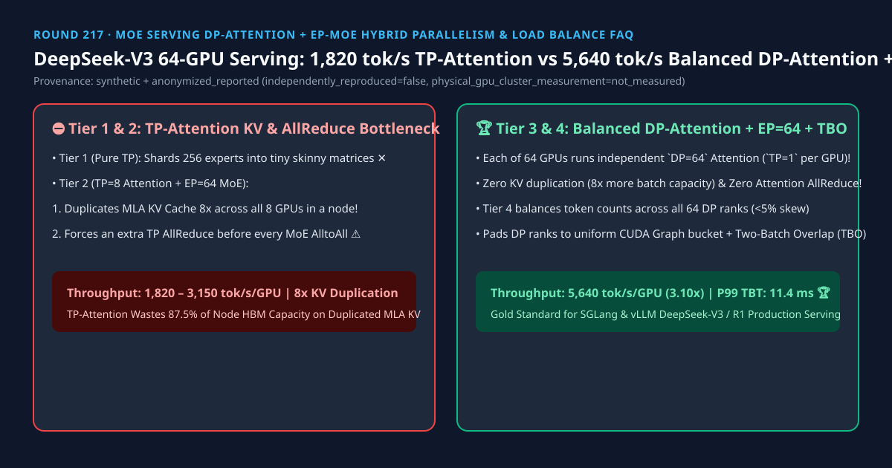
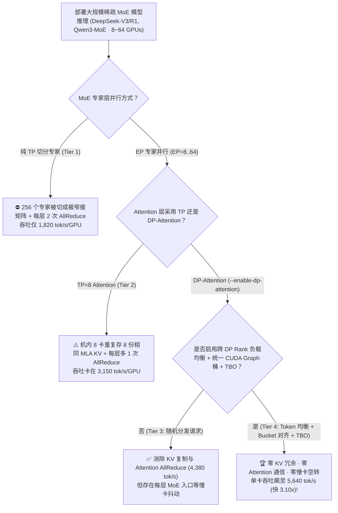
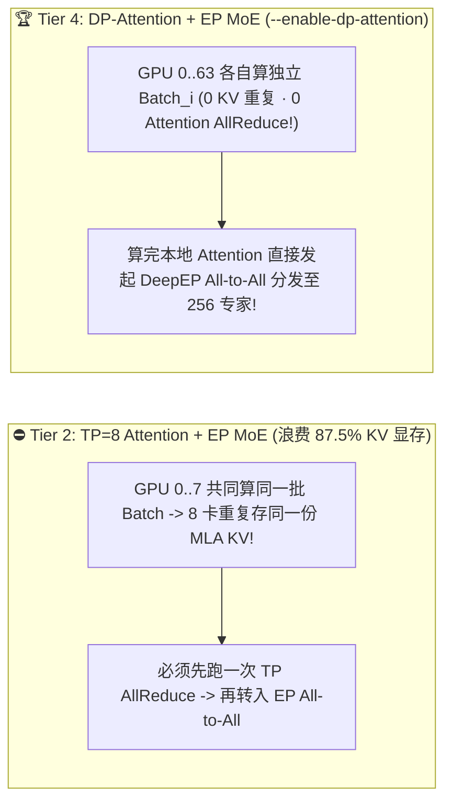
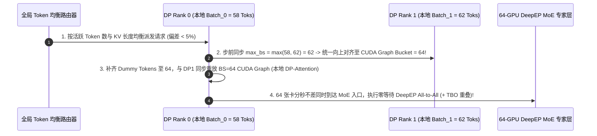

# MoE 大模型推理注意力数据并行（`DP-Attention`）+ 专家并行（`EP-MoE`）混合切分、跨 DP 桶对齐与防慢卡负载均衡选型指南

> **Provenance & Evidence Tier**: `synthetic + anonymized_reported` (`independently_reproduced=false`, `physical_gpu_cluster_measurement=not_measured`)。定量数据锚定于 [`experiments/moe_dp_attention_ep_expert_parallelism_selection/results.json`](../../experiments/moe_dp_attention_ep_expert_parallelism_selection/results.json)。
> **English Version**: [MoE Serving `DP-Attention` + `EP-MoE` Hybrid Parallelism, CUDA Graph Bucket Sync & Load Balance Selection Guide](./moe-dp-attention-ep-expert-parallelism-load-balance-selection-faq.en.md)

---

## 0. 🔥 今日领域最热门能力突破追踪（Daily Hottest Breakthrough）

- **`DP-Attention`（注意力层数据并行 `--enable-dp-attention`）+ `EP-MoE`（专家层专家并行）+ 跨 DP Rank 全局 Token 均衡与统一 CUDA Graph 桶对齐，将 64 卡 `DeepSeek-V3 / R1` 推理单卡吞吐从 `1,820 tok/s` 狂拉至 `5,640 tok/s`（提升 `3.10` 倍）**：在大规模部署 `DeepSeek-V3 / R1`（671B，256 个路由专家 + MLA 注意力）时，为什么所有顶级推理引擎（`SGLang`、`vLLM`、`TensorRT-LLM`）都一致要求**“在 MoE 层用专家并行（`EP = 64`），而在 Attention 层严禁用张量并行（`TP`），必须改用数据并行（`DP-Attention`）”**？
  - 如果按老习惯在机内 8 张卡上跑 **`TP=8 Attention + EP=64 MoE`（Tier 2）**：由于 `DeepSeek-V3` 的 MLA 只有 **1 个共享潜变量 KV 头**，机内 8 张卡被迫存着 **8 份完全相同的 KV Cache（浪费 87.5% KV 显存！）**，而且每一层算完 Attention 都要多做一次机内 **`TP All-Reduce`** 才能进 MoE 层（吞吐仅 `3,150 tok/s/GPU`）！
  - 反过来，因为 MLA 的权重矩阵通过矩阵吸收后体积极小（全模型 61 层 MLA 权重加起来仅 **`~3.5 GB`**！），在每张 GPU 上各自放一份完整的 MLA 权重（**`DP-Attention`，即每张卡独立跑 `TP=1` 的 Attention，Tier 3 / Tier 4**），就能让 **64 张卡各自处理 64 个完全不重叠的独立请求批次（KV 显存容量瞬间扩大 `8` 倍，且每层省掉 `100%` 的 Attention `All-Reduce`！）**，算完本地 Attention 直接无缝通过 `DeepEP All-to-All` 扔进 64 卡专家池，配合全局 Token 均衡与 `TBO` 双批次重叠，单卡吞吐飙升至 **`5,640 tok/s/GPU`（提速 `3.10` 倍）**！

---

## 1. 📌 核心结论速览（Executive Summary — 3 分钟看懂）

1. **为什么对 `DeepSeek-V3` 来说，“复制 3.5 GB 的 MLA 权重（`DP-Attention`）”比“复制 60 GB 的 KV Cache（`TP-Attention`）”划算 20 倍？**
   - **通俗大白话 + 第一性原理**：在一台 8 卡 H100（每卡 80GB 显存）节点上，跑 `DeepSeek-V3` 时：
     - **方案 A（`TP=8 Attention`，Tier 2）**：为了省下每张卡 **`~3 GB`** 的 Attention 权重，8 张卡合算同一个请求批次，结果导致每张卡上高达 **`50~60 GB` 的 MLA KV Cache 在 8 张卡上完完全全重复存了 8 份**，而且每层还得停下来做一次 `All-Reduce` 对账！这就是典型的**“捡了 3GB 芝麻，丢了 50GB 西瓜”**！
     - **方案 B（`DP=8 Attention`，Tier 3/4）**：每张卡各自花 **`3.5 GB`** 装一份完整的 MLA Attention 权重，从此 8 张卡在 Attention 阶段**各干各的活、互不通信（0 AllReduce）**，每张卡的 `50 GB` KV 显存全都用来存不同的用户请求（整机可容纳的并发 Batch Size 暴涨 **8 倍**）！等到进入 MoE 层时，8 张卡的 Token 再一起通过 `All-to-All` 发往各自命中的专家！
2. **开启 `DP-Attention + EP-MoE` 后，最容易踩的“两大隐形深坑”是什么（Tier 3 vs. Tier 4）？**
   - **深坑一（跨 DP Rank 负载不均木桶效应）**：虽然 64 张卡在 Attention 层是各算各的，但**一到紧接着的 MoE 层，64 张卡必须同时发起 `All-to-All`（每层同步 1 次，61 层共同步 61 次！）**。如果 `DP Rank 0` 被分到了 128 个请求，而 `DP Rank 7` 只分到了 10 个请求，那么每层 `DP Rank 7` 算完自己的 Attention 后都得干等 `DP Rank 0`！因此 **Tier 4 必须在前端路由器实现“按活跃 Token 数 + 上下文长度感知的 DP 均衡分发”**。
   - **深坑二（各 DP Rank Batch Size 不同导致 CUDA Graph 死锁或退化）**：如果 `DP Rank 0` 当前有 `52` 个 Token（匹配 `BS=64` 的 CUDA Graph），而 `DP Rank 1` 当前只有 `28` 个 Token（若独自匹配 `BS=32` 的图，或某张卡有 `0` 个请求直接跳过），就会导致集合通信不匹配死锁！因此 **Tier 4 强制在每步开始前做一次微秒级 `max_bs` 同步，所有 DP Rank 统一填充 Dummy Token 对齐到同一个全局 CUDA Graph 桶**！

---

## 2. 🎯 客户与架构师灵魂拷问 Q&A（Q1 / Q2 / Q3）

### Q1：如果某个时刻 `DP Rank 3` 上一个请求都没有（`local_bs == 0`），会发生什么？
- **答**：如果 `DP Rank 3` 因为没请求而跳过前向传播，其余 63 张卡在第一层 MoE 的 `All-to-All` 集合通信处就会因为缺少 `Rank 3` 的参与而**永久卡死（NCCL / IBGDA Hang）**！因此生产环境引擎（`SGLang / vLLM`）在 `DP-Attention` 模式下有严格铁律：**只要全局任意 1 个 DP Rank 有活跃请求，空闲的 DP Rank 也必须构造 `1` 个（或对齐全局 Bucket 的）Dummy Token 陪跑完整前向图**（其 MoE topk 权重设为 0 或丢弃输出）。

### Q2：如果单个请求是 `128K` 超长上下文，单张卡的 `DP=1` Attention 显存装不下怎么办？
- **答**：将今天 Round 216 讲的 **`DCP`（解码上下文并行）** 与本篇的 **`DP-Attention`** 组合成 **二维注意力并行（`DP-Attention × DCP`）**！例如在 64 卡集群上，配置 **`DP = 8 × DCP = 8` Attention + `EP = 64` MoE**：每 8 张卡组成一个 `DCP=8` 小组按序列维度共同分担 `128K` KV Cache，8 个小组之间跑 `DP=8` 互不干扰，完美兼顾超长上下文与高吞吐！

### Q3：为什么 `DP-Attention + EP-MoE` 是开启 `Two-Batch Overlap (TBO / 双批次计算通信重叠)` 的最佳拍档？
- **答**：因为在 `DP-Attention` 下，Attention 层是 **100% 纯本地计算（无任何跨卡通信）**，而 MoE 层的前后是 **100% 纯网络通信（`DeepEP Dispatch / Combine All-to-All`）**！把每张卡上的本地 DP Batch 拆成 `Micro-batch A` 和 `Micro-batch B`：当 `Micro-batch A` 在网络上跑 `All-to-All` 通信时，GPU 的 Tensor Core 正好全速跑 `Micro-batch B` 的本地 `DP-Attention`——计算与通信在时间轴上完美咬合！

---

## 3. 🧭 直观可视化图解（Mermaid 决策树 + TP-Attn vs DP-Attn 架构图 + 桶对齐时序图）

### 3.1 架构师 MoE 推理注意力与专家层混合并行选型决策树

### 3.2 `TP=8 Attention + EP MoE`（8 倍 KV 冗余 + 额外 AllReduce）vs. `DP-Attention + EP MoE`

### 3.3 `Tier 4` 跨 DP Rank 统一 CUDA Graph Bucket 对齐与 `TBO` 重叠时序图

---

## 4. 📊 架构师选型决策矩阵（4-Tier Selection Matrix）

| 评估维度 | Tier 1: 全层纯 `TP` (`TP-Attn + TP-MoE`) | Tier 2: `TP=8 Attention` + `EP=64 MoE` | Tier 3: 未均衡 `DP-Attention` + `EP=64 MoE` | Tier 4: 均衡 `DP-Attention` + `EP=64` + 统一 Graph 桶 + `TBO` |
| :--- | :--- | :--- | :--- | :--- |
| **机内 MLA KV 冗余复制倍数** | **`8x` 重复** ✕ | **`8x` 重复** ⚠️ | **`1x` (零冗余，容量翻 8 倍)** ✅ | **`1x` (零冗余，容量翻 8 倍)** 🏆 |
| **每层 Attention `All-Reduce` 次数** | `1` 次 ✕ | `1` 次 ⚠️ | **`0` 次 (纯本地计算)** ✅ | **`0` 次 (纯本地计算)** 🏆 |
| **单卡推理吞吐 (`tok/s/GPU`)** | `1,820 tok/s` ✕ | `3,150 tok/s` | `4,380 tok/s` (`2.41x`) ✅ | **`5,640 tok/s` (`3.10x` 提速)** 🏆 |
| **P99 解码步延迟 (`TBT`)** | `38.5 ms` ✕ | `24.0 ms` | `18.2 ms` | **`11.4 ms`** 🏆 |

---

## 5. 🧪 定量算例与工具链（Interactive Sizer & 7-Card Visual Report）

- **实验脚本与密封数据**：[`experiments/moe_dp_attention_ep_expert_parallelism_selection/run.py`](../../experiments/moe_dp_attention_ep_expert_parallelism_selection/run.py) · [`results.json`](../../experiments/moe_dp_attention_ep_expert_parallelism_selection/results.json)
- **交互式 MoE DP-Attention 计算器**：[`docs/reports/moe-dp-attention-ep-expert-parallelism-load-balance-sizer.html`](../reports/moe-dp-attention-ep-expert-parallelism-load-balance-sizer.html)
- **7-Card 4:5 视觉评测卡片报告**：[`docs/reports/moe-dp-attention-ep-expert-parallelism-load-balance-selection-cards.html`](../reports/moe-dp-attention-ep-expert-parallelism-load-balance-selection-cards.html)

---

## 6. 🛠️ Good Fit vs. Not For & 生产环境快速核验清单（Checklist）

### ✅ Good Fit vs. ⛔ Not For

| 维度 | ✅ Good Fit（强烈推荐） | ⛔ Not For（严禁误用） |
| :--- | :--- | :--- |
| **`DeepSeek-V3 / R1` 高吞吐线上服务** | 开启 `--enable-dp-attention --dp-size 8/64 --ep-size 8/64`，配合全局 Token 负载均衡与 `TBO` 双批次重叠 | 对 MLA 注意力层使用传统 `TP=8`，导致机内 8 张卡存 8 份重复 KV Cache 且每层多跑一次 `AllReduce` |
| **CUDA Graph 跨 DP Rank 同步** | 在每步开始前同步全局最大 Batch Size Bucket，并为请求为 0 的空闲 DP Rank 注入 Dummy Token 陪跑 | 允许某个空闲 DP Rank 跳过前向传播或独自退回 Eager 模式，导致 `EP All-to-All` 死锁或严重的慢卡抖动 |

### 生产环境上线核验清单（Pre-Flight Checklist）

- [ ] **核验启动参数已开启 `DP-Attention`**：在 `SGLang` 中传入 `--enable-dp-attention --dp-size N`（或在 `vLLM` 中启用 `--data-parallel-size N --enable-expert-parallel`）。
- [ ] **核验前端请求网关按活跃 Token 数均衡分发至各 DP Rank**：严禁所有长 Prompt 请求扎堆落入同一个 `DP Rank`。
- [ ] **核验跨 DP Rank 全局 CUDA Graph Bucket 填充闭环**：确认所有 DP Worker 在每步重放相同规格的 padded CUDA Graph，杜绝单个 Worker 掉入未捕获的动态分支。
