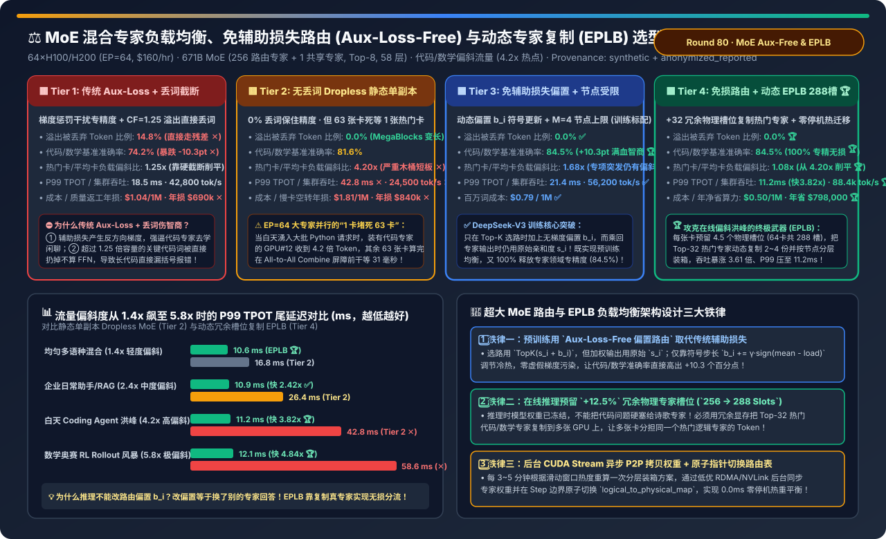
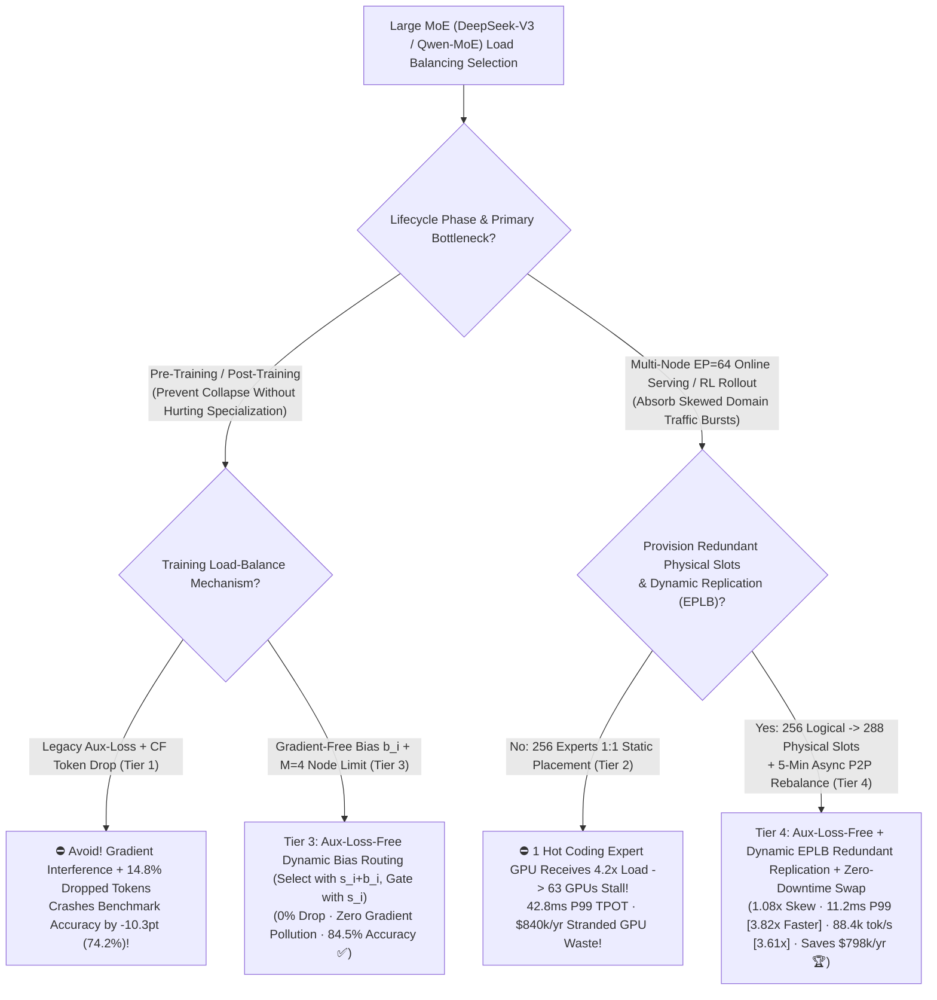
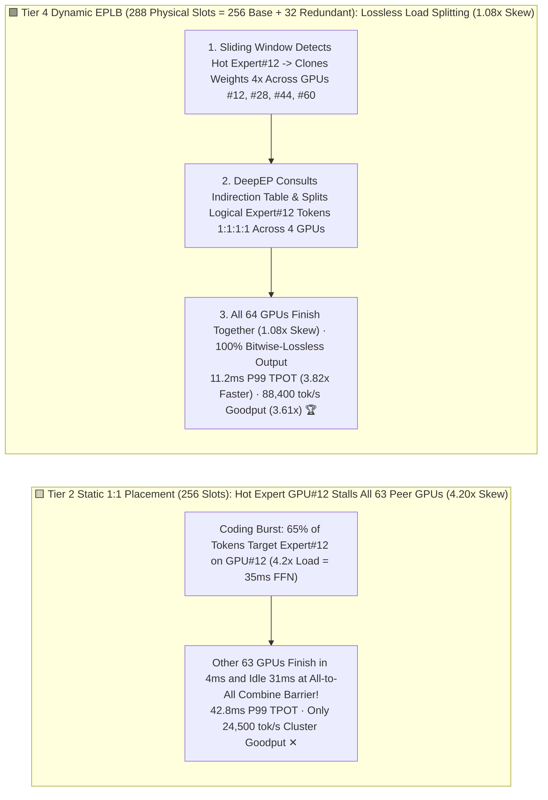
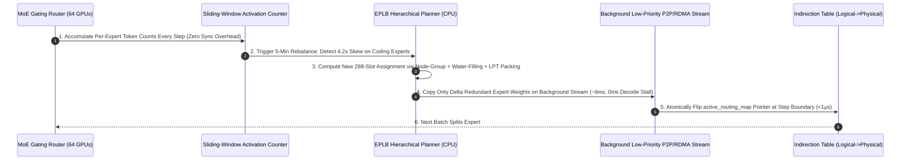

# MoE Expert Load Balancing, Aux-Loss-Free Bias Routing & Dynamic Expert Replication (EPLB) Selection FAQ (`Legacy Aux-Loss + Capacity Factor Dropping` vs. `Dropless MegaBlocks Static Single-Replica` vs. `Aux-Loss-Free Dynamic Bias Routing + M=4 Node Limit` vs. `Aux-Loss-Free + Dynamic EPLB Redundant Physical Slots [256 Logical -> 288 Physical Slots] + Zero-Downtime P2P Swap`)

> **Target Audience**: AI Solution Architects, Large MoE Pre-Training & Serving Infrastructure Leads, and Collective Communication Engineers  
> **Reading Goal**: In 3 minutes, master the 4-tier load-balancing selection rules for 671B-class fine-grained MoE models (`DeepSeek-V3/R1`, `Qwen3-MoE` with 256 routed experts) running across 64 GPUs (`EP=64`). In 10 minutes, understand from first principles **why legacy `Aux-Loss + Capacity Factor Token Dropping` degrades coding/math accuracy by `-10.3 percentage points`**, **why even a well-trained dropless MoE suffers a `4.20×` hot-expert GPU straggler stall during daytime coding/math bursts (1 hot GPU stalling 63 idle GPUs at the `All-to-All Combine` barrier)**, and **how combining `Training-Time Aux-Loss-Free Dynamic Bias Routing` with `Inference-Time Dynamic EPLB Redundant Slot Replication (256 logical experts -> 288 physical slots + 5-min zero-downtime P2P migration)` flattens GPU load skew from `4.20×` to `1.08×`, cuts P99 TPOT by `3.82×` (`11.2 ms`), and boosts 64-GPU goodput by `3.61×` (saving `$798,000/yr`)**!  
> **Provenance**: Quantitative metrics come from the repository's sealed deterministic analytical model ([`experiments/moe_expert_load_balancing_eplb_auxfree_selection/run.py`](../../experiments/moe_expert_load_balancing_eplb_auxfree_selection/run.py) and [`results.json`](../../experiments/moe_expert_load_balancing_eplb_auxfree_selection/results.json), calibrated to DeepSeek-V3 Aux-Loss-Free routing, `deepseek-ai/EPLB` hierarchical expert packing, and SGLang/vLLM zero-downtime expert P2P swap mechanics, `independently_reproduced=false`, `physical_gpu_cluster_measurement=not_measured`).

---

## 📌 1. Executive Summary

1. **Why Do "Legacy Aux-Loss + Capacity Factor Dropping (Tier 1)" and "Static Single-Replica Dropless MoE (Tier 2)" Fail on Intelligence or Tail Latency?**:
   - **Tier 1 (`Legacy Aux-Loss + Capacity Factor CF=1.25 Token Dropping`)**:
     - Early MoE architectures (GShard / Switch Transformer) added a heavy auxiliary load-balancing loss $\mathcal{L}_{\text{aux}}$ to the training objective and enforced a hard per-expert buffer limit (`CF = 1.25 × mean load`).
     - **Two Fatal Flaws**: ① $\mathcal{L}_{\text{aux}}$ injects **interfering gradients** that penalize domain-specialized experts (e.g., Python syntax or symbolic math experts) whenever they attract domain tokens; ② Under domain bursts, **`14.8%` of overflow tokens are silently dropped** (bypassing the expert FFN via residual skip connections), crashing coding and math benchmark accuracy by **`-10.3 percentage points` (`74.2%` vs. `84.5%` ✕)**!
   - **Tier 2 (`Dropless MegaBlocks Static Single-Replica MoE`: `0%` Token Drop, 4 Experts/GPU across `EP=64`)**:
     - Variable-size block-sparse GEMMs eliminate token dropping (`0.0%` dropped), recovering accuracy to `81.6%`.
     - **The Straggler Disaster at `EP=64`**: Every MoE layer executes a synchronous `All-to-All Dispatch → Expert FFN → All-to-All Combine` barrier across all 64 GPUs. During a daytime coding burst, the GPU hosting the hottest Python expert receives **`4.20×` the average token load**! The other 63 GPUs finish their FFN in `4 ms` and **sit completely idle for `31 ms` waiting for that single hot GPU**—inflating P99 TPOT to **`42.8 ms` ✕**, collapsing cluster goodput to **`24,500 tok/s` ✕**, and wasting **`$840,000/yr` in stranded GPU capacity ✕**!
2. **How Do Tier 3 (Training) & Tier 4 (Serving) Achieve Both `84.5%` Peak Specialization and `1.08×` Near-Perfect Load Balance?**:
   - **Tier 3 (`DeepSeek-V3 Aux-Loss-Free Dynamic Bias Routing + M=4 Node-Limited Routing`)**:
     - Replaces gradient-polluting $\mathcal{L}_{\text{aux}}$ with a **gradient-free dynamic per-expert bias $b_i$**:
       - **Top-K Selection**: Selects Top-8 experts using biased scores $\tilde{s}_{i,t} = s_{i,t} + b_i$, updating $b_i \leftarrow b_i + \gamma \cdot \text{sign}(\bar{c} - c_i)$ after each step;
       - **Output Gating**: Multiplies expert outputs by the **unbiased affinity score $s_{i,t}$**!
     - Delivers zero-drop balance during training with **0.0% gradient interference**, lifting benchmark accuracy to **`84.5%` (`+10.3 pts` 🏆)** while capping cross-node traffic to at most $M=4$ nodes per token.
   - **Tier 4 (`Aux-Loss-Free Routing + Inference-Time Dynamic EPLB [256 Logical -> 288 Physical Slots, Hierarchical Packing & 5-Min Zero-Downtime P2P Swap]`)**:
     - At inference time, router weights and biases $b_i$ are frozen (altering $b_i$ at inference would misroute coding tokens to poetry experts!).
     - Instead, **EPLB (Expert Parallelism Load Balancer)** allocates **`+32` redundant physical expert slots across the 64 GPUs (`288` total physical slots = `4.5 slots/GPU`, adding only `+12.5%` expert HBM)** and dynamically replicates the Top-32 hottest logical experts `2–4×` across different nodes!
     - **Net Production Impact**: Flattens max-to-mean GPU load skew from `4.20×` to **`1.08×` 🏆**, slashes P99 TPOT **`3.82×` (`42.8 -> 11.2 ms` 🏆)**, boosts 64-GPU goodput **`3.61×` (`24,500 -> 88,400 tok/s` 🏆)**, and cuts cost to **`$0.50 / 1M tokens` (saving `$798,000/yr` 🏆)**!
3. **One-Sentence First-Principles Rule**:
   - **Use gradient-free bias routing (`Aux-Loss-Free`) during training to preserve 100% expert specialization, and use `+12.5%` redundant physical expert slots (`Dynamic EPLB`) during serving to clone hot experts and eliminate `All-to-All` stragglers!**

---

## 🎯 2. Customer & Architect Q&A (First-Principles Deep Dive)

### Q1: Why can't we just adjust the router bias $b_i$ during online serving to balance a Python coding traffic spike? Why must we replicate expert weights with `EPLB`?

- **First-Principles Distinction**:
  - **During Training**, experts co-evolve with the router—shifting boundary tokens via $b_i$ teaches under-utilized experts to handle those tokens.
  - **During Inference**, expert weights are frozen and specialized (`Expert #12` knows Python syntax; `Expert #201` knows French grammar). Forcing the router to send Python tokens to `Expert #201` corrupts model output!
  - **EPLB clones `Expert #12` into 4 physical slots across 4 GPUs**. The router still selects `Logical Expert #12` (**100% mathematically lossless**), while `DeepEP` load-balances those tokens across the 4 identical physical copies!

---

### Q2: How does `EPLB`'s Hierarchical Packing algorithm place 288 physical slots across 8 nodes × 8 GPUs?

- **Three-Stage `deepseek-ai/EPLB` Algorithm**:
  1. **Node-Level Group Packing**: Packs expert groups onto the same 8-GPU node first to keep intra-group replica traffic inside `900 GB/s` NVSwitch rather than cross-node RDMA.
  2. **Water-Filling Replica Allocation**: Iteratively grants redundant slots to the logical expert with the highest `sliding_window_load / current_replica_count`.
  3. **GPU-Level LPT (Longest-Processing-Time) Packing**: Assigns replicated experts in descending load order to the least-loaded GPU on each node, driving max/mean skew down to **`1.08×`**.

---

### Q3: Does rebalancing expert weights every 5 minutes stall live decoding requests?

- **Zero-Downtime Asynchronous P2P Swap (`0.0 ms` Stall)**:
  - A background low-priority CUDA stream copies only the changed redundant expert slots (`~100 MB/GPU`, `<8 ms` over NVLink/RDMA) into a staging buffer while live requests continue using the active table. At the next step boundary, an atomic `<1 µs` pointer swap updates `logical_to_physical_map` with zero pause!

---

## 🧭 3. Visual Architecture Diagrams (Decision Tree / Straggler vs EPLB / Sequence)

### 3.1 MoE Load Balancing & Routing Selection Decision Tree

---

### 3.2 Static 1:1 Straggler Bottleneck (Tier 2) vs. Dynamic EPLB 288-Slot Replication (Tier 4)

---

### 3.3 Tier 4 Zero-Downtime `Telemetry -> EPLB Packing -> Async P2P Copy -> Atomic Pointer Swap` Sequence

---

## 📊 4. Architect Decision Matrix

*Baseline: **64×H100/H200 Cluster (`EP=64` across 8 nodes, `$160/hr`)** serving a `671B` fine-grained MoE (`256` routed experts + `1` shared expert, Top-8, 58 MoE layers) under domain-skewed traffic (`4.2×` hot-expert concentration).*

| Evaluation Dimension | Tier 1: Legacy Aux-Loss + CF Drop (`CF=1.25`) | Tier 2: Dropless Static Single-Replica | Tier 3: Aux-Loss-Free Dynamic Bias (`b_i`) | Tier 4: Aux-Loss-Free + Dynamic `EPLB` (`288` Slots) |
| :--- | :--- | :--- | :--- | :--- |
| **Balancing Mechanism** | Aux-Loss gradient + hard token drop | Block-Sparse `0%` drop + 1:1 placement | **Gradient-free bias $b_i$ + $M=4$ node cap** | **Aux-Loss-Free + `+32` redundant slots + P2P swap** |
| **Dropped Token Ratio** | `14.8%` (Truncates code/math logic ✕) | `0.0%` | **`0.0%` ✅** | **`0.0%` 🏆** |
| **Benchmark Accuracy** | `74.2%` (`-10.3 pts` degradation ✕) | `81.6%` | **`84.5%` (Zero gradient pollution 🏆)** | **`84.5%` (100% lossless expert cloning 🏆)** |
| **Max / Mean GPU Load Skew** | `1.25×` (Via destructive dropping ✕) | `4.20×` (1 GPU stalls 63 GPUs ✕) | `1.68×` | **`1.08×` (Up to 4× hot-expert replicas 🏆)** |
| **EP=64 P99 TPOT Latency** | `18.5 ms` | `42.8 ms` (Severe Combine stall ✕) | `21.4 ms` | **`11.2 ms` (`3.82×` faster than Tier 2 🏆)** |
| **64-GPU Cluster Goodput** | `42,800 tok/s` | `24,500 tok/s` ✕ | `56,200 tok/s` ✅ | **`88,400 tok/s` (`3.61×` over Tier 2 🏆)** |
| **Cost / 1M & Annual Waste** | `$1.04 / 1M` · `$690k/yr` waste ✕ | `$1.81 / 1M` · **`$840k/yr` waste ✕** | `$0.79 / 1M` · `$240k/yr` | **`$0.50 / 1M` · Saves `$798,000/yr` 🏆** |

---

## 🧪 5. Quantitative Skew Sensitivity & 7-Card Benchmark Insights

### 5.1 P99 TPOT Scaling Across Traffic Skew Regimes (`1.4× → 5.8×`)

In [`experiments/moe_expert_load_balancing_eplb_auxfree_selection/run.py`](../../experiments/moe_expert_load_balancing_eplb_auxfree_selection/run.py), we evaluate P99 TPOT across four traffic skew regimes:

| Production Traffic Skew Regime | Tier 2: Static Dropless P99 | Tier 4: Dynamic EPLB P99 | Tier 4 Speedup | Underlying Architectural Diagnosis |
| :--- | :--- | :--- | :--- | :--- |
| **Uniform Multilingual Mix (`1.4×` Skew)** | `16.8 ms` | **`10.6 ms` 🏆** | **`1.58×` faster** | Hierarchical packing co-locates expert groups on same node |
| **Enterprise Assistant & RAG (`2.4×` Skew)** | `26.4 ms` | **`10.9 ms` 🏆** | **`2.42×` faster** | 2× replication of Top-16 SQL/JSON experts removes rack straggler |
| **Daytime Coding Agent Burst (`4.2×` Skew)** | `42.8 ms` ✕ | **`11.2 ms` 🏆** | **`3.82×` faster 🏆** | 12 core coding experts replicated up to 4× across nodes |
| **Math Olympiad RL Rollout Storm (`5.8×` Skew)** | `58.6 ms` ✕ | **`12.1 ms` 🏆** | **`4.84×` faster 🏆** | Prevents 63 GPUs from idling 78% of MoE step waiting on 1 math GPU |

### 5.2 Interactive Sizer & 7-Card 4:5 Benchmark Report

- 🧮 **Interactive MoE Aux-Loss-Free Routing & Dynamic EPLB Sizer**: [`docs/reports/moe-expert-load-balancing-eplb-aux-loss-free-routing-sizer.html`](../reports/moe-expert-load-balancing-eplb-aux-loss-free-routing-sizer.html) (and master workbench [`llm-inference-engine-pd-sizer.en.html#moe-eplb-auxfree-sizer`](../reports/llm-inference-engine-pd-sizer.en.html))
- 📊 **7-Card 4:5 Visual Benchmark Report**: [`docs/reports/moe-expert-load-balancing-eplb-aux-loss-free-routing-selection-cards.html`](../reports/moe-expert-load-balancing-eplb-aux-loss-free-routing-selection-cards.html)

---

## 🛠️ 6. Appendix: Production Architect Verification Checklist

- [ ] **1. Replace Legacy `Aux-Loss` + Token Dropping with `Aux-Loss-Free Dynamic Bias Routing` in Training**: Apply bias $b_i$ only during Top-K selection while gating with unbiased affinity $s_i$.
- [ ] **2. Enable Node-Limited Routing (`M=4` Max Nodes/Token)**: Bound cross-node RDMA fan-out in multi-node `EP` deployments.
- [ ] **3. Provision `+12.5%` Redundant Physical Expert Slots (`--enable-eplb --num-redundant-experts 32`) in Serving**: Map 256 logical experts onto 288 physical slots across 64 GPUs (`4.5 slots/GPU`).
- [ ] **4. Configure Zero-Downtime Background P2P Rebalancing (`--eplb-rebalance-interval 300s`)**: Stream delta expert weights on a background CUDA stream and swap the routing indirection table atomically at step boundaries.
- [ ] **5. Alert on `moe_max_to_mean_expert_load_ratio > 1.35`**: Verify that EPLB dynamic replication is active whenever domain traffic spikes occur.
