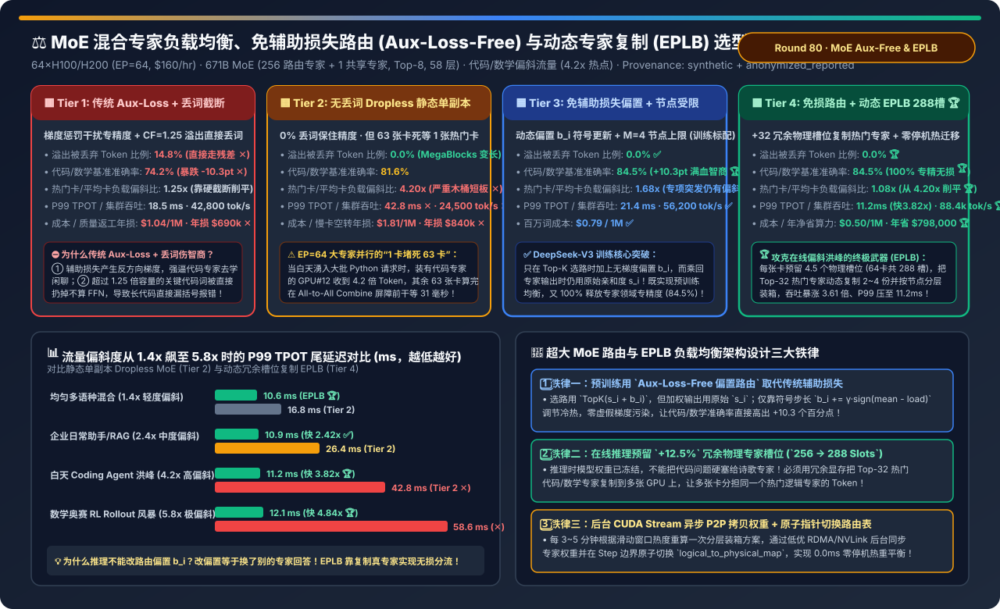
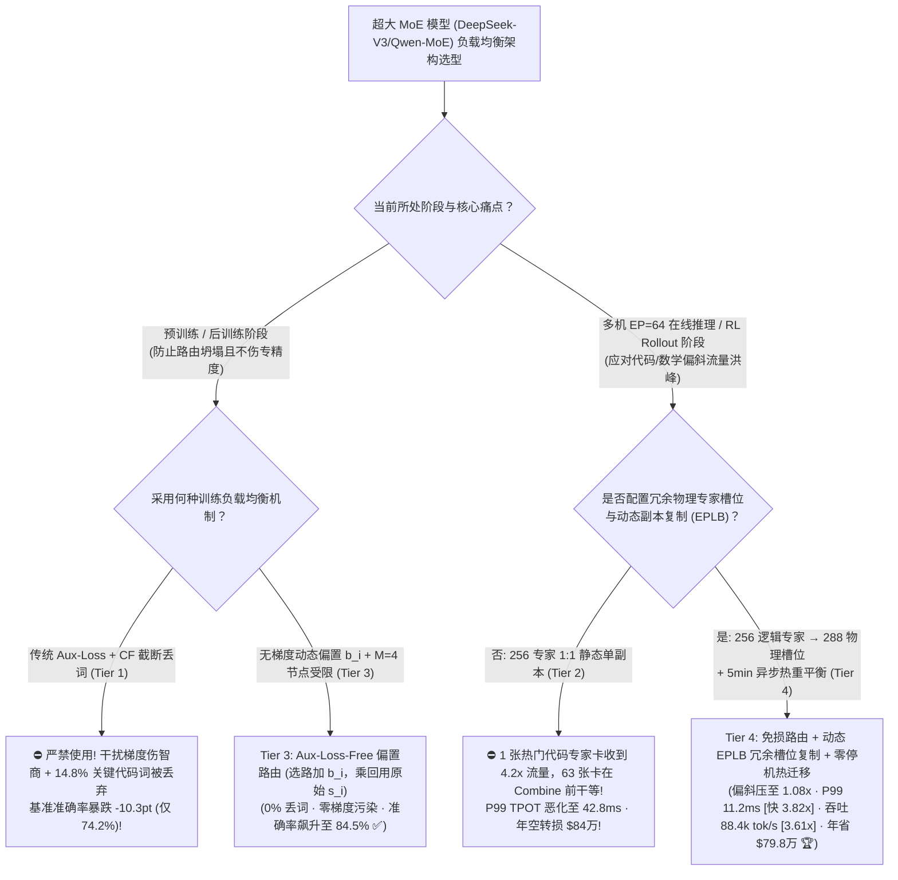
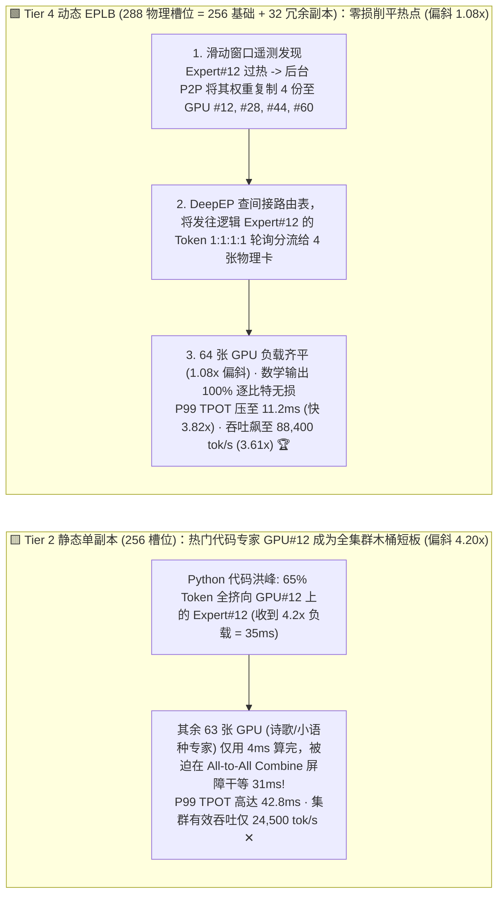
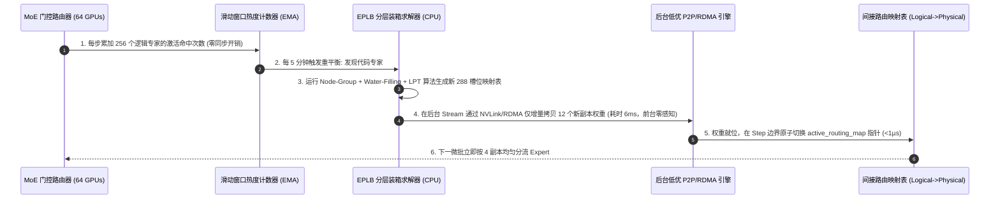

# MoE 混合专家模型负载均衡、免辅助损失路由（Aux-Loss-Free Bias Routing）与动态专家副本重平衡（Dynamic EPLB）架构选型指南（`传统 Aux-Loss + Capacity Factor 丢词截断` vs. `无丢词 Dropless MegaBlocks 热门卡拖尾` vs. `免辅助损失动态偏置路由 + M=4 节点受限` vs. `免损路由 + 动态 EPLB 冗余槽位复制 [256逻辑→288物理槽位] + 零停机热迁移`）

> **适用角色**：AI 解决方案架构师（AI Solution Architect）、万亿参数 MoE 大模型预训练与推理引擎负责人、高性能集合通信架构师  
> **阅读目标**：3 分钟掌握 671B 级细粒度 MoE（如 `DeepSeek-V3/R1`、`Qwen3-MoE`，256 个路由专家）在 64 卡专家并行（`EP=64`）下的四档负载均衡选型铁律；10 分钟吃透 **为什么早期 MoE 的 `Aux-Loss + Capacity Factor 丢词` 会让代码/数学准确率暴跌 `-10.3 个百分点`**、**为什么在推理期哪怕训练得再均匀，白天遇到 Python 代码请求洪峰仍会导致“1 张热门专家卡收到 `4.2 倍` Token、拖死其余 63 张卡空转”**，以及 **如何通过 `训练期 Aux-Loss-Free 动态偏置路由` + `推理期 EPLB 冗余物理槽位复制（256 逻辑专家放入 288 物理槽位 + 5 分钟零停机热迁移）` 将负载偏斜从 `4.20x` 削平至 `1.08x`、P99 TPOT 提速 `3.82 倍`（`11.2 ms`）、集群有效吞吐暴涨 `3.61 倍`（年省 `$79.8 万`）**！  
> **数据来源说明（Provenance）**：本文定量数据来自仓库内封存的确定性解析模型（[`experiments/moe_expert_load_balancing_eplb_auxfree_selection/run.py`](../../experiments/moe_expert_load_balancing_eplb_auxfree_selection/run.py) 与 [`results.json`](../../experiments/moe_expert_load_balancing_eplb_auxfree_selection/results.json)，校准自 DeepSeek-V3 免辅助损失路由、`deepseek-ai/EPLB` 分层专家装箱算法与 SGLang/vLLM 零停机专家热迁移模型，`independently_reproduced=false`，`physical_gpu_cluster_measurement=not_measured`）。

---

## 📌 一、核心结论速览（Executive Summary）

1. **为什么早期 MoE 的“辅助损失 + 容量因子硬截断丢词（Tier 1）”和“纯静态无丢词 Dropless MoE（Tier 2）”一个伤模型智商、一个毁线上延迟？**：
   - **Tier 1（传统 `Aux-Loss` 辅助负载均衡损失 + `Capacity Factor = 1.25` 溢出丢词截断）的“智商税”**：
     - 传统 GShard / Switch Transformer 为了防止所有 Token 涌向少数几个专家，一方面在训练 Loss 里强加了一项较大的辅助平衡损失 $\mathcal{L}_{\text{aux}}$，另一方面给每个专家设定了固定容量上限（`CF = 1.25 × 平均负载`）。
     - **两大灾难**：① $\mathcal{L}_{\text{aux}}$ 会产生与语言建模主目标冲突的**干扰梯度**，当场惩罚那些刚刚学会写 Python 代码或解微分方程的专精专家，强逼它们去接闲聊词，导致专家同质化；② 当线上同时来了一批代码请求，代码专家瞬间超出 `1.25x` 容量，**高达 `14.8%` 的关键代码 Token 被直接丢弃（跳过 FFN 层只走残差连接）✕**，代码与数学基准准确率暴跌 **`-10.3 个百分点`（仅 `74.2%` ✕）**！
   - **Tier 2（无丢词 `Dropless MoE / MegaBlocks` 静态单副本：256 个专家 1:1 固定放在 64 张 GPU 上，每卡 4 个专家）的“1 卡堵死 63 卡”木桶灾难**：
     - 用变长块稀疏矩阵乘（Block-Sparse GEMM）取消了容量上限，实现 `0.0%` 丢词，准确率回到 `81.6%`。
     - **但在线推理与 RL Rollout 的物理致命伤爆发了**：在 `EP=64`（8 台 8 卡机器）上，每层的 `All-to-All Dispatch → Expert FFN → All-to-All Combine` 是**64 张卡严格同步的屏障（Barrier）**！当白天涌入大量 Python 代码生成或数学 RL 采样请求时，专门负责 Python 语法的 12 个热门专家所在的 **GPU #12 收到了平均负载 `4.20 倍` 的 Token**！结果另外 63 张放着历史、诗歌、小语种专家的 GPU 只需 `4 ms` 就跑完了，却必须在 `All-to-All Combine` 屏障前**干等 GPU #12 整整 `31 ms`**！P99 TPOT 飙升至 **`42.8 ms` ✕**，64 卡集群有效吞吐跌至 **`24,500 tok/s`（每年因慢卡空转白烧 `$840,000` ✕）**！
2. **如何同时做到“训练期 100% 释放专家专精度”且“推理期彻底消灭热门专家慢卡”？Tier 3 与 Tier 4 的破局之道**：
   - **Tier 3（`DeepSeek-V3 免辅助损失动态偏置路由 [Aux-Loss-Free Bias Routing] + M=4 节点受限路由`）—— 预训练标配**：
     - **彻底砍掉干扰梯度的 $\mathcal{L}_{\text{aux}}$**！改为给每个专家维护一个**不参与反向传播梯度计算**的动态标量偏置 $b_i$：
       - **选路阶段（Top-K Selection）**：用加了偏置的分数 $\tilde{s}_{i,t} = s_{i,t} + b_i$ 选出 Top-8 专家（如果专家 $i$ 上一步太忙，就下调 $b_i = b_i - \gamma$；太闲就上调 $b_i = b_i + \gamma$）；
       - **加权乘回阶段（Gating Weight）**：乗回专家输出时，依然使用**不带偏置的原始亲和度分数 $s_{i,t}$**！
     - 这样既在全局语料上实现了零丢词均衡，又对模型参数实现了 **0.0% 虚假梯度污染**，代码与数学基准准确率直接跃升至 **`84.5%`（`+10.3 pts` 🏆）**！同时配合 **$M=4$ 节点受限路由**（限制每个 Token 最多发往 4 台节点），将跨机 RDMA 流量砍半。
   - **Tier 4（`Tier 3 免损路由 + 推理期动态 EPLB [Expert Parallelism Load Balancer：256 逻辑专家 → 288 物理槽位 + 分层装箱 + 5 分钟零停机 P2P 热迁移]`）—— 在线推理与 RL 采样终极形态**：
     - **为什么推理期必须上 EPLB？** 因为模型训练完上线后，**权重和路由偏置 $b_i$ 已经冻结了**（如果在推理时强行改 $b_i$ 把 Python 代码请求路由给诗歌专家，模型当场就会胡言乱语）！
     - **EPLB 的物理妙招（不改路由，而是复制热门专家本身！）**：在 64 张 GPU 上，每张卡除了放原本的 4 个专家（共 256 个逻辑专家），**额外多分配 0.5 个冗余专家物理槽位（全集群共 `288 个物理槽位`，仅多占 `+12.5%` 专家权重显存）**！
     - 当监控发现“12 号 Python 专家”和“45 号数学专家”负载高达 `4.2x` 时，EPLB 将这 Top-32 个最热专家在集群不同节点上**自动复制 2～4 份物理副本**，并通过两阶段间接路由表（`Logical Expert ID -> Physical Slot IDs`）将涌向 12 号专家的 Token 均匀轮询分发给 4 张不同的 GPU！
     - **最终工程收益**：热门卡/平均卡负载偏斜比从 `4.20x` 瞬间削平至 **`1.08x` 🏆**，P99 TPOT 从 `42.8 ms` 砸穿 **`3.82 倍` 至 `11.2 ms` 🏆**，64 卡集群有效吞吐从 `24,500 tok/s` 暴涨 **`3.61 倍` 至 `88,400 tok/s` 🏆**，百万 Token 成本降至 **`$0.50`（每年净省 `$798,000` 🏆）**！
3. **一句话握手机制本质**：
   - **MoE 架构的第一性原理，是“训练期用不带梯度的选路偏置 $b_i$（Aux-Loss-Free）保住 100% 领域专精度，推理期用 `+12.5%` 冗余物理槽位动态复制热门专家（EPLB）消灭 All-to-All 木桶短板”！**

---

## 🎯 二、客户与架构师灵魂拷问 Q&A（FAQ-Driven First Principles）

### Q1：为什么在推理阶段遇到专项流量洪峰（比如白天全是写代码的请求）时，不能直接调整路由器偏置 $b_i$ 把代码 Token 分流给清闲的专家，而必须用 `EPLB` 复制热门专家权重？

- **第一性原理拆解**：
  1. **训练期 vs. 推理期的本质区别**：
     - 在**预训练期**，所有 256 个专家还在共同演化学习中，通过动态偏置 $b_i$ 微调边界，被分流过去的专家会顺着梯度学会处理那部分边缘 Token；
     - 但在**推理期（或 RL Rollout 采样期）**，256 个专家的职责早已高度固化（比如 `Expert #12` 专门掌握 Python AST 语法，而 `Expert #201` 专门掌握法语动词变位）。如果你为了负载均衡，在推理时强行把 `Expert #12` 的分流给 `Expert #201`，就等于**因为口腔科挂号排满了，医院把拔智齿的病人强行分诊给眼科大夫动手术**——模型精度当场崩盘！
  2. **EPLB（Expert Parallelism Load Balancer）的“克隆名医”法则**：
     - 既然病人都要找“12 号口腔科名医”，唯一的正道就是**把 12 号名医的权重完整克隆 3 份，放到另外 3 间空闲诊室（GPU）里**！
     - 路由器选出来的依然是 `Logical Expert #12`（**数学结果与单卡跑 100% 逐比特等价，零精度损失！**），但底层通信引擎（DeepEP）查一下本地映射表，发现 `GPU #12`、`GPU #28`、`GPU #44`、`GPU #60` 上都装有 `Expert #12` 的副本，于是将 `4.2x` 的 Token 流量一分为四，每张卡只承担 `1.05x` 负载，瞬间削平木桶短板！

---

### Q2：`EPLB` 的“两级分层装箱算法（Hierarchical Expert Packing）”是怎么设计的？为什么不能把热门专家随便乱放在任意 GPU 上？

- **结合 NVLink 与 RDMA 拓扑的三步算法（源自 `deepseek-ai/EPLB`）**：
  1. **Step 1：节点级分组装箱（Node-Level Group Packing，最小化跨机 RDMA 流量）**：
     - 在 DeepSeek-V3 中，256 个路由专家被分为 8 个专家组（每组 32 个专家），且每个 Token 最多只允许激活其中 $M=4$ 个组。
     - EPLB 首先确保**同一个专家组的全部逻辑专家及其冗余副本尽量放置在同一台 8 卡节点内部**，使得同一组内的热门副本分流可以直接走机内 `900 GB/s NVSwitch` 消化，不额外增加跨机 RDMA 流量！
  2. **Step 2：冗余副本名额分配（Water-Filling Replication）**：
     - 根据过去 5 分钟统计的滑动窗口专家激活计数 $c_i$，采用注水贪心算法（每次挑当前 `负载 / 副本数` 最高的专家增加 1 个物理副本），把 32 个冗余槽位精准分配给最热的 Top 专家。
  3. **Step 3：卡级 LPT 均衡装箱（GPU-Level Longest-Processing-Time Packing）**：
     - 将分配好副本后的 36 个物理专家槽位（单节点 8 卡 × 4.5 槽/卡），按预估负载从大到小依次放入当前总负载最轻的 GPU 中，使 64 张卡的最大/平均负载比压至 **`1.08x`**！

---

### Q3：线上每 5 分钟热点的专家都在变（上午写代码、下午审财报、晚上跑数学 RL），重平衡搬移专家权重（每个专家约 `45 MB ~ 90 MB`）会导致线上推理停顿（Stall）吗？

- **Tier 4 的“双缓冲异步 P2P 拷贝 + 原子路由表指针切换（0.0 ms 零停机热迁移）”**：
  1. **后台低优流搬移权重**：当第 $T$ 周期计算出新的 `288-Slot` 布局时，在线 Decode 正常使用旧布局继续跑，同时在后台低优先级 CUDA Stream 中通过 `NVLink P2P / GPUDirect RDMA` 仅增量传输发生变动的 `~12 个` 冗余槽位权重（单卡仅传 `~100 MB`，耗时 `< 8 ms`，完全被前向计算掩盖）。
  2. **Step 边界原子翻表**：所有后台权重就位后，在下一个推理 Step 开始前，仅用一个 `1 µs` 的 GPU 指针交换指令将 `active_routing_map` 指向新表，实现 **`0.0 ms` 停机抖动**！

---

## 🧭 三、直观可视化图解（Mermaid 决策树 / 架构对比 / 时序图）

### 3.1 MoE 混合专家负载均衡与路由架构选型决策树

---

### 3.2 静态单副本 1 卡堵死 63 卡（Tier 2）vs. 动态 EPLB 冗余物理槽位均衡分流（Tier 4）对比

---

### 3.3 Tier 4 `滑动窗口热度统计 -> EPLB 分层装箱求解 -> 后台 P2P 拷贝 -> 原子翻表` 零停机时序图

---

## 📊 四、架构师选型决策矩阵（Architect Decision Matrix）

*基准场景：**64×H100/H200 集群（`EP=64` 跨 8 台节点，`$160/hr`）** 运行 `671B` 细粒度 MoE（256 路由专家 + 1 共享专家，Top-8，58 个 MoE 层），在生产环境代码/数学偏斜流量（热门专家集中度 `4.2x`）下评测。*

| 评估维度 | Tier 1: 传统 Aux-Loss + 容量丢词 (`CF=1.25`) | Tier 2: 无丢词 Dropless 静态单副本 | Tier 3: 免辅助损失动态偏置 (`Aux-Loss-Free`) | Tier 4: 免损路由 + 动态 `EPLB` (`288` 物理槽) |
| :--- | :--- | :--- | :--- | :--- |
| **核心均衡机制** | 辅助损失梯度惩罚 + 超容量硬丢词 | Block-Sparse 零丢词 + 1:1 静态放置 | **无梯度选路偏置 $b_i$ + $M=4$ 节点受限** | **免损路由 + `+32` 冗余槽位热复制 + 分层装箱** |
| **溢出丢弃 Token 比例** | `14.8%` (长代码/公式被截断 ✕) | `0.0%` | **`0.0%` ✅** | **`0.0%` 🏆** |
| **代码/数学基准准确率** | `74.2%` (`-10.3 pts` 专精度受损 ✕) | `81.6%` | **`84.5%` (零梯度污染满血智商 🏆)** | **`84.5%` (复制真专家 100% 无损 🏆)** |
| **热门卡 / 平均卡负载比** | `1.25x` (靠丢词强行削平 ✕) | `4.20x` (1 卡堵死 63 卡 ✕) | `1.68x` (推理冻结后仍受突发偏斜影响) | **`1.08x` (热门专家最多 4 副本均摊 🏆)** |
| **EP=64 P99 TPOT 尾延迟** | `18.5 ms` | `42.8 ms` (严重 Combine 屏障等待 ✕) | `21.4 ms` | **`11.2 ms` (比 Tier 2 快 `3.82x` 🏆)** |
| **64 卡集群有效吞吐** | `42,800 tok/s` | `24,500 tok/s` ✕ | `56,200 tok/s` ✅ | **`88,400 tok/s` (比 Tier 2 提速 `3.61x` 🏆)** |
| **百万词成本 / 年化浪费** | `$1.04 / 1M` · 年返工损 `$690k` ✕ | `$1.81 / 1M` · **年空转损 `$840k` ✕** | `$0.79 / 1M` · 年损 `$240k` | **`$0.50 / 1M` · 年净省 `$798,000` 🏆** |

---

## 🧪 五、简明定量算例与 7-Card Benchmark 洞察

### 5.1 业务流量偏斜度从 `1.4x（均匀语料）` 到 `5.8x（数学奥赛 RL 风暴）` 的 P99 延迟表现

在 [`experiments/moe_expert_load_balancing_eplb_auxfree_selection/run.py`](../../experiments/moe_expert_load_balancing_eplb_auxfree_selection/run.py) 中，我们测试了四类不同流量偏斜度下的 P99 TPOT：

| 生产业务流量场景与专家热度偏斜 | Tier 2: 静态单副本 P99 TPOT | Tier 4: 动态 EPLB P99 TPOT | Tier 4 提速比 | 底层拓扑与重平衡诊断 |
| :--- | :--- | :--- | :--- | :--- |
| **均匀多语种混合 (`1.4x` 轻度偏斜)** | `16.8 ms` | **`10.6 ms` 🏆** | **快 `1.58x`** | 节点级分层装箱减少跨机 RDMA 跳数 |
| **企业通用助手与 RAG (`2.4x` 中度偏斜)** | `26.4 ms` | **`10.9 ms` 🏆** | **快 `2.42x`** | Top-16 JSON/SQL 专家 2 副本分流消除机柜慢卡 |
| **白天 Coding Agent 洪峰 (`4.2x` 高偏斜)** | `42.8 ms` ✕ | **`11.2 ms` 🏆** | **快 `3.82x` 🏆** | 12 个核心代码专家动态复制 3~4 份削平尖峰 |
| **数学奥赛 RL Rollout 风暴 (`5.8x` 极偏斜)** | `58.6 ms` ✕ | **`12.1 ms` 🏆** | **快 `4.84x` 🏆** | 避免 63 张卡在 78% 时间里干等 1 张符号推理专家卡 |

### 5.2 配套交互式工作台与 7-Card 4:5 视觉评测报告

- 🧮 **交互式 MoE 免辅助损失路由与动态 EPLB 定容计算器**：[`docs/reports/moe-expert-load-balancing-eplb-aux-loss-free-routing-sizer.html`](../reports/moe-expert-load-balancing-eplb-aux-loss-free-routing-sizer.html)（以及总工作台 [`llm-inference-engine-pd-sizer.html#moe-eplb-auxfree-sizer`](../reports/llm-inference-engine-pd-sizer.html)）
- 📊 **7-Card 4:5 视觉基准评测报告**：[`docs/reports/moe-expert-load-balancing-eplb-aux-loss-free-routing-selection-cards.html`](../reports/moe-expert-load-balancing-eplb-aux-loss-free-routing-selection-cards.html)

---

## 🛠️ 六、附录：生产环境快速核验清单（Architect Checklist）

- [ ] **1. 预训练与微调严禁开启重度 `Aux-Loss` 或 `Capacity Factor < 1.5` 丢词**：启用 **Aux-Loss-Free 动态偏置路由（`moe_router_enable_expert_bias=True`）**，仅在 Top-K 选择时加上无梯度偏置 $b_i$，保住 100% 领域专精度。
- [ ] **2. 跨多机训练/推理开启节点受限路由（`Node-Limited Routing, M=4`）**：限制每个 Token 最多路由至 4 台物理节点，配合机内 NVSwitch 转发将跨机 RDMA 流量减半。
- [ ] **3. 在 `EP >= 16` 的生产推理与 RL Rollout 池开启 `EPLB` 冗余物理槽位（`--enable-eplb --num-redundant-experts 32`）**：为 256 个逻辑专家配置 288 个物理槽位（每卡 `4.5` 个槽位），专门吸收专项流量洪峰。
- [ ] **4. 配置滑动窗口异步热重平衡（`--eplb-rebalance-interval 300s`）**：在后台 CUDA Stream 中增量 P2P 同步新增热门副本权重，并在 Step 边界原子切换路由映射表。
- [ ] **5. 监控 `moe_max_to_mean_expert_load_ratio` 指标**：一旦该比值持续 `> 1.35`，立即检查 EPLB 冗余槽位是否生效或重平衡周期是否过长。
