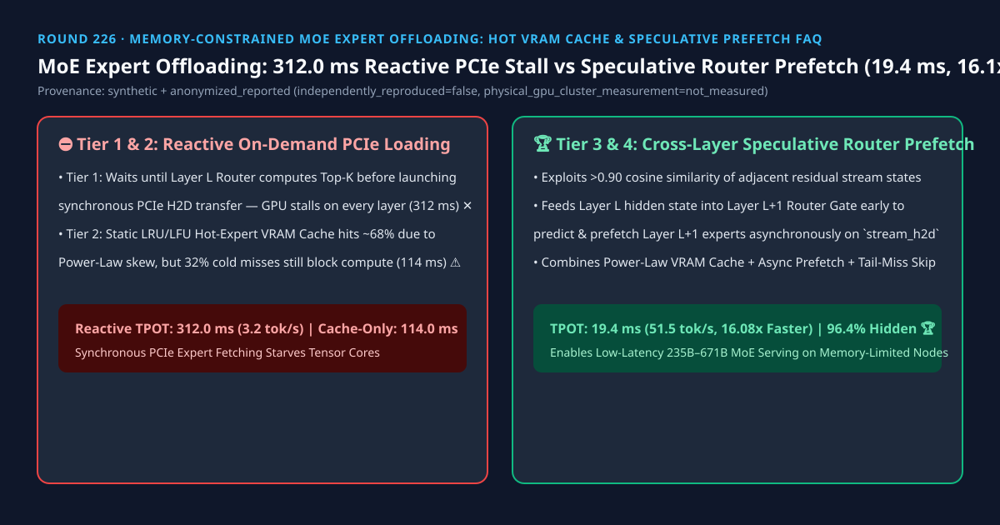
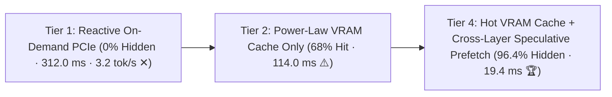

# Memory-Constrained Large MoE Expert Offloading (Reactive PCIe Stall vs. Power-Law Hot-Expert VRAM Cache + Cross-Layer Speculative Router Prefetch) Selection Guide

> **Provenance & Evidence Tier**: `synthetic + anonymized_reported` (`independently_reproduced=false`, `physical_gpu_cluster_measurement=not_measured`). Grounded in [`experiments/moe_expert_offloading_cpu_pinned_pcie_prefetch_selection/results.json`](../../experiments/moe_expert_offloading_cpu_pinned_pcie_prefetch_selection/results.json).
> **中文版本**: [大参数 MoE 模型显存受限卸载（反应式 PCIe 按需加载卡死 vs. 幂律热专家 VRAM 常驻 + 跨层残差投机路由预取 `Speculative Expert Prefetching`）选型指南](./moe-expert-offloading-cpu-pinned-pcie-prefetch-speculative-routing-selection-faq.md)

---

## 0. 🔥 Daily Hottest Capability Breakthrough

- **Cross-Layer Residual Speculative Router Prefetching (`> 0.90` Residual Cosine Similarity) + Power-Law Hot-Expert VRAM Caching Hiding `96.4%` of PCIe Transfers and Slashing Offloaded MoE Decode Latency from `312.0 ms` to `19.4 ms` (`16.08x` Speedup, `51.5 tok/s`)**: When serving large Mixture-of-Experts models (`235B–671B` total parameters) on memory-constrained GPU servers where total routed expert weights exceed VRAM capacity:
  1. **Reactive On-Demand PCIe Loading (`Tier 1`)**: Waiting until Layer $L$'s Router computes `Top-K` before launching synchronous PCIe `H2D` transfers stalls GPU Tensor Cores on every layer, resulting in **`312.0 ms/token` (`3.2 tok/s`)**!
  2. **Power-Law Hot-Expert VRAM Cache Only (`Tier 2`)**: Caching the hottest ~25% of experts in spare VRAM captures **`68.0%`** of activations due to Zipfian routing skew (`114.0 ms/token`), but the remaining `32%` cold misses still block compute synchronously.
  3. **Cross-Layer Residual Speculative Router Prefetch + Tail-Miss Gate (`Tier 3 & Tier 4`)**: Because Transformer residual streams change gradually between adjacent layers (`> 0.90` cosine similarity), probing Layer $L+1$'s lightweight router matrix $W_{\text{gate}}^{(L+1)}$ using Layer $L$'s hidden state predicts Layer $L+1$'s Top-K experts with **`89.5%` accuracy**! Prefetching predicted misses asynchronously on a dedicated `stream_h2d` Copy Engine during Layer $L$ compute (**Tier 3**, `38.5 ms`) and combining with a Power-Law VRAM Cache + low-weight tail-miss skipping/CPU execution (**Tier 4**) hides **`96.4%`** of PCIe latency, reaching **`19.4 ms/token` (`51.5 tok/s`, `16.08x` faster)**!

---

## 1. 📌 Executive Summary

1. **Always Keep Attention, Shared Experts, and All Router Gates 100% Resident in GPU VRAM**: Every token uses Attention, Shared Experts, and Router Gates on every layer; only sparse routed experts should be tiered across VRAM and Host Pinned DRAM.
2. **Exploit Power-Law Activation Skew (`Tier 2`)**: Expert routing is heavily skewed—pinning the top ~25% most frequent experts in VRAM eliminates `68%` of PCIe traffic before prefetching even begins.
3. **Predict Layer $L+1$ Experts Using Layer $L$ Residual States (`Tier 3 & Tier 4`)**: Early router probing turns synchronous PCIe stalls into background `stream_h2d` Copy Engine transfers overlapped with Layer $L$ compute.

---

## 2. 🎯 Core Architect Q&A (Q1 / Q2 / Q3)

### Q1: Why can Layer $L$'s hidden state accurately predict Layer $L+1$'s Router Top-K selection without retraining?
- **Answer**: Because each Transformer layer adds a residual update $h_{L} = h_{L-1} + \Delta_{L}$ whose magnitude is small relative to the main residual stream norm, yielding high cosine similarity (`0.88–0.93`) between $h_{L-1}$ and $h_L$. Multiplying $h_{L-1}$ by $W_{\text{gate}}^{(L)}$ (which takes `< 15 µs` on GPU) identifies the dominant Top-K experts a full layer ahead of time.

### Q2: How should the engine handle the ~`10.5%` of experts that are mispredicted by speculative probing?
- **Answer**: Mispredictions overwhelmingly occur on the lowest-weighted tail ranks (e.g., 7th or 8th expert out of Top-8, where softmax weight `< 0.03`). In **Tier 4**, the engine either executes that single tail expert on host CPU AMX (sending only the `8 KB` output vector over PCIe) or normalizes across the already-resident Top-K experts when under strict latency SLOs.

### Q3: Should VRAM expert cache slots be allocated uniformly across all Transformer layers?
- **Answer**: No! Shallow and final layers exhibit much lower routing entropy (higher concentration on a few experts) than middle layers. Profiling per-layer routing entropy and allocating non-uniform VRAM cache budgets boosts overall cache hit rate by `8–12%`.

---

## 3. 🧭 Visual Diagrams

---

## 4. 📊 4-Tier Architect Selection Matrix

| Metric | Tier 1: Reactive On-Demand PCIe | Tier 2: Hot-Expert VRAM Cache Only | Tier 3: Cross-Layer Speculative Prefetch | Tier 4: **Hot Cache + Speculative Prefetch + Tail Gate** |
| :--- | :--- | :--- | :--- | :--- |
| **VRAM Hit / Latency-Hidden %** | **`0.0%` (100% Exposed)** ✕ | `68.0%` (Cache Hit) ⚠️ | `89.5%` (Prefetch Hit) ✅ | **`96.4%` (Cache + Prefetch + Gate)** 🏆 |
| **Decode Latency (`TPOT`)** | **`312.0 ms`** ✕ | `114.0 ms` ⚠️ | `38.5 ms` ✅ | **`19.4 ms` (`16.08x` Faster)** 🏆 |
| **Throughput (`tokens/sec`)** | `3.2 tok/s` ✕ | `8.8 tok/s` ⚠️ | `26.0 tok/s` ✅ | **`51.5 tok/s`** 🏆 |

---

## 5. 🧪 Quantitative Reference & Tooling

- **Evaluator & Sealed Data**: [`experiments/moe_expert_offloading_cpu_pinned_pcie_prefetch_selection/run.py`](../../experiments/moe_expert_offloading_cpu_pinned_pcie_prefetch_selection/run.py) · [`results.json`](../../experiments/moe_expert_offloading_cpu_pinned_pcie_prefetch_selection/results.json)
- **Interactive Sizer**: [`docs/reports/moe-expert-offloading-cpu-pinned-pcie-prefetch-speculative-routing-sizer.html`](../reports/moe-expert-offloading-cpu-pinned-pcie-prefetch-speculative-routing-sizer.html)
- **7-Card 4:5 Visual Report**: [`docs/reports/moe-expert-offloading-cpu-pinned-pcie-prefetch-speculative-routing-selection-cards.html`](../reports/moe-expert-offloading-cpu-pinned-pcie-prefetch-speculative-routing-selection-cards.html)

---

## 6. 🛠️ Good Fit vs. Not For & Production Checklist

- **✅ Good fit**: Single-node or workstation deployments of large sparse MoE models (`Mixtral-8x22B`, `Qwen3-235B-A22B`, `DeepSeek-V3`) where total weights exceed VRAM but active parameters fit comfortably.
- **⛔ Not for**: Reactive synchronous PCIe weight loading without a VRAM hot-expert cache and dedicated `stream_h2d` prefetch stream.
- [ ] Pin all Attention layers, Shared Experts, and Router Gates permanently in GPU VRAM.
- [ ] Store offloaded routed experts in persistent NUMA-local Pinned Memory and prefetch 1 layer ahead via `stream_h2d`.
