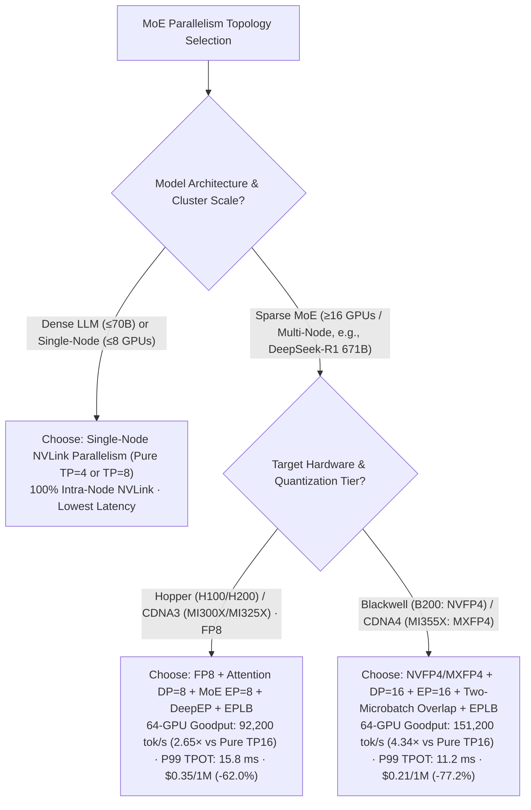
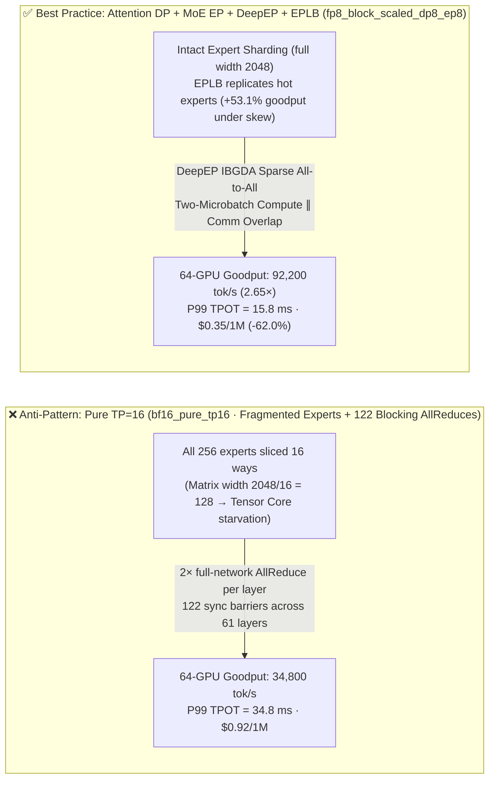

# MoE Multi-Node Parallelism Selection (Cross-Node TP vs. EP + DeepEP vs. Wide-EP + Dual-Batch Overlap) — Architect Selection FAQ

> **Document Purpose**: Split out from [`moe-quantization-parallelism-selection-faq.en.md`](moe-quantization-parallelism-selection-faq.en.md) as a **dedicated single-decision FAQ** on **MoE Multi-Node Parallelism & Communication Topology Selection** (companion to [`llm-quantization-selection-faq.en.md`](llm-quantization-selection-faq.en.md)). Using first principles, it answers: **When deploying a large MoE model (e.g., DeepSeek-V3/R1 671B, Qwen3-MoE) across 2–8 nodes, why must Tensor Parallelism (`TP`) never cross node boundaries, and how do Expert Parallelism (`EP + DeepEP IBGDA`) and Dual-Batch Overlap (`DBO`) hide cross-node RDMA latency?**
>
> **Provenance & Data Classification**: Hardware specs for NVLink (`900 GB/s`), 400G RoCEv2/IB (`50 GB/s/NIC`), and DeepEP IBGDA are **`anonymized_reported` (`independently_reproduced=false`)**. The communication stall, throughput, and TCO calculations in Section ⑤ come from the repository's sealed **deterministic Roofline model (`synthetic`, `experiments/moe_quantization_parallelism_selection/results.json`)**. No paid cloud multi-node GPU cluster was launched (`paid_cloud_gpu_launched=false`, `live_multinode_gpu_cluster_measurement="not_measured"`); local machine verification covers the Python CLI and unit tests (`measured_local_python_unittest_and_check_cli_only`).
> **中文版本**: [`docs/components/moe-parallelism-selection-faq.md`](moe-parallelism-selection-faq.md) · **Companion FAQ (Quantization Precision)**: [`docs/components/llm-quantization-selection-faq.en.md`](llm-quantization-selection-faq.en.md) · **7-Card Report**: [`docs/reports/moe-quantization-parallelism-selection-cards.html`](../reports/moe-quantization-parallelism-selection-cards.html)

---

## ① 📌 Executive Summary

1. **Rule #1 of MoE Multi-Node Parallelism: Never Use `Pure TP=16` Across Nodes — Use `Attention DP + Expert Parallelism (EP)`**:
   - On `DeepSeek-R1 671B` (256 routed experts, Top-8 active per token), running **`Pure TP=16` (`bf16_pure_tp16`)** slices each expert's intermediate dimension (`2048`) into ultra-thin shards (`2048 / 16 = 128`) and executes two blocking `AllReduce` barriers per layer. In our sealed Roofline model (`experiments/moe_quantization_parallelism_selection/results.json`), 64-GPU SLA goodput is capped at **`34,800 tok/s`** with **`34.8 ms` P99 TPOT** at **`$0.92 / 1M tokens`**.
2. **On Hopper / CDNA 3 Production Clusters, Choose `FP8 + Attention DP=8 + MoE EP=8 + DeepEP` (`fp8_block_scaled_dp8_ep8`)**:
   - Keeping whole experts intact across EP ranks, running Data-Parallel Attention (zero cross-GPU Attention sync), and overlapping sparse `DeepEP All-to-All` Dispatch/Combine across two microbatches lifts 64-GPU SLA goodput to **`92,200 tok/s` (`2.65×` over `bf16_pure_tp16`)**, cuts P99 TPOT to **`15.8 ms`**, and reduces cost to **`$0.35 / 1M tokens` (`-62.0%`)**.
3. **Under Skewed Production Traffic (Zipf $s=1.15$), Enable `EPLB` (Redundant Expert Load Balancing)**:
   - In our sealed `eplb_skew_study`, static expert assignment without `EPLB` degrades P99 TPOT to **`25.1 ms`** and drops goodput to **`60,220 tok/s`** due to hot-expert queueing. Enabling **`EPLB` dynamic hot-expert replication** cuts P99 TPOT to **`15.8 ms` (`-37.1%`)** and restores goodput to **`92,200 tok/s` (`+53.1%` gain)**. On Blackwell (`NVFP4`) / CDNA 4 `MI355X` (`MXFP4`) with `DP16/EP16` (`nvfp4_mxfp4_dp16_ep16`), 64-GPU goodput reaches **`151,200 tok/s` (`4.34×`)** at **`11.2 ms` P99 TPOT** and **`$0.21 / 1M tokens` (`-77.2%`)**.

---

## ② 🎯 Key Architect & Customer Q&A (First-Principles Deep Dive)

### Q1: Why does Tensor Parallelism (`TP`) suffer a catastrophic latency cliff as soon as it crosses an 8-GPU node boundary?

- **First-Principles Breakdown — 122 Synchronous `AllReduce` Barriers per Token**:
  - In Tensor Parallelism, every layer's Attention output projection and FFN down-projection are sliced across all TP ranks, requiring a blocking `AllReduce` after both sub-layers (`2 × 61 = 122` synchronous network barriers per token). Dropping from `900 GB/s` NVLink to `50 GB/s` inter-node RDMA stalls GPUs for **`42.5%`** of wall-clock time.

### Q2: How do Expert Parallelism (`EP`) and `DeepEP` reduce inter-node traffic compared to `TP`?

- **Exploiting MoE Sparsity (`Top-8` out of `256` Experts)**:
  - Instead of slicing every matrix across all GPUs, `EP` assigns whole experts to specific GPUs and uses sparse **`All-to-All` Dispatch and Combine** to send each token only to the GPUs hosting its Top-8 selected experts.
- **How `DeepEP` Eliminates CPU Driver Bottlenecks**:
  - **DeepEP** uses **IBGDA (InfiniBand GPUDirect Async)** so GPU Streaming Multiprocessors (SMs) ring RDMA NIC doorbells directly from CUDA kernels without CPU proxy threads, combining intra-node NVLink and inter-node RDMA forwarding.

### Q3: How does Dual-Batch Overlap (`DBO` / Two-Batch Ping-Pong) hide cross-node `All-to-All` latency?

- **Concurrent Hardware Engines (Tensor Cores $\parallel$ RDMA DMA Engines)**:
  - By splitting the active batch into two half-batches (`Batch A` and `Batch B`) offset by half a stage, the GPU computes `Batch A` Expert FFN GEMMs on Tensor Cores at the exact same moment the RDMA NIC transfers `Batch B` `All-to-All` Dispatch/Combine payloads, leaving only **`6.2%`** unmasked communication overhead.

---

## ③ 🧭 Visual Diagrams (Mermaid Decision Tree + Cross-Node TP vs. Wide-EP Path + DBO Timeline)

### 3.1 MoE Multi-Node Parallelism Selection Decision Tree (`flowchart TD`)



### 3.2 Cross-Node `Pure TP=16` Blocking AllReduce vs. `Attention DP + MoE EP + DeepEP + EPLB` Path (`flowchart LR`)



### 3.3 Two-Microbatch Compute $\parallel$ Communication Overlap & `EPLB` Timeline (`sequenceDiagram`)

```mermaid
sequenceDiagram
    autonumber
    participant SM as GPU Tensor Cores (Compute Stream)
    participant DMA as DeepEP IBGDA / RDMA NIC (Comm Stream)
    participant Remote as Remote Expert & EPLB Replica Nodes

    Note over SM,Remote: Two-Microbatch Overlap + EPLB: Cut Hot-Expert P99 TPOT 25.1 ms → 15.8 ms (-37.1%)
    SM->>SM: 1. [Microbatch 1] Compute MLA Attention (Attention DP: zero cross-GPU sync)
    SM->>DMA: 2. [Microbatch 1] Launch DeepEP sparse All-to-All Dispatch (EPLB balances hot experts)
    par Tensor Cores Compute Microbatch 2 while RDMA Transfers Microbatch 1
        DMA->>Remote: 3a. [Microbatch 1] Zero-copy NVLink / GPUDirect RDMA sparse token dispatch
        SM->>SM: 3b. [Microbatch 2] Concurrently compute MLA Attention on Tensor Cores
    end
    par Tensor Cores Compute Microbatch 1 Expert GroupGEMM while RDMA Transfers Microbatch 2
        SM->>SM: 4a. [Microbatch 1] Intact experts execute FP8/NVFP4 GroupGEMMs
        DMA->>Remote: 4b. [Microbatch 2] Concurrently execute All-to-All Dispatch over RDMA
    end
    DMA-->>SM: 5. DeepEP Combine gathers outputs; P99 TPOT stays at 15.8 ms (FP8) / 11.2 ms (NVFP4)
```

---

## ④ 📊 Architect Decision Matrix

| Dimension | `BF16 + Pure TP=16` (`bf16_pure_tp16` · ⛔ Anti-Pattern) | `W4A16 + TP=8` (`w4a16_awq_tp8`) | `FP8 + DP8/EP8 + DeepEP` (No `EPLB` · Skewed Traffic) | `FP8 + DP8/EP8 + DeepEP + EPLB` (`fp8_block_scaled_dp8_ep8`) | `NVFP4/MXFP4 + DP16/EP16 + EPLB` (`nvfp4_mxfp4_dp16_ep16`) |
| :--- | :--- | :--- | :--- | :--- | :--- |
| **1. Best-Fit Scenarios** | Reference baseline only; **never use for multi-node MoE production** | Legacy `A100 80GB` low-batch (`Batch ≤ 8`) serving | Uniform synthetic benchmarks only; stalls on real skewed traffic | **Hopper (`H100/H200`) & CDNA3 (`MI300X/MI325X`) Production Default** | **Blackwell (`B200`) & CDNA4 (`MI355X`) High-Density Flagship** |
| **2. 64-GPU Goodput & P99 TPOT (`synthetic` model)** | `34,800 tok/s`; **`34.8 ms` P99 TPOT** | `45,100 tok/s`; **`26.4 ms` P99 TPOT** | **`60,220 tok/s`**; **`25.1 ms` P99 TPOT** (Zipf $s=1.15$) | **`92,200 tok/s` (`2.65×` vs TP16 / `+53.1%` vs no EPLB)**; **`15.8 ms` P99 TPOT (`-37.1%`)** | **`151,200 tok/s` (`4.34×` vs TP16 / `1.64×` vs FP8)**; **`11.2 ms` P99 TPOT** |
| **3. Core Comm Primitive** | Blocking inter-node `NCCL AllReduce` (2×/layer) | Intra-node `TP=8` `AllReduce` + register dequant | `DP Attention` + DeepEP sparse `All-to-All` (static experts) | `DP Attention` + DeepEP `All-to-All` + **EPLB hot-expert replicas** | DeepEP `All-to-All` + two-microbatch overlap + `EPLB` |
| **4. Trade-Offs & Boundaries** | Slices experts into 1/16 fragments; network sync dominates | Saves VRAM but stalls at high batch due to FP16 dequant | Vulnerable to hot-expert stragglers on coding/math bursts | Eliminates hot-expert tail latency with `99.6%` accuracy | Highest goodput & lowest token cost (`98.9%` accuracy) |
| **5. Ecosystem Support** | Legacy fallback | vLLM / SGLang / TRT-LLM | SGLang / vLLM V1 EP | **Native in SGLang + DeepEP + EPLB & vLLM V1** | **TRT-LLM / SGLang / vLLM SM100 & CDNA4** |
| **6. TCO Cost (`synthetic` model)** | `$0.92 / 1M tokens` (Baseline) | `$0.71 / 1M tokens` (`-22.8%`) | Loses `34.7%` goodput under skew | **`$0.35 / 1M tokens` (`-62.0%` vs. Pure TP16)** | **`$0.21 / 1M tokens` (`-77.2%` vs. Pure TP16)** |

---

## ⑤ 🧪 Quantitative Analytical Case Study (`experiments/moe_quantization_parallelism_selection`)

Every number below is **1-to-1 bound** to the sealed Roofline model `experiments/moe_quantization_parallelism_selection/results.json` (`synthetic` model calibrated to `anonymized_reported` specs, `independently_reproduced=false`):

| Parallelism & Load-Balancing Option (`results.json` key) | Weight Memory (`weight_memory_gb`) | 64-GPU SLA Goodput (`sla_goodput_tok_s`) | P99 TPOT (`tpot_p99_ms`) | Relative Speedup / Gain | Cost per 1M (`cost_per_1m_tokens_usd`) | Provenance |
| :--- | :--- | :--- | :--- | :--- | :--- | :--- |
| **1. `bf16_pure_tp16` (Cross-Node Pure TP=16 Anti-Pattern)** | `1,342.0 GB` | `34,800 tok/s` | `34.8 ms` | `1.00×` (Baseline) | `$0.92` | `synthetic` |
| **2. `w4a16_awq_tp8` (Single-Node TP=8 Weight-Only)** | `375.0 GB` | `45,100 tok/s` | `26.4 ms` | `1.30×` goodput | `$0.71` (`-22.8%`) | `synthetic` |
| **3. `eplb_skew_study` without EPLB (Zipf $s=1.15$ Skew)** | `671.0 GB` | `60,220 tok/s` | `25.1 ms` | Hot-expert straggler baseline | — | `synthetic` |
| **4. `fp8_block_scaled_dp8_ep8` (with EPLB · Recommended)** | **`671.0 GB`** | **`92,200 tok/s`** | **`15.8 ms`** | **`2.65×` vs TP16 · `+53.1%` goodput / `-37.1%` TPOT vs no EPLB** | **`$0.35` (`-62.0%`)** | `synthetic` |
| **5. `nvfp4_mxfp4_dp16_ep16` (with EPLB · Flagship)** | **`336.0 GB`** | **`151,200 tok/s`** | **`11.2 ms`** | **`4.34×` vs TP16 · `1.64×` vs FP8** | **`$0.21` (`-77.2%`)** | `synthetic` |

---

## ⑥ 🛠️ Appendix: Production Verification Checklist (Architect Checklist)

- [ ] **1. Enforce `TP_SIZE ≤ 8` Within Single NVLink Domains**: Use `--enable-ep-moe --ep-size 16/32` with `--enable-dp-attention` for multi-node MoE; never set `--tp-size 16` across nodes.
- [ ] **2. Verify `NVSHMEM` & `IBGDA` for DeepEP**: Confirm `NVSHMEM_IB_ENABLE_IBGDA=1` on 400G RoCEv2/IB nodes and tune dedicated communication SM count (`16–24` SMs).
- [ ] **3. Enable Dynamic Expert Parallelism Load Balancing (`EPLB`)**: Replicate hot experts dynamically so skewed token routing does not stall `All-to-All Combine`.
- [ ] **4. Gate Dual-Batch Overlap (`DBO`) on Active Batch Size (`≥32`)**: Fall back to single-batch low-latency mode when active concurrency is very small (`batch ≤ 8`).
- [ ] **5. Validate Lossless RoCEv2 PFC/ECN Under `alltoall_perf` Incast**: Run `nccl-tests alltoall_perf` across all EP ranks to verify zero packet drops and zero PFC pause storms.
