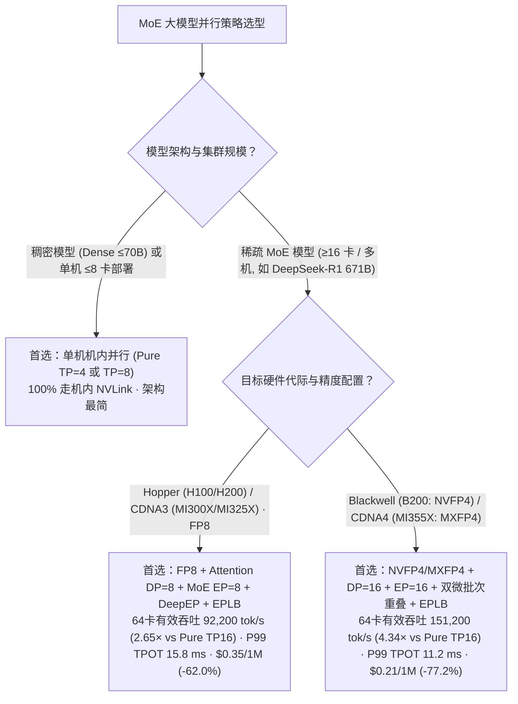
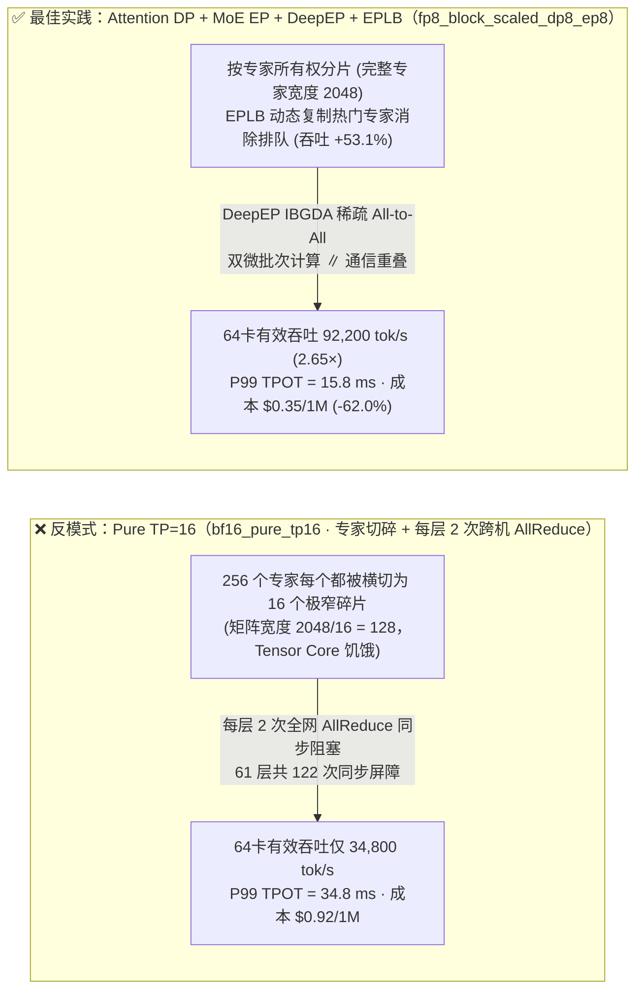
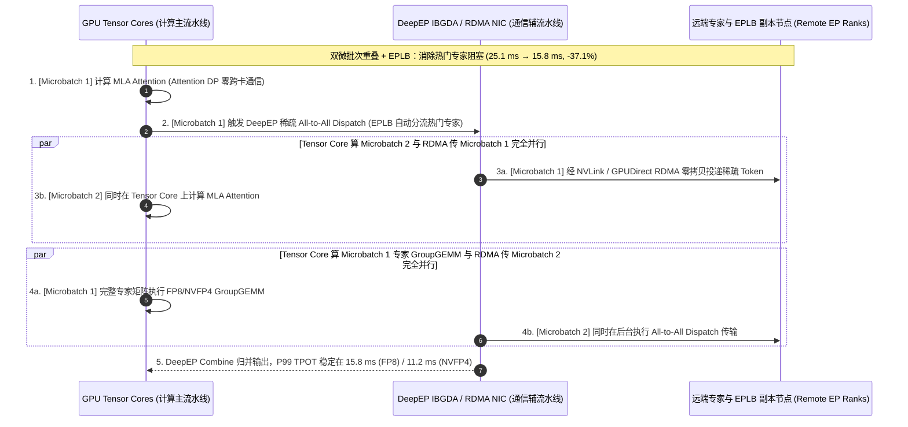

# MoE 大模型跨节点并行通信选型（跨机 TP vs 专家并行 EP + DeepEP vs 大规模 EP + 双批次重叠 DBO）架构师选型与原理解析 FAQ

> **文档定位**：本文是从原合并专题（[`moe-quantization-parallelism-selection-faq.md`](moe-quantization-parallelism-selection-faq.md)）按**单一独立架构决策主题**拆分出的 **MoE 跨机并行策略与通信拓扑独立指南**（与量化精度选型指南 [`llm-quantization-selection-faq.md`](llm-quantization-selection-faq.md) 互为姊妹篇）。本文用通俗易懂的第一性原理回答：**当超大 MoE 模型（如 DeepSeek-V3/R1 671B、Qwen3-MoE）跨越 2～8 台服务器部署时，为什么严禁把张量并行（TP）拉出单机 NVLink 边界？专家并行（EP + DeepEP IBGDA）与双批次流水重叠（Dual-Batch Overlap, DBO）又是如何把跨机 RDMA 通信延迟彻底隐藏起来的？**
>
> **数据溯源与口径声明（Provenance）**：本文引用的 NVLink (`900 GB/s`)、400G RoCEv2/IB (`50 GB/s/NIC`) 与 DeepEP IBGDA 硬件特性属于**厂商/开源社区公开发布参考规格（`anonymized_reported`, `independently_reproduced=false`）**；文中第 ⑤ 节的通信停顿占比、吞吐与成本对比数据来自本仓库封存的**确定性 Roofline 分析模型（`synthetic`, `experiments/moe_quantization_parallelism_selection/results.json`）**。本轮未启动付费云端多机物理 GPU 集群（`paid_cloud_gpu_launched=false`, `live_multinode_gpu_cluster_measurement="not_measured"`），本机实测仅限 Python 算例 CLI 与单元测试（`measured_local_python_unittest_and_check_cli_only`）。
> **English Edition**: [`docs/components/moe-parallelism-selection-faq.en.md`](moe-parallelism-selection-faq.en.md) · **姊妹篇（大模型量化精度选型）**：[`docs/components/llm-quantization-selection-faq.md`](llm-quantization-selection-faq.md) · **7-Card 视觉报告**：[`docs/reports/moe-quantization-parallelism-selection-cards.html`](../reports/moe-quantization-parallelism-selection-cards.html)

---

## ① 📌 核心结论速览（Executive Summary）

1. **并行拓扑第一铁律：MoE 多卡/跨机部署严禁纯张量并行（`Pure TP=16`），必选数据并行注意力（`Attention DP`）+ 专家并行（`MoE EP`）**：
   - 在 `DeepSeek-R1 671B`（256 个路由专家，每 Token 激活 Top-8）上，如果强行跑 **`Pure TP=16`（`bf16_pure_tp16`）**，每个专家的中间维度（`2048`）被横切成 `2048 / 16 = 128` 的极窄碎片（算术强度崩盘），且每层都要执行 2 次阻塞式全量 `AllReduce`。在封存算例（`experiments/moe_quantization_parallelism_selection/results.json`）中，64 卡集群 SLA 有效吞吐仅为 **`34,800 tok/s`**，P99 TPOT 高达 **`34.8 ms`**，单百万 Token 成本达 **`$0.92`**。
2. **Hopper / CDNA 3 主力集群首选 `FP8 + Attention DP=8 + MoE EP=8 + DeepEP`（`fp8_block_scaled_dp8_ep8`）**：
   - 将 256 个完整专家均匀分布到 EP 卡上（不切碎专家矩阵），Attention 层走数据并行（零跨卡通信），MoE 层通过 **DeepEP 稀疏 `All-to-All` Dispatch/Combine** 配合双微批次计算/通信重叠（Two-Microbatch Overlap），将 64 卡集群 SLA 有效吞吐提升至 **`92,200 tok/s`（较 `bf16_pure_tp16` 提升 `2.65×`）**，P99 TPOT 压降至 **`15.8 ms`**，单百万 Token 成本降至 **`$0.35`（`-62.0%`）**。
3. **生产真实偏斜流量（Zipf $s=1.15$）必须开启 `EPLB`（冗余专家动态负载均衡）**：
   - 在封存的专家倾斜算例（`eplb_skew_study`）中，若不开启 `EPLB`（静态专家分配），热门专家所在 GPU 的排队阻塞会使 P99 TPOT 恶化至 **`25.1 ms`**、有效吞吐跌至 **`60,220 tok/s`**；开启 **`EPLB` 动态复制热门专家副本**后，P99 TPOT 降至 **`15.8 ms`（削减 `37.1%`）**，有效吞吐恢复至 **`92,200 tok/s`（净增 `+53.1%`）**。在新一代 Blackwell (`NVFP4`) / CDNA 4 `MI355X` (`MXFP4`) + `DP16/EP16`（`nvfp4_mxfp4_dp16_ep16`）下，64 卡有效吞吐进一步达到 **`151,200 tok/s`（`4.34×`）**、P99 TPOT **`11.2 ms`**、成本 **`$0.21 / 1M tokens`（`-77.2%`）**。

---

## ② 🎯 客户与架构师灵魂拷问 Q&A（从第一性原理讲透）

### Q1：为什么张量并行（TP）一旦跨出单台 8 卡服务器，推理延迟（TPOT）就会断崖式恶化？

- **第一性原理：阻塞式 `AllReduce` 的频次与带宽断层**：
  - 在张量并行（Tensor Parallelism）中，每一个 Transformer 层的 Attention 输出投影和 FFN 输出投影都被切分在所有 TP 卡上。为了进入下一层，所有卡必须停下来执行同步阻塞的 **`AllReduce`（全归约求和）**。
  - 对于 61 层的大模型，每生成 1 个 token 就要跨越网络同步 **122 次**！一旦跨出单机 NVLink（`900 GB/s`）落到机间 RDMA（`50 GB/s/NIC`），这 122 次同步每次都会撞上微秒级网络延迟墙与带宽瓶颈，导致 GPU 接近一半时间（`42.5%`）在空等网卡收包。

### Q2：什么是专家并行（Expert Parallelism, EP）与 DeepEP？它为什么比跨机 TP 省通信？

- **MoE 模型的稀疏激活本质**：
  - 以 DeepSeek-V3/R1 (671B) 为例，虽然每层有 256 个路由专家，但每个 Token 每次只激活其中的 **Top-8 个专家**（总激活参数仅 37B）。
  - **专家并行（EP）** 不切分单个专家的矩阵，而是把 256 个完整专家分给 `N` 张 GPU（例如 `EP=16` 时每张卡管 16 个专家）。当某个 Token 需要调用第 42 号专家时，只需通过 **`All-to-All`（点对点稀疏路由）** 把该 Token 的激活向量发给持有 42 号专家的那张 GPU 计算，算完再发回（Combine）。
- **DeepEP 的底层突破（NVLink + RDMA IBGDA 混合直通）**：
  - DeepSeek 开源的 **DeepEP** 利用 **IBGDA（InfiniBand GPUDirect Async）**，允许 GPU 线程块（Streaming Multiprocessor, SM）直接在核函数内部向 RDMA 网卡门铃寄存器（Doorbell）投递发送请求，彻底绕过 CPU 驱动线程调度，将跨机小包 `All-to-All` 延迟压到极致。

### Q3：什么是双批次重叠（Dual-Batch Overlap, DBO / Two-Batch Ping-Pong）？它是怎么把通信时间“变没”的？

- **硬件单元天然独立**：GPU 上的 **矩阵计算单元（Tensor Core SM）** 和 **网络传输引擎（RDMA NIC / NVLink DMA Engine）** 是两套独立的物理硬件。
- 在普通串行流程中：`[计算 Attention] → [停下来等 RDMA All-to-All Dispatch] → [计算 Expert FFN] → [停下来等 RDMA Combine]`，计算与通信是串行相加的。
- **双批次乒乓重叠（DBO）**：调度器把当前批次拆成 `Batch A` 和 `Batch B` 两个半批，错开半拍执行：
  - 当 Tensor Core 正在满负荷计算 `Batch A` 的 Attention / Expert FFN 时，RDMA 网卡恰好在后台静默传输 `Batch B` 的 `All-to-All` Dispatch / Combine 数据！只要计算耗时 ≥ 通信耗时，跨机通信延迟就被 **隐藏（Overlapped）** 在计算阴影之下（未掩盖通信停顿仅剩 `6.2%`）。

---

## ③ 🧭 直观可视化图解（Mermaid 选型决策树 + 跨机 TP vs Wide-EP 路径对比 + DBO 乒乓时序图）

### 3.1 MoE 大模型多机并行通信选型决策树（`flowchart TD`）

### 3.2 跨机 `Pure TP=16` 全量同步阻塞 vs `Attention DP + MoE EP + DeepEP + EPLB` 路径对比图（`flowchart LR`）

### 3.3 双微批次重叠（Two-Microbatch Overlap）与 `EPLB` 冗余专家均衡时序图（`sequenceDiagram`）

---

## ④ 📊 架构师选型决策矩阵（Architect Decision Matrix）

| 对比维度 | `BF16 + Pure TP=16` (`bf16_pure_tp16` · ⛔ 反模式) | `W4A16 + TP=8` (`w4a16_awq_tp8`) | `FP8 + DP8/EP8 + DeepEP` (关闭 `EPLB` · 偏斜流量) | `FP8 + DP8/EP8 + DeepEP + EPLB` (`fp8_block_scaled_dp8_ep8`) | `NVFP4/MXFP4 + DP16/EP16 + EPLB` (`nvfp4_mxfp4_dp16_ep16`) |
| :--- | :--- | :--- | :--- | :--- | :--- |
| **1. 核心适用场景** | 仅作精度基线对照，**严禁用于大规模 MoE 在线生产** | `A100 80GB` 单机低并发（`Batch ≤ 8`）过渡部署 | 仅适合均匀合成压测，**真实偏斜流量下会出现热门卡排队** | **Hopper (`H100/H200`) & CDNA3 (`MI300X/MI325X`) 生产主力** | **Blackwell (`B200`) & CDNA4 (`MI355X`) 超高吞吐旗舰** |
| **2. 64 卡有效吞吐与 P99 TPOT（封存 `synthetic` 算例）** | 吞吐 `34,800 tok/s`；P99 TPOT **`34.8 ms`** | 吞吐 `45,100 tok/s`；P99 TPOT **`26.4 ms`** | 吞吐 **`60,220 tok/s`**；P99 TPOT **`25.1 ms`**（Zipf $s=1.15$） | **吞吐 `92,200 tok/s` (`2.65×` vs TP16 / `+53.1%` vs 无 EPLB)**；**P99 TPOT `15.8 ms` (`-37.1%`)** | **吞吐 `151,200 tok/s` (`4.34×` vs TP16 / `1.64×` vs FP8)**；**P99 TPOT `11.2 ms`** |
| **3. 底层通信原语** | 每层 2 次跨机阻塞式 `NCCL AllReduce` | 机内 `TP=8` `AllReduce` + 寄存器反量化 | `DP Attention` + DeepEP 稀疏 `All-to-All`（静态专家） | `DP Attention` + DeepEP `All-to-All` + **EPLB 热门专家副本** | DeepEP `All-to-All` + 双微批次重叠 + `EPLB` |
| **4. 优劣势与容灾边界** | 专家矩阵被切成 1/16 薄片，跨机同步拖垮延迟 | 省显存但大并发下受限于反量化算力瓶颈 | 遇到代码/数学专项流量时受限于单卡热门专家拥堵 | 消除热门专家尾延迟，兼顾高吞吐与 `99.6%` 精度 | 吞吐最高、单 Token 成本最低（精度保持 `98.9%`） |
| **5. 生态开放度** | 所有传统框架默认回退路径 | vLLM / SGLang / TRT-LLM 支持 | SGLang / vLLM V1 EP 支持 | **SGLang + DeepEP + EPLB / vLLM V1 原生支持** | **TRT-LLM / SGLang / vLLM SM100 & CDNA4 支持** |
| **6. 综合 TCO 成本（封存算例）** | `$0.92 / 1M tokens` (Baseline) | `$0.71 / 1M tokens` (`-22.8%`) | 偏斜下吞吐折损约 `34.7%` | **`$0.35 / 1M tokens`（较 Pure TP16 降本 `-62.0%`）** | **`$0.21 / 1M tokens`（较 Pure TP16 降本 `-77.2%`）** |

---

## ⑤ 🧪 简明定量算例与 Benchmark 洞察（`experiments/moe_quantization_parallelism_selection`）

以下数据 **100% 逐项绑定** 本仓库封存的确定性 Roofline 算例 `experiments/moe_quantization_parallelism_selection/results.json`（分类为 `synthetic`，硬件峰值取自 `anonymized_reported`，`independently_reproduced=false`）：

| 并行与负载均衡方案 (`results.json` 键名) | 权重显存 (`weight_memory_gb`) | 64 卡 SLA 有效吞吐 (`sla_goodput_tok_s`) | P99 TPOT (`tpot_p99_ms`) | 相对增益 / 削减幅度 | 单百万 Token 成本 (`cost_per_1m_tokens_usd`) | 数据属性 (`provenance`) |
| :--- | :--- | :--- | :--- | :--- | :--- | :--- |
| **1. `bf16_pure_tp16`（跨机 Pure TP=16 反模式）** | `1,342.0 GB` | `34,800 tok/s` | `34.8 ms` | `1.00×` (Baseline) | `$0.92` | `synthetic` |
| **2. `w4a16_awq_tp8`（单机 TP=8 仅权重量化）** | `375.0 GB` | `45,100 tok/s` | `26.4 ms` | `1.30×` goodput | `$0.71` (`-22.8%`) | `synthetic` |
| **3. `eplb_skew_study` 关闭 EPLB（Zipf $s=1.15$ 偏斜）** | `671.0 GB` | `60,220 tok/s` | `25.1 ms` | 热门专家排队阻塞基线 | — | `synthetic` |
| **4. `fp8_block_scaled_dp8_ep8`（开启 EPLB · 生产推荐）** | **`671.0 GB`** | **`92,200 tok/s`** | **`15.8 ms`** | **`2.65×` vs TP16 · 较无 EPLB 吞吐 `+53.1%` / TPOT `-37.1%`** | **`$0.35` (`-62.0%`)** | `synthetic` |
| **5. `nvfp4_mxfp4_dp16_ep16`（开启 EPLB · 旗舰）** | **`336.0 GB`** | **`151,200 tok/s`** | **`11.2 ms`** | **`4.34×` vs TP16 · `1.64×` vs FP8** | **`$0.21` (`-77.2%`)** | `synthetic` |

---

## ⑥ 🛠️ 附录：生产环境 MoE 跨机并行核验清单（Architect Checklist）

- [ ] **1. 严查启动参数，确保 `TP_SIZE ≤ 8`（锁死在单机 NVLink 域内）**：任何跨机部署必须使用 `--enable-ep-moe --ep-size 16/32` 配合 `--enable-dp-attention`，严禁把 `--tp-size` 设为 `16` 或 `32`。
- [ ] **2. 核查 DeepEP 的 `NVSHMEM` 与 `IBGDA` 内核开关**：在 400G RoCEv2 / InfiniBand 节点上确认 `NVSHMEM_IB_ENABLE_IBGDA=1` 已生效，且 GPU SM 专用于通信的 CTA 数量（通常 `16～24` 个 SM）已按并发规模调优。
- [ ] **3. 核查专家负载均衡（EPLB — Expert Parallelism Load Balancer）**：MoE 在真实业务流量下常出现“热门专家（Hot Experts）”负载偏斜；确认已开启冗余热门专家副本重排（如 DeepSeek EPLB），防止单张慢卡拖慢全局 `All-to-All Combine`。
- [ ] **4. 核查双批次重叠（DBO）的最小并发阈值**：DBO 需要当前活跃 Batch Size 足够拆分为两个有意义的子批次（建议 `active_batch ≥ 32`）；在极低并发（`batch = 1～4`）调试场景下应自动回退至单批次低延迟模式。
- [ ] **5. 核查 RoCEv2 无损网络 PFC / ECN 水位线**：`All-to-All` 会在微秒内产生多对多突发流量（Incast），上线前必须用 `perftest` 与 `nccl-tests alltoall_perf` 验证零丢包与零 PFC 死锁。
