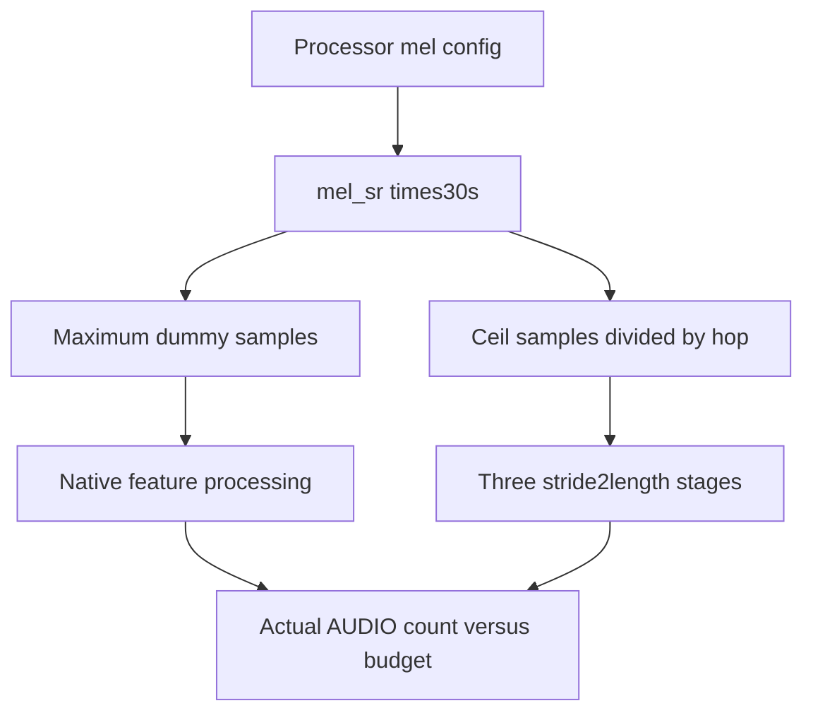
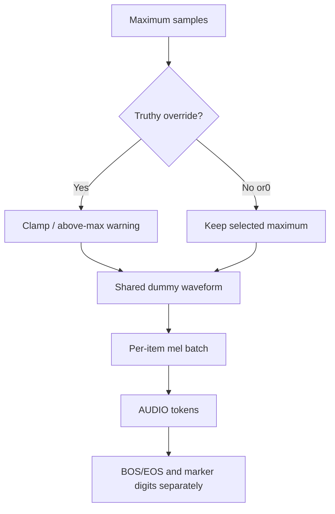

# MOSS-Audio Profiling FAQ: Sample-rate Dummy,Audio Budget and Full Prompt Span

> **Language**: English · [中文](moss-audio-profiling-dummy-sample-rate-budget-selection-faq.md)  
> **Round169/daytime46**: [pinned vLLM change](https://github.com/vllm-project/vllm/commit/24d4c4949db5d6d8c3149eb3c8f2ddb1f2c0224d),2026-11-14 07:15:27UTC/15:15:27BJT.Verified same-day capability,not popularity/hardware ranking.  
> [H5](../reports/moss-audio-profiling-dummy-sample-rate-budget-sizer.html) · [Seven cards](../reports/moss-audio-profiling-dummy-sample-rate-budget-selection-cards.html) · [SVG](../../assets/svg/moss-audio-profiling-dummy-sample-rate-budget-selection-faq-summary.svg) · [Experiment](../../experiments/audio_profile_budget_selection/README.md)

## Executive Summary

**Profiling dummies must cover the claimed input budget;16000samples is not maximum-duration audio at every sample rate.** MOSS-Audio changes fixed16000to processor `mel_sr × DEFAULT_MAX_AUDIO_SECONDS`,with30smaximum.Default16kHzneeds480000samples.Budget uses `ceil(sr×30/hop)` followed by three stride2length reductions.

Our source-default sr16000/hop160/mel_dim128 integer witness declares3000frames/375audio tokens versus100frames/13tokens for fixed16000,shortfall362.**Synthetic,independently_reproduced=false**;no waveform/STFT/Torch/encoder execution.Ceil-budget frames are not measured feature-extractor lengths;peak remains unknown.

Audio embedding budget differs from full prompt span:375audio tokens plus BOS/EOS gives377;two-second time markers add26original digit tokens,giving403.One dummy waveform can be shared across audio references while dense mel rows scale by item count.Dense payload budgets are not allocator peak.

## Q1: Why cannot short dummy audio certify maximum profiling coverage?

| Budget | Wrong proxy | Acceptance |
| :--- | :--- | :--- |
| Maximum duration | Fixed sample count | Processor sample rate times30s |
| Audio embeddings | One short forward succeeds | Processed AUDIO count equals declared budget |
| Prompt capacity | AUDIO count only | BOS/EOS,digits and text too |
| Peak memory | Waveform/dense mel bytes | Native lifecycle profiling |
| Overrides | Shortened profile called worst case | Explicit underfill and workload evidence |

The added [native test](https://github.com/vllm-project/vllm/blob/24d4c4949db5d6d8c3149eb3c8f2ddb1f2c0224d/tests/models/multimodal/processing/test_moss_audio.py) processes the default dummy and asserts AUDIO count equals budget.This is the relevant native check.We read it but did not execute its dependencies or download a model.

## Q2: Why distinguish samples,mel frames and downsample tokens?

Pinned [model/processor source](https://github.com/vllm-project/vllm/blob/24d4c4949db5d6d8c3149eb3c8f2c0224d/vllm/model_executor/models/moss_audio.py) defaults mel_dim128,sr16000,hop160,FFT400.Budget uses ceil frames.Each encoder length stage is `(length-1)//2+1`;three compose to integer `ceil(frames/8)`,not samples divided by8.

The model applies integer formulas to declared ceil-budget witnesses.Native extraction uses the Whisper numpy filterbank after float32conversion.Actual STFT boundaries/features require native verification,especially nondefault hop/rates.Our identity does not prove extraction always equals ceil.

This source's max-per-item calculation and dummy length do not shrink with seq_len.Our independent context ledger flags full span plus text exceeding context;it is not native admission/error behavior.

## Q3: How do overrides,time markers and multiple items affect sizing?

The shared [dummy helper](https://github.com/vllm-project/vllm/blob/24d4c4949db5d6d8c3149eb3c8f2c0224d/vllm/multimodal/processing/dummy_inputs.py) clamps truthy length overrides,warns above the selected maximum,and ignores0.Shortening to16000does not change the375maximum budget.Zero audio produces an empty list and empty budget mapping.

Native np.zeros defaults to float64and the helper repeats references to one array.Processor mel batching is float32.Default declared unique waveform is480000×8bytes,not multiplied by three audio items;dense mel payload triples.These source-derived budgets exclude headers,STFT temporaries,conversion copies,encoder workspace and GPUpeak.

Time markers default off.When enabled,approximate audio-token rate determines digit insertion without changing AUDIO count.Default2..30second markers use26digit tokens;full single-item span403.Nondefault floating boundaries and actual tokenizer IDs are unknown.

## Q4: Where do original tests and seven-card numbers come from?

Eight tests cover480000/3000/375versus13/362,rate changes,zero/short/above-max overrides,375/26/403marker sizing,context128without budget truncation,shared-waveform/per-item mel bytes,no audio,ceil boundaries and invalid inputs.65profiles compare130Python/Node outcomes;64additional random frame lengths compare three-ceil and ceil/8.

H5 accepts explicit bounded fields/rates/hop/dimensions,0–64items,context/text and nullable nonnegative sample overrides.It allocates no arrays.Extracted frames,native tokenizer/encoder and peak remain null,not invented zero.No audio/NumPy/Torch/GPUexecution.

CPU `latency.json` compares original fused Python scalar ceil with three scalar stages for64/256/1024/4096precreated lengths:two warmups,seven alternating repeats,three batches/sample,median repeat means.Native encoder uses Torch lengths,not these loops;bars are not GPU/profiling speed.Seven900×1125strict-CSPcards use sealed bars and no scripts/network;H5separately permits inline JS.The original budget-gauge cabinet has no visual acceptance.

## Q5: How can production avoid successful profiling followed by OOM/context mismatch?

Pin checkpoint processor/mm kwargs and test maximum duration,nondefault rates/hops,short overrides,multiple audio,time markers,text and context boundaries.Verify actual AUDIO count,full span,feature lengths,encoder rows and peak memory.A short successful forward or budget multiplication is insufficient.

Treat shortened overrides as non-worst-case evidence.If configuration changes break coverage,stop capacity certification,restore verified settings and obtain native measurements.Do not silently shorten dummies/remove markers to make context appear valid.Archive sample budgets,CPUtiming and actual allocator peak separately.

Recheck `python -m unittest discover -s tests -p test_audio_profile_budget_selection.py -q` and `python -m experiments.audio_profile_budget_selection.run --check`.Apache-2.0rights retained,link rather than mirror upstream.AI-assisted original research;native audio/model/hardware acceptance unknown.
