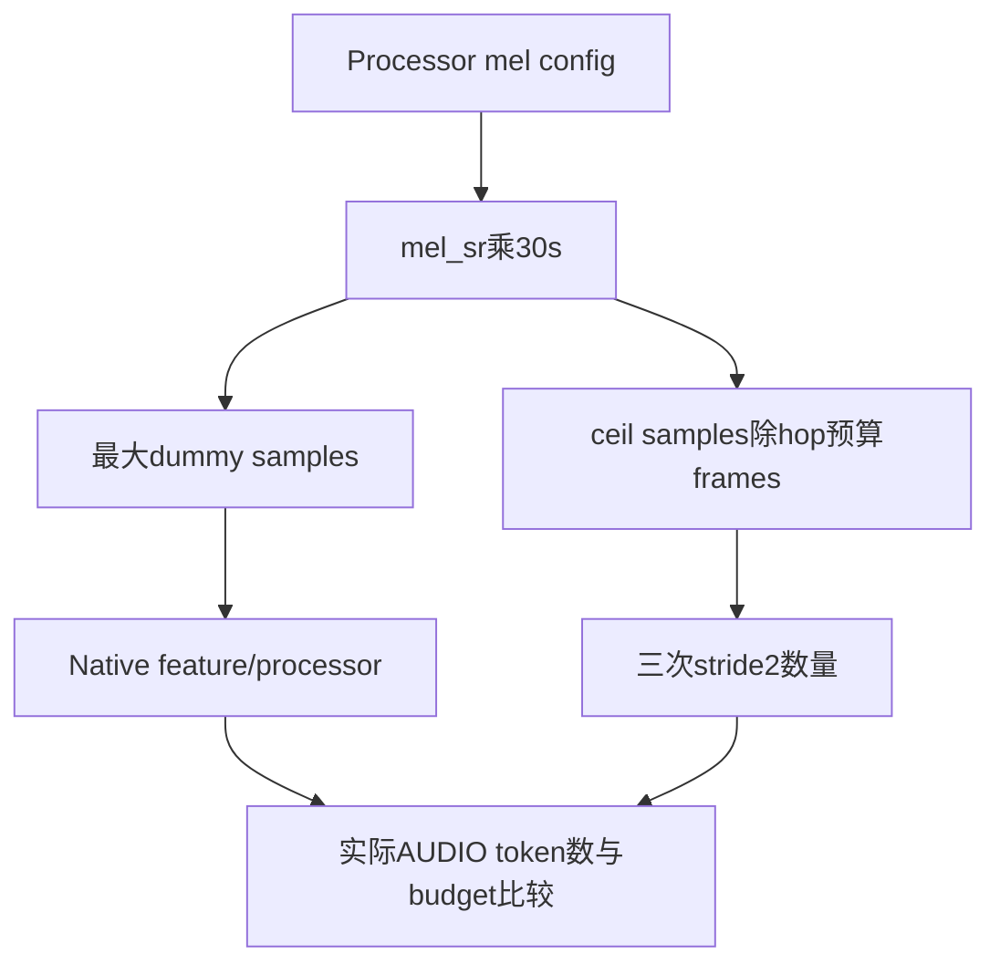
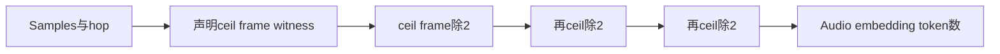
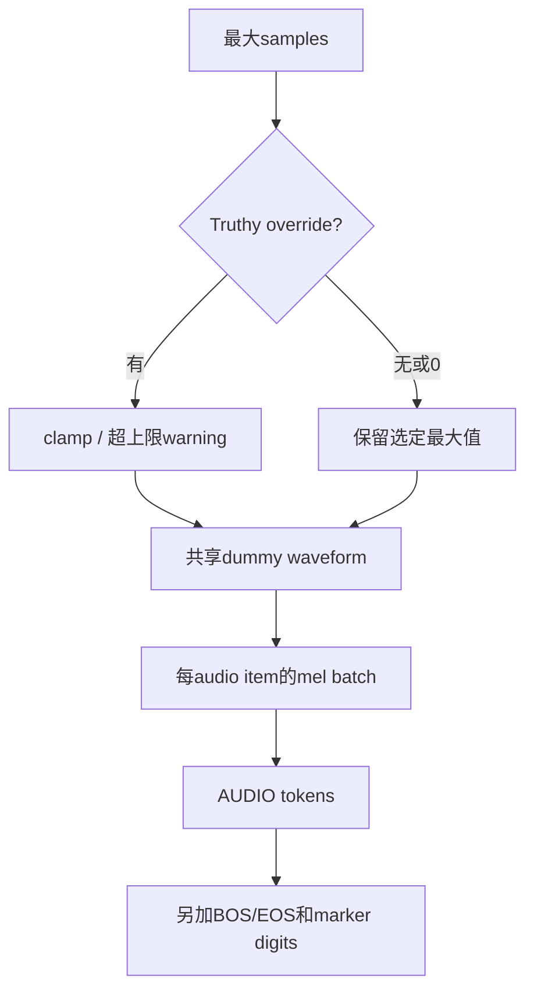

# MOSS-Audio Profiling 选型 FAQ：Sample-rate Dummy、Audio Budget 与 Full Prompt Span

> **语言**：中文 · [English](moss-audio-profiling-dummy-sample-rate-budget-selection-faq.en.md)  
> **Round 169 / 白班 46**：固定 [vLLM 当日改动](https://github.com/vllm-project/vllm/commit/24d4c4949db5d6d8c3149eb3c8f2ddb1f2c0224d)，2026-11-14 07:15:27 UTC / 15:15:27 BJT。新能力证据不等于热度榜或硬件 benchmark。  
> [H5](../reports/moss-audio-profiling-dummy-sample-rate-budget-sizer.html) · [七卡](../reports/moss-audio-profiling-dummy-sample-rate-budget-selection-cards.html) · [SVG](../../assets/svg/moss-audio-profiling-dummy-sample-rate-budget-selection-faq-summary.svg) · [实验](../../experiments/audio_profile_budget_selection/README.md)

## 核心结论速览

**容量 profiling 的 dummy 必须覆盖模型宣称的输入预算，不能把16000 samples当成所有采样率下的最大音频。** MOSS-Audio 原生 builder 从固定16000改为 processor `mel_sr × DEFAULT_MAX_AUDIO_SECONDS`，常量为30s；默认16kHz需480000 samples。budget info以 `ceil(sr×30/hop)` mel length经三次stride2 length reduction计算audio token数。

原创默认整数 sizing witness采用源码默认 sr16000、hop160、mel_dim128：30s budget对应3000声明frames、375 audio tokens；固定16000对应100声明frames、13 tokens，差362。**synthetic、independently_reproduced=false**；没有生成waveform或执行STFT/Torch/encoder。声明ceil frames不冒充实际feature extractor输出，真实峰值仍未知。

Audio embedding budget与完整prompt span不同：默认375 audio tokens加BOS/EOS得377；启用两秒time marker时原创digit ledger再加26，span403。Dummy waveform可被多条audio共享引用，mel batch却按item数扩张；密集tensor预算不能当allocator peak。

## Q1：为什么短音频 dummy 无法代表最大音频 profiling？

| 预算对象 | 错误代理 | 正确验收方向 |
| :--- | :--- | :--- |
| 最大duration | 固定sample个数 | 绑定processor sample rate与30s |
| Audio embedding数 | 一个短音频前向成功 | 实际processed AUDIO token数等于声明budget |
| Prompt容量 | AUDIO token数 | 加BOS/EOS、marker digits和text |
| Peak memory | waveform长度或dense mel bytes | nativeprofiler观测完整生命周期 |
| Overrides | 缩短profile却仍声称worst case | 显式标记underfill并核验生产负载 |

固定 [native test](https://github.com/vllm-project/vllm/blob/24d4c4949db5d6d8c3149eb3c8f2ddb1f2c0224d/tests/models/multimodal/processing/test_moss_audio.py) 新增default dummy processing，断言prompt中AUDIO token的数量等于budget。这是恰当native验收点；本机只读取该test，没有运行其依赖或下载模型。

## Q2：Sample、mel frame、downsample token为何不能直接相等？

固定 [model/processor source](https://github.com/vllm-project/vllm/blob/24d4c4949db5d6d8c3149eb3c8f2c0224d/vllm/model_executor/models/moss_audio.py) 默认mel_dim128、sr16000、hop160、FFT400。Budget用ceil frames；encoder长度公式每层为 `(length-1)//2+1`，三层合成整数 `ceil(frames/8)`。这不是“所有samples直接除8”。

原创工作台只对声明ceil budget witness应用整数公式。真实 `_extract_mel` 调用Whisper extractor的numpy filterbank，波形先转float32，实际STFT边界/feature length必须原生验证，尤其非默认hop/采样率。**我们的预算恒等式不是所有非默认配置实际extraction等于ceil的证明。**

`seq_len`没有缩小本源码的max-per-item公式，dummy长度也不以seq_len截断。原创`context_ledger_fits`另外检查完整span+text是否超过声明context；这是容量提示，不是native admission或错误状态。

## Q3：Override、time markers与多item怎样改变预算？

共享 [dummy helper](https://github.com/vllm-project/vllm/blob/24d4c4949db5d6d8c3149eb3c8f2c0224d/vllm/multimodal/processing/dummy_inputs.py) 对truthy length override取min，超过选定最大长度时warning；0不触发override。缩到16000依旧可以生成dummy，但默认最大audio budget375不因此变为13。零audio返回空list；budget info返回空mapping。

原生helper `np.zeros`默认float64且返回同一array的重复引用；processor构建的mel batch为float32。默认声明unique waveform为480000×8bytes，不随audio_count乘三；三item dense mel预算则是1item的三倍。这些是源码导出的**声明payload预算**，不含对象头、临时STFT、转型copy、encoder工作区或GPU peak。

Time marker默认关闭；开启时按approx audio-token rate插入时间digit tokens，但AUDIO token总数不变。默认两秒序列2..30的digit总量26，完整单item span403。非默认浮点边界及具体tokenizer输出未知；不把此digit ledger当实际模型token IDs。

## Q4：原创测试和七卡里的数字来自哪里？

八项测试覆盖480000/3000/375与legacy13/shortfall362，sample-rate变化、override0/短/超长clamp、marker375/26/403、context128但budget不截断、共享waveform/按item mel预算、无audio、整数ceil边界和非法输入。65原始配置/130Python-Node输出匹配，另64随机整数frame长度验证三ceil与ceil/8等价。

H5只接受明确字段与有限正hop/mel/rate、0–64items、有限context/text和nullable非负sample override；所有bytes仅算账，不分配数组。实际extracted frames、tokenizer/encoder验证和peak均为null，不补0；没有Native audio、NumPy、Torch或GPU运行。

CPU `latency.json` 对64/256/1024/4096预创建frame lengths比较原创Python scalar fused ceil和三scalar stages：2warmup、7交替重复、每样本3batch、median repeat means。Native encoder用Torch lengths，不是这些loops；图表不代表GPU或profiling加速。七卡所有条宽来自sealed data，900×1125strict CSP无script/network；H5另允许inline JS。原创budget gauge cabinet SVG仅为解释隐喻，视觉验收未知。

## Q5：如何避免profiling成功但线上OOM或context不匹配？

固定checkpoint processor config与mm kwargs版本，测试默认最大duration、不同sample rate/hop、短override、多audio、time markers、长text与context边界。验收实际processed AUDIO token数、full prompt span、mel tensorlength、encoder输出行数及峰值内存；不要只用预算乘法或一次短audio成功代替。

明确profile overrides不是默认worst-case证据。若配置变化后覆盖率不符，应停止容量认证，恢复经过验证的配置并补native測量；不要静默缩短dummy或删marker来使小context看似通过。sample budgets、CPU整数timing和true allocator peak分别归档。

复验 `python -m unittest discover -s tests -p test_audio_profile_budget_selection.py -q` 与 `python -m experiments.audio_profile_budget_selection.run --check`。Apache-2.0权利保留、公开实现只链接；AI辅助原创研究，native音频/模型/硬件验收未知。
