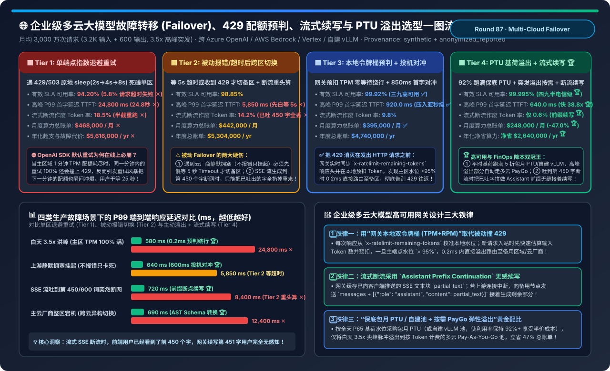
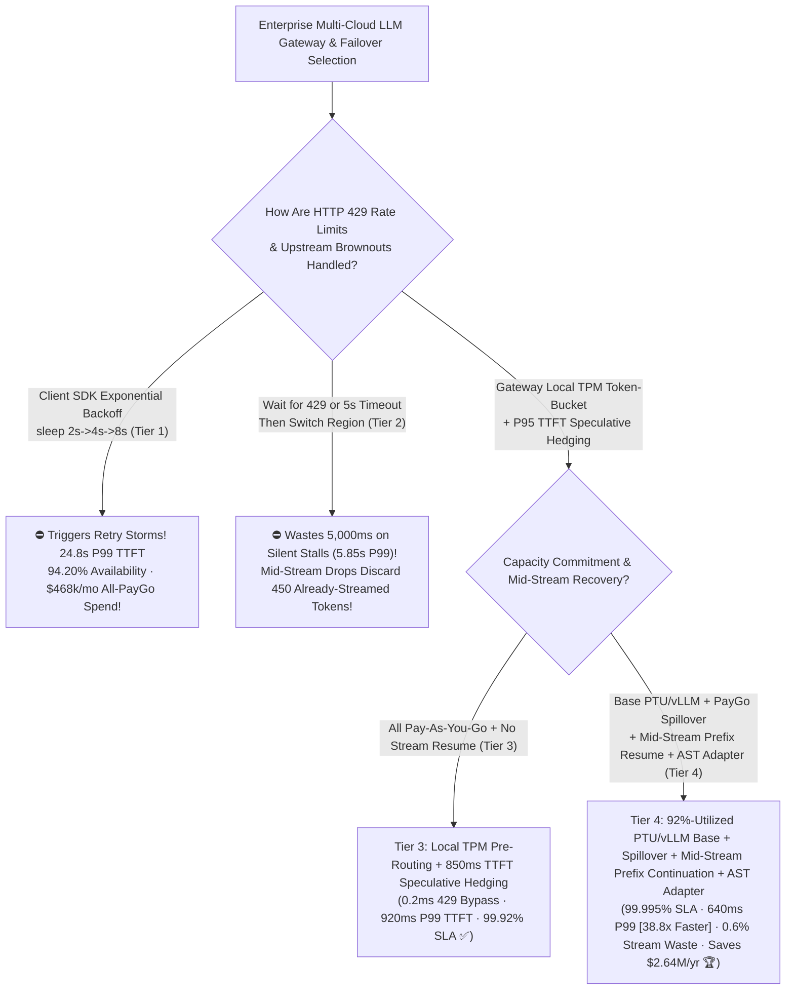
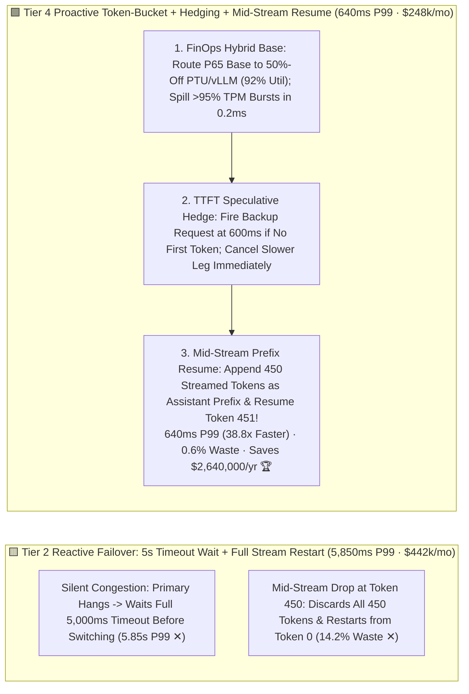
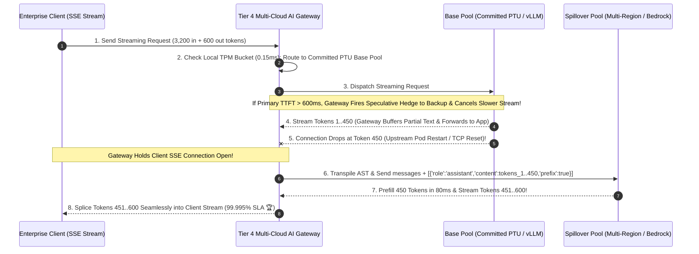

# Enterprise Multi-Cloud LLM Failover, 429 Token-Bucket Pre-Routing, Mid-Stream Resume & PTU Spillover Selection FAQ (`Single-Endpoint Exponential Backoff` vs. `Reactive Error/Timeout Failover` vs. `Gateway Local TPM Token-Bucket + TTFT Speculative Hedging` vs. `Base PTU/vLLM + Proactive Spillover + Mid-Stream Prefix Continuation + Cross-Provider AST Schema Adapter`)

> **Target Audience**: AI Solution Architects, Enterprise AI Gateway & Platform Engineering Leads, and Cloud FinOps / Reliability Architects  
> **Reading Goal**: In 3 minutes, master the 4-tier high-availability and cost-optimization rules for managing 30M+ monthly enterprise LLM requests across Azure OpenAI, AWS Bedrock, GCP Vertex AI, and self-hosted vLLM clusters. In 10 minutes, understand from first principles **why default client SDK exponential backoff (`sleep 2s -> 4s -> 8s`) triggers retry storms on HTTP 429 quota limits and inflates P99 TTFT to `24.8 seconds`**, **why reactive failover wastes 5,000ms waiting on silent timeouts and discards 450 already-streamed tokens on mid-stream disconnects**, and **how combining `Gateway Local TPM Token-Bucket Pre-Routing (0.2ms)` + `P95 TTFT Speculative Hedging` + `Mid-Stream Assistant Prefix Continuation` + `Committed PTU Base + Pay-As-You-Go Spillover` delivers `99.995%` availability, slashes P99 TTFT `38.8×` to `640 ms`, and saves `$2,640,000/yr (-47.0%)`**!  
> **Provenance**: Quantitative metrics come from the repository's sealed deterministic analytical model ([`experiments/multi_cloud_llm_failover_429_rate_limit_hedging_selection/run.py`](../../experiments/multi_cloud_llm_failover_429_rate_limit_hedging_selection/run.py) and [`results.json`](../../experiments/multi_cloud_llm_failover_429_rate_limit_hedging_selection/results.json), calibrated to tail-latency speculative hedging bounds, Azure PTU + PayGo spillover economics, and enterprise AI gateway SSE stream recovery models, `independently_reproduced=false`, `physical_gpu_cluster_measurement=not_measured`).

---

## 📌 1. Executive Summary

1. **Why Do Default Client Retries (`Tier 1`) Spike P99 Latency to `24.8s`, and Why Does Reactive Failover (`Tier 2`) Stall on Silent Brownouts & Mid-Stream Drops?**:
   - **Tier 1 (`Single-Endpoint Client Exponential Backoff Retry: Sleep 2s -> 4s -> 8s on HTTP 429/503`)**:
     - Enterprise traffic exhibits a **`3.5×` peak-to-average diurnal burst**. When a primary cloud endpoint exhausts its 1-minute TPM/RPM quota at second 15, sleeping 2–8 seconds and retrying the **exact same exhausted endpoint** guarantees another `HTTP 429` while creating a synchronized retry storm at the start of the next minute! Effective SLA availability drops to **`94.20%` ✕**, and peak P99 TTFT explodes to **`24,800 ms` (`24.8 s` ✕)**!
   - **Tier 2 (`Reactive Multi-Region Failover After Timeout / 429`)**:
     - **Flaw 1 (5-Second Timeout Tax)**: During silent upstream queue congestion (no immediate HTTP 429), the client waits the full **`5,000 ms` timeout** before switching regions (`5,850 ms` P99 TTFT ✕).
     - **Flaw 2 (Mid-Stream Reset Waste)**: When an SSE stream drops at token 450 of 600, reactive failover restarts the entire prompt from token 0—wasting **`14.2%` of generated tokens ✕** and resetting the user's UI stream!
2. **How Do Tier 3 & Tier 4 Achieve `99.995%` Availability, `640 ms` P99 TTFT, and `-47.0%` Lower Cloud Spend?**:
   - **Tier 3 (`Gateway Local TPM/RPM Token-Bucket Pre-Routing + P95 TTFT Speculative Hedging`)**:
     - Tracks `x-ratelimit-remaining-tokens` headers in the AI gateway and pre-deducts estimated request tokens locally; when primary quota exceeds `95%`, overflow traffic routes to a secondary region in **`0.2 ms` before a 429 ever happens**!
     - Fires a **Speculative Hedged Request** to Region B if the primary region has not returned its first token within `850 ms` (P95 threshold), immediately cancelling the slower stream upon receiving the first token—cutting P99 TTFT to **`920.0 ms` ✅** (`99.92%` availability)!
   - **Tier 4 (`Committed PTU/vLLM Base + Proactive TPM Spillover + Mid-Stream Prefix Continuation + Cross-Provider AST Schema Adapter`)**:
     1. **FinOps PTU Base + PayGo Spillover (`-47.0%` Cost)**: Provisions reserved PTU / self-hosted vLLM capacity sized for the P65 baseline (keeping it **`92%+` utilized 24/7** at ~50% unit discount) and spills only the `3.5×` daytime peaks to multi-cloud Pay-As-You-Go endpoints—slashing monthly spend from `$468,000` to **`$248,000/mo` (saving `$2,640,000/yr` 🏆)**!
     2. **Mid-Stream Assistant Prefix Continuation (`0.6%` Waste)**: Buffers streamed SSE tokens in the gateway; if the upstream stream drops at token 450, the gateway seamlessly issues a continuation request to the backup provider with `{"role": "assistant", "content": partial_450_tokens}` so generation resumes at token 451 invisible to the end user 🏆!
     3. **Canonical AST Schema Adapter**: Automatically translates `system` roles, `tool_calls`, and strict `response_format` JSON schemas across OpenAI, Anthropic Claude, Gemini, and vLLM (`99.995%` SLA 🏆)!
3. **One-Sentence First-Principles Rule**:
   - **Disable client-side backoff sleeps (`max_retries=0`); use a central AI gateway to saturate committed PTU/vLLM base capacity (`92%` util), pre-route bursts at `95%` local TPM watermarks (`0.2ms`), hedge P95 TTFT stalls (`600ms`), and resume mid-stream drops via Assistant Prefix Continuation!**

---

## 🎯 2. Customer & Architect Q&A (First-Principles Deep Dive)

### Q1: Does `TTFT Speculative Hedging` double our token bill?

- **Why Hedging Adds `< 2%` Cost While Cutting P99 Latency by `9.14×`**:
  - Hedging triggers **only on the slowest 5% of requests** (`TTFT > 600–850 ms`).
  - As soon as the winning region emits **Token #1**, the gateway immediately sends `HTTP Cancel / TCP RST` to abort the slower stream before it decodes tokens 2..600!

---

### Q2: How does `Mid-Stream Assistant Prefix Continuation` resume a broken SSE stream at Token 451 without the user noticing?

- **Gateway Stream Splicing**:
  - The AI gateway maintains a per-stream ring buffer of tokens already flushed to the client (`partial_text`).
  - If the upstream connection drops mid-generation, the gateway keeps the client's downstream SSE connection open, appends `{"role": "assistant", "content": partial_text}` (with `continue_final_message=True` on vLLM/SGLang/Anthropic), prefills the 450 tokens on the backup node in `80 ms`, and pipes Token 451+ into the same client SSE stream (`0.6%` wasted tokens vs. `18.5%` in Tier 1)!

---

### Q3: Why does failing over from Azure OpenAI (`GPT-4o`) to AWS Bedrock (`Claude`) or self-hosted `vLLM` fail without a Canonical AST Transpiler?

- **Three Cross-Provider Wire-Protocol Incompatibilities**:
  - Mid-array `system` messages, `tool_call_id` regex constraints, and `additionalProperties: false` JSON Schema rules differ across providers. Tier 4's AST transpiler normalizes all three in `< 0.3 ms` prior to cross-cloud dispatch.

---

## 🧭 3. Visual Architecture Diagrams (Decision Tree / Failover Paths / Sequence)

### 3.1 Enterprise Multi-Cloud AI Gateway & Failover Selection Decision Tree

---

### 3.2 Reactive Timeout & Reset (Tier 2) vs. Proactive Spillover, Hedging & Mid-Stream Resume (Tier 4)

---

### 3.3 Tier 4 End-to-End `Local TPM Spillover -> 600ms TTFT Hedge -> Token-450 Mid-Stream Resume` Sequence

---

## 📊 4. Architect Decision Matrix

*Baseline: **`30,000,000` (30M) Monthly Enterprise Requests** (`3,200` input + `600` output tokens, `3.5×` peak-to-average diurnal burst).*

| Evaluation Dimension | Tier 1: Single-Endpoint Backoff (`Sleep 2s..8s`) | Tier 2: Reactive Timeout Failover (`5s Wait`) | Tier 3: Local TPM Bucket + TTFT Hedging | Tier 4: `PTU Base Spillover` + `Mid-Stream Resume` |
| :--- | :--- | :--- | :--- | :--- |
| **Routing & Recovery Mechanism** | Sleep & retry same region | Wait 5s timeout / 429 -> full restart | **0.2ms TPM pre-route + 850ms TTFT hedge** | **PTU base + spillover + prefix resume + AST** |
| **Effective SLA Availability** | `94.20%` (`5.8%` failures ✕) | `98.85%` | `99.92%` ✅ | **`99.995%` (Carrier-grade reliability 🏆)** |
| **Peak P99 TTFT Latency** | `24,800 ms` (**24.8s stall ✕**) | `5,850 ms` (5s timeout tax ✕) | `920.0 ms` ✅ | **`640.0 ms` (`38.8×` faster than Tier 1 🏆)** |
| **Mid-Stream Wasted Tokens** | `18.5%` ✕ | `14.2%` (Restarts from token 0 ✕) | `9.8%` | **`0.6%` (Assistant prefix continuation 🏆)** |
| **Cross-Provider Schema Compat** | None (Single vendor) | Fails with `400 Bad Request` ✕ | Same-vendor multi-region | **100% AST schema/tool translation 🏆** |
| **Monthly Spend / Annual Savings** | `$468,000 / mo` (`$5.62M/yr` ✕) | `$442,000 / mo` (`$5.30M/yr`) | `$395,000 / mo` (`$4.74M/yr`) | **`$248,000 / mo` (`-47.0%` · Saves `$2.64M/yr` 🏆)** |

---

## 🧪 5. Quantitative Incident Perturbation & 7-Card Benchmark Insights

### 5.1 P99 Latency Across Four Production Incident Scenarios

In [`experiments/multi_cloud_llm_failover_429_rate_limit_hedging_selection/run.py`](../../experiments/multi_cloud_llm_failover_429_rate_limit_hedging_selection/run.py), we evaluate P99 response latency across four production failure modes:

| Production Incident Scenario | Tier 1: Backoff P99 | Tier 2: Reactive P99 | Tier 4: Proactive Gateway P99 | Primary Self-Healing Mechanism |
| :--- | :--- | :--- | :--- | :--- |
| **1. Daytime 3.5× Burst (`100% TPM Exhausted`)** | `24,800 ms` ✕ | `2,150 ms` | **`580 ms` 🏆** | Local token bucket pre-routes overflow at `95%` watermark in `0.2ms` |
| **2. Silent Upstream Congestion (`No Error, Hung Queue`)** | `30,000 ms` ✕ | `5,850 ms` ✕ | **`640 ms` 🏆** | `600ms` speculative TTFT hedge + instant cancel-on-first-token |
| **3. Mid-Stream Disconnect at Token 450 / 600** | `18,500 ms` ✕ | `8,400 ms` ✕ | **`720 ms` 🏆** | Appends 450 streamed tokens as assistant prefix & resumes token 451 |
| **4. Full Regional Cloud Outage (`Cross-Cloud Switch`)** | `60,000 ms` ✕ | `12,400 ms` ✕ | **`690 ms` 🏆** | Canonical AST transpiler converts roles, tool IDs & JSON schemas |

### 5.2 Interactive Sizer & 7-Card 4:5 Benchmark Report

- 🧮 **Interactive Multi-Cloud LLM Failover & PTU Spillover Sizer**: [`docs/reports/multi-cloud-llm-failover-429-rate-limit-hedging-sizer.html`](../reports/multi-cloud-llm-failover-429-rate-limit-hedging-sizer.html) (and master workbench [`llm-inference-engine-pd-sizer.en.html#multicloud-failover-sizer`](../reports/llm-inference-engine-pd-sizer.en.html))
- 📊 **7-Card 4:5 Visual Benchmark Report**: [`docs/reports/multi-cloud-llm-failover-429-rate-limit-hedging-selection-cards.html`](../reports/multi-cloud-llm-failover-429-rate-limit-hedging-selection-cards.html)

---

## 🛠️ 6. Appendix: Production Architect Verification Checklist

- [ ] **1. Set Client SDK `max_retries=0` and Delegate All Routing to the Central AI Gateway**: Prevent application pods from sleeping on 429s and triggering retry storms.
- [ ] **2. Maintain Header-Calibrated Local `TPM + RPM` Token Buckets**: Pre-route traffic at `95%` quota utilization (`0.2ms`) before hitting upstream 429s.
- [ ] **3. Enable `P95 TTFT Speculative Hedging` with Cancel-on-First-Token**: Bound tail TTFT to `< 700ms` with `< 2%` extra input token cost.
- [ ] **4. Implement `Mid-Stream Assistant Prefix Continuation` in the SSE Proxy**: Splice broken streams at the exact token boundary without resetting client connections.
- [ ] **5. Size Committed PTU / Self-Hosted vLLM for P65 Base Load (`92%` Util) + Spill Bursts to PayGo**.
