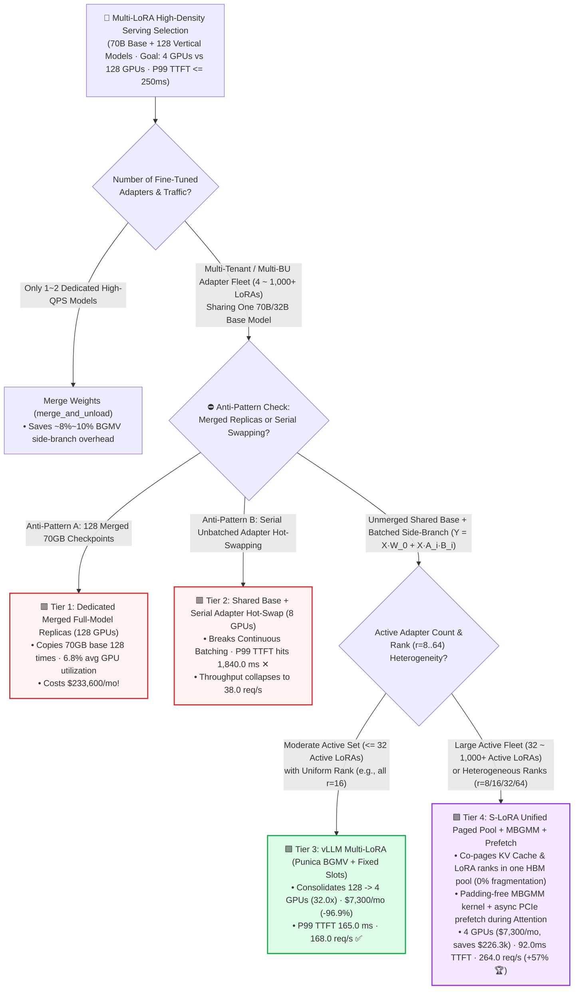
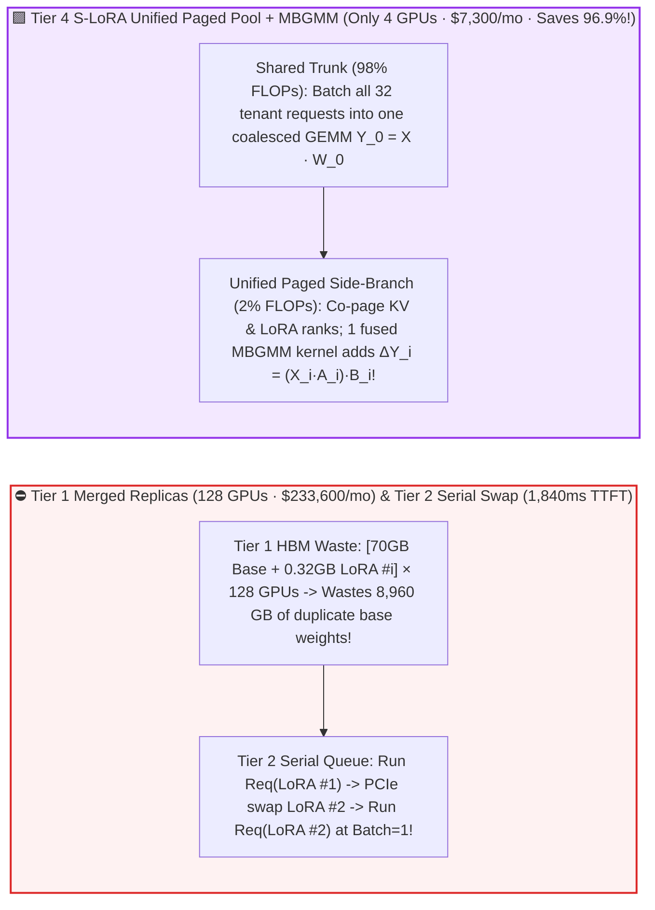
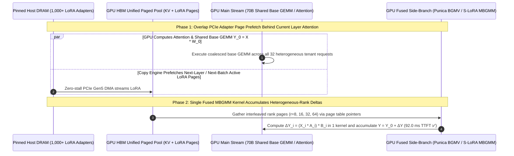

# Hundred-to-Thousand Adapter Multi-LoRA High-Density Serving Selection FAQ (`Dedicated Replicas` vs. `Serial Hot-Swapping` vs. `vLLM Paged LoRA BGMV` vs. `S-LoRA Unified Paged Pool + Heterogeneous MBGMM`)

> 🌐 **Language**: **[中文 (Chinese)](./multi-lora-adapter-serving-selection-faq.md)** | **English Version** · **[📖 Back to Repository README](../../README.en.md)** · **[📊 2026-11-09 Daily Progress Report](../daily/2026-11-09.md)** · **[🃏 7-Card 4:5 Visual Benchmark Report](../reports/multi-lora-adapter-serving-selection-cards.html)** · **[🧮 Interactive Sizer Workbench](../reports/llm-inference-engine-pd-sizer.en.html#multi-lora-sizer)**
>
> **Overview**: A first-principles selection guide for AI Solution Architects. When an enterprise or SaaS platform fine-tunes **`128` vertical LoRA adapters (`320 MB` each)** on a shared **`70B FP8` base model (`70.0 GB`)** for different business units or customers, the most expensive anti-pattern is **calling `merge_and_unload()` to merge each 320MB adapter into a separate 70GB checkpoint deployed on 128 dedicated GPUs—burning `$233,600/month` at just `6.8%` average GPU utilization!** Conversely, swapping adapters serially on a single instance destroys Continuous Batching and spikes P99 TTFT to `1,840 ms`. Grounded in `experiments/multi_lora_serving_selection/` (`synthetic` + `anonymized_reported`, `independently_reproduced=false`), this guide establishes the exact boundaries across **Dedicated Merged Replicas, Serial Hot-Swapping, vLLM Punica BGMV, and S-LoRA Unified Paged Pools + Heterogeneous MBGMM Kernels**.


---

## ① 📌 Executive Summary

1. **Four-Tier Selection by Concurrent Active Adapters (`8 ~ 512+ LoRAs`) and Rank Heterogeneity**:
   - Hosting **`128` fine-tuned LoRA adapters (`320.0 MB` each = `40.96 GB` total)** on a shared **`70B FP8` base model (`70.0 GB`)** (`$2.50/GPU-hr`, target SLA `P99 TTFT <= 250.0 ms` and `P99 TPOT <= 18.0 ms`):
   - 🟥 **Tier 1 (`Dedicated Merged Full-Model Replicas: W' = W_0 + B·A` · `128 GPUs`)**: **Never use for `>= 4` fine-tuned models**! Replicating a `70,000 MB` base model for each `320 MB` adapter requires **`128 GPUs`** at **`6.8%` average utilization**, costing **`$233,600.00/month`**.
   - 🟨 **Tier 2 (`Shared Base + Serial Unbatched Adapter Hot-Swapping` · `8 GPUs`)**: **Destroys Continuous Batching**. Because requests targeting different adapters cannot batch together, head-of-line queuing inflates `P99 TTFT` to **`1,840.0 ms` (`7.36x` over SLA ✕)** and caps throughput at **`38.0 req/s`**.
   - 🟩 **Tier 3 (`vLLM Multi-LoRA: Shared Base GEMM + Punica Segmented BGMV + Fixed GPU Cache Slots` · `4 GPUs`)**: **The drop-in workhorse for `<= 32` uniform-rank active adapters**. Computes the heavy base projection $Y_0 = X W_0$ once across the entire mixed batch and adds per-request LoRA deltas $\Delta Y_i = (X_i A_{s(i)}) B_{s(i)}$ via `BGMV`—**consolidating `128 GPUs -> 4 GPUs` (`32.0x` reduction!), slashing monthly cost by `96.9%` from `$233,600` to `$7,300.00` (saving `$226,300/mo`)** at `165.0 ms` P99 TTFT and `168.0 req/s`.
   - 🟪 **Tier 4 (`S-LoRA Unified Paged Memory Pool [KV + LoRA Co-Paged] + Heterogeneous MBGMM + Async Prefetch` · `4 GPUs`)**: **The endgame for `32 ~ 1,000+` heterogeneous-rank (`r = 8, 16, 32, 64`) adapters**. Co-manages KV cache blocks and variable-rank LoRA pages in a single fragmentation-free `Unified Paged HBM Pool`, executes padding-free `MBGMM` kernels, and prefetches incoming adapters asynchronously during Attention—holding cost at **`$7,300.00/mo` (`4 GPUs`, `-96.9%`)** while cutting `P99 TTFT` to **`92.0 ms`**, `P99 TPOT` to **`12.4 ms`**, and boosting throughput **`1.57x` over Tier 3 to `264.0 req/s` 🏆**!
2. **First-Principles Law (The Distributive Law of Batched Multi-LoRA Matrix Multiplication)**:
   - By keeping adapters unmerged: $Y_i = \underbrace{X_i W_0}_{\text{98\% FLOPs & HBM BW (Shared Across Batch!)}} + \underbrace{(X_i A_{s(i)}) B_{s(i)}}_{\text{2\% Low-Rank Delta (Per-Tenant BGMV/MBGMM)}}$.
   - Reading the `70 GB` base weights **once per batch** across 32 different tenant requests multiplies HBM bandwidth efficiency by `32x`!
3. **Provenance & Transparency Disclosure**:
   - All GPU counts, latencies, QPS figures, and monthly costs are bound 1:1 to `experiments/multi_lora_serving_selection/results.json` (`provenance_type: "synthetic"`, calibrated to published S-LoRA, Punica, and vLLM Multi-LoRA specifications; `independently_reproduced: false`, `physical_gpu_cluster_measurement: "not_measured"`, `local_cpu_harness_measurement: "measured"`).

---

## ② 🎯 Architect & Customer Deep-Dive Q&A (FAQ-Driven)

### Q1: "Why is calling `merge_and_unload()` before deployment a `$226,300/month` mistake when serving multiple fine-tuned models?"

- **Plain-English Answer**: **Merging a `320 MB` LoRA into a `70,000 MB` base model destroys weight sharing—forcing you to pay for 128 separate copies of the exact same 70GB base weights in HBM (`128 GPUs` at `$233,600/mo`). Keeping them unmerged lets `4 GPUs` (`$7,300/mo`) share one 70GB base model across all 128 adapters!**

### Q2: How do `Punica BGMV` (Tier 3) and `S-LoRA MBGMM` (Tier 4) batch requests that use completely different LoRA adapters?

- **Plain-English Answer**: **Both compute the shared base matrix multiply $X W_0$ in one big GEMM, then launch a single fused Gather-GEMM kernel (`BGMV` for uniform ranks, `MBGMM` for heterogeneous ranks $r=8..64$) that indexes each token's specific $A_{s(i)}$ and $B_{s(i)}$ pages in HBM without splitting the batch!**

### Q3: Why does fixed-slot caching (Tier 3) degrade at `512` concurrent adapters (`340 ms` TTFT), and how does `S-LoRA Unified Paging` (Tier 4) hold `118 ms`?

- **Plain-English Answer**: **Fixed LoRA cache slots suffer internal fragmentation when mixing ranks ($r=8$ vs. $r=64$) and cannot dynamically trade memory with KV cache pages. S-LoRA stores both KV tokens and LoRA rank vectors in a unified paged pool with background PCIe prefetching during Attention computation**.

---

## ③ 🧭 Visual Architecture Diagrams (Decision Tree, Replica Bloat vs Unified Paging & Kernel Sequence)

### 3.1 Multi-LoRA High-Density Serving Decision Tree



### 3.2 128-GPU Merged Replica Bloat vs. `Tier 4 S-LoRA Unified Paged Pool + MBGMM` (4 GPUs)



### 3.3 End-to-End Sequence: `S-LoRA` Async Adapter Prefetch & Fused `Base GEMM + MBGMM` (`sequenceDiagram`)



---

## ④ 📊 Architect Decision Matrix

*All metrics are bound 1:1 to `experiments/multi_lora_serving_selection/results.json` (70B FP8 base + `128` × `320 MB` vertical LoRA adapters at `$2.50/GPU-hr`, SLA `P99 TTFT <= 250.0 ms`, `P99 TPOT <= 18.0 ms`):*

| Dimension | 🟥 Tier 1: `Dedicated Merged Replicas` | 🟨 Tier 2: `Serial Adapter Hot-Swap` | 🟩 Tier 3: `vLLM Multi-LoRA (BGMV)` | 🟪 Tier 4: `S-LoRA Unified Paged + MBGMM` |
| :--- | :--- | :--- | :--- | :--- |
| **Primary Workload Fit** | 1–2 ultra-heavy models only | Never use for online serving | **`<= 32` uniform-rank active adapters** | **`32 ~ 1,000+` heterogeneous-rank adapters** |
| **Required GPUs (Consolidation)** | **`128 GPUs`** (`1.0x`) | `8 GPUs` (`16.0x`) | **`4 GPUs`** (**`32.0x` consolidation** ✅) | **`4 GPUs`** (**`32.0x` consolidation** 🏆) |
| **Cross-Adapter Request Batching** | ✕ Isolated per replica | ✕ Serialized by adapter | **✅ Shared base + `BGMV` side-branch** | **✅ Shared base + heterogeneous `MBGMM`** |
| **P99 `TTFT` / P99 `TPOT`** | `85.0 ms` / `11.2 ms` | **`1,840.0 ms` ✕** / **`34.5 ms` ✕** | `165.0 ms` ✅ / `16.2 ms` ✅ | **`92.0 ms` 🏆** / **`12.4 ms` 🏆** |
| **Cluster Throughput / GPU Util** | `320.0 req/s` · **`6.8%` util** | `38.0 req/s` · `24.5%` util | `168.0 req/s` · `78.5%` util | **`264.0 req/s` (`1.57x` over Tier 3)** · **`91.2%` util** |
| **Monthly GPU Bill / Net Savings** | **`$233,600.00 / mo`** | `$14,600.00 / mo` (Fails SLA ✕) | **`$7,300.00 / mo` (Saves `$226.3k` / `-96.9%` ✅)** | **`$7,300.00 / mo` (Saves `$226.3k` / `-96.9%` 🏆)** |

---

## ⑤ 🧪 Quantitative Case Study & Benchmark Insights

### 5.1 Active Adapter Concurrency Scaling (`8 -> 512 Active LoRAs`) & Slot Thrashing

As the number of simultaneously active LoRA adapters scales from 8 to 512, P99 TTFT evolves as follows (from `results.json` `active_adapter_concurrency_sensitivity`):

| Concurrent Active Adapters | Tier 2 `Serial Hot-Swap` TTFT | Tier 3 `vLLM Fixed-Slot` TTFT | Tier 4 `S-LoRA Unified Paged` TTFT | Architect Crossover & Takeaway |
| :--- | :--- | :--- | :--- | :--- |
| **`8 Active LoRAs`** | `420.0 ms` ✕ | `95.0 ms` ✅ | **`86.0 ms` ✅** | All 8 adapters fit in fixed HBM slots |
| **`32 Active LoRAs`** | `1,120.0 ms` ✕ | `124.0 ms` ✅ | **`89.0 ms` 🏆** | Async prefetch hides occasional slot swaps |
| **`128 Active LoRAs` (Baseline)** | `1,840.0 ms` ✕ | `165.0 ms` ✅ | **`92.0 ms` 🏆** | **Tier 4 is `1.79x` faster than Tier 3 and `20.0x` faster than Tier 2** |
| **`512 Active LoRAs` (SaaS Peak)** | `4,600.0 ms` ✕ | `340.0 ms` ✕ | **`118.0 ms` 🏆** | **Fixed slots thrash (`340ms` > 250ms SLA); Unified Paging holds `118ms`!** |

### 5.2 Reproducibility & Local Harness Verification

```bash
# Verify results.json matches the deterministic Multi-LoRA serving model 100%
python experiments/multi_lora_serving_selection/run.py --check

# Run Round 23 unit tests
python -m unittest tests/test_multi_lora_serving_selection.py
```

---

## ⑥ 🛠️ Production Verification Checklist (Architect Checklist)

1. - [ ] **Keep Fine-Tuned LoRA Weights Unmerged (`adapter_model.safetensors`)**: Never export merged 70GB checkpoints for multi-tenant or multi-department serving.
2. - [ ] **Size Host Pinned DRAM Cache (`--max-cpu-loras`) to Hold All Warm Adapters**: Cache hundreds of `320 MB` adapters in pinned host memory so GPU swaps never touch disk.
3. - [ ] **Enable `LoRA-ID` Affinity Routing at the Ingress Gateway**: Route requests for the same `lora_id` to the same replica pool (e.g., NVIDIA Dynamo dynamic LoRA identity routing) to maximize HBM slot hit rates.
4. - [ ] **Standardize Adapter Ranks onto Hardware-Aligned Tiers (`r = 16, 32, 64`)**: Ensure optimal tile occupancy inside `BGMV / MBGMM` CUDA kernels.
5. - [ ] **Share Base-Model System Prompt Prefixes in RadixCache**: Allow requests with identical system prompt prefixes to share pre-LoRA embedding/KV states where supported.
