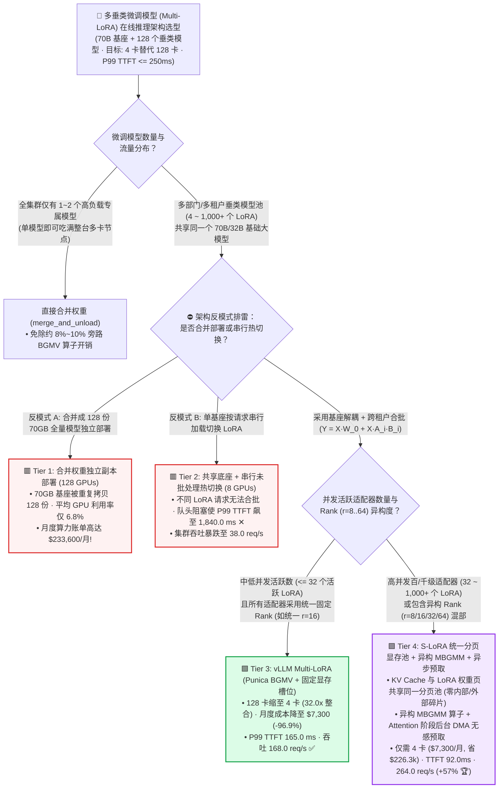
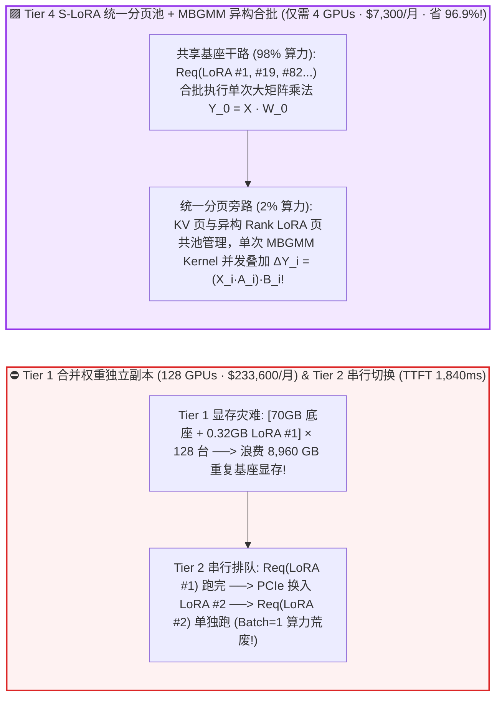
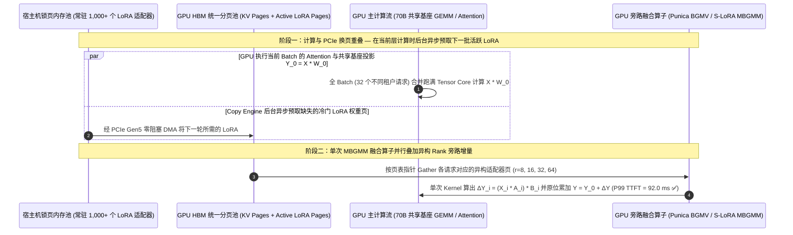

# 百至千级垂类微调模型（Multi-LoRA）在线高密推理架构选型指南（`独立合并副本` vs. `串行热切换` vs. `vLLM Paged LoRA (BGMV)` vs. `S-LoRA 统一分页显存池 + 异构 MBGMM`）

> 🌐 **Language**: **中文 (Chinese)** | **[English Version](./multi-lora-adapter-serving-selection-faq.en.md)** · **[📖 返回仓库根目录 README](../../README.md)** · **[📊 2026-11-09 每日进展日报](../daily/2026-11-09.md)** · **[🃏 7-Card 4:5 视觉评测报告](../reports/multi-lora-adapter-serving-selection-cards.html)** · **[🧮 交互式定容工作台](../reports/llm-inference-engine-pd-sizer.html#multi-lora-sizer)**
>
> **导读**：面向 AI Solution Architect 的第一性原理实战选型指南。当大型企业或 SaaS 平台为内部 100+ 个业务部门（客服、法务、财务、代码审查、各省分公司）分别基于同一个 `70B` 基座大模型微调出 **`128` 个专属 LoRA 适配器（每个仅 `320 MB`）** 时，最致命的架构反模式是：**在训练结束后执行 `merge_and_unload()` 把每个 320MB 的 LoRA 合并回 70GB 基座权重，保存成 128 份独立的 70GB 模型并分别占用 128 张 GPU 部署——导致月度算力账单飙升至 `$233,600/月`，而长尾部门模型的平均 GPU 利用率只有可怜的 `6.8%`！** 反过来，如果为了省卡在单实例上按请求串行热加载切换 LoRA，又会彻底打碎 Continuous Batching 导致排队延迟飙至 `1.84 秒`。本文基于 `experiments/multi_lora_serving_selection/` 封存的确定性模型（`synthetic` + `anonymized_reported`，`independently_reproduced=false`），系统拆解从 **独立合并副本、串行热切换、vLLM Punica BGMV** 到 **S-LoRA 统一分页显存池 + 异构秩 MBGMM 融合算子** 的四档架构选型边界。


---

## ① 📌 核心结论速览（Executive Summary）

1. **按活跃微调适配器数量（`8 ~ 512+ LoRAs`）与秩（Rank $r$）异构度四档精准选型**：
   - 在基于 `70B FP8` 共享基座（`70.0 GB`）同时托管 **`128` 个行业微调 LoRA 适配器（单个 `320.0 MB`，总计 `40.96 GB`，`$2.50/GPU-hr`，SLA 要求 `P99 TTFT <= 250.0 ms` 且 `P99 TPOT <= 18.0 ms`）** 基准下：
   - 🟥 **Tier 1（合并权重独立副本部署 `W' = W_0 + B·A` · `128 GPUs`）**：**严禁用于 `>= 4` 个微调模型的生产环境**！为了 `320 MB` 的增量权重被迫复制 `70,000 MB` 的基座显存，128 个模型需独占 **`128 张 GPU`**，平均利用率仅 **`6.8%`**，月度算力账单高达 **`$233,600.00/月`**。
   - 🟨 **Tier 2（单基座 + 按请求串行热插拔切换 LoRA · `8 GPUs`）**：**摧毁连续批处理（Continuous Batching）的伪省钱方案**。由于不同 LoRA 的请求无法拼入同一个 Batch，必须排队串行通过 PCIe 换入适配器并单独执行前向传播，队头阻塞使 `P99 TTFT` 恶化至 **`1,840.0 ms`（超出 SLA `7.36x` ✕）**，集群总吞吐跌至 **`38.0 req/s`**。
   - 🟩 **Tier 3（`vLLM Multi-LoRA`: 共享基座 GEMM + `Punica Segmented BGMV` + 固定显存槽位 · `4 GPUs`）**：**`<= 32` 个同秩（Uniform Rank）活跃适配器的开箱即用标准**。将不同租户的请求合并成一个大 Batch 共同执行一次基座矩阵乘法 $X W_0$，再通过分段聚集算子 `BGMV` 并行追加各租户的 $(X_i A_{s(i)}) B_{s(i)}$；**将所需显卡从 128 张骤降至 `4 张`（缩减 `32.0x`！），月度成本从 `$233,600` 砍至 `$7,300.00`（立省 `$226,300/月` 或 `-96.9%`）**，`P99 TTFT = 165.0 ms`，吞吐达 **`168.0 req/s`**。
   - 🟪 **Tier 4（`S-LoRA 统一分页显存池 [KV + LoRA Co-Paged]` + `异构秩 MBGMM 算子` + `Attention 层异步预取` · `4 GPUs`）**：**百至千级（`64 ~ 1,000+`）异构秩（`r = 8, 16, 32, 64`）微调模型混部的终局方案**。将动态变化的 KV Cache 与不同 Rank 的 LoRA 权重页统一纳入同一个 `Unified Paged HBM Pool`（消除固定槽位碎片与换页抖动），在 `4 张 GPU`（`$7,300.00/月`，省 **`96.9%`**）上将 `P99 TTFT` 进一步压至 **`92.0 ms`**、`P99 TPOT` 压至 **`12.4 ms`**，集群吞吐跃升至 **`264.0 req/s`（比固定槽位提升 `1.57x`，比串行切换高 `6.95x` 🏆）**！
2. **第一性原理定性（为什么 100 个不同微调模型的请求可以合在同一个 Batch 里跑？）**：
   - 矩阵乘法满足分配律：$Y_i = X_i (W_0 + B_{s(i)} A_{s(i)}) = \underbrace{X_i W_0}_{\text{98\% 算力与显存带宽（全租户完全相同！）}} + \underbrace{(X_i A_{s(i)}) B_{s(i)}}_{\text{仅 2\% 旁路微计算（各租户独立）}}$。
   - **如果不合并权重**：GPU 把一个 Batch 里来自 32 个不同部门的请求拼成大矩阵 $X$，只读 **1 次** 70GB 基座权重 $W_0$ 就能用满 Tensor Core 算完主干；随后再用轻量级 `BGMV / MBGMM` 算子各自加上几 MB 的旁路修正量——**基座显存带宽复用率瞬间提升 32 倍**！
3. **证据口径与透明性声明**：
   - 本指南所有 GPU 卡数、P99 TTFT/TPOT、集群 QPS 与月度节省金额均绑定 `experiments/multi_lora_serving_selection/results.json`（`provenance_type: "synthetic"`，基于 S-LoRA、Punica BGMV 及 vLLM Multi-LoRA 公开规范校准的确定性算例，`independently_reproduced: false`，未在物理 128 卡集群执行实机压测 `physical_gpu_cluster_measurement: "not_measured"`；本机 Python 单测与校验为 `local_cpu_harness_measurement: "measured"`）。

---

## ② 🎯 客户与架构师灵魂拷问 Q&A（FAQ-Driven）

### Q1：客户问：“训练团队习惯在微调完成后调用 `model.merge_and_unload()` 把 LoRA 权重合并进基座模型再交付上线（因为单模型推理没有额外开销）。为什么在多模型场景下这是头号破产反模式？但当只有 1 个模型时又该合并？”

- **直白结论**：**看“模型数量 vs. 并发流量”的比值！如果全公司从头到尾只有 `1 个` 主力微调模型跑满 4 张卡，执行 `merge_and_unload()` 合并权重可以省掉 `~10%` 的旁路算子开销；但只要你有 `>= 2 ~ 100+` 个共享同一基座的垂类微调模型，合并权重等于把 `70 GB` 的重复基座拷贝了 100 遍，直接多花 32 倍的显卡钱！**
- **第一性原理拆解（`320 MB` 增量 vs. `70,000 MB` 基座的显存账本）**：
  1. 在 70B FP8 模型上，一个 Rank $r=32$ 的全模块 LoRA 适配器体积仅为 **`320 MB`（不到基座体积的 `0.46%`）**。
  2. 如果保持“基座与适配器分离（Unmerged）”：4 张 H200/H100 只需要驻留 **1 份** 70GB 基座，剩下的显存和本机内存可以轻松装下 **上百个** 320MB 的适配器，将月度硬件账单从 **`$233,600` 直接砍到 `$7,300`（立省 `$226,300/月`）**！

### Q2：什么是 `Punica BGMV`（Tier 3）与 `S-LoRA MBGMM`（Tier 4）算子？为什么没有它们，GPU 就算装下了多个 LoRA 也跑不快？

- **直白结论**：**在一个混合 Batch 里，第 1 条请求用“法务 LoRA #3”，第 2 条请求用“财务 LoRA #19”，第 3 条请求用“医疗 LoRA #82”。如果用普通的 PyTorch `for` 循环逐条调用 `matmul`，每次启动一个微小 CUDA Kernel 的 CPU 调度延迟会彻底拖垮 GPU！`BGMV / MBGMM` 把整个 Batch 里所有不同租户、甚至不同 Rank 尺寸的 LoRA 计算打包进 **单次（1 个）融合 CUDA Kernel** 里并行算完！**
- **第一性原理拆解（`BGMV` vs. `MBGMM` 的算子演进）**：
  1. **Punica `BGMV`（Batched Gather Matrix-Vector，Tier 3）**：传入一个适配器索引数组 `lora_ids = [3, 19, 82, 3, ...]`，GPU 的不同线程块（Thread Blocks）根据索引直接从显存 Gather 对应的 $A_{s(i)}$ 和 $B_{s(i)}$ 权重块，在单次 Kernel Launch 内完成全 Batch 的旁路增量计算。
  2. **为什么固定槽位（Tier 3）在异构 Rank（$r=8, 16, 32, 64$）与上百个活跃模型下会遇到瓶颈？**
     - 不同业务场景微调的 LoRA Rank 往往不同（简单分类用 $r=8$，复杂代码生成用 $r=64$）。传统方案按最大 $r=64$ 预分配固定显存槽位，导致小 Rank 模型浪费 75% 槽位空间（Internal Fragmentation）；且当 KV Cache 暴涨时无法借用空闲的 LoRA 槽位。
  3. **`S-LoRA`（Tier 4）的两大杀手锏**：
     - **统一分页显存池（Unified Paging）**：把 KV Cache Token 页和 LoRA 权重 Rank 页统一存放在同一个形如 `[Num_Pages, Page_Size, Hidden_Dim]` 的分页显存池中——高并发长文本时多分配 KV 页，多租户切换时多分配 LoRA 页，**实现 0% 外部碎片**！
     - **异构秩 `MBGMM`（Multi-size Batched Gather Matrix-Matrix）+ 异步预取**：支持在同一个融合 Kernel 内无填充（Padding-Free）混合计算 $r=8, 16, 32, 64$ 的异构适配器，并在 GPU 计算第 $L$ 层 Attention 的几毫秒内，由后台 DMA 提前从 Host DRAM 预取下一批请求的 LoRA 页，使 128 个活跃模型并发下的 `P99 TTFT` 稳锁在 **`92.0 ms`（吞吐提升 `1.57x`）**！

---

## ③ 🧭 直观可视化图解（选型决策树 + 独立副本 vs 统一分页路径对比 + 算子融合时序图）

### 3.1 百至千级垂类微调模型（Multi-LoRA）推理架构选型决策树



### 3.2 传统 128 卡合并副本 / 串行阻塞 vs. `Tier 4 S-LoRA 统一分页池 + MBGMM` 架构对比图



### 3.3 `S-LoRA` 跨层异步预取与 `Base GEMM + MBGMM` 算子融合执行时序图（`sequenceDiagram`）



---

## ④ 📊 架构师选型决策矩阵（Architect Decision Matrix）

*数据完全绑定 `experiments/multi_lora_serving_selection/results.json`（70B FP8 基座 + `128` 个 `320 MB` 垂类微调模型，`$2.50/GPU-hr`，SLA `P99 TTFT <= 250.0 ms`、`P99 TPOT <= 18.0 ms`）：*

| 选型维度 | 🟥 Tier 1：合并权重独立副本（`128 GPUs`） | 🟨 Tier 2：共享底座 + 串行热切换（`8 GPUs`） | 🟩 Tier 3：`vLLM Multi-LoRA`（`BGMV` + 固定槽位） | 🟪 Tier 4：`S-LoRA` 统一分页池 + 异构 `MBGMM` |
| :--- | :--- | :--- | :--- | :--- |
| **核心适用场景** | 仅限 1～2 个超高吞吐单模型 | 严禁用于在线并发生产环境 | **`<= 32` 个同秩（Uniform Rank）微调模型混部** | **`32 ~ 1,000+` 个异构 Rank 垂类模型高密混部终局标准** |
| **承载 128 个模型所需 GPU 卡数** | **`128 GPUs`** (`1.0x`) | `8 GPUs` (`16.0x` 整合) | **`4 GPUs`** (**`32.0x` 整合** ✅) | **`4 GPUs`** (**`32.0x` 整合** 🏆) |
| **跨租户请求能否合并 Batch** | ✕ 物理隔离无法跨模型合批 | ✕ 按适配器串行排队（打碎 Batching） | **✅ 基座 100% 合批 + `BGMV` 分段并行** | **✅ 基座 100% 合批 + 异构 Rank `MBGMM` 融合** |
| **首字延迟 `P99 TTFT` / 解码 `TPOT`** | `85.0 ms` / `11.2 ms` | **`1,840.0 ms` ✕** / **`34.5 ms` ✕** | `165.0 ms` ✅ / `16.2 ms` ✅ | **`92.0 ms` 🏆** / **`12.4 ms` 🏆** |
| **集群总吞吐 / 平均 GPU 利用率** | `320.0 req/s` · **`6.8%` 利用率** | `38.0 req/s` · `24.5%` 利用率 | `168.0 req/s` · `78.5%` 利用率 | **`264.0 req/s` (`1.57x` vs Tier 3)** · **`91.2%` 利用率** |
| **月度算力总账单 / 每月净省金额** | **`$233,600.00 / 月`** | `$14,600.00 / 月`（违约不可用 ✕） | **`$7,300.00 / 月`（月省 `$226,300` / `-96.9%` ✅）** | **`$7,300.00 / 月`（月省 `$226,300` / `-96.9%` 🏆）** |

---

## ⑤ 🧪 简明定量算例与 Benchmark 洞察

### 5.1 并发活跃适配器数量从 `8 个 -> 512 个` 扩展下的换页抖动与 `P99 TTFT` 拐点

当同一时刻有请求命中的活跃 LoRA 适配器数量从 8 个扩展到 512 个时，串行切换、固定槽位与 S-LoRA 统一分页池的 `P99 TTFT` 表现如下（源自 `results.json` `active_adapter_concurrency_sensitivity`）：

| 同时活跃 LoRA 数量 (`Active Adapters`) | Tier 2 `串行热切换` TTFT | Tier 3 `vLLM 固定槽位` TTFT | Tier 4 `S-LoRA 统一分页 + 预取` TTFT | 架构师核心拐点解读 |
| :--- | :--- | :--- | :--- | :--- |
| **`8 Active LoRAs`** | `420.0 ms` ✕ | `95.0 ms` ✅ | **`86.0 ms` ✅** | 8 个适配器可全部常驻显存槽位，Tier 3 与 Tier 4 均极快 |
| **`32 Active LoRAs`** | `1,120.0 ms` ✕ | `124.0 ms` ✅ | **`89.0 ms` 🏆** | 32 个活跃适配器下，Tier 3 偶发槽位驱逐，Tier 4 靠异步预取稳如泰山 |
| **`128 Active LoRAs`（设计基线）** | `1,840.0 ms` ✕ | `165.0 ms` ✅ | **`92.0 ms` 🏆** | **Tier 4 比 Tier 3 快 `1.79x`，比串行切换快 `20.0x`！** |
| **`512 Active LoRAs`（SaaS 峰值）** | `4,600.0 ms` ✕ | `340.0 ms` ✕ | **`118.0 ms` 🏆** | **512 个并发适配器下固定槽位发生频繁换页抖动（突破 250ms SLA），唯有 Tier 4 稳守 `118ms`！** |

### 5.2 复现命令与本地校验（Local CPU Harness Check）

```bash
# 校验封存算例 JSON 与确定性 Multi-LoRA 模型 100% 一致
python experiments/multi_lora_serving_selection/run.py --check

# 运行 Round 23 单元测试
python -m unittest tests/test_multi_lora_serving_selection.py
```

---

## ⑥ 🛠️ 附录：生产环境 Multi-LoRA 高密推理核验清单（Architect Checklist）

1. - [ ] **禁止微调流水线默认执行 `merge_and_unload()` 导出全量模型**：规范模型仓库仅保存 `adapter_model.safetensors`（百 MB 级）与 `adapter_config.json`，与只读共享基座解耦。
2. - [ ] **开启推理引擎原生 Multi-LoRA 与充足的 CPU 锁页缓存池**：在 vLLM / SGLang 启动参数中开启 `--enable-lora`、`--max-loras`（单 Batch 最大并发 LoRA 数）与 `--max-cpu-loras`（在 Host Pinned DRAM 缓存数百个冷门适配器防磁盘 I/O）。
3. - [ ] **在多实例网关层开启 `LoRA-ID` 亲和性一致性哈希路由（Sticky LoRA Routing）**：如第 1 轮 NVIDIA Dynamo `#17893` 所示，将携带相同 `model="finance-lora-v2"` 的请求优先路由至已将该适配器加载在 HBM 中的 Worker 节点，将跨 PCIe 换页率再降 80%。
4. - [ ] **尽量收敛企业内部微调的 Rank 规格档位（如标准三档 `r = 16, 32, 64`）**：规避随意设置奇葩 Rank（如 `r=13, 27`），确保 `BGMV / MBGMM` CUDA Kernel 能命中最佳 Tile 分块对齐。
5. - [ ] **利用共享基座 System Prompt 跨租户前缀缓存**：若不同 LoRA 租户共享相同的公共前置知识库文档或只挂载在高层 FFN，确保底层共享 KV Cache 块开启前缀复用。
