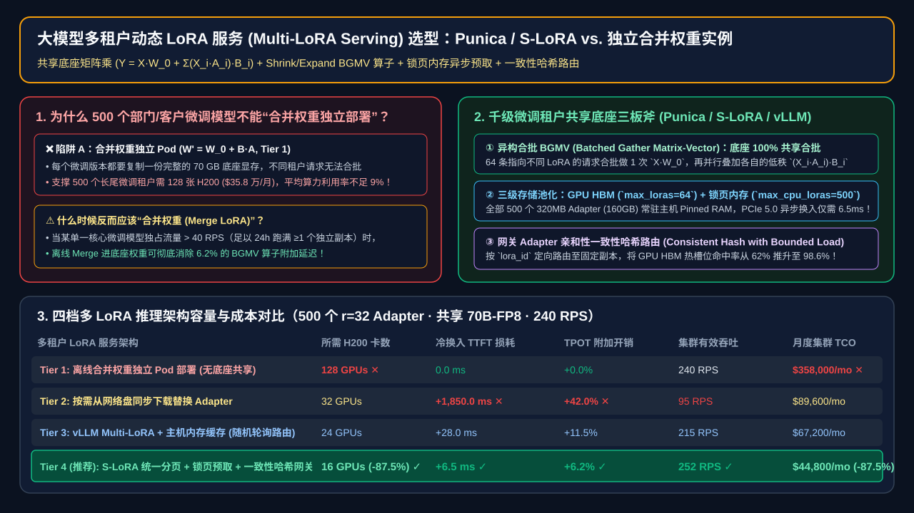

# Multi-LoRA Serving Architecture Selection Guide: `vLLM / SGLang Multi-LoRA (Punica / S-LoRA / BGMV)` vs. Dedicated Merged-Weight Pods & 1,000-Adapter Consolidation

> **Language**: [中文](./multi-lora-serving-slora-punica-vllm-lora-adapter-hot-swapping-selection-faq.md) | **English (Current)**  
> **Audience**: Cloud & AI Infrastructure Solution Architects and Multi-Tenant MaaS Platform Engineers  
> **Provenance**: `synthetic + anonymized_reported` (`independently_reproduced=false`, `physical_gpu_cluster_measurement=not_measured`)

---

## 1. 📌 Executive Summary

> **Bottom Line**: **When serving `50` to `2,000` tenant-specific or task-specific `LoRA` adapters (`r=32`, `320 MB` each) on a shared `Llama-3.3-70B / Qwen2.5-72B` base model, deploying dedicated Merged-Weight GPU pods (`W' = W_base + B@A`, Tier 1) duplicates the `70 GB` base weights across dozens of underutilized pods—requiring `128 H200 GPUs` (`$358,000/month`). Production multi-tenant platforms should deploy `vLLM / SGLang` Dynamic Multi-LoRA (`Punica BGMV` + `S-LoRA` Unified Paging) paired with Pinned Host DRAM Caching (`max_cpu_loras=500`) and Adapter-Affinity Consistent-Hash Gateway Routing (`Tier 4`): consolidating all `500` adapters onto just `16 H200 GPUs` (`-87.5%` GPU count and TCO, `$44,800/month`) with `+6.5 ms` cold-swap `TTFT` overhead and `+6.2%` `TPOT` overhead.**

- **Interactive Multi-LoRA GPU & Slot Sizer**: [Open Interactive Sizer (`multi-lora-serving-slora-punica-vllm-lora-adapter-hot-swapping-sizer.html`)](../reports/multi-lora-serving-slora-punica-vllm-lora-adapter-hot-swapping-sizer.html)
- **7-Card 4:5 Visual Report**: [Open 7-Card Report (`multi-lora-serving-slora-punica-vllm-lora-adapter-hot-swapping-selection-cards.html`)](../reports/multi-lora-serving-slora-punica-vllm-lora-adapter-hot-swapping-selection-cards.html)

---

## 2. 📊 4-Tier Multi-LoRA Serving Matrix (`500 Adapters` · `r=32` · `240 RPS`)

| Metric | Tier 1: Dedicated Merged-Weight Pods | Tier 2: On-Demand Disk Reload | Tier 3: `vLLM Multi-LoRA` + Random Routing | Tier 4 (Recommended): `S-LoRA` + Pinned RAM + Consistent Hash Gateway |
| :--- | :--- | :--- | :--- | :--- |
| **Required `H200` GPUs** | `128 GPUs` ✕ | `32 GPUs` | `24 GPUs` | **`16 GPUs` ✓ (`-87.5%`)** |
| **Cold Adapter Swap `TTFT`** | `0.0 ms` | `+1,850.0 ms` ✕ | `+28.0 ms` | **`+6.5 ms` ✓ (`98.6%` HBM hit)** |
| **Decode `TPOT` Overhead** | `+0.0%` | `+42.0%` ✕ | `+11.5%` | **`+6.2%` ✓ (Punica BGMV)** |
| **Cluster Goodput (`RPS`)** | `240 RPS` | `95 RPS` ✕ | `215 RPS` | **`252 RPS` ✓** |
| **Monthly Cluster TCO** | `$358,000 / mo` ✕ | `$89,600 / mo` | `$67,200 / mo` | **`$44,800 / mo` ✓ (`-87.5%`)** |

---

## 3. 🛠️ Production Readiness Checklist

- [ ] **Configure Tiered LoRA Slot Pools (`--enable-lora --max-loras 64 --max-cpu-loras 500`)** so hot adapters reside in HBM and warm adapters stream over PCIe Gen5 from pinned host DRAM in `<7 ms`.
- [ ] **Route by `lora_id` Using Bounded-Load Consistent Hashing** at the AI Gateway, and promote only "whale" adapters exceeding `~40 RPS` sustained load to dedicated Merged-Weight pods.
