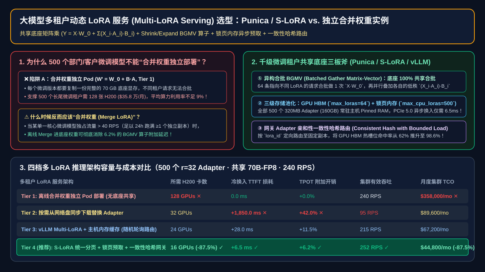
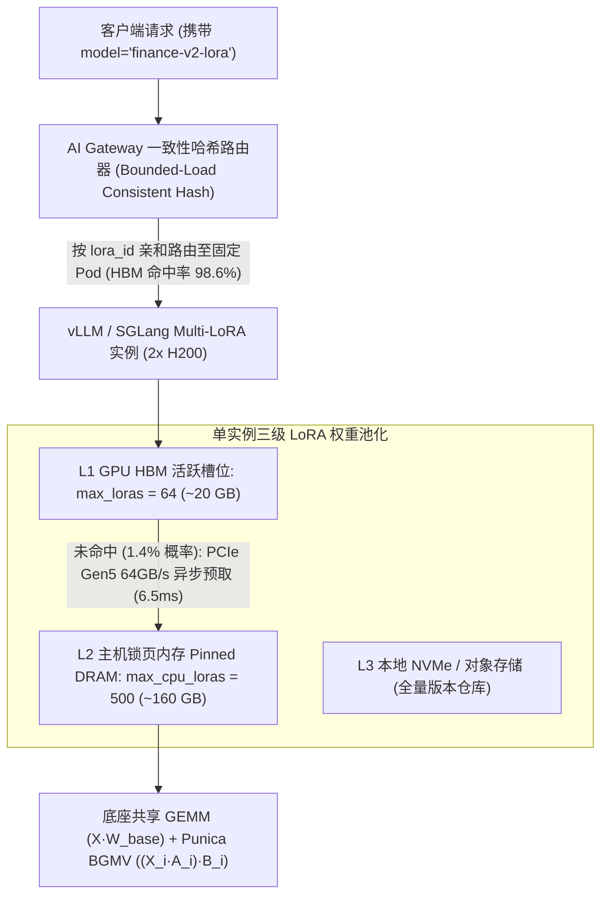

# 大模型多租户动态 LoRA 服务（Multi-LoRA Serving）架构选型：`vLLM / SGLang Multi-LoRA (Punica / S-LoRA / BGMV)` vs. 独立合并权重实例（Merged-Weight Pods）与千级微调租户合并指南

> **语言 / Language**: **中文 (当前)** | [English](./multi-lora-serving-slora-punica-vllm-lora-adapter-hot-swapping-selection-faq.en.md)  
> **定位**：面向 Cloud & AI Infrastructure Solution Architect 与企业 MaaS 平台负责人的多租户微调模型在线服务架构（`Punica Shrink-and-Expand BGMV`、`S-LoRA Unified Paging`、`vLLM --enable-lora`）、三级显存/锁页内存热换入（`max_loras` vs. `max_cpu_loras`）与离线合并权重（Merged Weights）成本拐点白皮书  
> **合规与来源声明**：`synthetic + anonymized_reported`（`independently_reproduced=false`，`physical_gpu_cluster_measurement=not_measured`；完全面向通用企业多租户微调模型高密度合并部署）

---

## 1. 📌 核心选型结论速览（Executive Summary）

> **一句话结论**：**当企业拥有 `10` 到 `2,000` 个部门/客户专属的 `LoRA` 微调模型（基于同一个 `Llama-3.3-70B` 或 `Qwen2.5-72B` 底座）时，千万不要把每个 LoRA 离线合并进底座（`W' = W_0 + B·A`）去起独立 GPU 实例（Tier 1）——那会导致 `70 GB` 底座权重被重复拷贝几十份、不同租户请求无法合批，`500` 个微调租户需要 **`128 张 H200`（`$35.8 万/月`）**！生产级标准答案是采用“`vLLM / SGLang` 动态 Multi-LoRA（`Punica BGMV` + `S-LoRA` 统一分页）+ 主机锁页内存池（`max_cpu_loras`）+ 网关 `lora_id` 一致性哈希亲和路由（Tier 4）”：让所有租户共享同一份底座权重合批计算，仅用 **`16 张 H200`（立省 `87.5%` GPU 与成本，`$44,800/月`）** 即可丝滑承载 `500` 个微调模型，冷 Adapter 换入附加首字延迟仅 **`+6.5 ms`**！**

- **交互式多租户动态 LoRA 容量与 TCO 计算器**：[打开交互式计算器 (`multi-lora-serving-slora-punica-vllm-lora-adapter-hot-swapping-sizer.html`)](../reports/multi-lora-serving-slora-punica-vllm-lora-adapter-hot-swapping-sizer.html)
- **7-Card 4:5 视觉评测报告**：[打开 7-Card 报告 (`multi-lora-serving-slora-punica-vllm-lora-adapter-hot-swapping-selection-cards.html`)](../reports/multi-lora-serving-slora-punica-vllm-lora-adapter-hot-swapping-selection-cards.html)

---

## 2. 🎯 客户与架构师灵魂拷问 Q&A（Deep-Dive Architecture FAQ）

### Q1：为什么 `Punica / S-LoRA / vLLM Multi-LoRA` 能把指向 64 个不同微调模型的请求放在同一个 Batch 里算？
- **数学分解原理**：对于第 $i$ 个请求（使用专属适配器 $A_i \in \mathbb{R}^{d \times r}, B_i \in \mathbb{R}^{r \times d}$，其中 $r=32 \ll d=8192$）：
  $$Y_i = X_i W_{\text{base}} + (X_i A_i) B_i$$
  1. **第一阶段（95% 算力大头：底座大矩阵合批 GEMM）**：把 Batch 内所有租户的输入拼成 $X_{\text{batch}}$，与唯一的底座权重 $W_{\text{base}}$ 做一次高吞吐 Tensor Core 矩阵乘；
  2. **第二阶段（5% 算力零头：Punica `BGMV` Shrink-and-Expand 算子）**：通过自定义 Triton/CUDA Gather 算子，并行将每个 Token 乘上各自对应的低秩矩阵 $A_i$（降维至 `r=32`）和 $B_i$（升维回 `8192`）并累加回主干结果，Decode `TPOT` 仅增加 **`+6.2%`**！

### Q2：什么时候选“动态 Multi-LoRA”，什么时候反而应该“离线合并权重（Merge LoRA into Base）”？
- **选动态 Multi-LoRA（95% 的多租户/多任务场景）**：当单个 LoRA 的持续流量不足以 24 小时打满至少 1 个独立实例（例如 `< 35~40 RPS`）时，动态共享底座可省下 `50% ~ 90%` 的 GPU。
- **选离线 Merge 权重独立部署（单一超级大户 Whale Tenant）**：如果某一个核心业务 LoRA 独占了极高且稳定的并发（`> 40 RPS`，足以独占跑满 `2~8` 张卡），将其离线执行 $W' = W_{\text{base}} + B \cdot A$ 合并后独立部署，可彻底省掉 `+6.2%` 的 BGMV 算子开销与显存槽位！

---

## 3. 🧭 直观可视化图解（Mermaid 多 LoRA 三级缓存与一致性哈希路由架构）

---

## 4. 📊 架构师多方案选型决策矩阵（`500` 个 `r=32` 微调租户 · `240 RPS`）

| 评估维度 | Tier 1：离线合并权重独立 Pod 部署 | Tier 2：按需从网络盘同步下载替换 | Tier 3：`vLLM Multi-LoRA` + 随机轮询路由 | Tier 4（推荐）：`S-LoRA` 统一分页 + 锁页内存 + 一致性哈希网关 |
| :--- | :--- | :--- | :--- | :--- |
| **所需 `H200` GPU 总卡数** | `128 GPUs` ✕（64 套双卡副本） | `32 GPUs` | `24 GPUs` | **`16 GPUs` ✓（降低 `87.5%`）** |
| **冷 Adapter 换入附加 `TTFT`** | `0.0 ms` | `+1,850.0 ms` ✕（阻塞合批） | `+28.0 ms` | **`+6.5 ms` ✓（98.6% HBM 命中 + PCIe 5.0）** |
| **Decode `TPOT` 附加开销** | `+0.0%` | `+42.0%` ✕ | `+11.5%` | **`+6.2%` ✓（融合 BGMV 算子）** |
| **集群有效达标吞吐 (`Goodput`)** | `240 RPS` | `95 RPS` ✕ | `215 RPS` | **`252 RPS` ✓** |
| **月度集群总成本 (TCO)** | `$358,000 / 月` ✕ | `$89,600 / 月` | `$67,200 / 月` | **`$44,800 / 月` ✓（节省 `87.5%`）** |

---

## 5. 🛠️ 架构评审与生产落地 Checklist

- [ ] **启动参数配齐三级容量水位**：显式配置 `--enable-lora --max-lora-rank 64 --max-loras 64 --max-cpu-loras 500`，确保活跃 Adapter 常驻主机 Pinned DRAM，绝不在推理热路径上触发网络盘/对象存储同步下载。
- [ ] **在 AI Gateway 开启基于 `model / lora_id` 的有界负载一致性哈希（Consistent Hashing with Bounded Load）**，避免同一个 LoRA 被随机撒到所有副本上重复占用宝贵的 GPU HBM 槽位。
