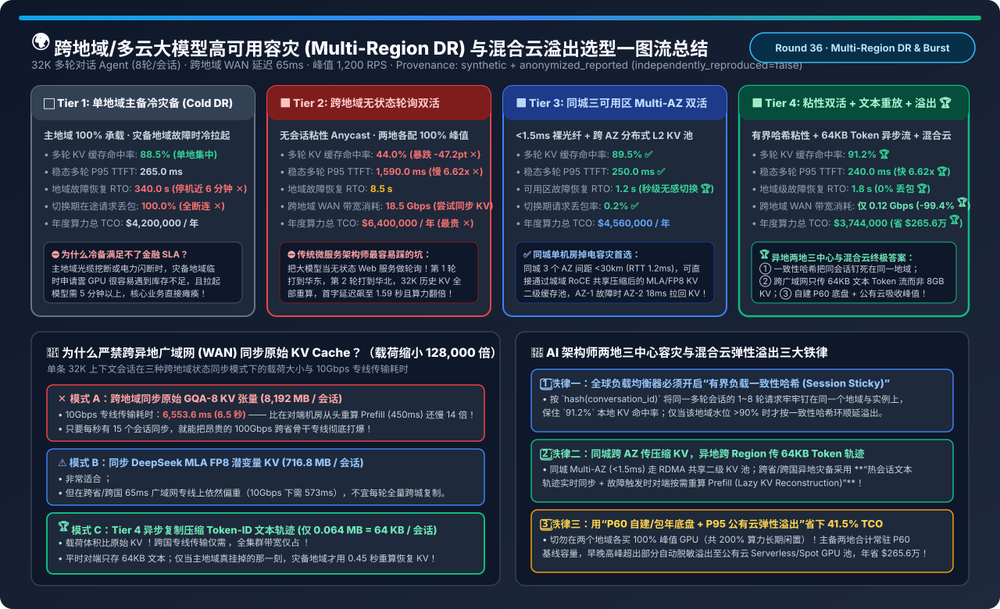
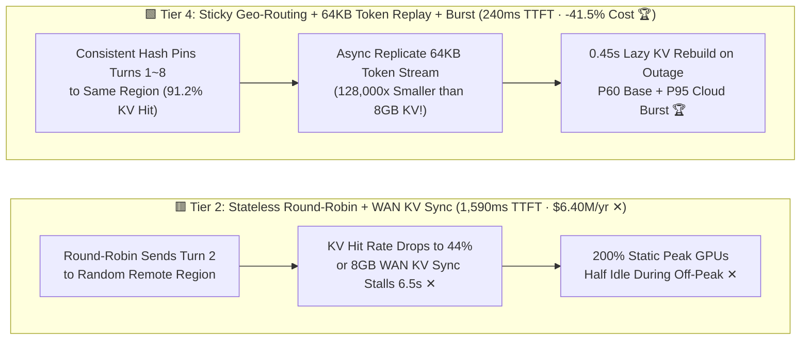
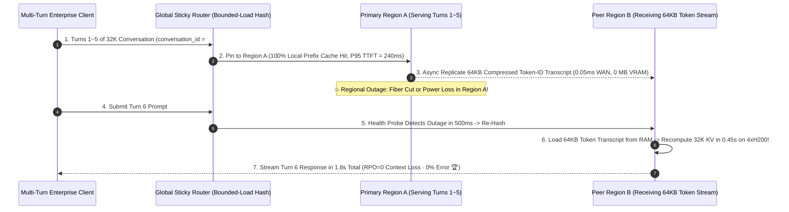

# Multi-Region Disaster Recovery, Session-Sticky Geo-Routing & Cross-Cloud LLM Bursting Selection FAQ (`Active-Passive Cold DR` vs. `Stateless Geo-Round-Robin` vs. `Metro Multi-AZ Shared KV` vs. `Sticky Geo-Active-Active + Token Replay + Cloud Bursting`)

> **Reader's Guide (3-Minute Executive Read / 10-Minute Whiteboard Pitch)**: Built for AI Solution Architects and Principal Cloud Architects, this first-principles guide answers the three costliest mistakes in multi-region and hybrid-cloud LLM high availability: **"Why does copying traditional web microservice 'Stateless Geo-Round-Robin Active-Active' slash multi-turn KV Prefix Cache hit rates from 91.2% down to 44.0% and inflate P95 TTFT by 6.62× (240 ms → 1,590 ms)? Why is replicating raw 8 GB KV Cache tensors across a 65 ms WAN link physically impossible compared to replicating a 64 KB compressed Token-ID transcript (128,000× smaller)? And how does combining `Bounded-Load Session-Sticky Geo-Routing + Lazy KV Reconstruction + P60 Base / P95 Cloud Bursting` deliver a 1.8-second failover RTO while saving $2.656M/year (-41.5% TCO)?"**
>
> 🔗 **中文版本**: [跨地域/多云大模型高可用容灾、会话粘性路由与混合云弹性溢出架构选型指南 (`multi-region-disaster-recovery-cross-cloud-llm-serving-selection-faq.md`)](./multi-region-disaster-recovery-cross-cloud-llm-serving-selection-faq.md) · **7-Card Benchmark Deck**: [`multi-region-disaster-recovery-cross-cloud-llm-serving-selection-cards.html`](../reports/multi-region-disaster-recovery-cross-cloud-llm-serving-selection-cards.html) · **Interactive Sizer**: [`llm-inference-engine-pd-sizer.en.html#multi-region-dr-sizer`](../reports/llm-inference-engine-pd-sizer.en.html)

---

## ① 📌 Executive Summary

1. **Never Use Web-Style `Stateless Geo-Round-Robin Active-Active (Tier 2)` for Multi-Turn LLMs**:
   - Multi-turn LLM agents are **heavily stateful** (`8 GB` of KV Cache per 32K-token session). Under **Tier 2 (Stateless Round-Robin across two regions)**, Turn $N+1$ lands on a region lacking the session's KV Cache 50% of the time—crushing KV Cache hit rate from `91.2%` to **`44.0%` (`-47.2 pt`)**, inflating P95 TTFT by **`6.62×` (`240 ms → 1,590.0 ms`)**, and burning **`$6,400,000/yr`** on 200% duplicate peak GPU capacity!
2. **For Single-Datacenter Power/Cooling Fault Tolerance, Use `Metro Multi-AZ Active-Active (<1.5ms Dark Fiber + Shared L2 KV Pool, Tier 3)`**:
   - Across 3 Availability Zones within `< 30 km` (`RTT < 1.5 ms` over 400G metro RoCE), **Tier 3** shares a distributed L2 compressed KV Cache pool (Mooncake / Redis-RDMA). If AZ-1 fails, AZ-2 pulls the compressed KV state in `18 ms`, achieving a **`1.2 s` RTO** and **`250.0 ms` P95 TTFT**.
3. **For Cross-Region Disaster Recovery & Hybrid Cloud Economics, Standardize on `Session-Sticky Geo-Active-Active + 64KB Token-Transcript Replay + Cloud Bursting (Tier 4)`**:
   - **① Steady-State (`Bounded-Load Consistent Hashing`)**: Pins all turns of a `conversation_id` to the same region (`91.2%` KV hit rate, **`240.0 ms` P95 TTFT**), overflowing only *brand-new Turn-1 sessions* when a region exceeds 85% load.
   - **② Cross-WAN State Sync (`64 KB` Token-ID Transcript vs. `8,192 MB` Raw KV — `128,000×` Smaller!)**: Asynchronously replicates only the compressed token-ID array (`64 KB`, `0.12 Gbps` total WAN traffic) across regions. Only when a region actually fails does the peer region perform **Lazy KV Reconstruction** (`0.45 s` parallel prefill), achieving a **`1.8 s` RTO** with **`0.0%` dropped sessions**!
   - **③ Hybrid Cloud Bursting (`P60` Base + `P95` Cloud Burst)**: Provisioning reserved/on-prem GPUs for the `P60` baseline (`650 RPS`) and bursting `P95` diurnal peaks (`1,200 RPS`) to cloud GPUs slashes annual TCO by **`-41.5%` (`$3,744,000/yr`, saving `$2,656,000/yr` 🏆)**!

---

## ② 🎯 Architect & Customer Q&A (First-Principles Deep Dive)

### Q1: Why shouldn't we synchronously replicate raw KV Cache tensors across regions over a WAN link?

- **The Physics of `8,192 MB` vs. `64 KB` (`128,000×` Payload Ratio)**:
  - For a single 32K-token conversation on a 70B GQA-8 model, the raw BF16 KV Cache tensor is **`8,192 MB (8 GB)`**. Transferring `8 GB` over a `10 Gbps` inter-region WAN link takes **`6,553.6 ms (6.55 seconds)`**—which is **14× slower than simply recomputing the 32K prefill from text (`450 ms`) on the backup region's GPUs**!
  - By contrast, the compressed integer Token-ID transcript of that exact same 32K conversation is just **`64 KB (0.064 MB)`** and crosses the WAN in **`0.05 ms`**. Replicating token transcripts and reconstructing KV lazily on failover saves 99.4% of WAN bandwidth and 100% of idle backup VRAM!

### Q2: How does `Consistent Hashing with Bounded Load` prevent regional hotspots without breaking KV Cache affinity?

- **Turn-Aware Overflow Routing**:
  - When Region A's queue or KV utilization stays `< 85%`, 100% of turns for `hash(conversation_id) → Region A` stay in Region A.
  - If Region A exceeds `85%` load during a regional traffic spike, the global router keeps routing **in-progress multi-turn sessions (`Turn >= 2`)** to Region A (where their 30K KV Cache already lives), while diverting **brand-new `Turn = 1` sessions** (which have zero cached KV anywhere) to Region B or cloud burst instances!

### Q3: How can regulated financial/healthcare enterprises use Hybrid Cloud Bursting (`Tier 4`) without exposing sensitive PII to public clouds?

- **Sensitivity-Gated Bursting + Confidential GPU TEEs**:
  - Tag requests at the gateway: route PII/regulated workloads strictly to the on-premises `P60` base cluster, and burst anonymized/public-knowledge workloads (or hardware-encrypted **NVIDIA H200 CC-On Confidential Computing TEE** sessions) to cloud GPU pools during peak hours.

---

## ③ 🧭 Visual Architecture Diagrams (Decision Tree / Datapath / Failover Sequence)

### 3.1 Multi-Region DR & Cross-Cloud LLM Serving Decision Tree

```mermaid
flowchart TD
    A["🌍 Enterprise LLM Multi-Region HA/DR & Cloud Bursting Selection"] --> B{"Fault Domain Radius & Availability SLA?"}
    B -- "Cross-Region / Multi-Cloud Active-Active (RTO < 2s) + TCO Opt" --> C["🟩 Tier 4: Bounded-Load Sticky Geo-Routing + 64KB Token Replay<br/>+ Lazy KV Reconstruction + P60 Base / P95 Cloud Bursting<br/>(91.2% KV Hit · 240ms TTFT · 1.8s RTO · Saves $2.656M/yr 🏆)"]
    B -- "Single-Metro Multi-AZ HA (<30km, Dark Fiber RTT <1.5ms)" --> D["🟦 Tier 3: Metro 3-AZ Active-Active + Shared L2 Compressed KV Pool<br/>(Metro RoCE Shares MLA/FP8 KV · 1.2s RTO · 250ms TTFT ✅)"]
    B -- "Internal Non-Critical Tooling (5~10 Min Outage Acceptable)" --> E["⬜ Tier 1: Single-Region Active-Passive Cold Standby<br/>(340s Cold-Start RTO · 100% Drop During Cutover ⚠️)"]
    B -- "Never Use for Multi-Turn LLM Agents" --> F["🟥 Tier 2: Stateless Geo-Round-Robin Active-Active<br/>(Crushes KV Hit Rate to 44% · 1,590ms TTFT · $6.40M/yr ✕)"]
```

### 3.2 Stateless Geo-Round-Robin (Tier 2) vs. Session-Sticky + 64KB Token Replay + Cloud Burst (Tier 4)

### 3.3 1.8-Second Regional Outage Failover & Lazy KV Reconstruction Sequence

---

## ④ 📊 Architect Decision Matrix

*Baseline: Global enterprise multi-turn Agent (`32K` avg context, `8 turns/session`, `1,200 RPS` diurnal peak, `650 RPS` P60 baseline, `65 ms` inter-region WAN RTT).*

| Evaluation Dimension | ⬜ Tier 1: Active-Passive Cold DR | 🟥 Tier 2: Stateless Geo-Round-Robin | 🟦 Tier 3: Metro 3-AZ Shared KV Pool | 🟩 Tier 4: Sticky Geo-Active + Token Replay + Burst |
| :--- | :--- | :--- | :--- | :--- |
| **Routing & State Architecture** | Single active; cold boot DR on outage | Stateless round-robin + WAN KV sync | **Metro `<1.5ms` RoCE shared L2 KV pool** | **Sticky Bounded Hash + `64KB` Token Replay + Cloud Burst 🏆** |
| **Multi-Turn KV Cache Hit Rate** | `88.5%` | **`44.0%` (`-47.2 pt` cache thrash ✕)** | `89.5%` ✅ | **`91.2%` (Session-pinned + Turn-1 overflow 🏆)** |
| **Steady-State P95 TTFT** | `265.0 ms` | **`1,590.0 ms` (`6.62×` slower ✕)** | `250.0 ms` ✅ | **`240.0 ms` (`6.62×` faster than Tier 2 🏆)** |
| **Outage Failover RTO** | **`340.0 s` (`5m 40s` outage ✕)** | `8.5 s` | **`1.2 s` (Metro RoCE pull 🏆)** | **`1.8 s` (Lazy KV prefill rebuild 🏆)** |
| **Failover Request Drop Rate** | `100.0%` ✕ | `14.2%` | `0.2%` ✅ | **`0.0%` (Mid-stream token resume 🏆)** |
| **Inter-Region WAN Bandwidth** | `0.05 Gbps` | **`18.50 Gbps` (Link saturation ✕)** | `12.00 Gbps` (Local metro fiber) | **`0.12 Gbps` (`-99.4%` via 64KB transcript 🏆)** |
| **Annual Cluster TCO (USD)** | `$4,200,000 / yr` | **`$6,400,000 / yr` (200% peak GPUs ✕)** | `$4,560,000 / yr` | **`$3,744,000 / yr` (Saves `$2.656M/yr` / `-41.5%` 🏆)** |

---

## ⑤ 🧪 Quantitative Example & Benchmark Insights (WAN State Replication Physics)

> 📁 **Sealed Source Data & Reproducible Script**: [`experiments/multi_region_dr_cross_cloud_llm_serving/run.py`](../../experiments/multi_region_dr_cross_cloud_llm_serving/run.py) · [`experiments/multi_region_dr_cross_cloud_llm_serving/results.json`](../../experiments/multi_region_dr_cross_cloud_llm_serving/results.json) · Unit Test [`tests/test_multi_region_dr_cross_cloud_llm_serving.py`](../../tests/test_multi_region_dr_cross_cloud_llm_serving.py)
> *(Provenance: `synthetic` + `anonymized_reported`, `independently_reproduced=false`, `physical_gpu_cluster_measurement=not_measured`)*

### 5.1 Single 32K Session Replication Payload & `10 Gbps` WAN Transfer Time

| WAN Replication Payload Mode | Payload Size (`MB`) | Transfer Time on `10 Gbps` WAN | Architectural Verdict |
| :--- | :--- | :--- | :--- |
| **1. Raw GQA-8 BF16 KV Cache Tensor** | **`8,192.0 MB` (`8.0 GB`) ✕** | **`6,553.6 ms` (`6.55 s`) ✕** | ⛔ **14× slower than recomputing prefill (`450ms`) on peer GPUs!** |
| **2. DeepSeek MLA FP8 Latent KV** | `716.8 MB` (`0.70 GB`) | `573.4 ms` (`14ms` on 400G Metro) | ✅ **Ideal for Metro Multi-AZ (Tier 3)**; too heavy for WAN |
| **3. Compressed Token-ID Transcript** | **`0.064 MB` (`64 KB`) 🏆** | **`0.05 ms` (`128,000×` smaller 🏆)** | 🏆 **Optimal for Geo-DR! Recompute KV lazily only on actual failover!** |

### 5.2 Companion 7-Card 4:5 Visual Report & Interactive Sizer

- 🃏 **7-Card 4:5 Visual Benchmark Report (Self-Contained CSP)**: [`docs/reports/multi-region-disaster-recovery-cross-cloud-llm-serving-selection-cards.html`](../reports/multi-region-disaster-recovery-cross-cloud-llm-serving-selection-cards.html)
- 🧮 **Standalone Interactive Multi-Region DR & Cloud Bursting Sizer**: [`docs/reports/multi-region-disaster-recovery-cross-cloud-llm-serving-sizer.html`](../reports/multi-region-disaster-recovery-cross-cloud-llm-serving-sizer.html) (integrated into [`docs/reports/llm-inference-engine-pd-sizer.en.html#multi-region-dr-sizer`](../reports/llm-inference-engine-pd-sizer.en.html))

---

## ⑥ 🛠️ Appendix: Production Architect Verification Checklist

- [ ] **1. Replace Stateless Geo-Round-Robin with `Bounded-Load Consistent Hashing` on `conversation_id`**: Preserve `90%+` local Prefix Cache hit rates across multi-turn sessions.
- [ ] **2. Replicate `64 KB` Token-ID Transcripts Across Regions Instead of Multi-GB KV Tensors**: Reserve cross-node KV shipping strictly for `< 1.5 ms` Metro Multi-AZ RoCE fabrics; use **Lazy KV Reconstruction** across WANs.
- [ ] **3. Implement Gateway Mid-Stream Token Resume**: If a region drops mid-generation at token #150, automatically append those 150 tokens to the prompt and resume seamlessly on the failover region.
- [ ] **4. Divert Only Brand-New `Turn = 1` Sessions During Regional Overload (`> 85%`)**: Keep existing multi-turn sessions anchored to their cached KV home region.
- [ ] **5. Size Reserved/On-Premises Capacity at `P60` and Burst `P95` Peaks to Confidential Cloud GPUs**: Avoid paying 200% static peak GPU costs across two regions.
