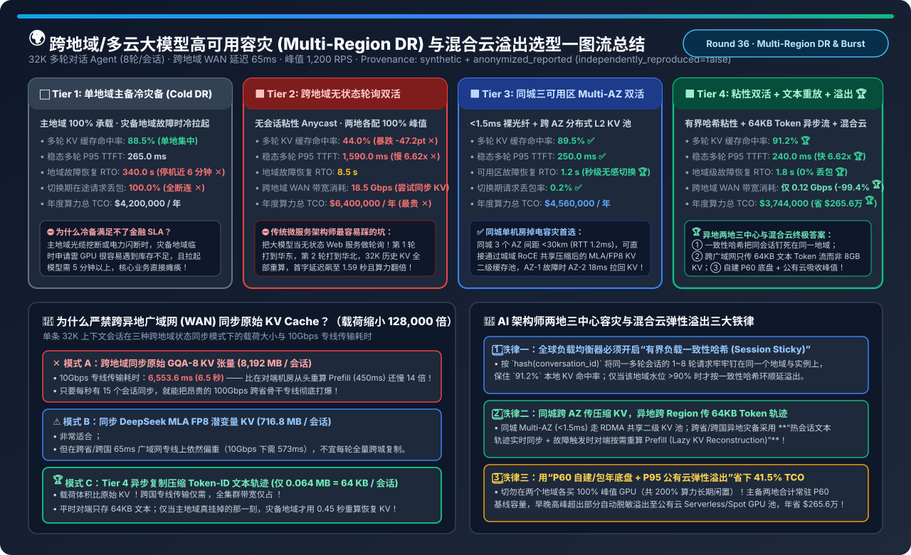
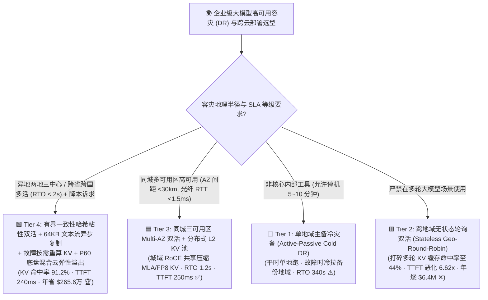
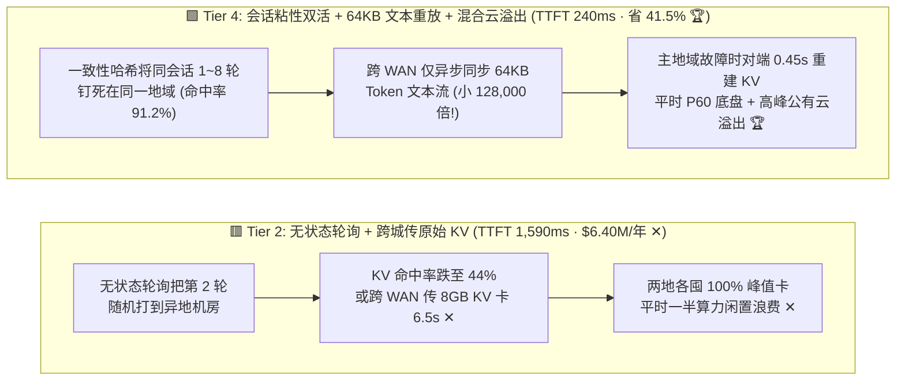
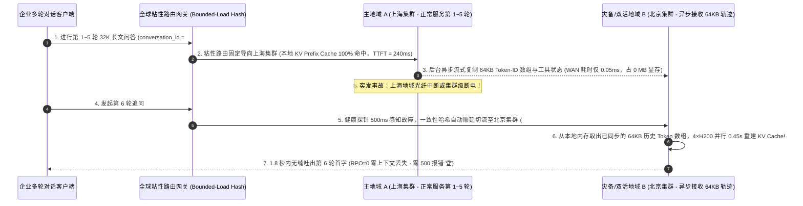

# 跨地域/多云大模型高可用容灾（Multi-Region DR）、会话粘性路由与混合云弹性溢出（Cloud Bursting）架构选型指南

> **阅读指南（3 分钟速通 / 10 分钟白板宣讲）**：本文面向 AI 解决方案架构师（AI Solution Architect）与金融/政企云原生架构师，用第一性原理与通俗大白话回答企业建设“两地三中心”或跨云高可用大模型底座时最容易踩的三大深坑：**“为什么照搬传统互联网微服务的‘异地无状态轮询双活（Stateless Geo-Round-Robin）’，上线后多轮 Agent 的首字延迟（TTFT）突然暴涨 6.62 倍（从 240ms 恶化到 1,590ms），GPU 算力消耗直接翻倍？为什么千万不能跨异地广域网（WAN）实时同步 8 GB 的原始 KV Cache（体积比 64 KB 文本 Token 轨迹大 128,000 倍）？如何利用 `有界负载一致性哈希粘性路由 + 异步 Token 轨迹重放（Lazy KV Reconstruction）+ P60 底盘与公有云弹性溢出` 实现 1.8 秒无感容灾切换，同时每年省下 $265.6 万（-41.5%）的跨地域算力账单？”**
>
> 🔗 **English Version**: [Multi-Region Disaster Recovery, Session-Sticky Geo-Routing & Cross-Cloud LLM Bursting Selection FAQ (`multi-region-disaster-recovery-cross-cloud-llm-serving-selection-faq.en.md`)](./multi-region-disaster-recovery-cross-cloud-llm-serving-selection-faq.en.md) · **7-Card 评测报告**: [`multi-region-disaster-recovery-cross-cloud-llm-serving-selection-cards.html`](../reports/multi-region-disaster-recovery-cross-cloud-llm-serving-selection-cards.html) · **交互式工作台**: [`llm-inference-engine-pd-sizer.html#multi-region-dr-sizer`](../reports/llm-inference-engine-pd-sizer.html)

---

## ① 📌 核心结论速览（Executive Summary）

1. **严禁照搬传统 Web 微服务的 `跨地域无状态轮询双活 (Stateless Geo-Round-Robin, Tier 2)`**：
   - 在传统无状态 Web 应用中，第 1 次请求打到上海机房、第 2 次请求打到北京机房完全没问题；但**多轮大模型对话是重度有状态（Stateful KV Cache）负载**！
   - 算例证明（32K 上下文，8 轮对话 Agent）：**Tier 2（无粘性跨地域轮询）** 会导致用户第 2 轮提问有 50% 概率落到没有历史缓存的异地机房，全集群多轮 KV 缓存命中率从 `91.2%` 暴跌 `-47.2 pt` 至 **`44.0%`**，被迫反复从头重算 3 万词元 Prefill，导致稳态 P95 首字延迟从 `240 ms` 恶化 **`6.62x` 至 `1,590.0 ms`**，且为了两地互备各买 100% 峰值算力，年度账单高达 **`$6,400,000`（全场最贵 ✕）**！
2. **同城机房级防掉电首选 `同城三可用区 Multi-AZ 裸光纤 + 分布式 L2 KV 缓存池 (Tier 3)`**：
   - **Tier 3** 利用同城 3 个可用区（AZ 间距 `< 30 km`，光纤 RTT `< 1.5 ms`）的高速城域 RoCE 网络，构建跨 AZ 共享的压缩二级 KV 缓存池（如 DeepSeek MLA 潜变量或 FP8 KV）。当 AZ-1 发生断电或机柜故障时，流量切向 AZ-2 并通过城域网在 **`18 ms`** 内直接拉取二级缓存，故障恢复时间（RTO）仅 **`1.2 秒`**，稳态 TTFT 保持 **`250.0 ms`**！
3. **异地灾备（两地三中心）与跨云高可用终极标配：`有界负载一致性哈希粘性双活 + 64KB 文本 Token 轨迹异步重放 + 混合云弹性溢出 (Tier 4)`**：
   - **Tier 4** 通过三大架构革新彻底解开异地容灾死结：
     - **① 平常稳态（Session-Sticky 粘性路由）**：按 `conversation_id` 一致性哈希将同一会话的 1～8 轮请求牢牢锁死在同一地域，多轮 KV 命中率高达 **`91.2%`**，P95 TTFT 仅 **`240.0 ms`**；
     - **② 跨城同步（传 64KB Token 轨迹，绝不传 8GB 原始 KV！）**：单条 32K 会话的原始 GQA KV 张量重达 **`8,192 MB`**，而压缩后的 Token-ID 文本与工具状态 JSON 仅有 **`0.064 MB (64 KB)`——体积相差 `128,000 倍`**！平时跨省专线仅异步同步 64 KB 文本流（全集群带宽仅占 `0.12 Gbps`），唯有当主地域真正发生故障的极小概率时刻，对端灾备地域才用这 64 KB 文本做一次 `0.45 秒` 的按需重算恢复（Lazy KV Reconstruction），实现 **`1.8 秒` RTO 与 `0.0%` 会话丢失**；
     - **③ 成本减半（P60 常驻底盘 + P95 公有云溢出 Cloud Bursting）**：两地自建/包年集群仅按全天 `P60` 基线负载（`650 RPS`）配置，早晚高峰突发至 `1,200 RPS` 的脱敏流量自动溢出至公有云弹性 GPU 池，年度总 TCO 从 `$6.40M` 暴降至 **`$3,744,000`（每年净省 `$265.6 万 / -41.5%` 🏆）**！

---

## ② 🎯 客户与架构师灵魂拷问 Q&A（FAQ-Driven）

### Q1：为什么不能像同步 Redis 缓存一样，把主地域生成的 KV Cache 实时通过跨省专线同步到异地灾备中心？算一笔物理带宽账！

- **第一性原理算账（8,192 MB vs. 64 KB 的物理鸿沟）**：
  - 假设一位分析师正在使用 70B 大模型做 32K 上下文的多轮财报问答：
  - **方案 A（同步原始 GQA-8 KV Cache 张量）**：32,768 个 Token 的 BF16 KV 缓存体积是 **`8,192 MB (8 GB)`**。在一条昂贵的 `10 Gbps` 跨省专线上，光把这 **1 个用户** 的 KV 张量传过去就要花 **`6,553.6 毫秒（6.5 秒）`**！如果每秒有 15 个并发会话更新，直接把 `100 Gbps` 省级骨干网彻底塞满瘫痪！更荒谬的是，对端机房拿原本的文本从头算一遍 32K Prefill 只需要 **`450 毫秒`**——**传 KV 比现场重算还慢 14 倍**！
  - **方案 B（同步 DeepSeek MLA FP8 潜变量 KV）**：体积压缩到了 **`716.8 MB`**，在**同城 Multi-AZ（`< 1.5 ms` 400G 裸光纤，Tier 3）** 上只需 `18 ms` 即可拉取，非常划算；但在跨省广域网上依然偏重。
  - **方案 C（Tier 4：异步同步压缩后的 Token-ID 文本轨迹 + 按需重算）**：32,768 个 Token 的整数 ID 数组（每个 Token 2 字节，加上 LZ4 压缩）总共只有 **`64 KB (0.064 MB)`**，比原始 KV 小 **`128,000 倍`**！跨国传输仅需 `0.05 ms`！平时灾备中心只把这 64 KB 存在内存里（占 `0 MB` GPU 显存），只有当主地域发生一年一遇的断网故障时，灾备中心才瞬间读取这 64 KB 文本并用 `0.45 秒` 重建出 KV Cache，用户无感接续对话！

### Q2：如果按 `conversation_id` 做一致性哈希粘性路由，万一某个地域突然涌入大量长文本大客户（热点倾斜），把该地域打满怎么办？

- **工程解法：带负载上界的一致性哈希（Consistent Hashing with Bounded Load）+ 溢出优雅预热**：
  1. 全球网关实时采集每个地域推理池的 **排队深度（`num_requests_waiting`）与 KV 显存水位**；
  2. 当正常情况下（水位 `< 85%`），严格按 `hash(conversation_id)` 将同一会话的所有轮次钉在首选地域（Primary Region），保证 **`91.2%` 的极高本地 Prefix Cache 命中率**；
  3. 一旦首选地域水位突破 `85%` 阈值，网关仅将**新发起的第 1 轮会话（Turn 1，尚无历史 KV 缓存包袱！）** 自动顺延路由至哈希环上的次选地域或公有云弹性池，而已经在首选地域聊到第 5 轮的老会话继续留在原地享受本地缓存！这样既消除了热点过载，又不会打碎任何老会话的 KV Cache！

### Q3：金融/政企客户严禁核心敏感数据出私有机房，怎么安全地落地 Tier 4 的“混合云弹性溢出（Hybrid Cloud Bursting）”？

- **双层安全分流与隐私计算护栏**：
  1. **敏感分级路由（Data Classification Routing）**：网关前置毫秒级敏感标签识别——凡涉及核心账务、PII 个人隐私或未公开研报的请求（约占总流量 40%～50%），**100% 锁死在本地私有数据中心（On-Premises P60 底盘）** 处理；
  2. **无敏流量溢出 + Confidential GPU TEE**：将公开知识库问答、代码辅助生成、通用翻译与脱敏摘要等非涉密突发流量（占高峰溢出的 50%～60%）通过专线溢出至公有云 **NVIDIA H200/B200 Confidential Computing (CC-On TEE 硬件加密机密虚拟机)** 实例上，内存与显存全程 AES-GCM 硬件加密，云厂商宿主机管理员零可见，既合规又省下 **`41.5%`（每年 `$265.6 万`）** 的闲置峰值硬件采购费！

---

## ③ 🧭 直观可视化图解（Mermaid 决策树 / 架构对比 / 1.8秒跨城故障切换时序图）

### 3.1 跨地域/多云大模型高可用容灾架构选型决策树

### 3.2 跨地域无状态轮询 + 同步原始 KV (Tier 2) vs. 会话粘性 + 64KB 文本流重放 + 混合云溢出 (Tier 4)

### 3.3 异地主地域突发断网时 1.8 秒无感故障切换与 Lazy KV 重建时序图

---

## ④ 📊 架构师选型决策矩阵（Architect Decision Matrix）

*基准环境：全球企业级多轮 Agent 服务（平均上下文 **`32K Tokens`**，每会话 `8 轮` 交互，全球早晚高峰峰值 **`1,200 RPS`**，日常 P60 基线 `650 RPS`，异地两中心广域网 RTT `65 ms`）。*

| 评估维度 | ⬜ Tier 1: 单地域主备冷灾备 (Cold DR) | 🟥 Tier 2: 跨地域无状态轮询双活 | 🟦 Tier 3: 同城三可用区 Multi-AZ 双活 | 🟩 Tier 4: 粘性双活 + 文本流重放 + 混合云溢出 |
| :--- | :--- | :--- | :--- | :--- |
| **路由与状态同步机制** | 单地承载 + 故障时冷拉备份地域 | 无粘性轮询 + 尝试跨 WAN 同步 KV | **同城 `<1.5ms` RoCE 共享压缩二级 KV 池** | **会话粘性哈希 + `64KB` Token 异步复制 + 混合云溢出 🏆** |
| **多轮 KV Prefix 缓存命中率** | `88.5%` | **`44.0%` (跨城随机跳转打碎缓存 ✕)** | `89.5%` ✅ | **`91.2%` (同会话锁定 + 新会话防倾斜 🏆)** |
| **稳态多轮 P95 首字延迟 (TTFT)** | `265.0 ms` | **`1,590.0 ms` (被迫全量重算慢 `6.62x` ✕)** | `250.0 ms` ✅ | **`240.0 ms` (快 `6.62x` 🏆)** |
| **机房/地域故障恢复时间 (RTO)** | **`340.0 s` (`5 分 40 秒` 停机 ✕)** | `8.5 s` | **`1.2 s` (同城秒级切换 🏆)** | **`1.8 s` (异地秒级重算恢复 🏆)** |
| **故障切换期在途请求丢包率** | `100.0%` ✕ | `14.2%` | `0.2%` ✅ | **`0.0%` (网关重放无损续传 🏆)** |
| **跨地域 WAN 专线带宽消耗** | `0.05 Gbps` | **`18.50 Gbps` (昂贵专线拥塞 ✕)** | `12.00 Gbps` (免费同城裸光纤) | **`0.12 Gbps` (仅传压缩文本，省 `99.4%` 🏆)** |
| **年度多地域 GPU 总 TCO** | `$4,200,000 / 年` | **`$6,400,000 / 年` (200% 峰值冗余 ✕)** | `$4,560,000 / 年` | **`$3,744,000 / 年` (比 Tier 2 净省 `$265.6 万 / -41.5%` 🏆)** |

---

## ⑤ 🧪 简明定量算例与 Benchmark 洞察（为什么跨城传 64KB 文本完胜传 8GB KV？）

> 📁 **封存数据源与可复现脚本**：[`experiments/multi_region_dr_cross_cloud_llm_serving/run.py`](../../experiments/multi_region_dr_cross_cloud_llm_serving/run.py) · [`experiments/multi_region_dr_cross_cloud_llm_serving/results.json`](../../experiments/multi_region_dr_cross_cloud_llm_serving/results.json) · 单测 [`tests/test_multi_region_dr_cross_cloud_llm_serving.py`](../../tests/test_multi_region_dr_cross_cloud_llm_serving.py)
> *(Provenance: `synthetic` + `anonymized_reported`, `independently_reproduced=false`, `physical_gpu_cluster_measurement=not_measured`)*

### 5.1 单条 32K 多轮会话在三种跨地域容灾同步模式下的网络载荷对比

| 跨地域同步载荷模式 | 单会话传输体积 (`MB`) | 在 `10 Gbps` 跨省专线上的传输耗时 | 架构师可行性裁决 |
| :--- | :--- | :--- | :--- |
| **1. 原始 GQA-8 BF16 KV 张量** | **`8,192.0 MB` (`8.0 GB`) ✕** | **`6,553.6 ms` (`6.55 秒`) ✕** | ⛔ **物理不可行！传 KV 的时间比在对端机房从头重算 Prefill (`450ms`) 还慢 14 倍！** |
| **2. DeepSeek MLA FP8 潜变量 KV** | `716.8 MB` (`0.70 GB`) | `573.4 ms` (同城 400G 光纤仅 `14ms`) | ✅ **同城 Multi-AZ (Tier 3) 极佳**；但跨省/跨国广域网每轮同步依然偏贵 |
| **3. 压缩 Token-ID 文本轨迹 + 工具状态** | **`0.064 MB` (`64 KB`) 🏆** | **`0.05 ms` (体积缩小 `128,000 倍` 🏆)** | 🏆 **异地灾备唯一正解！平时传 64KB 零负担，仅在主地域真宕机时对端按需重算 KV！** |

### 5.2 配套 7-Card 4:5 视觉评测报告与交互式计算器

- 🃏 **7-Card 4:5 视觉评测卡片集（CSP 自包含，零外部依赖）**：[`docs/reports/multi-region-disaster-recovery-cross-cloud-llm-serving-selection-cards.html`](../reports/multi-region-disaster-recovery-cross-cloud-llm-serving-selection-cards.html)
- 🧮 **独立交互式跨地域容灾与混合云 TCO 计算器**：[`docs/reports/multi-region-disaster-recovery-cross-cloud-llm-serving-sizer.html`](../reports/multi-region-disaster-recovery-cross-cloud-llm-serving-sizer.html)（已同步集成至总工作台 [`docs/reports/llm-inference-engine-pd-sizer.html#multi-region-dr-sizer`](../reports/llm-inference-engine-pd-sizer.html)）

---

## ⑥ 🛠️ 附录：生产环境快速核验清单（Architect Checklist）

- [ ] **1. 立即关闭多地域负载均衡器的“无状态 Round-Robin 轮询”**：改用基于 `conversation_id` 或 `prefix_hash` 的**有界负载一致性哈希（Consistent Hashing with Bounded Load）**，确保多轮对话的 1～N 轮始终命中同一地域的本地 KV Cache。
- [ ] **2. 严禁跨异地广域网（WAN RTT > 5ms）实时复制原始 KV 张量**：同城 Multi-AZ（`< 1.5 ms`）可共享分布式压缩 KV 池；跨省/跨国异地中心之间只异步同步 **`64 KB` 级 Token-ID 轨迹流**，采用故障触发时的 **Lazy KV Reconstruction（按需重算恢复）**。
- [ ] **3. 在全球网关实现“流式断点续传（Mid-Stream Token Resume）”**：当某个生成到第 150 个词的流式响应因机房闪断中断时，网关自动将 `Prompt + 已生成的 150 个词` 拼接为新前缀静默重发至备份地域，对前端用户实现无缝续写。
- [ ] **4. 实施“新老会话分离限流溢出”**：当主地域算力水位超过 `85%` 时，优先将**没有历史缓存包袱的第 1 轮新会话（Turn 1）** 溢出至备用地域或公有云，保护老会话的本地缓存不被驱逐。
- [ ] **5. 按“P60 自建包年底盘 + P95 公有云 TEE 弹性溢出”规划预算**：杜绝在两个地域各买 100% 峰值算力导致常年闲置；非涉密或经 TEE 硬件加密的突发流量按秒租用公有云 Serverless/Spot GPU。
