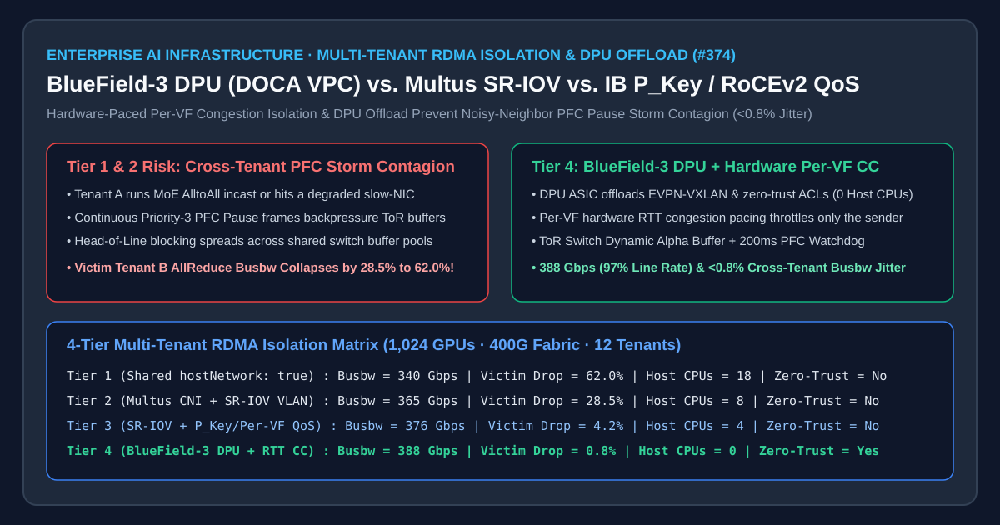

# Multi-Tenant GPU Cluster Network Isolation & DPU Offload Guide: `NVIDIA BlueField-3 DPU (DOCA VPC)` vs. `Multus + SR-IOV` vs. `IB P_Key / RoCEv2 Per-VF QoS`

> **Language**: [中文](./multi-tenant-gpu-cluster-dpu-bluefield3-sriov-rdma-network-isolation-selection-faq.md) | **English (Current)**  
> **Audience**: Cloud & AI Infrastructure Solution Architects and AI Cloud Network Engineers  
> **Provenance**: `synthetic + anonymized_reported` (`independently_reproduced=false`, `physical_gpu_cluster_measurement=not_measured`)

---

## 1. 📌 Executive Summary

> **Bottom Line**: **In shared `1,024-GPU` `400G RoCEv2 / InfiniBand` clusters, running tenant containers with `hostNetwork: true` (`Tier 1`) or basic `Multus + SR-IOV VLAN` (`Tier 2`) leaves co-located workloads vulnerable to cross-tenant `Priority-3 PFC Pause Storm` contagion: when Tenant A triggers an `AlltoAll` incast or hits a degraded slow-receiver NIC, shared ToR switch buffers fill up and collapse unrelated Tenant B's `AllReduce` `busbw` by `-62.0%` (`Tier 1`) or `-28.5%` (`Tier 2`), while burning `8–18` host CPU cores per node on SDN processing. Production multi-tenant AI clusters deploy `SR-IOV + IB P_Key / RoCEv2 Per-VF Hardware Rate Pacing` (`Tier 3`, `4.2%` drop) or `NVIDIA BlueField-3 DPU / SuperNIC` with `DOCA VPC + Hardware RTT Congestion Control + 200ms PFC Watchdog` (`Tier 4`): consuming `0` host CPU cores (saving `2,304` CPU cores across `128` nodes), delivering `388 Gbps` (`97%` line rate) GPUDirect RDMA, and containing noisy-neighbor `busbw` jitter to `<0.8%`.**

- **Interactive Multi-Tenant RDMA & DPU Isolation Sizer**: [Open Interactive Sizer (`multi-tenant-gpu-cluster-dpu-bluefield3-sriov-rdma-network-isolation-sizer.html`)](../reports/multi-tenant-gpu-cluster-dpu-bluefield3-sriov-rdma-network-isolation-sizer.html)
- **7-Card 4:5 Visual Report**: [Open 7-Card Report (`multi-tenant-gpu-cluster-dpu-bluefield3-sriov-rdma-network-isolation-selection-cards.html`)](../reports/multi-tenant-gpu-cluster-dpu-bluefield3-sriov-rdma-network-isolation-selection-cards.html)

---

## 2. 📊 4-Tier Multi-Tenant RDMA Isolation Matrix (`1,024 GPUs` · `400G Fabric` · `12 Co-Located Tenants`)

| Metric | Tier 1: Shared `hostNetwork: true` | Tier 2: `Multus CNI + SR-IOV VF` + VLAN | Tier 3: `SR-IOV` + `IB P_Key` / `RoCEv2 Per-VF Hardware QoS` | Tier 4 (Recommended): `BlueField-3 DPU` (`DOCA VPC` + Hardware `RTT CC` + `PFC Watchdog`) |
| :--- | :--- | :--- | :--- | :--- |
| **GPUDirect RDMA `busbw`** | `340.0 Gbps` | `365.0 Gbps` | `376.0 Gbps` | **`388.0 Gbps` ✓ (`97%` line rate)** |
| **Victim Tenant `busbw` Drop in Storm** | `-62.0%` ✕ (Severe stall) | `-28.5%` ✕ (Shared ToR buffer) | `-4.2%` ✓ | **`-0.8%` ✓ (Full SLA isolation)** |
| **Host CPU Cores Used by SDN / Node** | `18 Cores` ✕ | `8 Cores` | `4 Cores` | **`0 Cores` ✓ (`2,304` cores saved)** |
| **Zero-Trust Control-Plane Isolation** | No ✕ | No ✕ | No ✕ | **Yes ✓ (Hardware DPU boundary)** |

---

## 3. 🛠️ Production Readiness Checklist

- [ ] **Prohibit `hostNetwork: true` for Multi-Tenant GPU Pods**; use `NVIDIA Network Operator` (`Multus` + `SR-IOV Device Plugin` + `nv_peer_mem / nvidia-peermem`) to inject isolated RDMA VFs with `1:1` GPU-NIC NUMA affinity.
- [ ] **Configure Per-VF Hardware Rate Pacing, Dynamic ToR Switch Buffer Alpha Limits, and a `200ms PFC Watchdog`** so a single slow receiver can never exhaust shared switch headroom or propagate pause frames across the fabric.
