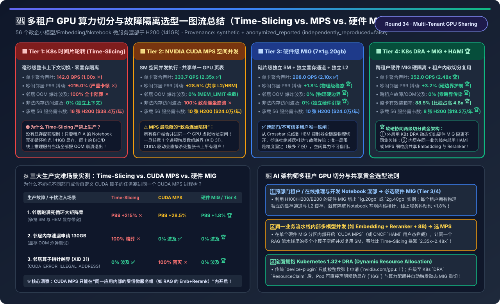
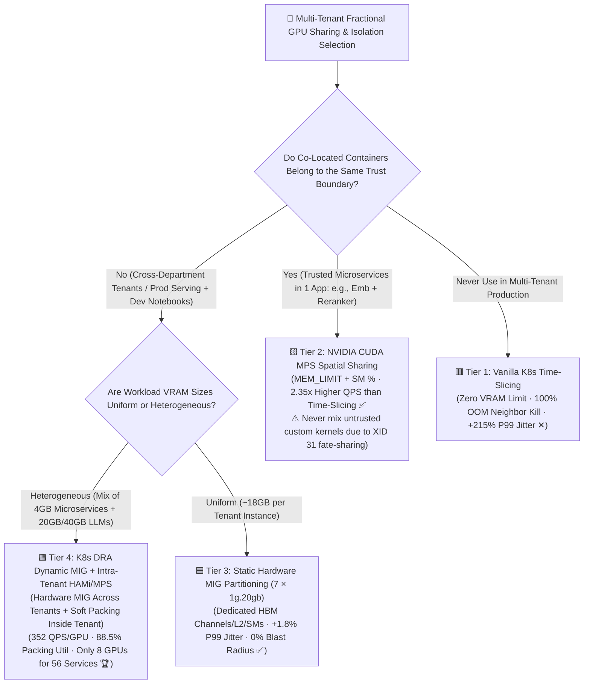
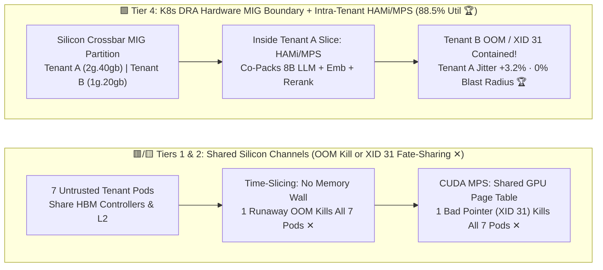

# Multi-Tenant Fractional GPU Sharing & Isolation (Time-Slicing vs. CUDA MPS vs. Hardware MIG vs. K8s DRA + HAMi) Selection FAQ

> **Reader's Guide (3-Minute Executive Read / 10-Minute Whiteboard Pitch)**: Built for AI Solution Architects and Kubernetes Platform Leads, this first-principles guide answers the three most critical questions in multi-tenant GPU sharing: **"We have 56 enterprise microservices (8B LLMs, BGE Embeddings, Rerankers, and developer Jupyter Notebooks) that each need only 16–18 GB of VRAM—giving each a dedicated 141 GB H200 wastes 85% of the GPU! Why does enabling Kubernetes `Time-Slicing` allow a single runaway Notebook OOM to crash all 6 neighbor services on the same GPU? Why does `NVIDIA CUDA MPS` boost throughput by 2.35× yet suffer a 100% fatal 'fate-sharing' crash whenever a single tenant triggers an illegal memory pointer (XID 31)? And how does combining `Hardware MIG` with `Kubernetes DRA + CNCF HAMi` achieve 88.5% GPU packing efficiency with a 0.0% cross-tenant fault blast radius?"**
>
> 🔗 **中文版本**: [多租户 GPU 算力切分、共享与故障隔离架构选型指南 (`multi-tenant-gpu-sharing-mig-mps-dra-selection-faq.md`)](./multi-tenant-gpu-sharing-mig-mps-dra-selection-faq.md) · **7-Card Benchmark Deck**: [`multi-tenant-gpu-sharing-mig-mps-dra-selection-cards.html`](../reports/multi-tenant-gpu-sharing-mig-mps-dra-selection-cards.html) · **Interactive Sizer**: [`llm-inference-engine-pd-sizer.en.html#gpu-sharing-sizer`](../reports/llm-inference-engine-pd-sizer.en.html)



---

## ① 📌 Executive Summary

1. **Never Use Vanilla Kubernetes `Time-Slicing (Tier 1)` for Multi-Tenant Production Sharing**:
   - **Tier 1 (OS Time-Slicing)** multiplexes whole-GPU contexts temporally across processes with **zero memory quota enforcement and zero bandwidth isolation**.
   - Under a single compute-heavy noisy neighbor, co-located services suffer **`+215.0%` P99 tail-latency inflation**; worse, if one tenant leaks memory (`130 GB` allocation), **100% of neighbor pods on that GPU crash with `CUDA_ERROR_OUT_OF_MEMORY`**!
2. **Understand the `NVIDIA CUDA MPS (Tier 2)` Trade-Off — `2.35×` Higher Throughput vs. `100%` Fatal Fault Fate-Sharing**:
   - **Tier 2 (CUDA Multi-Process Service)** funnels multiple processes into a single shared GPU context, enabling spatial concurrent SM execution (`CUDA_MPS_ACTIVE_THREAD_PERCENTAGE`) and per-client memory caps (`CUDA_MPS_PINNED_DEVICE_MEM_LIMIT`)—boosting single-GPU throughput by **`2.35×` (`333.7` vs. `142.0 QPS`)**!
   - ⚠️ **The Hidden MPS Trap**: Because all MPS clients **share a single GPU virtual address page table**, if *any* client kernel triggers an out-of-bounds memory access (`CUDA_ERROR_ILLEGAL_ADDRESS` / XID 31), the GPU MMU cannot isolate the corruption—forcing the driver to **terminate the shared context and kill 100% of co-located pods on that GPU**! Reserve MPS strictly for **co-trusted microservices within the same application pipeline** (e.g., Embedding + Reranker inside one RAG pod).
3. **For Untrusted Multi-Tenancy, Enforce `Hardware MIG (Tier 3)`; for Maximum Packing Efficiency, Deploy `K8s DRA Dynamic MIG + Intra-Slice HAMi/MPS (Tier 4)`**:
   - **Tier 3 (Hardware MIG, e.g., `7 × 1g.20gb` on H200)**: Physically partitions SMs, HBM3e memory controllers, L2 cache banks, and internal crossbars in silicon—holding noisy-neighbor P99 jitter to **`+1.8%`** with a **`0.0%` OOM and XID-31 blast radius**!
   - **Tier 4 (`K8s 1.32+ DRA Dynamic MIG` across tenants + `CNCF HAMi / MPS` inside trusted slices)**: Uses hardware MIG for hard inter-tenant security boundaries while sub-packing lightweight microservices inside each MIG slice—achieving **`352.0 QPS/GPU` (`2.48×`)**, **`88.5%` GPU packing utilization**, and serving all 56 workloads on just **`8 H200 GPUs` (saving `-71.4%` GPUs / `$480,000/yr` vs. 28 partially packed GPUs)**!

---

## ② 🎯 Architect & Customer Q&A (First-Principles Deep Dive)

### Q1: How do Time-Slicing, CUDA MPS, Hardware MIG, and HAMi (`LD_PRELOAD`) differ at the silicon and driver level?

- **First-Principles Comparison**:
  1. **`Time-Slicing (Tier 1)` — Temporal Context Switching**: Only one process runs on the GPU at any microsecond. Switching between 7 processes flushes L2 caches and stalls SMs (`142.0 QPS`), with zero VRAM limit enforcement.
  2. **`CUDA MPS (Tier 2)` — Spatial SM Multiplexing in a Shared Address Space**: `nvidia-cuda-mps-server` merges kernels from multiple processes into one hardware context so small kernels fill all 132 SMs concurrently (`333.7 QPS`), but shares one GPU page table (100% fate-sharing on memory faults).
  3. **`Hardware MIG (Tier 3)` — Physical Silicon Partitioning**: Carves the GPU into up to 7 independent hardware instances (`1g.20gb`), each with dedicated SM slices, dedicated HBM memory channels, dedicated L2 cache banks, and isolated page tables (`0%` fault propagation, `+1.8%` P99 jitter).
  4. **`CNCF HAMi + K8s DRA Dynamic MIG (Tier 4)` — Two-Level Hardware + User-Space Virtualization**: Uses K8s Dynamic Resource Allocation (DRA) to dynamically provision hardware MIG boundaries between tenants, while injecting `libvgpu.so` (`LD_PRELOAD`) or MPS inside trusted tenant slices to intercept `cuMemAlloc` and `cuLaunchKernel` at `1 GB` VRAM granularity.

### Q2: Why does an illegal memory access (`XID 31`) in one CUDA MPS container kill all other containers on the same GPU?

- **Hardware MMU Fate-Sharing**:
  - Under CUDA MPS, all client processes map their device allocations into a **single unified GPU virtual address space** managed by the MPS daemon to avoid context-switch overhead.
  - When Client A executes a buggy custom Triton/CUDA kernel that dereferences an invalid pointer, the hardware MMU cannot prove that Client B's tensors were not silently overwritten. To guarantee memory safety, the NVIDIA driver marks the entire MPS context as fatal and terminates all connected clients.

### Q3: Why isn't static `7 × 1g.20gb` MIG (Tier 3) enough on its own, and what does `K8s DRA + Dynamic MIG + HAMi` (Tier 4) add?

- **Overcoming Static MIG Fragmentation**:
  - Static MIG locks a GPU into fixed profiles (`20 GB` chunks). If a tenant has three `5 GB` microservices (Embedding + Reranker + OCR), assigning three separate `1g.20gb` MIG slices wastes `45 GB` of HBM3e!
  - **Tier 4** uses **K8s DRA** to dynamically reconfigure MIG geometries on demand (`1g.20gb`, `2g.40gb`, `3g.71gb`) between tenants, while allowing a single tenant's `2g.40gb` MIG slice to internally host 4–6 microservices via **HAMi / MPS**—raising effective packing utilization from `74.0%` to **`88.5%`**!

---

## ③ 🧭 Visual Architecture Diagrams (Decision Tree / Datapath / Sequence)

### 3.1 Multi-Tenant GPU Sharing & Isolation Decision Tree



### 3.2 Shared-Channel Time-Slicing/MPS (Tiers 1–2) vs. Two-Level Hardware MIG + HAMi/MPS (Tier 4)



### 3.3 K8s DRA Dynamic MIG Provisioning + Fault Containment Sequence

```mermaid
sequenceDiagram
    autonumber
    participant K8s as K8s 1.32+ Scheduler & DRA Controller
    participant MIG as NVIDIA GPU Operator (Dynamic MIG Manager)
    participant TenantA as Tenant A (Prod RAG Pipeline: 2g.40gb + MPS)
    participant TenantB as Tenant B (Dev Jupyter Notebook: 1g.20gb)

    K8s->>MIG: 1. Reconfigure H200 via ResourceClaim: Carve 2g.40gb (Tenant A) & 1g.20gb (Tenant B)
    MIG-->>TenantA: 2. Mount Isolated Silicon Engine /dev/nvidia-caps/mig-devA (Dedicated 40GB HBM & L2)
    TenantA->>TenantA: 3. Launch Intra-Slice MPS for 8B LLM + BGE Embedding + Reranker (352 QPS)
    MIG-->>TenantB: 4. Mount Isolated Silicon Engine /dev/nvidia-caps/mig-devB (Dedicated 20GB HBM)
    TenantB->>TenantB: 5. 💥 Incident! Notebook allocates 130GB & dereferences bad pointer (XID 31)
    MIG->>TenantB: 6. Hardware MMU Contains OOM & XID 31 Inside mig-devB; Resets Only Tenant B
    TenantA-->>K8s: 7. Tenant A Prod Traffic Uninterrupted (0% Blast Radius · +3.2% P99 Jitter 🏆)
```

---

## ④ 📊 Architect Decision Matrix

*Baseline: **56 Concurrent Enterprise AI Microservices & Dev Pods** (`~16–18 GB` VRAM and `~12%` peak compute each) packed onto **NVIDIA H200 SXM (`141 GB HBM3e`)** GPUs (vs. 28 partially packed GPUs at `$672,000/yr`).*

| Evaluation Dimension | 🟥 Tier 1: Vanilla K8s Time-Slicing | 🟨 Tier 2: NVIDIA CUDA MPS Spatial Sharing | 🟦 Tier 3: Hardware MIG (`7 × 1g.20gb`) | 🟩 Tier 4: K8s DRA Dynamic MIG + HAMi/MPS |
| :--- | :--- | :--- | :--- | :--- |
| **Isolation Architecture** | OS context switch; **no VRAM quota** | Spatial SM + `MEM_LIMIT`; **shared page table** | **Dedicated SMs, HBM channels, L2 & crossbar** | **Inter-tenant Hardware MIG + Intra-tenant HAMi/MPS 🏆** |
| **Aggregate QPS / GPU** | `142.0 QPS` (`1.00x` context thrash ✕) | **`333.7 QPS` (`2.35x` spatial concurrency ✅)** | `298.0 QPS` (`2.10x` static slices) | **`352.0 QPS` (`2.48x` two-level optimum 🏆)** |
| **Noisy-Neighbor P99 Jitter** | **`+215.0%` (Severe stalls ✕)** | `+28.5%` (Shared L2/HBM contention) | **`+1.8%` (Hardware QoS isolation 🏆)** | **`+3.2%` (Protected by MIG wall 🏆)** |
| **OOM Bomb Blast Radius** | **`100.0%` (Crashes all neighbors ✕)** | `0.0%` (`MEM_LIMIT` enforced ✅) | **`0.0%` (Physical 20GB wall 🏆)** | **`0.0%` (MIG + `libvgpu` enforcement 🏆)** |
| **XID 31 Fault Blast Radius** | `0.0%` (Separate OS contexts) | **`100.0%` (Fatal shared-context kill ✕)** | **`0.0%` (Isolated silicon engines 🏆)** | **`0.0%` (Zero cross-tenant kill 🏆)** |
| **Effective GPU Packing Util** | `42.0%` | `79.5%` | `74.0%` (Fixed 7-slice granularity) | **`88.5%` (Dynamic MIG + 1GB sub-slices 🏆)** |
| **H200 GPUs for 56 Services** | `16 GPUs` (`$384,000 / yr`) | `10 GPUs` (`$240,000 / yr`) | `10 GPUs` (`$240,000 / yr`) | **`8 GPUs` (`$192,000 / yr`, `-71.4%` vs 28 GPUs 🏆)** |

---

## ⑤ 🧪 Quantitative Example & Benchmark Insights (Fault & Interference Matrix)

> 📁 **Sealed Source Data & Reproducible Script**: [`experiments/multi_tenant_gpu_sharing_mig_mps_dra_selection/run.py`](../../experiments/multi_tenant_gpu_sharing_mig_mps_dra_selection/run.py) · [`experiments/multi_tenant_gpu_sharing_mig_mps_dra_selection/results.json`](../../experiments/multi_tenant_gpu_sharing_mig_mps_dra_selection/results.json) · Unit Test [`tests/test_multi_tenant_gpu_sharing_mig_mps_dra_selection.py`](../../tests/test_multi_tenant_gpu_sharing_mig_mps_dra_selection.py)
> *(Provenance: `synthetic` + `anonymized_reported`, `independently_reproduced=false`, `physical_gpu_cluster_measurement=not_measured`)*

### 5.1 Production Fault & Noisy-Neighbor Survival Matrix

| Injected Production Incident | Tier 1: Time-Slicing | Tier 2: CUDA MPS | Tier 3 / Tier 4: Hardware MIG Boundary | Silicon Root Cause |
| :--- | :--- | :--- | :--- | :--- |
| **1. Noisy Neighbor GEMM Flood** | **`+215.0%` P99 Stall ✕** | `+28.5%` P99 Jitter | **`+1.8% ~ +3.2%` 🏆** | MIG dedicates separate HBM memory controllers & L2 banks |
| **2. Runaway 130 GB OOM Bomb** | **`100%` Neighbor Crash ✕** | `0%` Neighbor Impact ✅ | **`0%` Neighbor Impact 🏆** | Time-Slicing lacks memory limits; MPS/HAMi/MIG block excess allocs |
| **3. Illegal Memory Pointer (`XID 31`)** | `0%` Neighbor Impact ✅ | **`100%` All Pods Killed ✕** | **`0%` Neighbor Impact 🏆** | **MPS shares a single GPU page table; MIG isolates MMU & engines!** |

### 5.2 Companion 7-Card 4:5 Visual Report & Interactive Sizer

- 🃏 **7-Card 4:5 Visual Benchmark Report (Self-Contained CSP)**: [`docs/reports/multi-tenant-gpu-sharing-mig-mps-dra-selection-cards.html`](../reports/multi-tenant-gpu-sharing-mig-mps-dra-selection-cards.html)
- 🧮 **Standalone Interactive Multi-Tenant GPU Sharing Sizer**: [`docs/reports/multi-tenant-gpu-sharing-mig-mps-dra-sizer.html`](../reports/multi-tenant-gpu-sharing-mig-mps-dra-sizer.html) (integrated into [`docs/reports/llm-inference-engine-pd-sizer.en.html#gpu-sharing-sizer`](../reports/llm-inference-engine-pd-sizer.en.html))

---

## ⑥ 🛠️ Appendix: Production Architect Verification Checklist

- [ ] **1. Never Run Unprotected `Time-Slicing` in Production**: On non-MIG GPUs (L40S / RTX PRO 6000), deploy **CNCF HAMi (`vgpu-device-plugin`)** to enforce hard `cuMemAlloc` quotas via `LD_PRELOAD=libvgpu.so`.
- [ ] **2. Restrict `CUDA MPS` to Co-Trusted Containers Within a Single Application Pod**: Never share an MPS daemon across different teams or untrusted custom Triton kernels (`XID 31` fate-sharing risk).
- [ ] **3. Enforce `Hardware MIG` Across Untrusted Tenants on H100 / H200 / B200**: Isolate production serving from developer notebooks at the silicon crossbar level (`1g.20gb`, `2g.40gb`, `3g.71gb`).
- [ ] **4. Adopt Kubernetes 1.32+ `DRA (Dynamic Resource Allocation)`**: Replace rigid `nvidia.com/mig-*` resource names with declarative `ResourceClaim` specs and dynamic MIG reconfiguration.
- [ ] **5. Enable Per-MIG-Instance Telemetry (`GPU_I_ID`) in `dcgm-exporter`**: Monitor SM active percentage, HBM bandwidth, and memory usage per MIG slice rather than only at the whole-GPU level.
