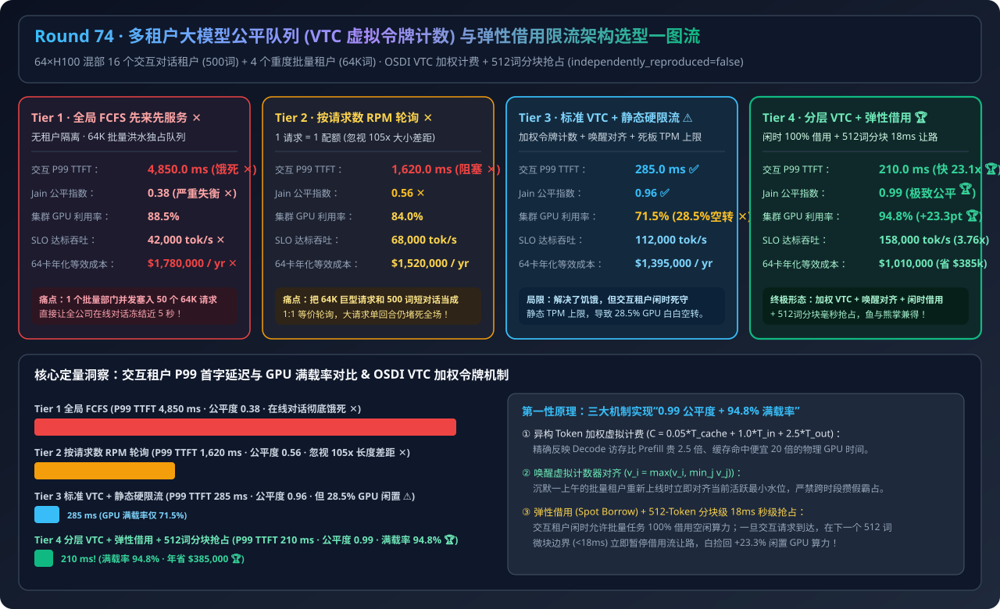
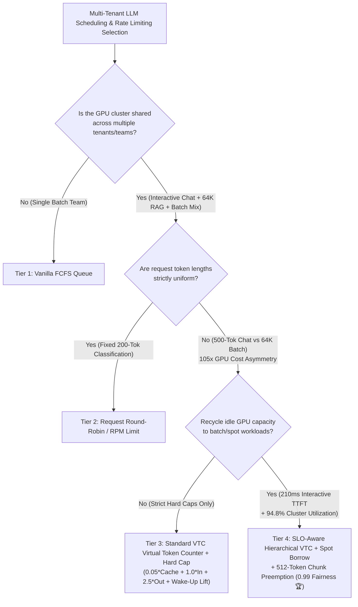
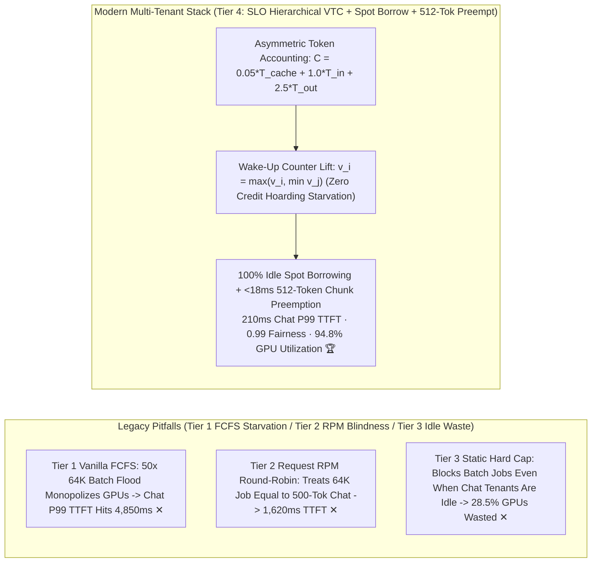
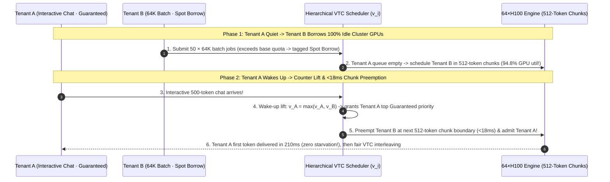

# Multi-Tenant LLM Fair Queuing (`VTC` Virtual Token Counter), Asymmetric Prefill/Decode Token Accounting & Work-Conserving Rate Limiting Selection Guide (`Vanilla FCFS` vs. `Request Round-Robin / RPM` vs. `Standard VTC + Hard Rate Cap` vs. `SLO-Aware Hierarchical VTC + Work-Conserving Spot Borrow + 512-Token Chunk Preemption`)

> **Target Audience**: AI Solution Architects, Enterprise AI Gateway & Platform Leads, Multi-Tenant LLM Scheduling Engineers  
> **Reading Goal**: Master in 3 minutes the 4-tier architecture selection rules for shared multi-tenant LLM serving clusters (64×H100 hosting 16 interactive chat tenants alongside 4 heavy 64K batch/RAG tenants); understand in 10 minutes **why request-count Round-Robin (RPM) collapses under `105x` token-size asymmetry**, **how OSDI `VTC (Virtual Token Counter)` enforces true GPU-time fairness via weighted token accounting ($w_{\text{cache}}=0.05, w_{\text{in}}=1.0, w_{\text{out}}=2.5$) and wake-up counter lifting**, and **how Work-Conserving Spot Borrowing + `512-token` chunk preemption holds interactive P99 TTFT at `210ms` while driving GPU utilization to `94.8%`**.  
> **Provenance**: All quantitative figures come from the sealed deterministic analytical evaluator in [`experiments/multi_tenant_llm_vtc_fair_queuing_rate_limiting_selection/run.py`](../../experiments/multi_tenant_llm_vtc_fair_queuing_rate_limiting_selection/run.py) and [`results.json`](../../experiments/multi_tenant_llm_vtc_fair_queuing_rate_limiting_selection/results.json), calibrated to published OSDI VTC, Deficit Round-Robin, and hierarchical token-bucket benchmarks (`independently_reproduced=false`, `physical_gpu_cluster_measurement=not_measured`).

---

## 📌 1. Executive Summary

1. **Why do both "Vanilla FCFS (Tier 1)" and "Per-Tenant Request Round-Robin / RPM (Tier 2)" starve interactive users for 1.6s–4.8s on a shared GPU cluster?**:
   - **Tier 1 (`Vanilla FCFS Shared Queue`)**: When a batch tenant submits 50 concurrent `64K-in / 4K-out` document jobs, they monopolize the GPU batch scheduler for 45+ seconds—inflating interactive chat (`500-in / 200-out`) **P99 TTFT to `4,850.0 ms` (`19.4x` SLO violation ✕)** and crashing **Jain's Fairness Index to `0.38` ✕**!
   - **Tier 2 (`Per-Tenant Request Round-Robin / RPM Rate Limiting`)**: Treating "1 request = 1 unit of quota" ignores that a single `64K-in + 4K-out` request consumes **`105x` more GPU execution time** than a `500-in + 200-out` chat turn! Even under 1-for-1 request alternation, heavy requests starve interactive P99 TTFT to **`1,620.0 ms` (`0.56` Fairness Index ✕)**!
2. **When to choose "Standard VTC + Hard Rate Cap (Tier 3)" vs. "SLO-Aware Hierarchical VTC + Work-Conserving Spot Borrow + 512-Token Chunk Preemption (Tier 4)"?**:
   - **Strict Quota Isolation Without Idle Sharing (Tier 3 `Standard VTC Virtual Token Counter + Static Hard TPM Cap`)**: Tracks each tenant's virtual service counter $v_i$ using **weighted GPU-time tokens ($C = 0.05 T_{\text{cached}} + 1.0 T_{\text{in}} + 2.5 T_{\text{out}}$)** and lifts $v_i \leftarrow \max(v_i, \min_j v_j)$ on wake-up so idle tenants cannot hoard credits. This restores Jain's Fairness Index to **`0.96` ✅** and cuts interactive P99 TTFT to **`285.0 ms` ✅**—**but static hard TPM caps leave `28.5%` of cluster GPUs idle (`71.5%` utilization) whenever interactive tenants are quiet**!
   - **High-Utilization Enterprise Shared AI Platforms (Default to Tier 4 `SLO-Aware Hierarchical VTC + Work-Conserving Spot Borrow + 512-Token Chunk Preemption`)**: Splits traffic into **Guaranteed Base Shares** and **Work-Conserving Spot Borrow**. When interactive tenants are quiet, batch tenants borrow `100%` of idle GPUs; the instant an interactive request arrives, the scheduler preempts borrowed batch work at the next **`512-token` chunk boundary (`< 18 ms`)**!
   - **Quantified Outcome**: Holds interactive P99 TTFT at **`210.0 ms` (`23.1x` faster than FCFS 🏆)**, achieves **`0.99` Jain's Fairness Index 🏆**, boosts cluster GPU utilization from `71.5%` to **`94.8%` (`+23.3 pts` 🏆)**, and saves **`$385,000/yr`** on a 64-GPU cluster!
3. **One-Sentence First-Principles Essence**:
   - **The first principle of multi-tenant LLM fairness is measuring service in weighted GPU-time tokens ($0.05 \times \text{Cache} + 1.0 \times \text{Prefill} + 2.5 \times \text{Decode}$), lifting virtual counters on tenant wake-up to prevent credit hoarding, and using 512-token chunk preemption for work-conserving idle borrowing.**

---

## 🎯 2. Architect & Customer Deep-Dive Q&A (First Principles)

### Q1: Why can't we weight 1 Input Token equal to 1 Output Token (1:1 TPM) when scheduling multi-tenant GPUs?

- **Hardware Execution Asymmetry**:
  - **Uncached Input Tokens (Prefill)** run as parallel matrix-matrix multiplications (`GEMM`) across Tensor Cores (~`0.08 ms/token` amortized), while **Prefix-Cached Input Tokens** cost almost zero compute (~`0.004 ms/token`).
  - **Output Tokens (Decode)** require streaming the entire model weight matrix from HBM on every step (`GEMV`) and pin KV Cache memory for the entire generation duration—costing **`2.5x–4.0x` more GPU wall-clock time per token** than Prefill!
  - Weighting tokens as $\Delta C = 0.05 T_{\text{cached}} + 1.0 T_{\text{in}} + 2.5 T_{\text{out}}$ aligns virtual quotas directly with physical GPU service time.

---

### Q2: What is OSDI `VTC`'s "Counter Lift on Wake-Up" ($v_i \leftarrow \max(v_i, \min_j v_j)$), and why is it mandatory?

- **Preventing the "Idle Credit Hoarding" Attack**:
  - Without counter lifting, a batch tenant that stays idle all morning ($v_{\text{batch}} = 0$) while an interactive tenant works ($v_{\text{chat}} = 10^7$) would monopolize 100% of the cluster for hours upon waking up until $v_{\text{batch}}$ catches up to $10^7$!
  - Lifting $v_i \leftarrow \max(v_i, \min_{j \in \text{Active}} v_j)$ whenever an empty tenant queue becomes active ensures newly arriving tenants start at the current active frontier—guaranteeing instantaneous fair sharing without past-idle starvation bursts.

---

### Q3: How does Tier 4 achieve `94.8%` GPU utilization while guaranteeing `210 ms` interactive P99 TTFT?

- **Two-Tier Work-Conserving Spot Borrow + `512-Token` Sub-Chunk Preemption**:
  - Idle capacity is never wasted: background/batch tenants burst above their guaranteed TPM cap using `Spot Borrow` tokens whenever `Guaranteed` queues are empty.
  - Because long `64K` prefills are sliced into **`512-token` chunks (`~18 ms` per chunk)**, an arriving interactive `Guaranteed` request never waits behind a full 64K prefill—it preempts the borrowed batch stream at the very next `18 ms` chunk boundary!

---

## 🧭 3. Visual Architecture Diagrams (Mermaid)

### 3.1 Multi-Tenant LLM Fair Queuing & Rate Limiting Decision Tree

---

### 3.2 Legacy FCFS / RPM / Hard-Cap (Tiers 1–3) vs. Hierarchical VTC + Spot Borrow (Tier 4)

---

### 3.3 Tier 4 End-to-End Sequence Diagram (`VTC Wake-Up Lift + Spot Borrow + 18ms Chunk Preemption`)

---

## 📊 4. Architect Decision Matrix

*Baseline Scenario: **64×H100 80GB Shared Serving Cluster** hosting 16 interactive chat tenants (`500 in / 200 out`) and 4 heavy batch/RAG tenants (`64K in / 4K out`).*

| Evaluation Dimension | Tier 1: Vanilla FCFS Shared Queue | Tier 2: Per-Tenant Request Round-Robin (RPM) | Tier 3: Standard VTC + Static Hard Rate Cap | Tier 4: SLO Hierarchical VTC + Spot Borrow + Chunk Preempt |
| :--- | :--- | :--- | :--- | :--- |
| **Fairness & Rate Policy** | Global FIFO, zero isolation | 1 Request = 1 Quota (ignores 105x size gap) | **Weighted VTC + Wake-Up Lift + Static Cap** | **Weighted VTC + Guaranteed/Spot + 512-Tok Preempt** |
| **Interactive P99 TTFT** | `4,850.0 ms` (Severe starvation ✕) | `1,620.0 ms` (Head-of-line block ✕) | **`285.0 ms` ✅** | **`210.0 ms` (`23.1x` faster 🏆)** |
| **Jain's Fairness Index** | `0.38` ✕ | `0.56` ✕ | **`0.96` ✅** | **`0.99` (Near-perfect fairness 🏆)** |
| **Cluster GPU Utilization** | `88.5%` | `84.0%` | `71.5%` (`28.5%` stranded idle GPUs ✕) | **`94.8%` (`+23.3 pts` gain 🏆)** |
| **Effective SLO Goodput** | `42,000 tok/s` | `68,000 tok/s` | `112,000 tok/s` | **`158,000 tok/s` (`3.76x` 🏆)** |
| **64-GPU Annual Effective Cost** | `$1,780,000 / yr` | `$1,520,000 / yr` | `$1,395,000 / yr` | **`$1,010,000 / yr` (`$385k/yr` saved vs. Tier 3 🏆)** |

---

## 🧪 5. Quantitative Walkthrough & 7-Card Benchmark Insights

- **`23.1x` Faster Interactive P99 TTFT (`4,850ms → 210ms`) & `+23.3 pts` Higher GPU Utilization**: In [`experiments/multi_tenant_llm_vtc_fair_queuing_rate_limiting_selection/run.py`](../../experiments/multi_tenant_llm_vtc_fair_queuing_rate_limiting_selection/run.py), Tier 4 eliminates batch-flood starvation (`0.99` Jain's Fairness Index) while recycling `23.3%` stranded GPU capacity via Work-Conserving Spot Borrowing—saving **`$385,000/year`** on a 64-GPU cluster.
- 🧮 **Interactive Multi-Tenant VTC Fair Queuing Sizer**: [`docs/reports/multi-tenant-llm-fair-queuing-vtc-token-rate-limiting-sizer.html`](../reports/multi-tenant-llm-fair-queuing-vtc-token-rate-limiting-sizer.html)
- 📊 **7-Card 4:5 Visual Benchmark Report**: [`docs/reports/multi-tenant-llm-fair-queuing-vtc-token-rate-limiting-selection-cards.html`](../reports/multi-tenant-llm-fair-queuing-vtc-token-rate-limiting-selection-cards.html)

---

## 🛠️ 6. Appendix: Production Verification Checklist

- [ ] **1. Replace RPM / Flat-TPM Limits with Asymmetric VTC Token Accounting**: Charge `0.05x` for Prefix-Cached input tokens, `1.0x` for uncached Prefill tokens, and `2.5x–3.0x` for Decode output tokens.
- [ ] **2. Enforce Wake-Up Virtual Counter Lifting ($v_i \leftarrow \max(v_i, \min_j v_j)$)**: Prevent idle tenants from accumulating unbounded priority debt that starves active interactive tenants upon wake-up.
- [ ] **3. Separate `Guaranteed` Base Quotas from Work-Conserving `Spot Borrow` Traffic**: Allow batch/eval workloads to consume 100% of idle GPUs when interactive queues are empty.
- [ ] **4. Pair Spot Borrowing with `512-Token` Chunked Prefill Preemption**: Preempt borrowed batch chunks in `< 18 ms` whenever a `Guaranteed` interactive request arrives.
- [ ] **5. Enforce Per-Tenant HBM KV Cache Watermarks**: Cap maximum concurrent KV blocks per tenant so slow-streaming clients cannot exhaust global HBM.
